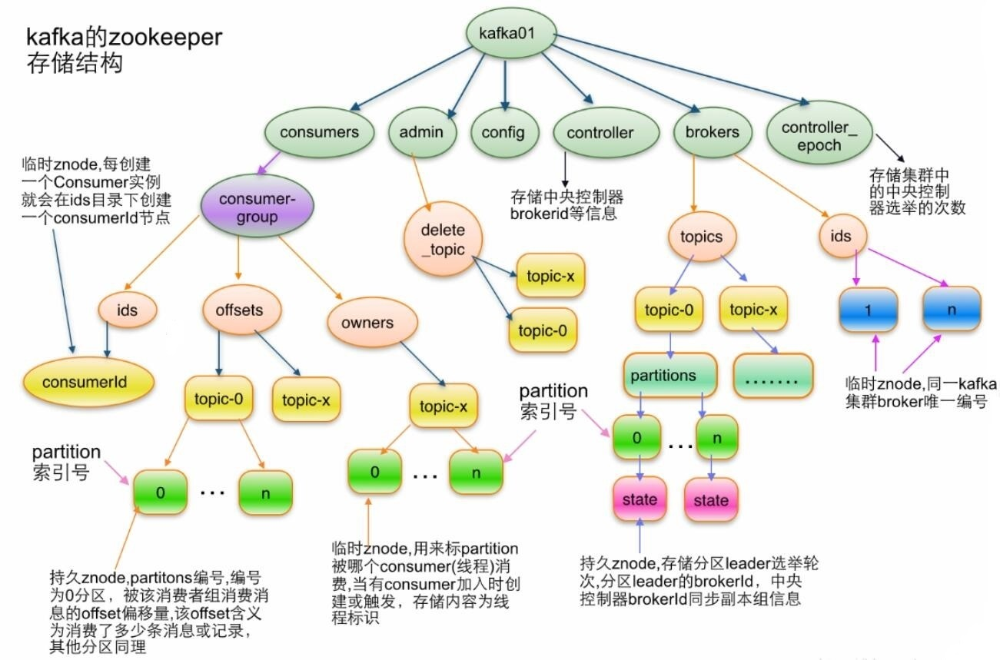

[← 返回微服务架构目录]({{ '/subjects/Microservices/' | relative_url }})



# 20 Kafka 在 ZooKeeper 里面的存储结构
### 3.8 Kafka 在 ZooKeeper 里面的存储结构



topic 结构

```text
/brokers/topics/[topic]
```

partition结构

```text
/brokers/topics/[topic]/partitions/[partitionId]/state
```

broker信息

```text
/brokers/ids/[o...N]
```

控制器

```text
/controller
存储center controller中央控制器所在kafka broker的信息
```

消费者

```text
消费者信息:
/consumers/[groupId]/ids /[consumerIdstring]
每个consumer都有一个唯一的ID,此id用来标记消费者信息
消费者管理者:
/consumers/[groupId]/owners/[topic]/[partitionid]
```



<nav class="article-end" aria-label="章节导航">
  <a href="{{ '/subjects/Microservices/19-reading-and-writing-kafka-data.html' | relative_url }}">← Previous: Reading and Writing Kafka Data</a>
  <a href="{{ '/subjects/Microservices/' | relative_url }}">Back to Microservices Index</a>
  <a href="{{ '/subjects/Microservices/21-kafka-tools.html' | relative_url }}">Next: Kafka Tools →</a>
</nav>
