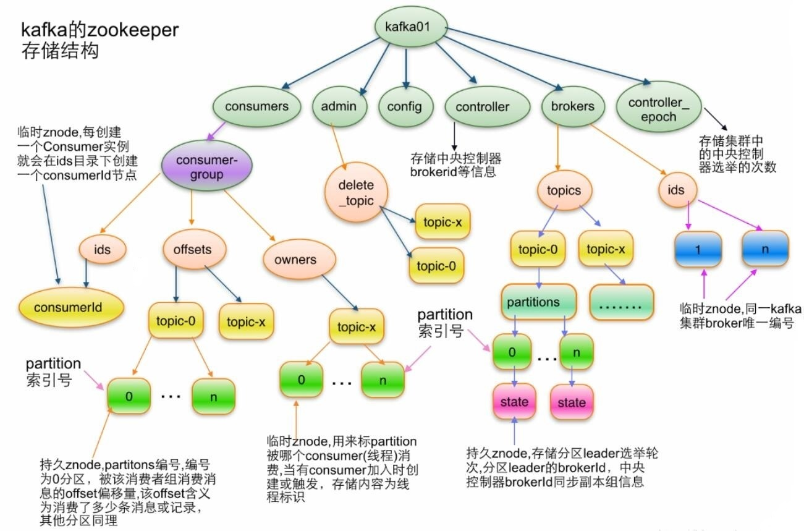

[← 返回微服务架构目录]({{ '/subjects/Microservices/' | relative_url }})



# 20 Kafka 在 ZooKeeper 里面的存储结构
### 3.8 Kafka 在 ZooKeeper 里面的存储结构

这张图只适用于**旧版 ZooKeeper 模式**的元数据布局，不适用于 KRaft 集群。ZooKeeper 保存 Topic、Broker 注册与 Controller 等协调信息；Kafka 的消息记录本身保存在 Broker 的分区日志中，不保存在 ZooKeeper。

| 常见路径 | 含义 |
| --- | --- |
| /brokers/ids/节点编号 | Broker 注册信息；节点离线后对应临时信息会变化 |
| /brokers/topics/主题名 | Topic 的分区与副本分配元数据 |
| /brokers/topics/主题名/partitions/分区号/state | 分区领导者及 ISR 等状态，具体字段随版本变化 |
| /controller | 当前旧模式 Controller 的信息 |

图中 /consumers/... 路径属于更早的高阶消费者实现。现代消费者组位点主要存储在 Kafka 内部的 __consumer_offsets Topic 中，不能把 /consumers/... 当作所有 Kafka 版本都存在的当前结构。KRaft 模式则由 Controller 法定多数派管理集群元数据，不再通过上述 ZooKeeper 路径排查。

排障时优先使用 kafka-topics.sh --describe、kafka-consumer-groups.sh --describe 与 Broker 日志；不要直接编辑或删除 ZooKeeper znode 来修复 Topic。若维护旧集群，需要先确认具体 Kafka 版本并遵照其官方元数据说明。



<nav class="article-end" aria-label="章节导航">
  <a href="{{ '/subjects/Microservices/19-reading-and-writing-kafka-data.html' | relative_url }}">← 上一篇：Kafka 读写数据</a>
  <a href="{{ '/subjects/Microservices/' | relative_url }}">返回微服务架构目录</a>
  <a href="{{ '/subjects/Microservices/21-kafka-tools.html' | relative_url }}">下一篇：Kafka 工具 →</a>
</nav>
