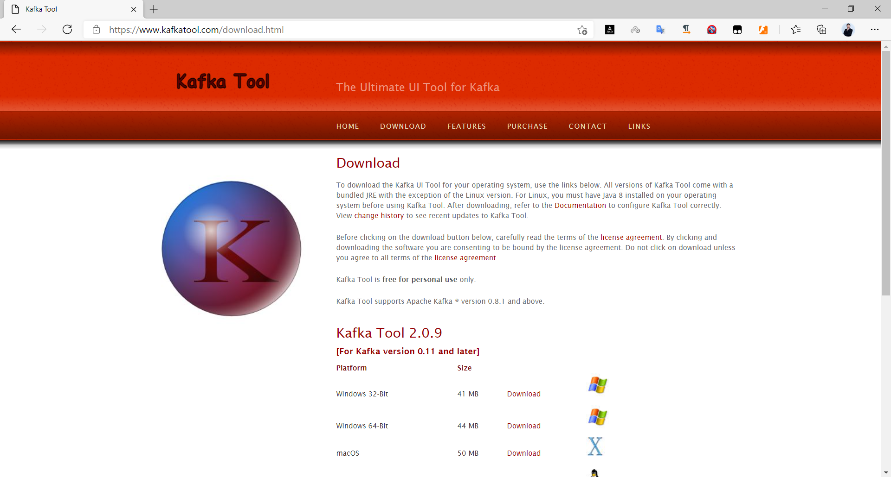
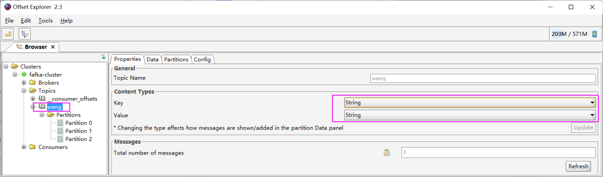
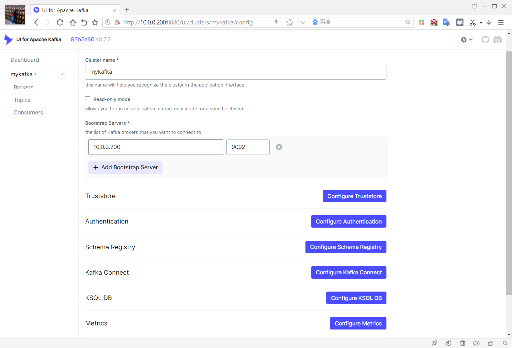
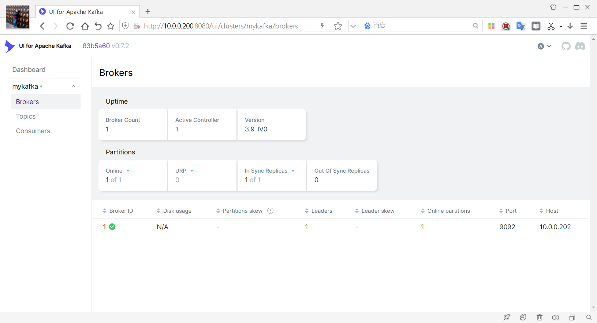
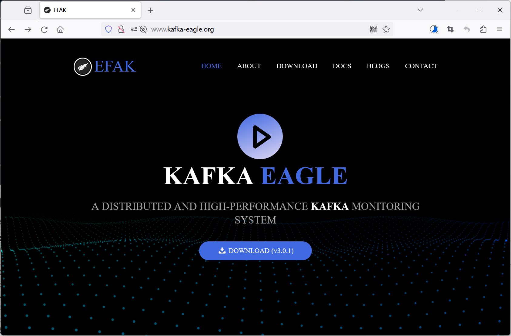
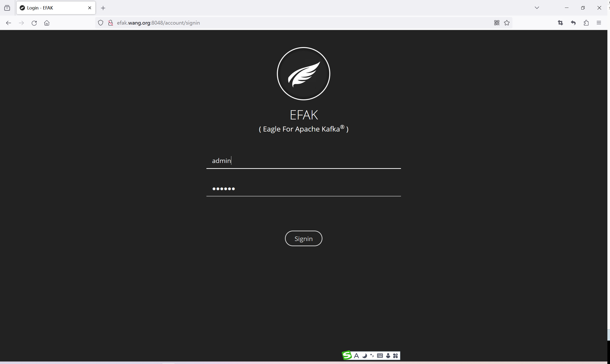
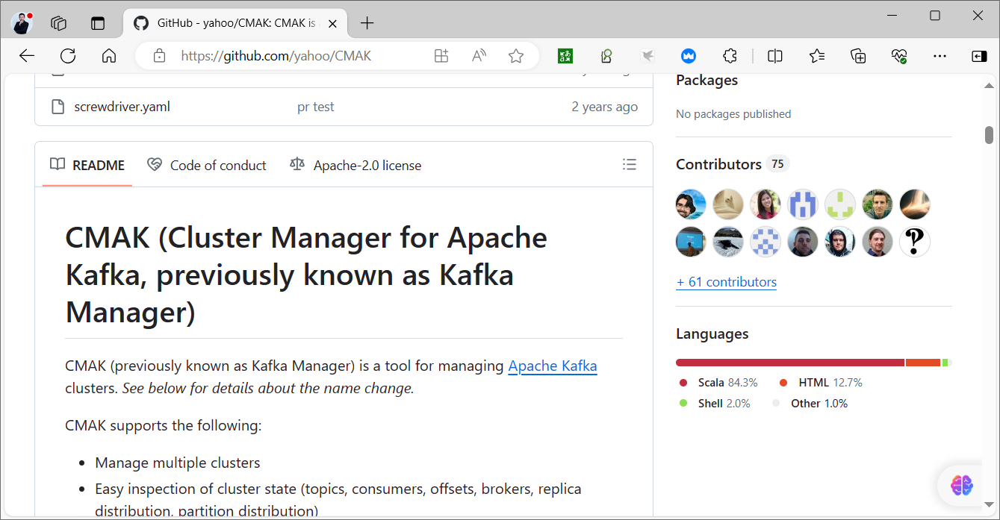

[← 返回微服务架构目录]({{ '/subjects/Microservices/' | relative_url }})



# 21 Kafka 工具

Kafka 工具可分为**官方命令行**、**桌面客户端**和 **Web 管理界面**。先明确要回答的问题：Topic 是否可用、分区领导者与 ISR 怎样、消费者积压多少，还是需要浏览消息内容。工具的界面并不改变 Kafka 的权限边界：能连接集群不代表应允许删除 Topic、重置位点或读取业务敏感消息。接入前确认 Kafka 版本、KRaft/ZooKeeper 模式及 TLS/SASL 支持。

## 首选：Kafka 自带的命令行

CLI 与 Broker 版本尽量匹配，使用 `--bootstrap-server` 指向**客户端可访问的 Broker 地址**，而非 KRaft Controller 端口。以下命令为只读检查；它们通常比打开一个拥有管理权限的 Web 界面更容易审计。

```bash
BOOTSTRAP=kafka01:9092
bin/kafka-broker-api-versions.sh --bootstrap-server "$BOOTSTRAP"
bin/kafka-topics.sh --bootstrap-server "$BOOTSTRAP" --list
bin/kafka-topics.sh --bootstrap-server "$BOOTSTRAP" --describe --topic demo-events
bin/kafka-consumer-groups.sh --bootstrap-server "$BOOTSTRAP" --describe --group demo-check
```

`--describe` 中的 Leader、Replicas、ISR 分别表示当前领导者、已分配副本和同步副本。消费组输出中的 LAG 是日志末端与已提交位点之差，不是“剩余文件数”或处理时间。若 CLI 使用 TLS/SASL，应将认证参数放入受保护的客户端配置文件，并传入 `--command-config`；不要在文档或命令历史中写入凭据。

## Offset Explorer：桌面浏览

[Offset Explorer](https://www.kafkatool.com/)（旧称 Kafka Tool）可浏览 Broker、Topic、分区和消费者组，授权后还可查看消息和做部分管理操作。先用只读账号验证连接、证书与 Broker 广告地址，再决定是否开放写入权限。浏览大型 Topic 时限制分区、时间和条数，避免将历史消息无限量加载到客户端。






这些截图仅展示旧版菜单位置；不同版本名称和连接选项可能变化。若出现“能连接初始 Broker，却无法浏览 Topic”，优先核对 `advertised.listeners` 返回的地址是否也能从桌面访问，而不是只修改最初输入的 Bootstrap 地址。

## Kafka UI：Web 观察与管理

[Kafka UI](https://github.com/provectus/kafka-ui) 提供 Broker、Topic 和消费者组视图。下面是固定版本的**本机演示**；`kafka01` 必须能从 Kafka UI 容器内部解析、访问，且 Broker 广告地址也必须可达。绑定到 `127.0.0.1` 只开放本机浏览器访问，不代表 Web 应用已经具备登录认证。

```bash
docker run --rm --name kafka-ui \
  -p 127.0.0.1:8080:8080 \
  -e KAFKA_CLUSTERS_0_NAME=demo \
  -e KAFKA_CLUSTERS_0_BOOTSTRAPSERVERS=kafka01:9092 \
  provectuslabs/kafka-ui:v0.7.2
```





需要远程或生产访问时，再依据目标版本文档配置认证、反向代理、网络隔离与审计，并使用 Kafka 侧的最小权限账号。GUI 中删除 Topic、修改配置和重置消费者位点都可能造成数据丢失或长时间重放；应先有变更记录和回退方案。

## EFAK 与 CMAK：理解历史界面，不照搬旧安装记录

EFAK（原 Kafka Eagle）和 [CMAK](https://github.com/yahoo/CMAK)（旧称 Kafka Manager）出现在许多 ZooKeeper 模式的旧教程中，可查看 Broker、Topic、位点及分区分配，部分版本还有管理操作。课件中的 EFAK 3.0.1 配置混有多个未定义集群、旧 ZooKeeper 路径、失效下载镜像、硬编码口令、错误 JMX 地址与破损的 Java 参数；复制后既不一定能启动，也不适合接入新 KRaft 集群。







若维护现有 EFAK/CMAK，应先核对工具发布说明与 Kafka 模式、认证方式、Java 版本的兼容矩阵，再备份配置和工具数据库、限制访问权限。需要 JMX 指标时在 Broker 启动环境或服务管理器中设置 JMX，并限制端口和认证；**不要直接修改 `kafka-server-start.sh` 脚本来永久插入端口与 JVM 参数**。新版集群优先用 Kafka CLI、Broker 指标和仍受维护的可视化工具完成观察任务，管理操作则按最小权限单独授权。

图形工具负责呈现状态，不能替代监控告警。下一篇把集群健康、Broker 资源、Topic 流量和消费组积压组织成一套可解释的监控视图。



<nav class="article-end" aria-label="章节导航">
  <a href="{{ '/subjects/Microservices/20-kafka-data-structures-in-zookeeper.html' | relative_url }}">← 上一篇：Kafka 在 ZooKeeper 里面的存储结构</a>
  <a href="{{ '/subjects/Microservices/' | relative_url }}">返回微服务架构目录</a>
  <a href="{{ '/subjects/Microservices/22-kafka-monitoring.html' | relative_url }}">下一篇：Kafka 监控 →</a>
</nav>
