[← 返回微服务架构目录]({{ '/subjects/Microservices/' | relative_url }})



# 21 Kafka 工具
### 3.9 Kafka 工具

本篇保留了不同年代的桌面和 Web 管理工具截图。选型前先确认目标 Kafka 是 ZooKeeper 还是 KRaft 模式、工具是否支持相应版本及认证机制，并区分只读观察与可删除 Topic、修改位点的管理权限。旧版命令和页面截图不能当作当前版本的默认配置。

### 图形工具 Offset Explorer (Kafka Tool)


Offset Explorer（旧称 Kafka Tool）是桌面 GUI，可查看 Broker、Topic、分区和消费者组位点，也能在授权后浏览记录与执行部分管理操作。先建立只读连接检查集群地址及 TLS/SASL 配置，再决定是否开放生产、删除或位点修改权限；浏览消息时注意其中可能包含业务敏感数据。

官网:

<https://www.kafkatool.com/>

下载链接:

<https://www.kafkatool.com/download.html>

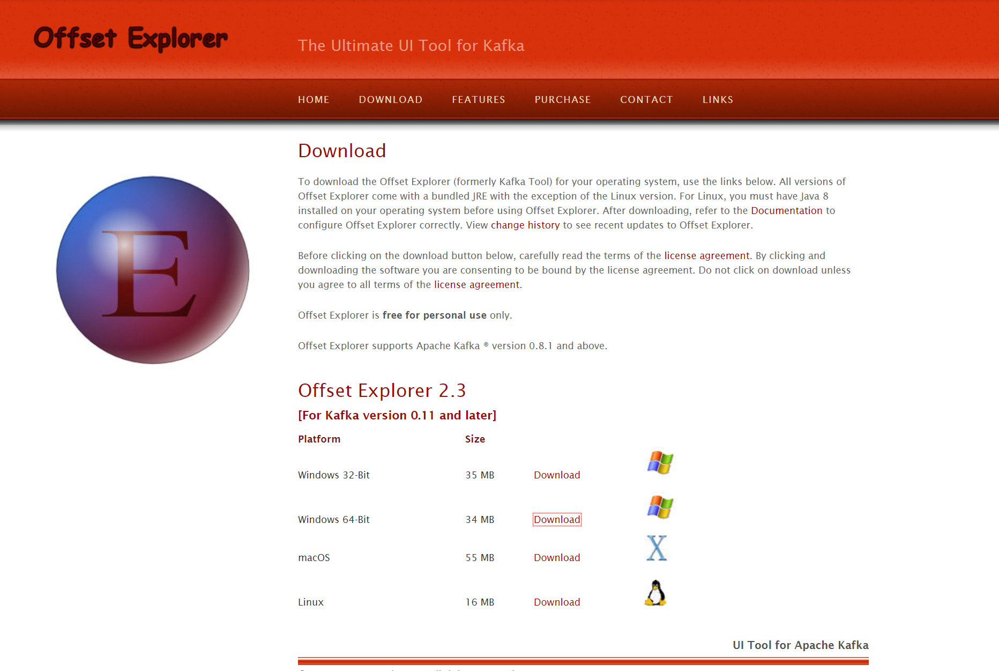


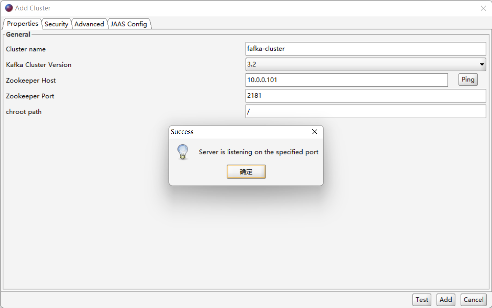

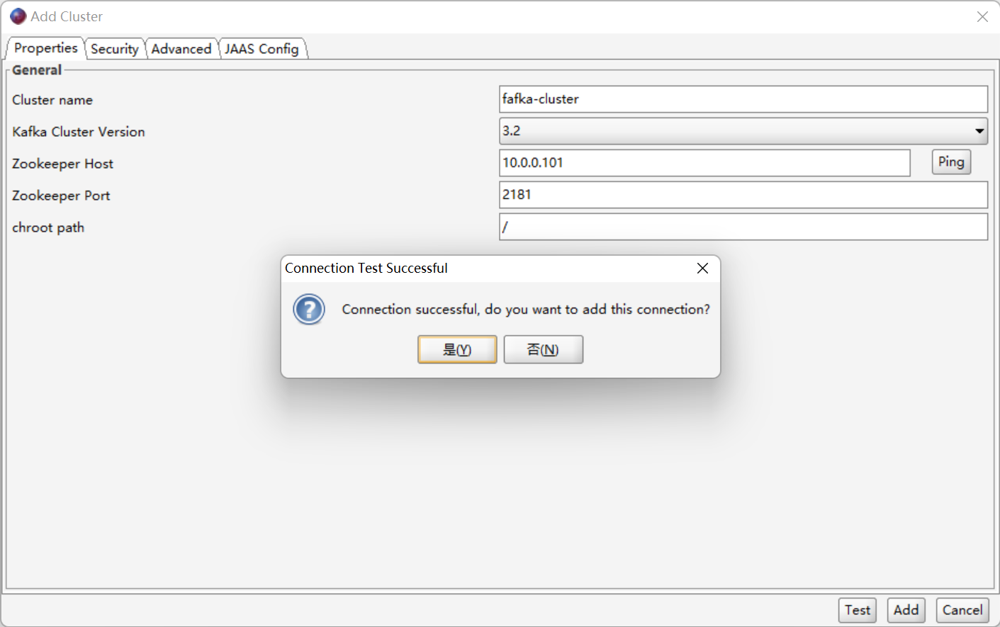

下面的截图展示连接配置与消息数据视图；不同版本菜单名称可能不同。


查看数据时先限制 Topic、分区和读取数量，不要在大型生产 Topic 上无边界加载历史记录。

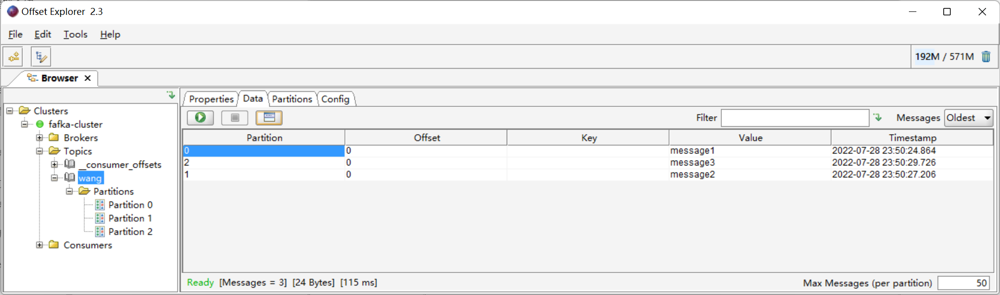

### 基于Web的Kafka集群监控系统 kafka-eagle

### 介绍

EFAK（原 Kafka Eagle）提供 Broker、Topic、消费者位点等可视化信息，部分版本还提供查询与管理操作。下方安装记录针对旧版本及其 ZooKeeper 配置；在 KRaft 集群部署前，应核对目标版本的兼容性和认证支持。可视化工具只是排查入口，不能替代 Kafka 自身指标、日志与告警体系。

官方地址

<http://www.kafka-eagle.org/>

<https://github.com/smartloli/kafka-eagle-bin>

<https://www.cnblogs.com/smartloli/>


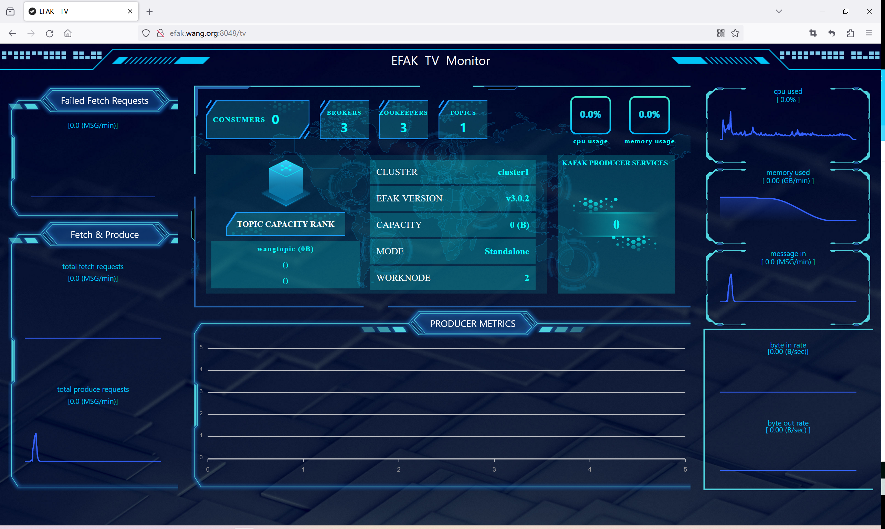

### 安装

安装说明

<https://docs.kafka-eagle.org/2.installation>

<https://www.cnblogs.com/smartloli/p/16728995.html>

以下 3.0.1/3.0.2 的差异是当时的环境记录，不代表当前最新版或所有部署都存在同一问题。部署前请查阅发行说明和目标 Kafka 版本兼容矩阵。

3.9.2.2.1 安装 JAVA

以下 Java 8 安装命令只对应这份 3.0.1 历史记录；新版工具的 Java 要求应查当前发布说明，不要把“不支持 JDK 11”当作所有版本的结论。

```text
apt update && apt -y install openjdk-8-jdk
```

3.9.2.2.2 下载安装

```text
wget https://github.com/smartloli/kafka-eagle-bin/archive/refs/tags/v3.0.1.tar.gz
```

3.9.2.2.3 解压安装包

```text
tar zxf kafka-eagle-bin-3.0.1.tar.gz
cd kafka-eagle-bin-3.0.1/
tar -zxvf kafka-eagle-web-3.0.1-bin.tar.gz -C /usr/local/
ln -s /usr/local/efak-web-3.0.1 /usr/local/kafka-eagle-web
```

3.9.2.2.4 设置全局变量

设置相关全局变量KE_HOME

```text
vi /etc/profile
export JAVA_HOME=/usr/lib/jvm/java-8-openjdk-amd64
export KE_HOME=/usr/local/kafka-eagle-web
export PATH=$PATH:$KE_HOME/bin
. /etc/profile
```

3.9.2.2.5 修改配置文件

```text
vim /usr/local/kafka-eagle-web/conf/system-config.properties
######################################
# 填写 zookeeper集群列表
#kafkazookeeper节点配置属性多个可以添加一个cluster1,如果有多套kafka集群加多个名称
efak.zk.cluster.alias=cluster1,cluster2
######################################
#zookeeper地址
######################################修改此处
cluster1.zk.list=10.0.0.101:2181,10.0.0.102:2181,10.0.0.103:2181
#cluster2.zk.list=10.0.0.201:2181,10.0.0.202:2181,10.0.0.203:2181 此行必须注释掉，否则无法启动
######################################
# broker 最大规模数量
######################################
cluster1.efak.broker.size=20
######################################
# zk 客户端线程数#####################
#################
kafka.zk.limit.size=32
######################################
# EFAK webui 端口
######################################
efak.webui.port=8048
######################################
# kafka offset storage
######################################
cluster1.efak.offset.storage=kafka
cluster2.efak.offset.storage=zk
######################################
# kafka jmx uri
######################################
cluster1.efak.jmx.uri=service:jmx:rmi:///jn di/rmi://%s/jmxrmi
######################################
# kafka metrics 指标，默认存储15天
######################################
efak.metrics.charts=true
efak.metrics.retain=15
######################################
# kafka sql topic records max
######################################
efak.sql.topic.records.max=5000
efak.sql.topic.preview.records.max=10
######################################
# delete kafka topic token
######################################
efak.topic.token=REPLACE_WITH_PRIVATE_TOKEN
######################################
# kafka sqlite 数据库地址（需要修改存储路径）
######################################修改此处,取消下面四行注释
efak.driver=org.sqlite.JDBC
efak.url=jdbc:sqlite:/usr/local/kafka-eagle-web/db/ke.db
efak.username=root
efak.password=REPLACE_WITH_PRIVATE_PASSWORD
######################################
# kafka mysql 数据库地址（需要提前创建ke库）
######################################修改此处添加注释下面四行
#efak.driver=com.mysql.cj.jdbc.Driver
#efak.url=jdbc:mysql://127.0.0.1:3306/ke?useUnicode=true&characterEncoding=UTF-8
#efak.username=ke
#efak.password=REPLACE_WITH_PRIVATE_PASSWORD
```

3.9.2.2.6 启动

```bash
#内存优化
[root@ubuntu2204 ~]#vim /usr/local/kafka-eagle-web/bin/ke.sh
......
export KE_JAVA_OPTS="-server -Xmx2g -Xms2g -XX:MaxGCPauseMillis=20 -XX:+UseG1GC -XX:MetaspaceSize=128m -
XX:InitiatingHeapOccupancyPercent=35 -XX:G1HeapRegionSize=16M -XX:Min
MetaspaceFreeRatio=50 -XX:MaxMetaspaceFreeRatio=80"
......
#启动
[root@ubuntu2204 ~]#/usr/local/kafka-eagle-web/bin/ke.sh start
#观察日志
[root@ubuntu2204 ~]#tail -f /usr/local/kafka-eagle-web/logs/*
==> /usr/local/kafka-eagle-web/logs/log.log <==
[2023-12-01 20:37:00]
ScheduleShardSubTask.org.springframework.scheduling.quartz.SchedulerFactoryBean#0_Worker-8 - INFO  -
Standalone mode start thread on one node.
==> /usr/local/kafka-eagle-web/logs/ke_console.out <==
2023-12-01 20:38:00 INFO
[ScheduleShardSubTask.org.springframework.scheduling.quartz.SchedulerFactoryBean#0_Worker-9] - Standalone mode
start thread on one node.
==> /usr/local/kafka-eagle-web/logs/log.log <==
[2023-12-01 20:38:00]
ScheduleShardSubTask.org.springframework.scheduling.quartz.SchedulerFactoryBean#0_Worker-9 - INFO  -
Standalone mode start thread on one node.
==> /usr/local/kafka-eagle-web/logs/ke_console.out <==
2023-12-01 20:39:00 INFO
[ScheduleShardSubTask.org.springframework.scheduling.quartz.SchedulerFactoryBean#0_Worker-10] - Standalone
mode start thread on one node.
==> /usr/local/kafka-eagle-web/logs/log.log <==
[2023-12-01 20:39:00]
ScheduleShardSubTask.org.springframework.scheduling.quartz.SchedulerFactoryBean#0_Worker-10 - INFO  -
Standalone mode start thread on one node.
```

3.9.2.2.7 登录

本地访问地址示例：<http://localhost:8048/>。若安装版本仍采用默认凭据，应在首次登录后立即修改密码，并限制管理页面的网络访问范围；不要把示例凭据当作固定值。

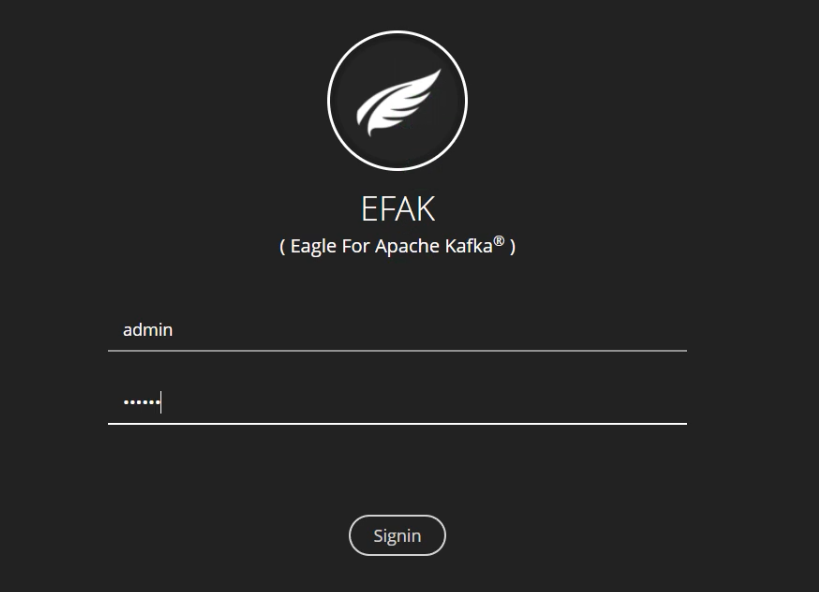

默认 kafka 没有开启JMX，无法监控到Kafka的相关数据

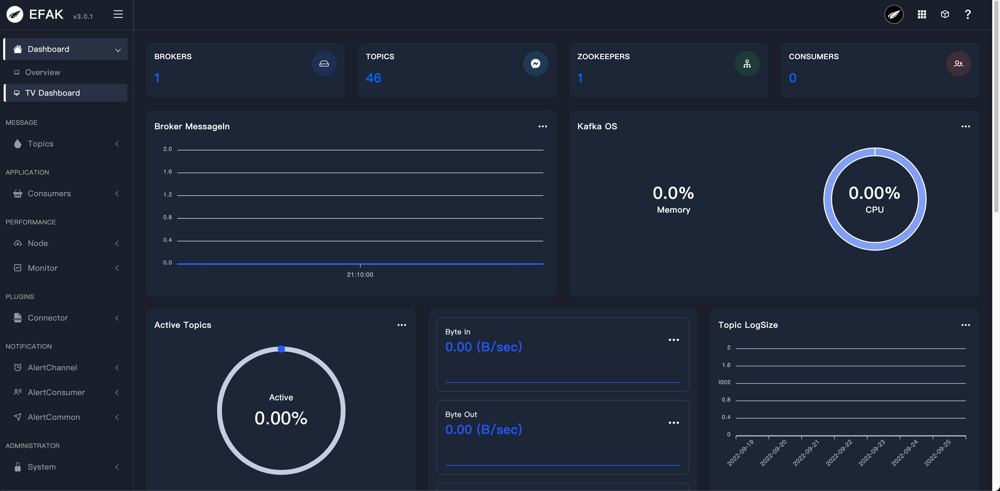

3.9.2.2.8 修改和监控 Kafka

```bash
#所有kafka节点修改配置
[root@node1 ~]#vim /usr/local/kafka/bin/kafka-server-start.sh
......
if[ " x$KAFKA_HEAP_OPTS"="x"] ; then
export KAFKA_HEAP_OPTS=" -Xmx1G-Xms1G"
export JMX_PORT="9999" #添加此行
fi
......
[root@node1 ~]#systemctl restart kafka
#将Kafka-eagle重启
[root@ubuntu2204 ~]#/usr/local/kafka-eagle-web/bin/ke.sh restart
```

3.9.2.2.9 通过 Kafka-eagle 监控

```bash
#测试访问
[root@ubuntu2204 ~]#while true;do let i++; echo $i | /usr/local/kafka/bin/kafka-console-producer.sh --broker-
list 10.0.0.101:9092 --topic bowentopic ;done
```

若图表没有数据，先核对采集配置、JMX 连接、Kafka 模式与应用日志，再判断是否属于具体版本缺陷，而不是直接降级。


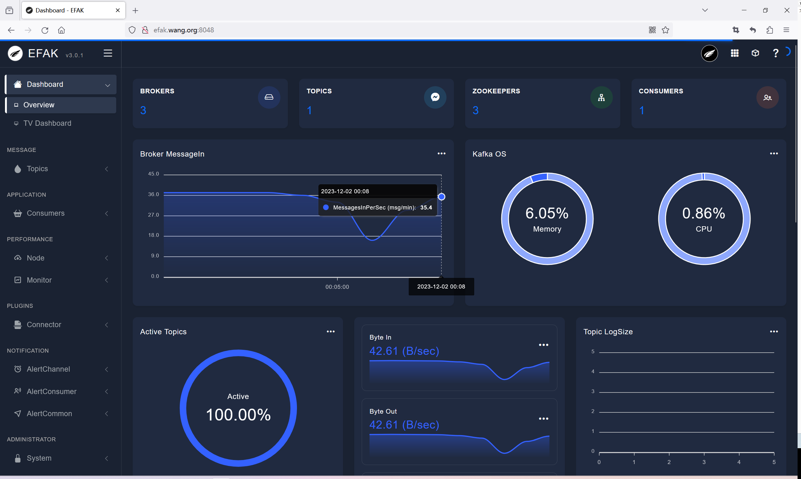

创建topic

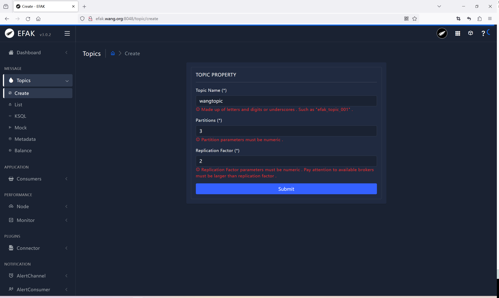

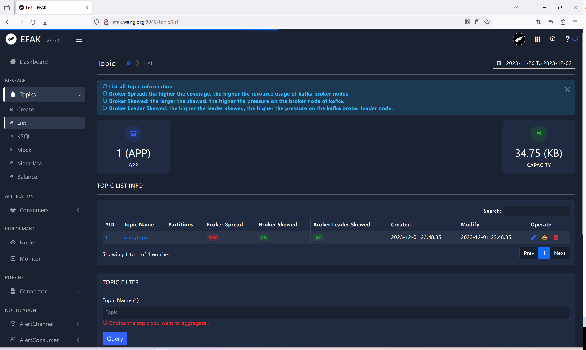

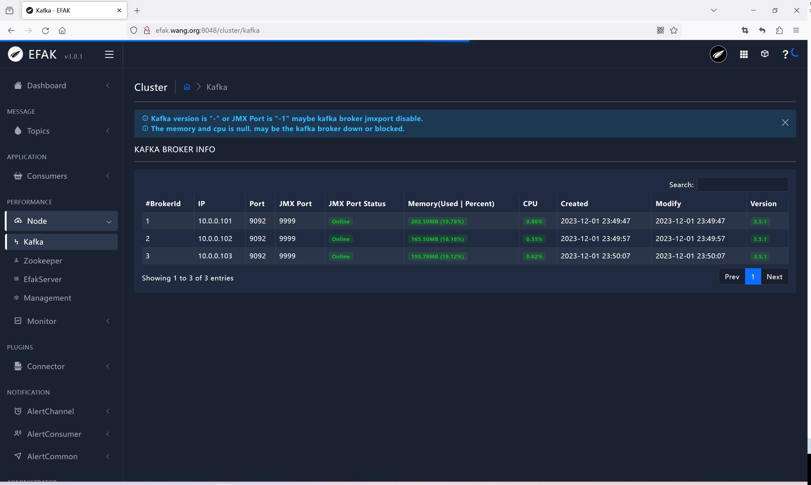

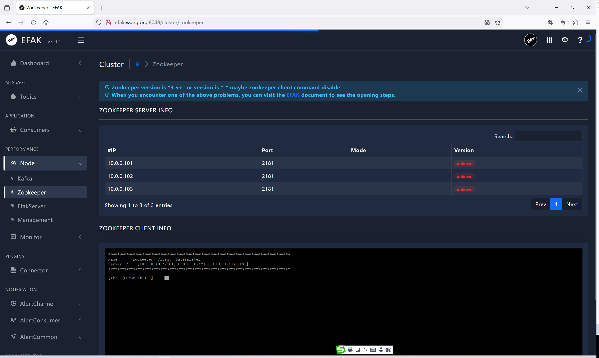

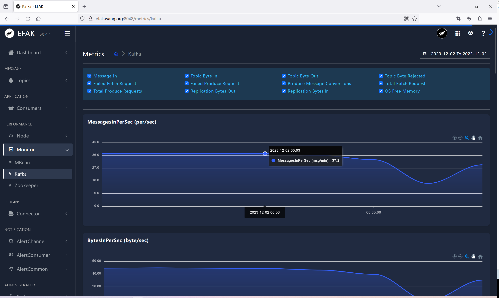

多次访问后可以看到如下

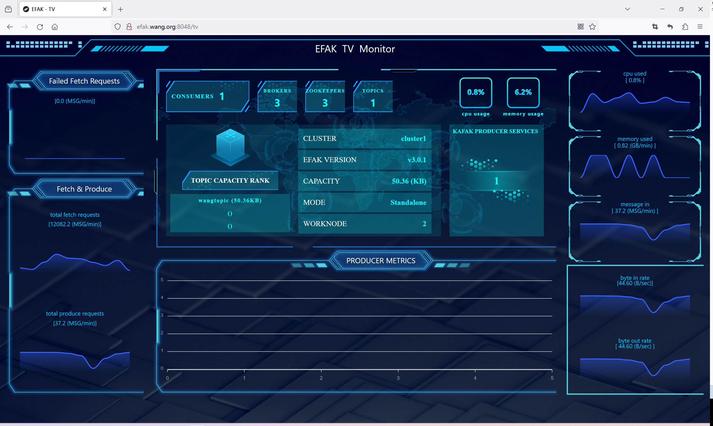

### kafka-UI

<https://docs.kafka-ui.provectus.io/>

<https://github.com/provectus/kafka-ui>

<https://hub.docker.com/r/provectuslabs/kafka-ui/>

Kafka UI 可浏览 Broker、Topic、分区与消费者组，部分版本支持生产消息和修改配置。它能帮助定位问题，但不会自动保证集群“最佳性能”；在生产环境接入前，应设置 Kafka 侧最小权限、Web 访问控制与审计，并确认容器能解析并访问 Broker 广告地址。

范例:容器化部署

```bash
docker run --rm --name kafka-ui -p 127.0.0.1:8080:8080 \
  -e KAFKA_CLUSTERS_0_NAME=demo \
  -e KAFKA_CLUSTERS_0_BOOTSTRAPSERVERS=kafka01:9092 \
  provectuslabs/kafka-ui:v0.7.2
```


范例: docker-compose部署

```yaml
services:
  kafka-ui:
    image: provectuslabs/kafka-ui:v0.7.2
    ports:
      - "127.0.0.1:8080:8080"
    environment:
      KAFKA_CLUSTERS_0_NAME: demo
      KAFKA_CLUSTERS_0_BOOTSTRAPSERVERS: kafka01:9092
```

示例中的 `kafka01` 必须能从 **Kafka UI 容器内部**解析和访问，且 Broker 的 `advertised.listeners` 要返回同样可达的地址。若 Kafka 只监听宿主机的 `localhost`，容器内的 `localhost` 指向容器自己，不能照抄该地址。示例只把页面绑定到本机回环接口；需要远程访问时先配置认证和反向代理。

### Kafka Manager

<https://github.com/yahoo/CMAK>

CMAK（Cluster Manager for Apache Kafka，旧称 Kafka Manager）是较早的 Kafka 集群管理工具，常见于 ZooKeeper 模式的历史部署。它可查看 Broker、Topic 与分区分布，部分版本提供 Topic 管理和副本重分配。文中的旧截图与功能清单不保证适用于 KRaft 或较新的 Kafka 版本，接入前请检查项目维护状态和兼容矩阵。

这些工具都能执行高影响操作：删除 Topic、修改配置和重新分配副本可能引起不可逆的数据损失或性能波动。生产环境宜先使用 Kafka 自带 CLI 与指标系统核对状态，再按最小权限为 GUI 开放必要功能，而不是让管理页面直接暴露在公网。


下载

<https://github.com/yahoo/CMAK/releases>

<https://blog.wolfogre.com/posts/kafka-manager-download/>



<nav class="article-end" aria-label="章节导航">
  <a href="{{ '/subjects/Microservices/20-kafka-data-structures-in-zookeeper.html' | relative_url }}">← 上一篇：Kafka 在 ZooKeeper 里面的存储结构</a>
  <a href="{{ '/subjects/Microservices/' | relative_url }}">返回微服务架构目录</a>
  <a href="{{ '/subjects/Microservices/22-kafka-monitoring.html' | relative_url }}">下一篇：Kafka 监控 →</a>
</nav>
