[← Back to Microservices Index]({{ '/subjects/Microservices/' | relative_url }})



# 21 Kafka Tools
### 3.9 Kafka 工具

### 图形工具 Offset Explorer (Kafka Tool)


Offset Explorer ，旧称Kafka Tool，工具是一个 GUI 应用程序，用于管理和使用 Apache Kafka 群集。它提供了一个直观的 UI，允许人们快速查看 Kafka 群集中的对象以及存储在群集主题中的消息。它包含面向开发人员和管理员的功能。一些关键功能包括

快速查看您的所有 Kafka 集群，包括其经纪人、主题和消费者查看分区中邮件的内容并添加新邮件查看消费者的偏移量，包括阿帕奇风暴卡夫卡喷口消费者以漂亮的打印格式显示 JSON和 XML 消息添加和删除主题以及其他管理功能将单个邮件从分区保存到本地硬盘驱动器编写自己的插件，允许您查看自定义数据格式 Kafka 工具在Windows、Linux 和 Mac 操作系统上运行

官网:

<https://www.kafkatool.com/>

下载链接:

<https://www.kafkatool.com/download.html>

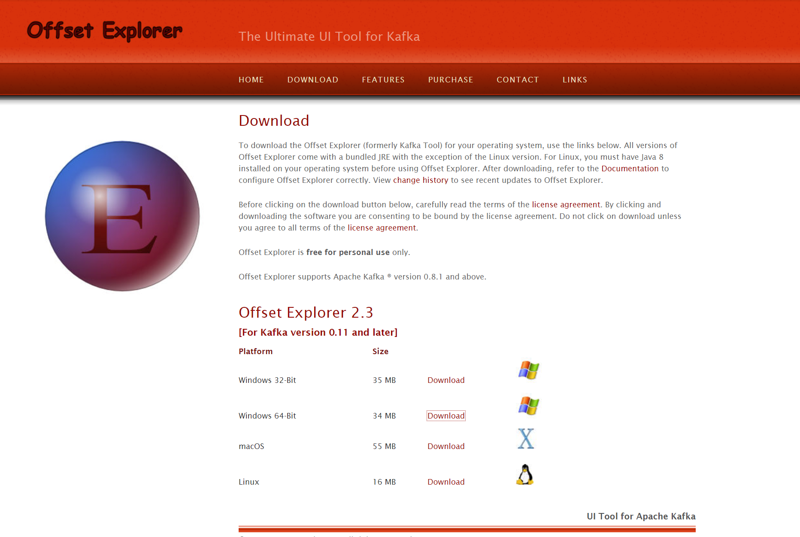

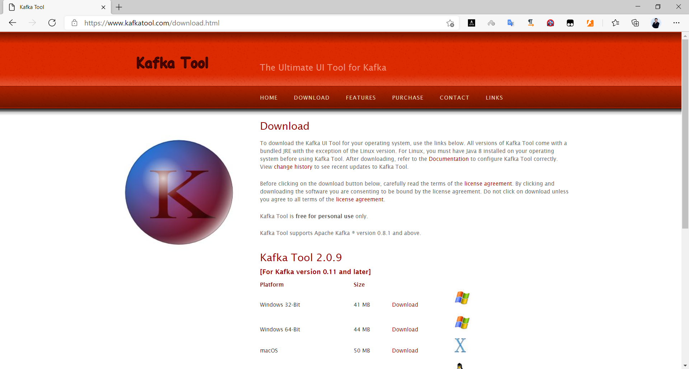

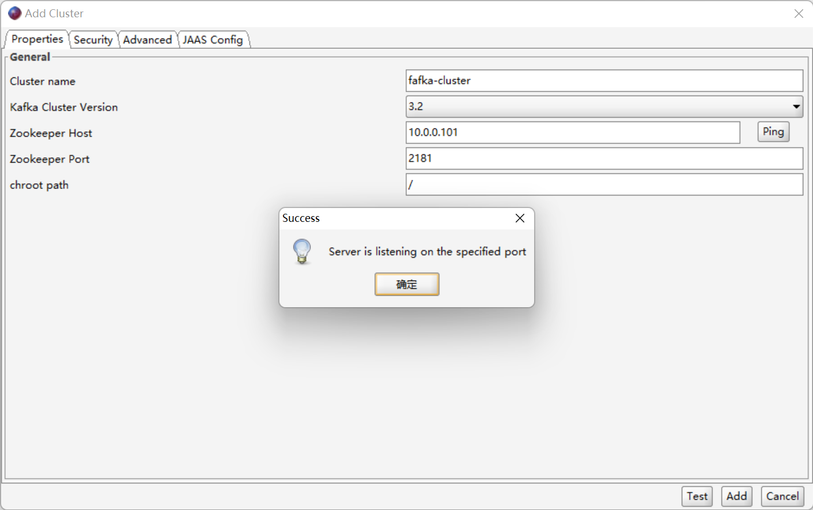

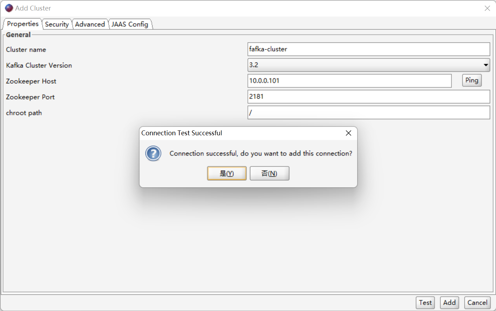

修改类型

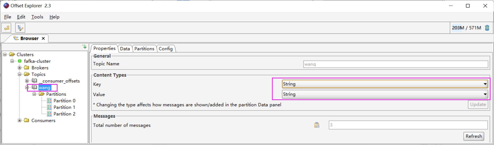

查看数据

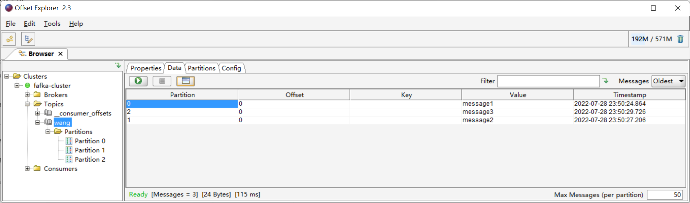

### 基于Web的Kafka集群监控系统 kafka-eagle

### 介绍

Kafka eagle（kafka鹰） 是一款由国内公司开源的Kafka集群监控系统，可以用来监视kafka集群的broker状态、Topic信息、IO、内存、 consumer线程、偏移量等信息，并进行可视化图表展示。独特的KQL还可以通过SQL在线查询kafka中的数据。

官方地址

<http://www.kafka-eagle.org/>

<https://github.com/smartloli/kafka-eagle-bin>

<https://www.cnblogs.com/smartloli/>

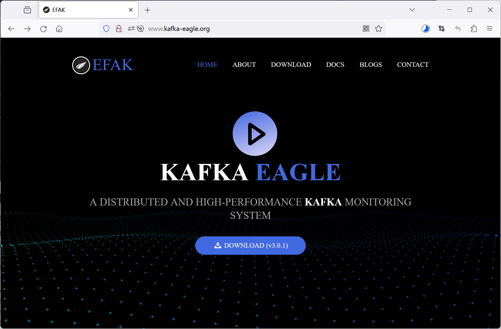

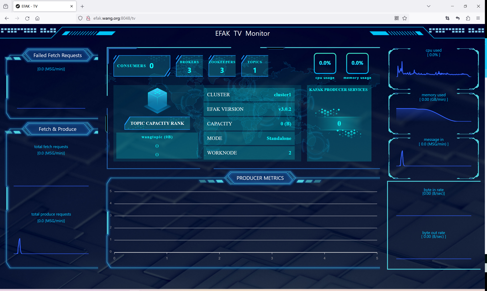

### 安装

安装说明

<https://docs.kafka-eagle.org/2.installation>

<https://www.cnblogs.com/smartloli/p/16728995.html>

注意：当前最新版kafka-eagle-bin-3.0.2有bug，无法正常显示数据，可以选用kafka-eagle-bin-3.0.1版本

3.9.2.2.1 安装 JAVA

注意: 不支持JDK-11

```text
apt update && apt -y install openjdk-8-jdk
```

3.9.2.2.2 下载安装

```text
wget https://github.com/smartloli/kafka-eagle-bin/archive/refs/tags/v3.0.1.tar.gz
```

3.9.2.2.3 解压安装包

```text
tar zxf kafka-eagle-bin-3.0.1.tar.gz
cd kafka-eagle-bin-3.0.1/
tar -zxvf kafka-eagle-web-3.0.1-bin.tar.gz -C /usr/local/
ln -s /usr/local/efak-web-3.0.1 /usr/local/kafka-eagle-web
```

3.9.2.2.4 设置全局变量

设置相关全局变量KE_HOME

```text
vi /etc/profile
export JAVA_HOME=/usr/lib/jvm/java-8-openjdk-amd64
export KE_HOME=/usr/local/kafka-eagle-web
export PATH=$PATH:$KE_HOME/bin
. /etc/profile
```

3.9.2.2.5 修改配置文件

```text
vim /usr/local/kafka-eagle-web/conf/system-config.properties
######################################
# 填写 zookeeper集群列表
#kafkazookeeper节点配置属性多个可以添加一个cluster1,如果有多套kafka集群加多个名称
efak.zk.cluster.alias=cluster1,cluster2
######################################
#zookeeper地址
######################################修改此处
cluster1.zk.list=10.0.0.101:2181,10.0.0.102:2181,10.0.0.103:2181
#cluster2.zk.list=10.0.0.201:2181,10.0.0.202:2181,10.0.0.203:2181 此行必须注释掉，否则无法启动
######################################
# broker 最大规模数量
######################################
cluster1.efak.broker.size=20
######################################
# zk 客户端线程数#####################
#################
kafka.zk.limit.size=32
######################################
# EFAK webui 端口
######################################
efak.webui.port=8048
######################################
# kafka offset storage
######################################
cluster1.efak.offset.storage=kafka
cluster2.efak.offset.storage=zk
######################################
# kafka jmx uri
######################################
cluster1.efak.jmx.uri=service:jmx:rmi:///jn di/rmi://%s/jmxrmi
######################################
# kafka metrics 指标，默认存储15天
######################################
efak.metrics.charts=true
efak.metrics.retain=15
######################################
# kafka sql topic records max
######################################
efak.sql.topic.records.max=5000
efak.sql.topic.preview.records.max=10
######################################
# delete kafka topic token
######################################
efak.topic.token=keadmin
######################################
# kafka sqlite 数据库地址（需要修改存储路径）
######################################修改此处,取消下面四行注释
efak.driver=org.sqlite.JDBC
efak.url=jdbc:sqlite:/usr/local/kafka-eagle-web/db/ke.db  #此文件会自动生成
efak.username=root
efak.password=www.kafka-eagle.org
######################################
# kafka mysql 数据库地址（需要提前创建ke库）
######################################修改此处添加注释下面四行
#efak.driver=com.mysql.cj.jdbc.Driver
#efak.url=jdbc:mysql://127.0.0.1:3306/ke?useUnicode=true&characterEncoding=UTF-
8&zeroDateTimeBehavior=convertToNull
#efak.username=ke
#efak.password=123456
```

3.9.2.2.6 启动

```bash
#内存优化
[root@ubuntu2204 ~]#vim /usr/local/kafka-eagle-web/bin/ke.sh
......
export KE_JAVA_OPTS="-server -Xmx2g -Xms2g -XX:MaxGCPauseMillis=20 -XX:+UseG1GC -XX:MetaspaceSize=128m -
XX:InitiatingHeapOccupancyPercent=35 -XX:G1HeapRegionSize=16M -XX:Min
MetaspaceFreeRatio=50 -XX:MaxMetaspaceFreeRatio=80"
......
#启动
[root@ubuntu2204 ~]#/usr/local/kafka-eagle-web/bin/ke.sh start
#观察日志
[root@ubuntu2204 ~]#tail -f /usr/local/kafka-eagle-web/logs/*
==> /usr/local/kafka-eagle-web/logs/log.log <==
[2023-12-01 20:37:00]
ScheduleShardSubTask.org.springframework.scheduling.quartz.SchedulerFactoryBean#0_Worker-8 - INFO  -
Standalone mode start thread on one node.
==> /usr/local/kafka-eagle-web/logs/ke_console.out <==
2023-12-01 20:38:00 INFO
[ScheduleShardSubTask.org.springframework.scheduling.quartz.SchedulerFactoryBean#0_Worker-9] - Standalone mode
start thread on one node.
==> /usr/local/kafka-eagle-web/logs/log.log <==
[2023-12-01 20:38:00]
ScheduleShardSubTask.org.springframework.scheduling.quartz.SchedulerFactoryBean#0_Worker-9 - INFO  -
Standalone mode start thread on one node.
==> /usr/local/kafka-eagle-web/logs/ke_console.out <==
2023-12-01 20:39:00 INFO
[ScheduleShardSubTask.org.springframework.scheduling.quartz.SchedulerFactoryBean#0_Worker-10] - Standalone
mode start thread on one node.
==> /usr/local/kafka-eagle-web/logs/log.log <==
[2023-12-01 20:39:00]
ScheduleShardSubTask.org.springframework.scheduling.quartz.SchedulerFactoryBean#0_Worker-10 - INFO  -
Standalone mode start thread on one node.
```

3.9.2.2.7 登录

<http://localhost:8048默认账号：admin默认密码：123456>

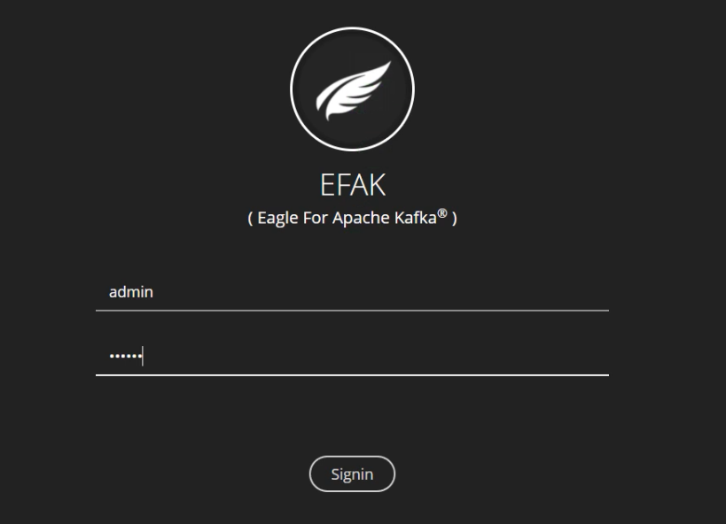

默认 kafka 没有开启JMX，无法监控到Kafka的相关数据

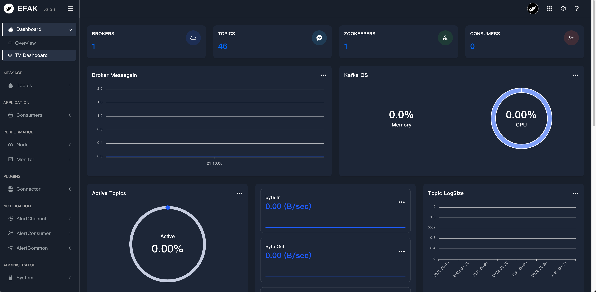

3.9.2.2.8 修改和监控 Kafka

```bash
#所有kafka节点修改配置
[root@node1 ~]#vim /usr/local/kafka/bin/kafka-server-start.sh
......
if[ " x$KAFKA_HEAP_OPTS"="x"] ; then
export KAFKA_HEAP_OPTS=" -Xmx1G-Xms1G"
export JMX_PORT="9999" #添加此行
fi
......
[root@node1 ~]#systemctl restart kafka
#将Kafka-eagle重启
[root@ubuntu2204 ~]#/usr/local/kafka-eagle-web/bin/ke.sh restart
```

3.9.2.2.9 通过 Kafka-eagle 监控

```bash
#测试访问
[root@ubuntu2204 ~]#while true;do let i++; echo $i | /usr/local/kafka/bin/kafka-console-producer.sh --broker-
list 10.0.0.101:9092 --topic bowentopic ;done
```

注意：kafka-eagle-bin-3.0.2有bug，选择kafka-eagle-bin-3.0.1版本才能看到数据展示

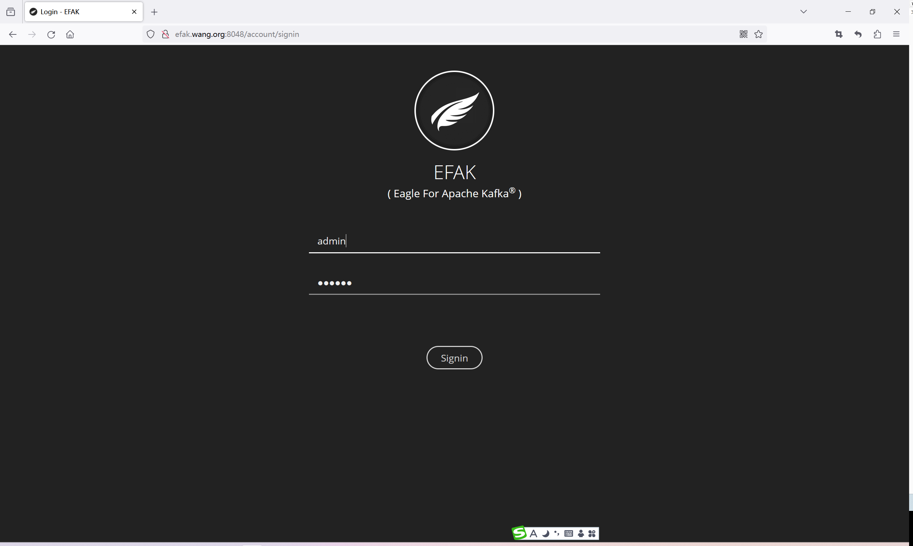

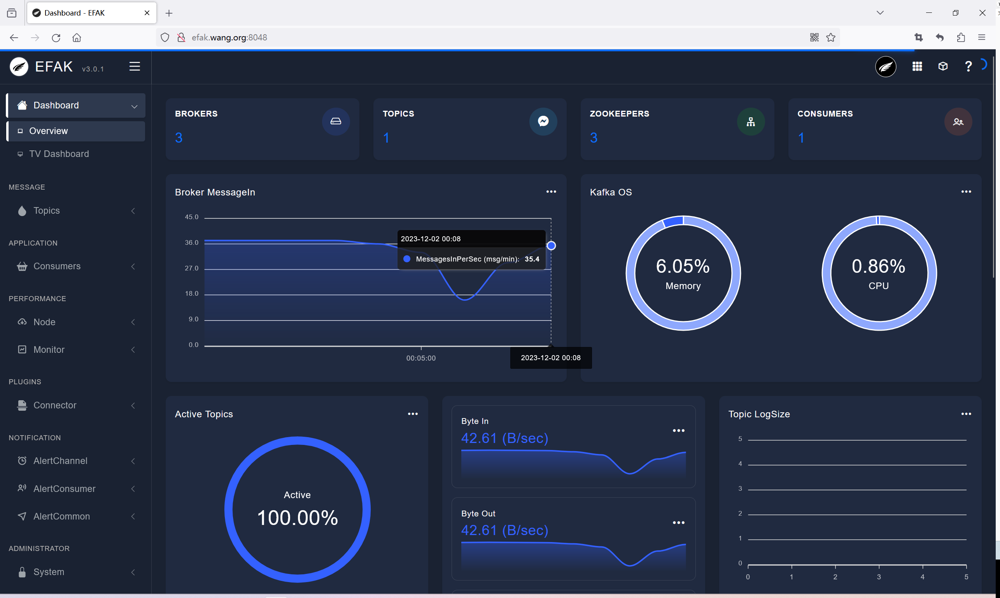

创建topic

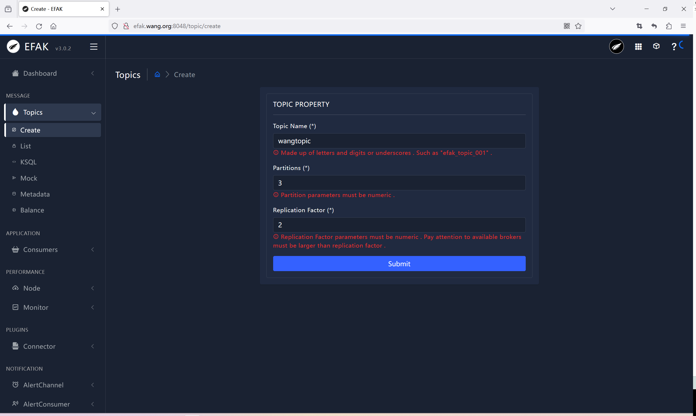

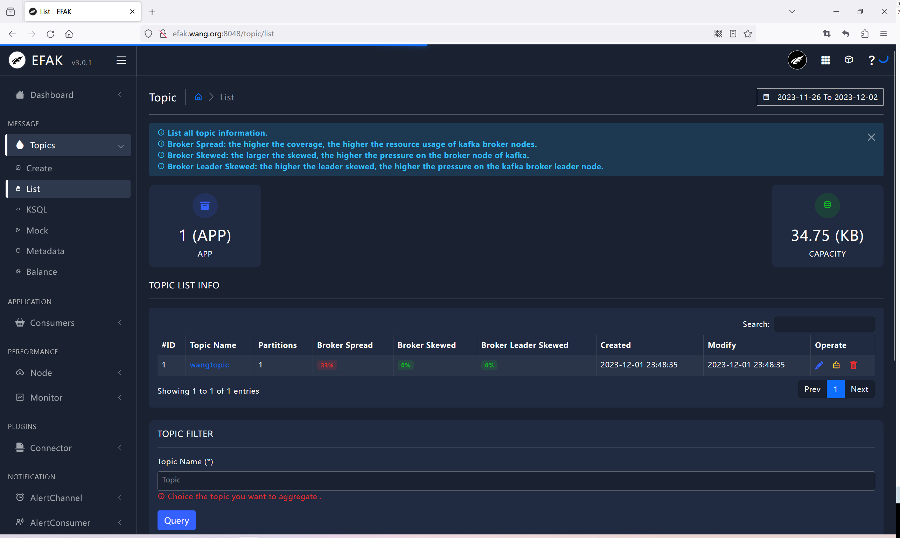

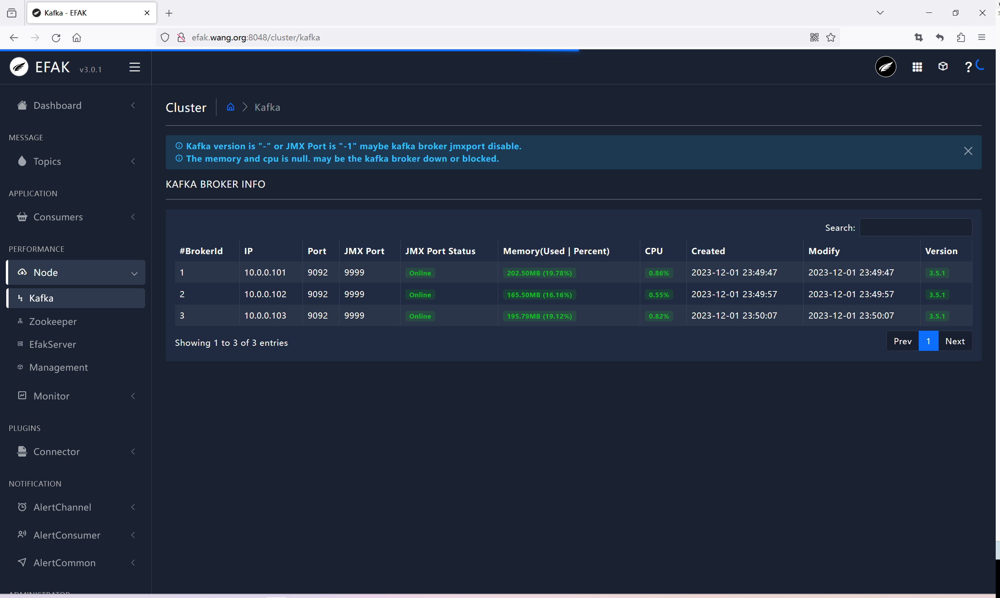

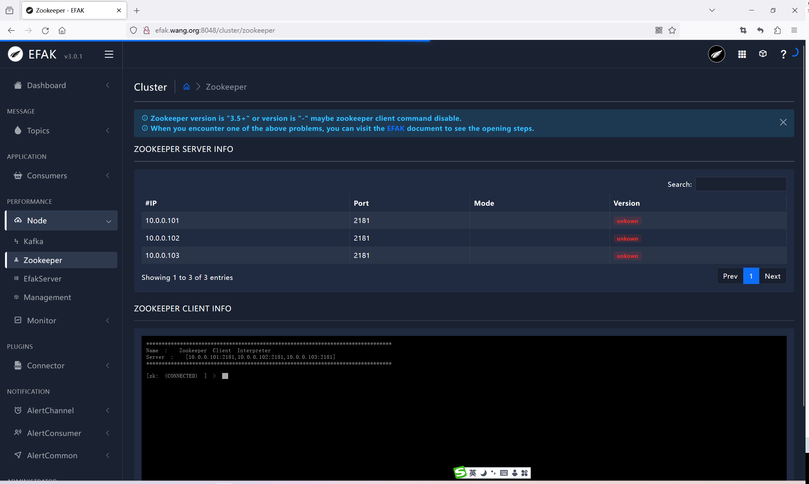

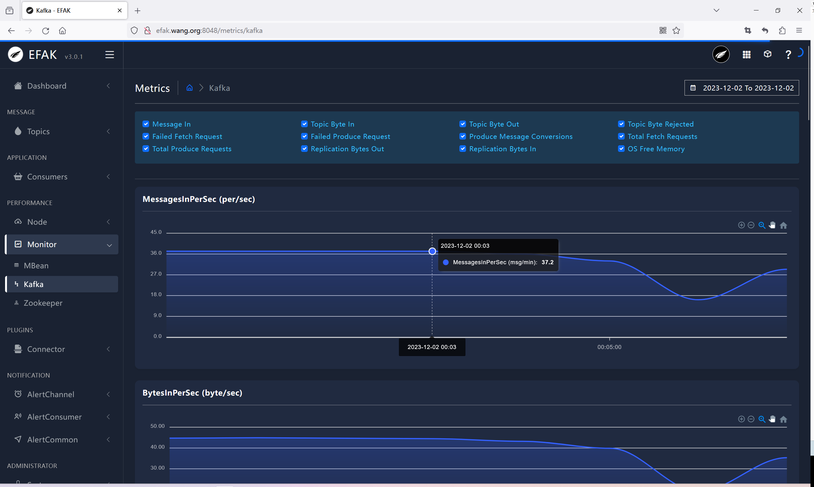

多次访问后可以看到如下

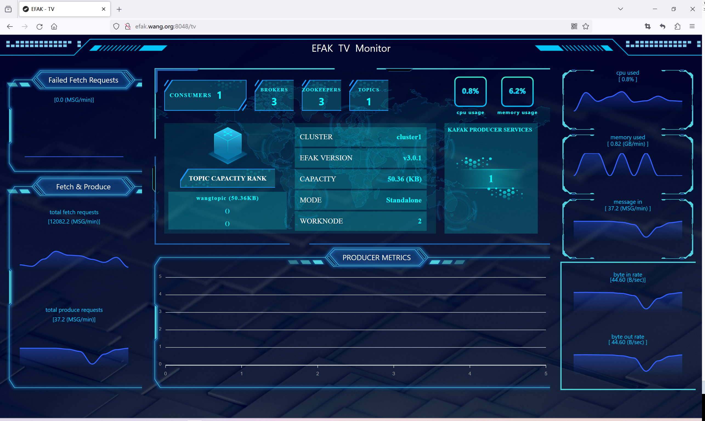

### kafka-UI

<https://docs.kafka-ui.provectus.io/>

<https://github.com/provectus/kafka-ui>

<https://hub.docker.com/r/provectuslabs/kafka-ui/>

Apache Kafka 的 UI 是一种多功能、快速且轻量级的 Web UI，用于管理 Apache Kafka® 集群。由开发人员构建，为开发人员服务。

该应用程序是一个免费的开源 Web UI，用于监控和管理 Apache Kafka 集群。

适用于 Apache Kafka 的 UI 是一个简单的工具，可让您的数据流可观察，有助于更快地发现和排查问题，并提供最佳性能。其轻量级控制面板可以轻松跟踪 Kafka 集群的关键指标: Brokers, Topics, Partitions、生产和消费。

范例:容器化部署

```bash
[root@ubuntu2404 ~]#docker run --name kafka-ui -it -p 8080:8080 -e DYNAMIC_CONFIG_ENABLED=true
provectuslabs/kafka-ui
[root@ubuntu2404 ~]#docker run --name kafka-ui -it -p 8080:8080 -e DYNAMIC_CONFIG_ENABLED=true registry.cn-
beijing.aliyuncs.com/bowenxiaochun/kafka-ui:v0.7.2
```

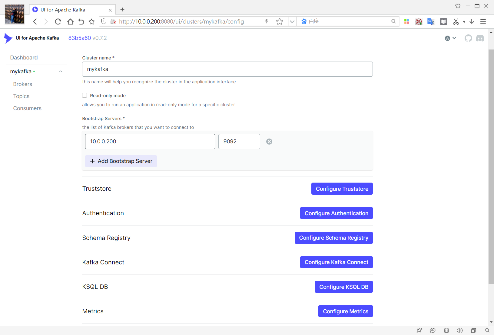

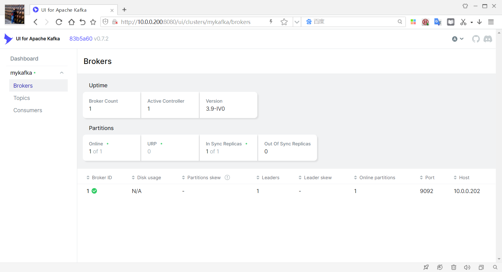

范例: docker-compose部署

```yaml
#https://docs.kafka-ui.provectus.io/configuration/configuration-file
services:
kafka-ui:
container_name: kafka-ui
#image: provectuslabs/kafka-ui:latest
image: registry.cn-beijing.aliyuncs.com/bowenxiaochun/kafka-ui:v0.7.2
ports:
- 8080:8080
depends_on:
- kafka0
environment:
DYNAMIC_CONFIG_ENABLED: 'true'
KAFKA_CLUSTERS_0_NAME: wizard_test
KAFKA_CLUSTERS_0_BOOTSTRAPSERVERS: kafka0:29092
```

### Kafka Manager

<https://github.com/yahoo/CMAK>

CMAK 原名 kafka manager 是一个yahoo 公司开源的 kafka 管理工具

因 Apache 版权，后来从“kafka manager”改名为“CMAK”，意为“Cluster Manager for Apache Kafka”。

Kafka Manager是用于管理Apache Kafka 集群的工具。为了简化开发者和服务工程师维护Kafka集群的工作，yahoo构建了一个叫做Kafka 管理器的基于Web工具，叫做 Kafka Manager。

这个管理工具可以很容易地发现分布在集群中的哪些topic分布不均匀，或者是分区在整个集群分布不均匀的的情况。它支持管理多个集群、 选择副本、副本重新分配以及创建Topic。同时，这个管理工具也是一个非常好的可以快速浏览这个集群的工具，有如下功能：

1.管理多个kafka集群

2.便捷的检查kafka集群状态(topics,brokers,备份分布情况,分区分布情况)

3.选择你要运行的副本

4.基于当前分区状况进行

5.可以选择topic配置并创建topic(0.8.1.1和0.8.2的配置不同)

6.删除topic(只支持0.8.2以上的版本并且要在broker配置中设置delete.topic.enable=true)

7.Topic list会指明哪些topic被删除（在0.8.2以上版本适用）

8.为已存在的topic增加分区

9.为已存在的topic更新配置

10.在多个topic上批量重分区

11.在多个topic上批量重分区(可选partition broker位置)

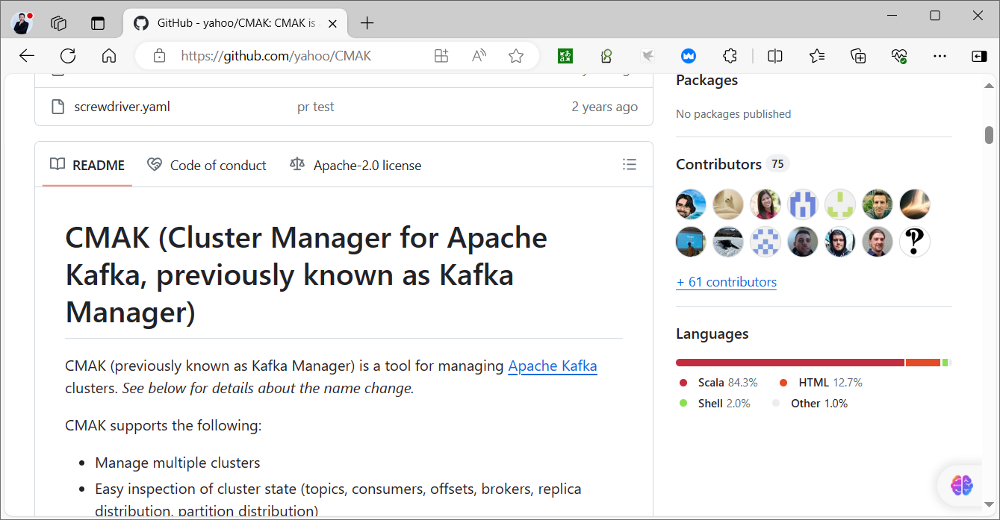

下载

<https://github.com/yahoo/CMAK/releases>

<https://blog.wolfogre.com/posts/kafka-manager-download/>



<nav class="article-end" aria-label="章节导航">
  <a href="{{ '/subjects/Microservices/20-kafka-data-structures-in-zookeeper.html' | relative_url }}">← Previous: Kafka Data Structures in ZooKeeper</a>
  <a href="{{ '/subjects/Microservices/' | relative_url }}">Back to Microservices Index</a>
  <a href="{{ '/subjects/Microservices/22-kafka-monitoring.html' | relative_url }}">Next: Kafka Monitoring →</a>
</nav>
