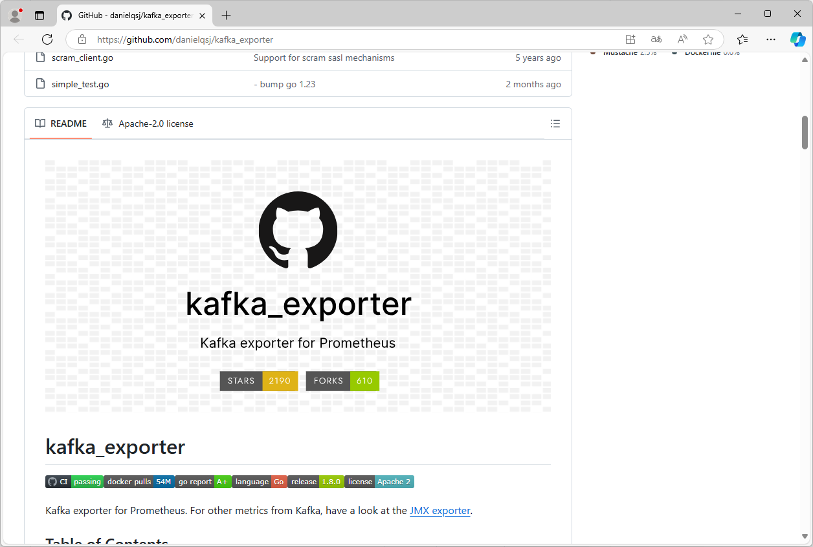
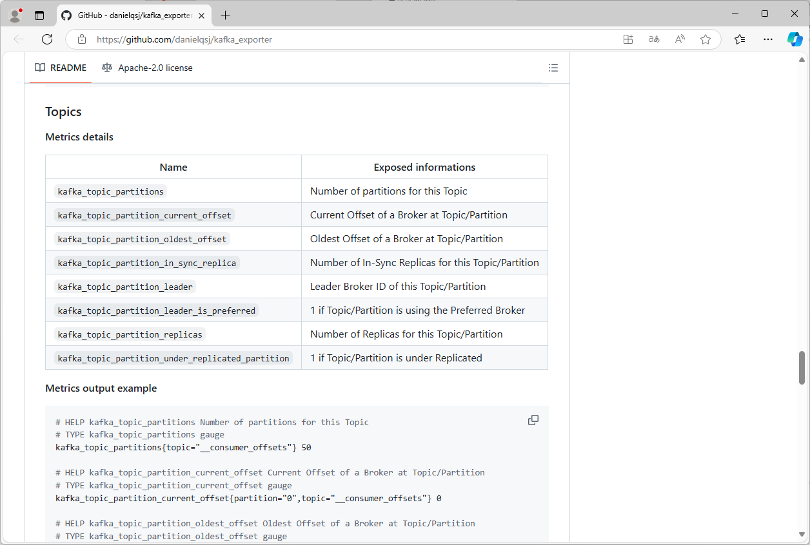

[← 返回微服务架构目录]({{ '/subjects/Microservices/' | relative_url }})



# 22 Kafka 监控
### 3.10 Kafka 监控

Prometheus 监控 kafka

<https://github.com/danielqsj/kafka_exporter>

Kafka 常用监控指标

Kafka集群

序号指标别名指标含义解释单位

1 Partitions总数集群中所有节点Partition数之和个

2 未复制分区总数集群中所有节点未复制分区数之和个

3 离线分区总数集群中所有节点离线分区数之和个

4 Controller存活数集群中Controller存活的数量个

5 失败请求（生产者） 集群中所有节点生产者失败请求的速率之和次/s

6 失败请求（消费者） 集群中所有节点消费者失败请求的速率次/s

7 生产者流量集群中所有节点生产者流量之和 Bytes/s

8 消费者流量集群中所有节点消费者流量之和 Bytes/s

9 生产者QPS 集群中所有节点生产者QPS之和次/s

10 消费者QPS 集群中所有节点消费者QPS之和次/s

11 存活节点数集群中存活的节点数量个

12 每秒流入消息数集群中所有节点流入消息数之和个/s

13 最大CPU利用率集群中所有节点CPU利用率最大值

14 最大内存利用率集群中所有节点内存利用率最大值

15 最大Heap区利用率集群中所有节点堆内存利用率最大值

16 最大Non-Heap区利用率集群中所有节点非堆内存利用率最大值

17 最大Minor GC次数集群中所有节点每分钟Minor GC次数最大值

18 最大Major GC次数集群中所有节点每分钟Major GC次数最大值

19 最大Minor GC时间集群中所有节点每分钟Minor GC时间

20 最大Major GC时间集群中所有节点每分钟Major GC时间

Broker指标

序号指标别名指标含义解释单位

1 CPU利用率 %

2 内存利用率 %

3 内存使用量 Bytes

4 磁盘吞吐（Read） Bytes/s

5 磁盘吞吐（Write） Bytes/s

6 生产者流量 Bytes

7 消费者流量 Bytes

8 生产者QPS

9 消费者QPS

10 是否是Controller 0：不是，1：是

11 Follower落后Leader最大消

息量个

12 Partition总数该节点分区总数个

13 Leader分区总数个

14 未复制分区总数个

15 ISR扩大速率个/s

16 ISR收缩速率个/s

17 离线分区总数个

18 Broker拒绝的消息 Byte/s

19 生产者失败请求次/s

20 消费者失败请求次/s Kafka集群

21 生产者请求响应时间分位值 request="Produce" ms

22 消费者请求响应时间分位值 request="FetchConsumer" ms

23 fetch请求速率

24 失败的fetch请求数

25 zookeeper 连接断开速率客户端已断开与服务器的连接，并尝试重新连接。会话不一定

过期。

26 zookeeper 会话过期速率

27 broker请求zk响应时间分位

值

Topic指标

序号指标别名指标含义解释单位

1 生产者流量

2 消费者流量

3 生产者QPS

4 消费者QPS

5 Topic大小

ConsumperGroup 指标

序号指标别名指标含义解释单位

1 生产者QPS

2 消费者QPS

3 Current-Offset

4 Log-End-Offset

5 Lag

6 消费组状态



<nav class="article-end" aria-label="章节导航">
  <a href="{{ '/subjects/Microservices/21-kafka-tools.html' | relative_url }}">← Previous: Kafka Tools</a>
  <a href="{{ '/subjects/Microservices/' | relative_url }}">Back to Microservices Index</a>
  <a href="{{ '/subjects/Microservices/23-nacos-architecture-and-overview.html' | relative_url }}">Next: Nacos Architecture and Overview →</a>
</nav>
