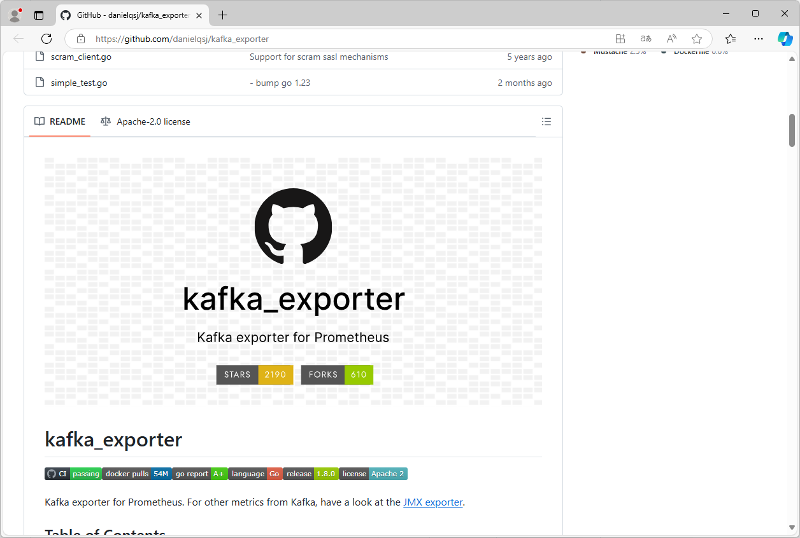
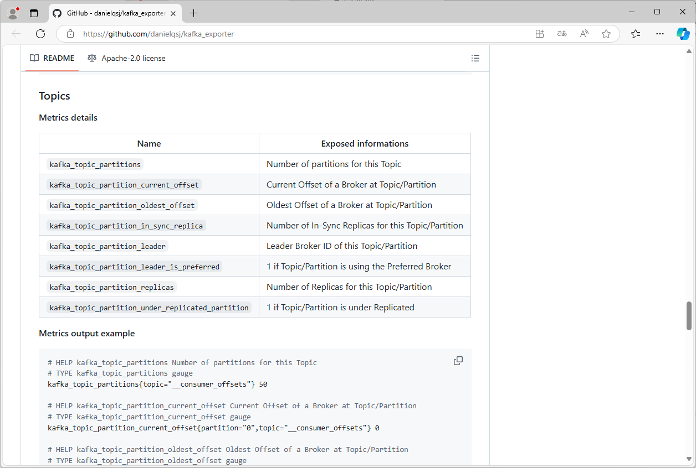

[← 返回微服务架构目录]({{ '/subjects/Microservices/' | relative_url }})



# 22 Kafka 监控

Kafka 监控不能只看“Broker 是否存活”。集群健康、分区副本、生产与消费流量、消费积压分别回答不同的问题：数据能否写入、能否读取、是否及时被处理。

Prometheus 可通过 Kafka Exporter 采集主题、分区和消费组等指标；Broker 的 JVM、请求与操作系统指标通常还需要 JMX Exporter、Node Exporter 等数据源。部署前应确认导出器版本与集群模式兼容，并以实际导出的指标名配置告警。

<https://github.com/danielqsj/kafka_exporter>

### 集群与分区：先确认数据是否可用

| 观察项 | 含义与阅读方法 |
| --- | --- |
| Broker 存活数 | 与预期实例数比较，发现节点退出或反复重启。仅靠实例存活不能证明分区可用。 |
| 离线分区数 | 没有可用 Leader 的分区数量；持续大于零时，相关分区可能无法正常读写，应优先排查。 |
| 副本不同步分区数 | 分区的 ISR 少于预期副本集合，说明副本追赶出现问题；结合复制延迟、磁盘和网络判断原因。 |
| 分区与 Leader 分布 | 看各 Broker 承担的分区和 Leader 数量是否明显失衡，避免单节点成为瓶颈。 |
| Controller 状态 | 控制器负责集群元数据管理。监控方式取决于 Kafka 使用 ZooKeeper 还是 KRaft，不能把旧版 ZooKeeper 指标直接套到 KRaft 集群。 |

### Broker：区分请求瓶颈与机器瓶颈

应同时观察生产／消费流量（Bytes/s）、请求速率（次/s）、Produce 与 Fetch 请求失败率、响应时间分位值，以及被拒绝请求。**流量**是字节量，**QPS**是请求数，**每秒消息数**是记录条数，三者不能混为同一个指标。

当响应时间升高时，再结合 CPU、堆内存、GC 时间、磁盘读写吞吐、网络吞吐，以及 ISR 扩大／收缩速率定位瓶颈。例如，磁盘持续饱和且副本落后，通常比单看 CPU 更能解释复制延迟。原表中“生产者流量 Bytes”和“每秒生产者流量 Bytes/s”混用，绘图前要确认指标是累计计数器还是速率。

旧版 ZooKeeper 模式可监控连接断开、会话过期及请求延迟；KRaft 模式则应改看控制器仲裁和元数据复制相关指标。不要对不存在的指标配置告警。

### Topic：找出负载来自哪里

按 Topic 观察写入字节速率、读取字节速率、消息速率、分区数和磁盘占用。集群总量正常，也可能只有一个 Topic 增长过快；需要把 Topic 曲线与 Broker 资源曲线对照。Topic 大小还会受保留时间、压缩和副本数影响，不能简单等同于业务数据量。

### 消费组：判断业务是否跟得上

对每个消费组和分区，`Log-End-Offset` 表示日志末端位置，`Current-Offset` 表示该组已提交的位置，两者之差是常用的 **Lag（积压条数）**。Lag 持续上升意味着消费速度跟不上生产速度，或消费者已停止工作；要再看消费组成员、分区分配、处理错误和提交频率。Lag 以“条”为单位，不代表处理完积压所需的时间，同样的 1 万条对不同业务可能意义不同。

告警宜关注**持续异常**而非瞬时尖峰：离线分区应优先处理；副本不同步、失败率和 Lag 可结合持续时间及业务峰谷设阈值。先让仪表板回答“哪里坏了”，再逐步增加细粒度指标，避免一开始就堆满难以解释的曲线。



<nav class="article-end" aria-label="章节导航">
  <a href="{{ '/subjects/Microservices/21-kafka-tools.html' | relative_url }}">← 上一篇：Kafka 工具</a>
  <a href="{{ '/subjects/Microservices/' | relative_url }}">返回微服务架构专题目录</a>
  <a href="{{ '/subjects/Microservices/23-nacos-architecture-and-overview.html' | relative_url }}">下一篇：Nacos 架构与概览 →</a>
</nav>
