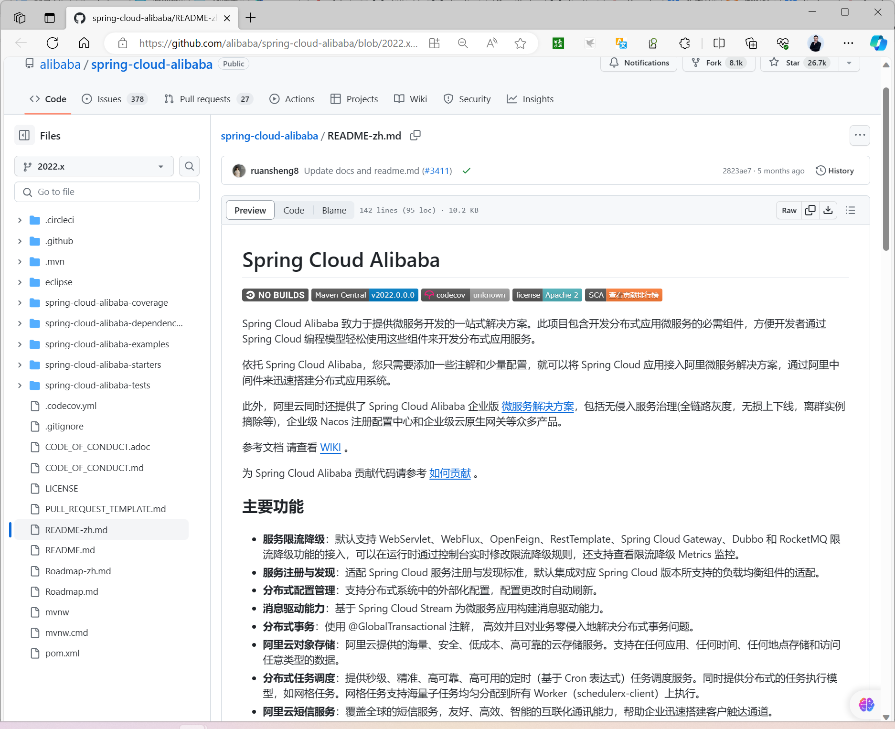
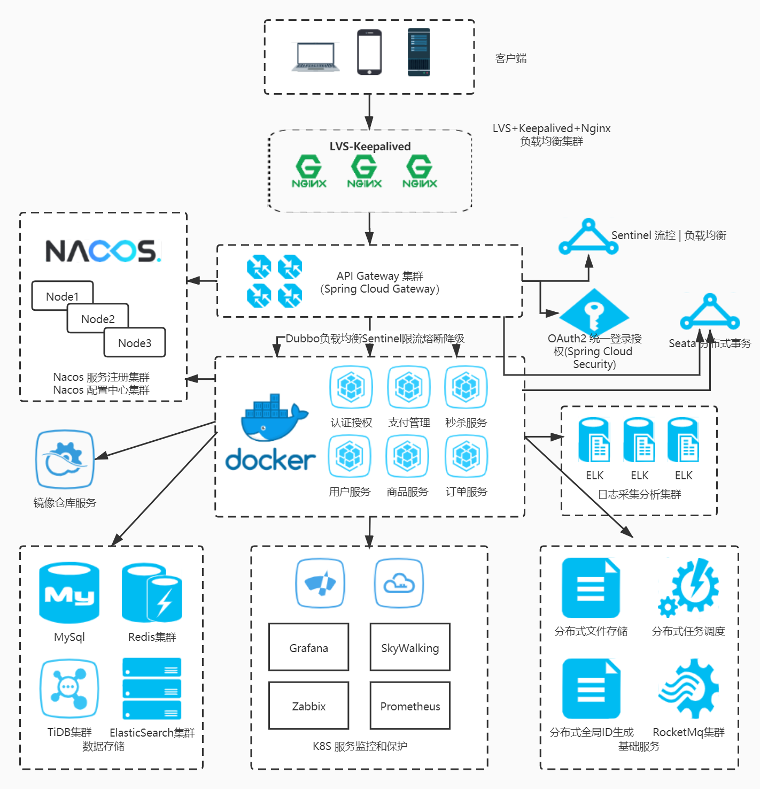
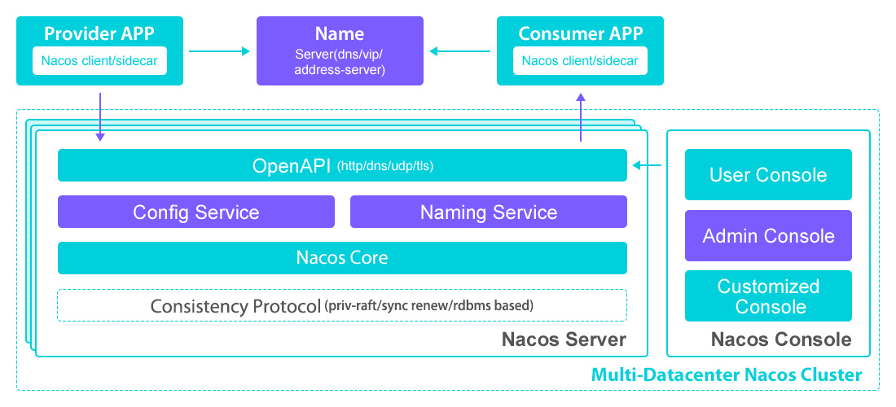
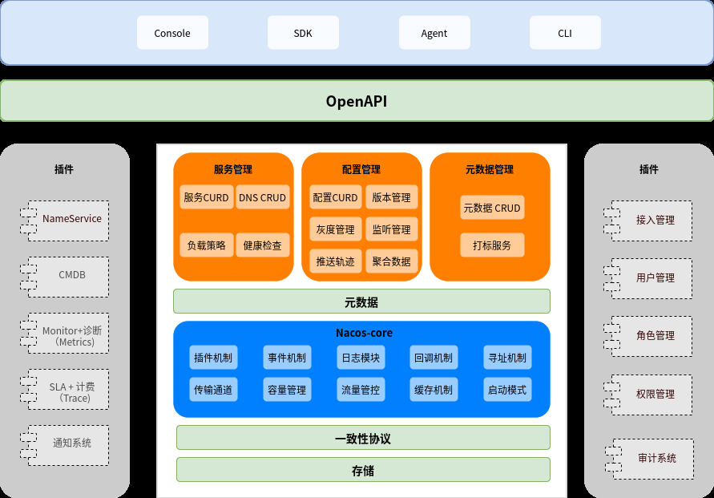
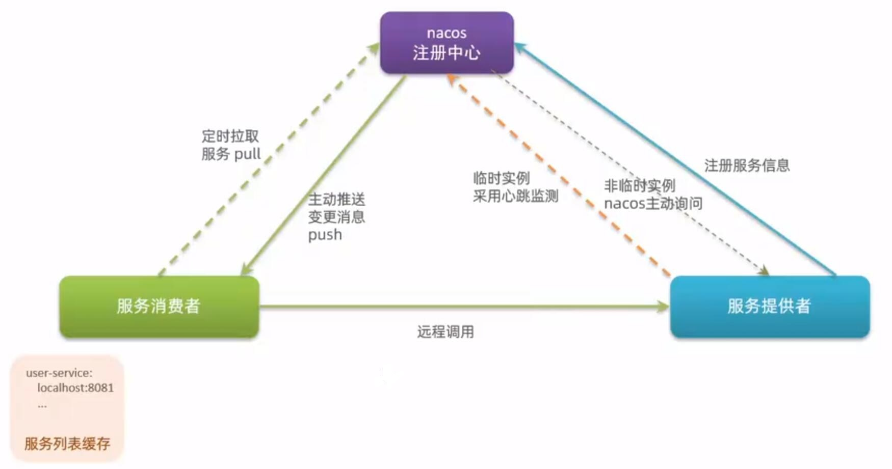

[← Back to Microservices Index]({{ '/subjects/Microservices/' | relative_url }})



# 23 Nacos Architecture and Overview
## 4 Nacos（重点）


### 4.1 Nacos 介绍和架构

### Spring Cloud Alibaba

<https://spring.io/projects/spring-cloud-alibaba>

<https://sca.aliyun.com/en/>

<https://github.com/alibaba/spring-cloud-alibaba/blob/2022.x/README-zh.md>



### Spring Cloud Alibaba 介绍

<https://developer.aliyun.com/article/983677>

当前微服务应用最广泛的主要都是基于JAVA的项目，而 Spring Cloud 是当前最主流的JAVA微服务开发框架规范

2015 年 6 月， Spring Cloud 第一个正式版本发布后，得益于 SpringBoot 奠定的用户群体基础，再加上 Spring Cloud 本身较为完善的解决方案能力和简单易上手的特点，迅速成为微服务技术圈热点。

随后两年的发展事实证明，以 Spring Cloud Netflix 为代表的基于 Spring Cloud 规范的一整套微服务解决方案，对中小企业的技术发展产生了巨大影响，加速了大量中小企业从单体式应用向分布式微服务转型的节奏。

受到 Spring Cloud Netflix 项目的启发，考虑到虽然 Spring Cloud 生态设计理念非常好，但相关微服务解决方案并不是十分成熟，部分能力缺失。恰逢阿里内部已经有一套相对较完整的解决方案。因此，阿里于 2018 年 7 月将内部经过十多年技术打磨的一整套微服务解决方案， 通过 Spring Cloud Alibaba 的方式贡献给 Spring Cloud 生态

基于微服务中的标准，Spring Cloud Alibaba 为来自阿里巴巴内部的微服务解决方案提供了具体实现，不仅给 Spring Cloud 生态带来 Nacos、RocketMQ、Sentinel 等微服务解决方案的实现，还集成了一些阿里云平台服务，比如短信服务、SMS、分布式任务调度、 Schedulex 等。

Spring Cloud Netflex 和 Spring Cloud Alibaba 与 Spring Cloud 的关系一样，都是基于 Spring Cloud 这一整套微服务所定义标准的具体实现。

Spring Cloud Alibaba 和 Spring Cloud Netflix 互为补充，在 Spring Cloud 生态完整度方面起到重要作用。

另外，Spring Cloud Alibaba的组件在国内用户中的受欢迎程度已经超过 Spring Cloud 官方默认提供的一些组件，比如 Nacos和 RocketMQ 已经逐渐成为国内分布式注册配置中心和分布式消息的事实标准，广泛应用于大量中小企业的生产环境中。

综上所述，Spring Cloud 规范有多种实现方案：Spring Cloud 官方，Spring Cloud Netflix，Spring Cloud Alibaba等，而 Spring Cloud 的当前最为流行的具体实现方案当属 Spring Cloud Alibaba

Spring Cloud Alibaba 致力于提供微服务开发的一站式解决方案。此项目包含开发分布式应用微服务的必需组件，方便开发者通过 Spring Cloud 编程模型轻松使用这些组件来开发分布式应用服务。

依托 Spring Cloud Alibaba，您只需要添加一些注解和少量配置，就可以将 Spring Cloud 应用接入阿里微服务解决方案，通过阿里中间件来迅速搭建分布式应用系统。

此外，阿里云同时还提供了 Spring Cloud Alibaba 企业版 微服务解决方案，包括无侵入服务治理(全链路灰度，无损上下线，离群实例摘除等)，企业级 Nacos 注册配置中心和企业级云原生网关等众多产品。

参考文档 请查看 WIKI 。

### 主要功能

服务注册与发现：适配 Spring Cloud 服务注册与发现标准，默认集成对应 Spring Cloud 版本所支持的负载均衡组件的适配。 分布式配置管理：支持分布式系统中的外部化配置，配置更改时自动刷新。 服务限流降级：默认支持 WebServlet、WebFlux、OpenFeign、RestTemplate、Spring Cloud Gateway、Dubbo 和 RocketMQ 限流降级功能的接入，可以在运行时通过控制台实时修改限流降级规则，还支持查看限流降级 Metrics 监控。 分布式事务：使用 @GlobalTransactional 注解， 高效并且对业务零侵入地解决分布式事务问题。 消息驱动能力：基于 Spring Cloud Stream 为微服务应用构建消息驱动能力。 阿里云对象存储：阿里云提供的海量、安全、低成本、高可靠的云存储服务。支持在任何应用、任何时间、任何地点存储和访问任意类型的数据。 分布式任务调度：提供秒级、精准、高可靠、高可用的定时（基于 Cron 表达式）任务调度服务。同时提供分布式的任务执行模型，如网格任务。网格任务支持海量子任务均匀分配到所有 Worker（schedulerx-client）上执行。 阿里云短信服务：覆盖全球的短信服务，友好、高效、智能的互联化通讯能力，帮助企业迅速搭建客户触达通道。

更多功能请参考 Roadmap

除了上述所具有的功能外，针对企业级用户的场景，Spring Cloud Alibaba 配套的企业版微服务治理方案 微服务引擎MSE 还提供了企业级微服务治理中心，包括全链路灰度、服务预热、无损上下线和离群实例摘除等更多更强大的治理能力，同时还提供了企业级 Nacos 注册配置中心，企业级云原生网关等多种产品及解决方案。

### 组件

Nacos：一个更易于构建云原生应用的动态服务发现、配置管理和服务管理平台。

Sentinel：把流量作为切入点，从流量控制、熔断降级、系统负载保护等多个维度保护服务的稳定性。

Seata：阿里巴巴开源产品，一个易于使用的高性能微服务分布式事务解决方案。

RocketMQ：一款开源的分布式消息系统，基于高可用分布式集群技术，提供低延时的、高可靠的消息发布与订阅服务。

Alibaba Cloud OSS: 阿里云对象存储服务（Object Storage Service，简称 OSS），是阿里云提供的海量、安全、低成本、高可靠的云存储服务。您可以在任何应用、任何时间、任何地点存储和访问任意类型的数据。

Alibaba Cloud SchedulerX: 阿里中间件团队开发的一款分布式任务调度产品，提供秒级、精准、高可靠、高可用的定时（基于 Cron 表达式）任务调度服务。

Alibaba Cloud SMS: 覆盖全球的短信服务，友好、高效、智能的互联化通讯能力，帮助企业迅速搭建客户触达通道。

更多组件请参考 Roadmap。

### 如何构建

2022.x 分支对应的是 Spring Cloud 2022 与 Spring Boot 3.0.x，最低支持 JDK 17。 2021.x 分支对应的是 Spring Cloud 2021 与 Spring Boot 2.6.x，最低支持 JDK 1.8。 2020.0 分支对应的是 Spring Cloud 2020 与 Spring Boot 2.4.x，最低支持 JDK 1.8。 2.2.x 分支对应的是 Spring Cloud Hoxton 与 Spring Boot 2.2.x，最低支持 JDK 1.8。 greenwich 分支对应的是 Spring Cloud Greenwich 与 Spring Boot 2.1.x，最低支持 JDK 1.8。 finchley 分支对应的是 Spring Cloud Finchley 与 Spring Boot 2.0.x，最低支持 JDK 1.8。 1.x 分支对应的是 Spring Cloud Edgware 与 Spring Boot 1.x，最低支持 JDK 1.7。

Spring Cloud 使用 Maven 来构建，最快的使用方式是将本项目 clone 到本地，然后执行以下命令：

```text
./mvnw install
```

执行完毕后，项目将被安装到本地 Maven 仓库。

### 如何使用

如何引入依赖

如果需要使用已发布的版本，在 dependencyManagement 中添加如下配置。

```xml
<dependencyManagement>
<dependencies>
<dependency>
<groupId>com.alibaba.cloud</groupId>
<artifactId>spring-cloud-alibaba-dependencies</artifactId>
<version>2022.0.0.0</version>
<type>pom</type>
<scope>import</scope>
</dependency>
</dependencies>
</dependencyManagement>
```

然后在 dependencies 中添加自己所需使用的依赖即可使用。如果你想选择老版本，可以参考版本说明。

### 演示 Demo

为了演示如何使用，Spring Cloud Alibaba 项目包含了一个子模块spring-cloud-alibaba-examples 。此模块中提供了演示用的 example ，您可以阅读对应的 example 工程下的 readme 文档，根据里面的步骤来体验。

Example 列表：

Sentinel Example

Nacos Config Example

Nacos Discovery Example

RocketMQ Example

Seata Example Alibaba Cloud OSS Example

Alibaba Cloud SMS Example

Alibaba Cloud SchedulerX Example

### 版本管理规范

项目的版本号格式为 x.x.x 的形式，其中 x 的数值类型为数字，从 0 开始取值，且不限于 0~9 这个范围。项目处于孵化器阶段时，第一位版本号固定使用 0，即版本号为 0.x.x 的格式。

由于 Spring Boot 1 和 Spring Boot 2 在 Actuator 模块的接口和注解有很大的变更，且 spring-cloud-commons 从 1.x.x 版本升级到 2.0.0 版本也有较大的变更，因此我们采取跟 SpringBoot 版本号一致的版本:

1.5.x 版本适用于 Spring Boot 1.5.x 2.0.x 版本适用于 Spring Boot 2.0.x 2.1.x 版本适用于 Spring Boot 2.1.x 2.2.x 版本适用于 Spring Boot 2.2.x 2020.x 版本适用于 Spring Boot 2.4.x 2021.x 版本适用于 Spring Boot 2.6.x 2022.x 版本适用于 Spring Boot 3.0.x

### Spring Cloud Alibaba 的微服务架构



### Nacos 是什么

<https://nacos.io/>

<https://github.com/alibaba/nacos>

Nacos /nɑ:kəʊs/ 是 Dynamic Naming and Configuration Service的首字母简称

Nacos 是阿里巴巴开源的一个基于JAVA语言的更易于构建云原生应用的动态服务发现、配置管理和服务管理平台。

Nacos 是 Spring Cloud Alibaba开发框架的众多组件之一

Nacos 致力于帮助您发现、配置和管理微服务。Nacos 提供了一组简单易用的特性集，帮助您快速实现动态服务发现、服务配置、服务元数据及流量管理。 Nacos 帮助您更敏捷和容易地构建、交付和管理微服务平台。 Nacos 是构建以“服务”为中心的现代应用架构 (例如微服务范式、云原生范式) 的服务基础设施。

服务（Service）是 Nacos 世界的一等公民。Nacos 支持几乎所有主流类型的“服务”的发现、配置和管理,，包括：

Kubernetes Service gRPC & Dubbo RPC Service Spring Cloud RESTful Service

Nacos 的核心功能

服务发现和服务健康监测 Nacos 支持基于 DNS 和基于 RPC 的服务发现。服务提供者使用 原生SDK、OpenAPI、或一个独立的Agent TODO注册 Service 后，服务消费者可以使用DNS TODO 或HTTP&API查找和发现服务。 Nacos 提供对服务的实时的健康检查，阻止向不健康的主机或服务实例发送请求。Nacos 支持传输层 (PING 或 TCP)和应用层 (如 HTTP、MySQL、用户自定义）的健康检查。 对于复杂的云环境和网络拓扑环境中（如 VPC、边缘网络等）服务的健康检查，Nacos 提供了 agent 上报模式和服务端主动检测2种健康检查模式。Nacos 还提供了统一的健康检查仪表盘，帮助您根据健康状态管理服务的可用性及流量。 动态配置服务

动态配置服务可以让您以中心化、外部化和动态化的方式管理所有环境的应用配置和服务配置。 动态配置消除了配置变更时重新部署应用和服务的需要，让配置管理变得更加高效和敏捷。

配置中心化管理让实现无状态服务变得更简单，让服务按需弹性扩展变得更容易。 Nacos 提供了一个简洁易用的UI (控制台样例 Demo) 帮助您管理所有的服务和应用的配置。Nacos 还提供包括配置版本跟踪、金丝雀发布、一键回滚配置以及客户端配置更新状态跟踪在内的一系列开箱即用的配置管理特性，帮助您更安全地在生产环境中管理配置变更和降低配置变更带来的风险。

动态 DNS 服务动态 DNS 服务支持权重路由，让您更容易地实现中间层负载均衡、更灵活的路由策略、流量控制以及数据中心内网的简单DNS解析服务。动态DNS服务还能让您更容易地实现以 DNS 协议为基础的服务发现，以帮助您消除耦合到厂商私有服务发现 API 上的风险。 Nacos 提供了一些简单的 DNS APIs TODO 帮助您管理服务的关联域名和可用的 IP:PORT 列表. 服务及其元数据管理

Nacos 能让您从微服务平台建设的视角管理数据中心的所有服务及元数据，包括管理服务的描述、生命周期、服务的静态依赖分析、服务的健康状态、服务的流量管理、路由及安全策略、服务的 SLA 以及最首要的 metrics 统计数据。

Nacos 和 Eureka

Nacos 是一个更全面的服务管理平台，不仅提供了服务注册与发现功能，还集成了配置管理、动态配置推送、服务元数据管理等特性。

这意味着使用Nacos可以同时解决服务发现和服务配置管理的问题。 此项目由阿里巴巴负责持续迭代更新

Eureka 主要聚焦于服务注册与发现，虽然它也具备一定的配置管理能力，但相较于Nacos，其功能较为单一，主要被设计为高度可用的服务发现服务器其自身也需要做为微服务由程序员自行开发编码和部署

重要的是此项目当前已不再更新

### Nacos 基本架构及概念

Nacos 架构



相关概念

服务 (Service) 服务是指一个或一组软件功能（例如特定信息的检索或一组操作的执行），其目的是不同的客户端可以为不同的目的重用（例如通过跨进程的网络调用）。Nacos 支持主流的服务生态，如 Kubernetes Service、gRPC|Dubbo RPC Service 或者 Spring Cloud RESTful Service。 服务注册中心 (Service Registry) 服务注册中心，它是服务，其实例及元数据的数据库。服务实例在启动时注册到服务注册表，并在关闭时注销。服务和路由器的客户端查询服务注册表以查找服务的可用实例。服务注册中心可能会调用服务实例的健康检查 API 来验证它是否能够处理请求。 服务元数据 (Service Metadata) 服务元数据是指包括服务端点(endpoints)、服务标签、服务版本号、服务实例权重、路由规则、安全策略等描述服务的数据。 服务提供方 (Service Provider) 是指提供可复用和可调用服务的应用方。

服务消费方 (Service Consumer) 是指会发起对某个服务调用的应用方。

配置 (Configuration) 在系统开发过程中通常会将一些需要变更的参数、变量等从代码中分离出来独立管理，以独立的配置文件的形式存在。目的是让静态的系统工件或者交付物（如 WAR，JAR 包等）更好地和实际的物理运行环境进行适配。配置管理一般包含在系统部署的过程中，由系统管理员或者运维人员完成这个步骤。配置变更是调整系统运行时的行为的有效手段之一。

配置管理 (Configuration Management) 在数据中心中，系统中所有配置的编辑、存储、分发、变更管理、历史版本管理、变更审计等所有与配置相关的活动统称为配置管理。

名字服务 (Naming Service) 提供分布式系统中所有对象(Object)、实体(Entity)的“名字”到关联的元数据之间的映射管理服务，例如 ServiceName -> Endpoints Info, Distributed Lock Name -> Lock Owner/Status Info, DNS Domain Name -> IP List, 服务发现和 DNS 就是名字服务的2大场景。 配置服务 (Configuration Service) 在服务或者应用运行过程中，提供动态配置或者元数据以及配置管理的服务提供者。

### Nacos 逻辑架构及其组件介绍



服务管理：实现服务CRUD，域名CRUD，服务健康状态检查，服务权重管理等功能配置管理：实现配置管CRUD，版本管理，灰度管理，监听管理，推送轨迹，聚合数据等功能元数据管理：提供元数据CURD 和打标能力插件机制：实现三个模块可分可合能力，实现扩展点SPI机制事件机制：实现异步化事件通知，sdk数据变化异步通知等逻辑日志模块：管理日志分类，日志级别，日志可移植性（尤其避免冲突），日志格式，异常码+帮助文档回调机制：sdk通知数据，通过统一的模式回调用户处理。接口和数据结构需要具备可扩展性寻址模式：解决ip，域名，nameserver、广播等多种寻址模式，需要可扩展推送通道：解决server与存储、server间、server与sdk间推送性能问题容量管理：管理每个租户，分组下的容量，防止存储被写爆，影响服务可用性流量管理：按照租户，分组等多个维度对请求频率，长链接个数，报文大小，请求流控进行控制缓存机制：容灾目录，本地缓存，server缓存机制。容灾目录使用需要工具启动模式：按照单机模式，配置模式，服务模式，dns模式，或者all模式，启动不同的程序+UI 一致性协议：解决不同数据，不同一致性要求情况下，不同一致性机制存储模块：解决数据持久化、非持久化存储，解决数据分片问题 Nameserver：解决namespace到clusterid的路由问题，解决用户环境与nacos物理环境映射问题 CMDB：解决元数据存储，与三方cmdb系统对接问题，解决应用，人，资源关系 Metrics：暴露标准metrics数据，方便与三方监控系统打通 Trace：暴露标准trace，方便与SLA系统打通，日志白平化，推送轨迹等能力，并且可以和计量计费系统打通接入管理：相当于阿里云开通服务，分配身份、容量、权限过程用户管理：解决用户管理，登录，sso等问题权限管理：解决身份识别，访问控制，角色管理等问题审计系统：扩展接口方便与不同公司审计系统打通通知系统：核心数据变更，或者操作，方便通过SMS系统打通，通知到对应人数据变更 OpenAPI：暴露标准Rest风格HTTP接口，简单易用，方便多语言集成 Console：易用控制台，做服务管理、配置管理等操作 SDK：多语言sdk Agent：dns-f类似模式，或者与mesh等方案集成 CLI：命令行对产品进行轻量化管理，像git一样好用

### Nacos 注册中心工作机制（重点）



随着应用架构向微服务架构迁移,服务数量的增加和动态部署、动态扩展的特性,使得服务地址和端口在运行时随时可变

需要一个组件管理当前注册到服务注册与发现中心的微服务实例元数据信息,包括服务实例的服务名、IP 地址、端口号、服务描述和服务状态等,与注册到服务发现与注册中心的微服务实例维持心跳定期检查注册表中的服务实例是否在线，并剔除无效服务实例信息,并提供服务发现能力，为服务调用方提供服务提供方的服务实例元数据

服务提供者分类

临时实例: 服务提供者定期周期主动向nacos 发送心跳监测报告,如果一段时间后,nacos无法收到心跳,则删除此实例非临时实例(永久实例): nacos 主动定时监测此类实例,如果提供者实例异常,则并不会删除只是标记此实例异常,等待此实例恢复

服务消费者

消费者定时向nacos 注册中心PULL拉取提供者信息,并加以缓存如果提供者有变化,nacos会主动向消费者PUSH推送消息通知,Eureka不支持主动PUSH

集群模式

Nacos 默认使用 AP ( Availability和Partiton tolerance)模式,存在非临时实例时,会采用CP(Consistency和Partiton tolerance)模式 Eureka 采用 AP( Availability和Partiton tolerance)模式

集群数据一致性实现

CP模式基于强一致性协议 Raft AP模式基于阿里的Distro(基于Gossip和Eureka协议优化而来)最终一致性的AP 分布式协议



<nav class="article-end" aria-label="章节导航">
  <a href="{{ '/subjects/Microservices/22-kafka-monitoring.html' | relative_url }}">← Previous: Kafka Monitoring</a>
  <a href="{{ '/subjects/Microservices/' | relative_url }}">Back to Microservices Index</a>
  <a href="{{ '/subjects/Microservices/24-deploying-nacos.html' | relative_url }}">Next: Deploying Nacos →</a>
</nav>
