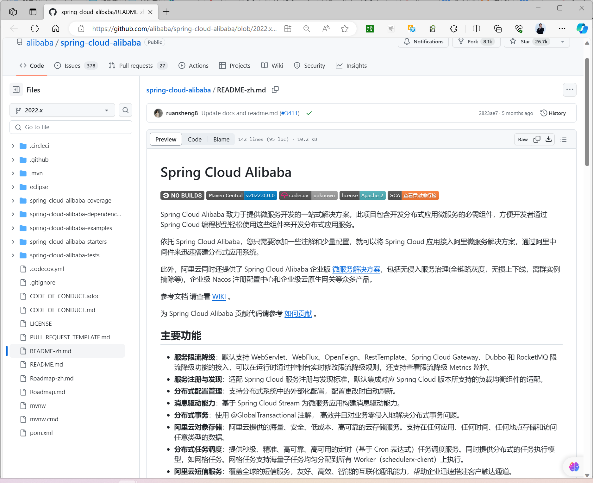
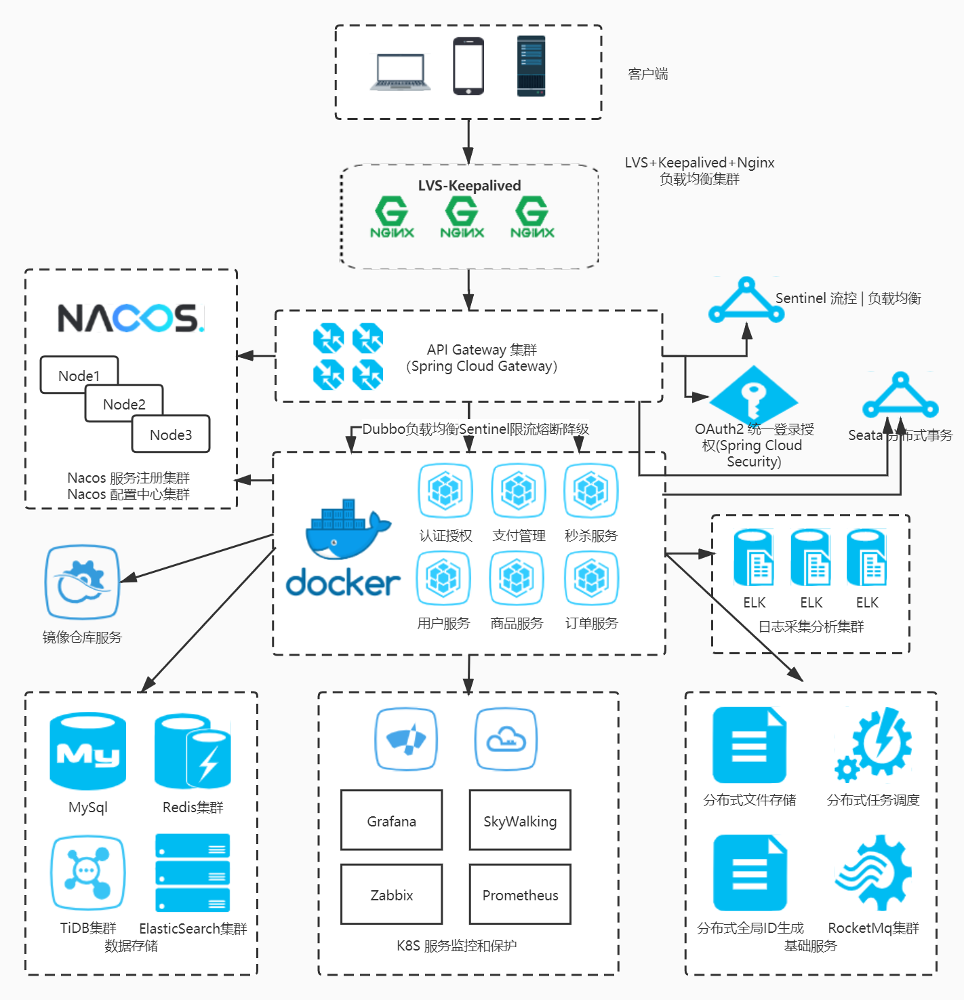
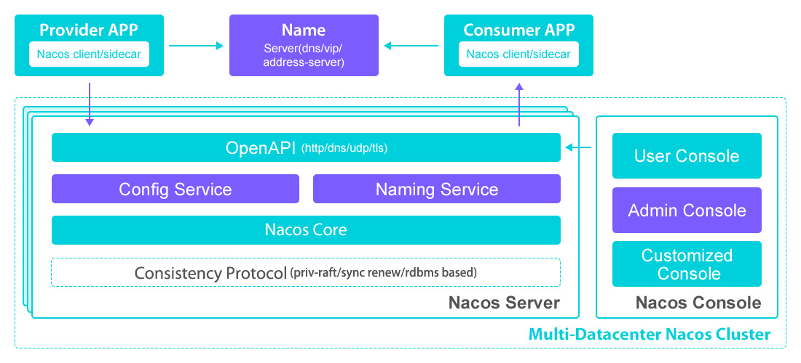
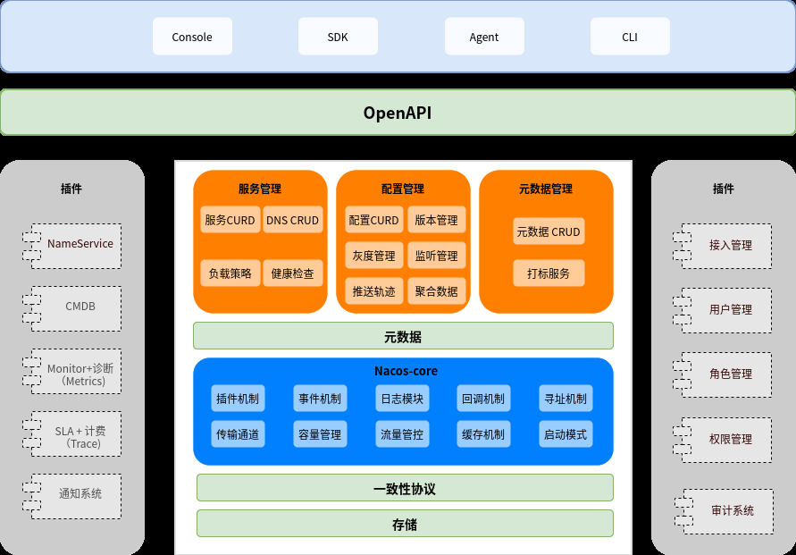
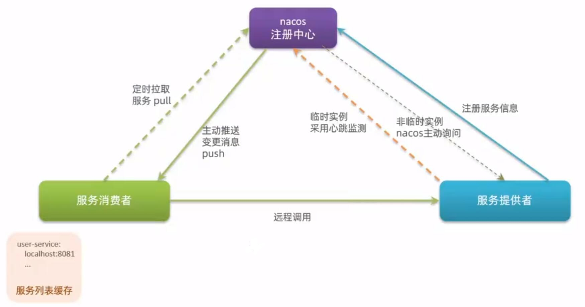

[← 返回微服务架构目录]({{ '/subjects/Microservices/' | relative_url }})



# 23 Nacos 介绍和架构

## 它解决什么问题

微服务实例的地址会随部署、扩缩容和故障恢复而变化。若调用方把 IP 和端口写死，每次变化都要重新发布。**服务注册与发现**让提供者登记地址，消费者按服务名查找可用实例。**配置管理**则把需要随环境或运行状态调整的参数从应用包中分离。Nacos 同时提供这两类能力，但并不代替网关、限流器或消息队列。


### Nacos 与 Spring Cloud Alibaba

[Spring Cloud Alibaba](https://sca.aliyun.com/) 是 Spring Cloud 生态的一组集成方案，提供 Nacos、Sentinel、Seata、RocketMQ 等组件与 Spring 应用的适配。Spring Cloud 是一组项目与编程模型；Spring Cloud Alibaba 不是它的“官方标准实现”，也不是 Spring Cloud Netflix 的直接替代品。各组件可按需组合，Nacos 本身也能通过 SDK 或 OpenAPI 服务于非 Spring 应用。



| 组件 | 主要解决的问题 |
| --- | --- |
| Nacos | 服务注册与发现、配置集中管理 |
| Sentinel | 流量控制、熔断降级与系统保护 |
| Seata | 跨服务事务协调；具体保证取决于事务模式与业务边界 |
| RocketMQ | 异步消息、解耦和削峰 |
| 阿里云 OSS、SchedulerX、短信服务 | 对象存储、任务调度和短信能力，属于可选云服务 |

原资料列举了 Spring Boot 1.x 至 3.0 的多个历史分支，映射关系会随发布而变化。新项目应先确定 JDK、Spring Boot 和 Spring Cloud 版本，再查阅 [官方版本说明](https://github.com/alibaba/spring-cloud-alibaba) 选择兼容的 BOM。以下仅展示原资料所用 `2022.0.0.0` 的依赖管理写法：

```xml
<dependencyManagement>
  <dependencies>
    <dependency>
      <groupId>com.alibaba.cloud</groupId>
      <artifactId>spring-cloud-alibaba-dependencies</artifactId>
      <version>2022.0.0.0</version>
      <type>pom</type>
      <scope>import</scope>
    </dependency>
  </dependencies>
</dependencyManagement>
```

BOM 只管理依赖版本；应用仍需引入实际使用的 Nacos Discovery、Nacos Config 等 starter。官方仓库的示例模块提供各组件用法，阅读时应切换到与项目一致的发布分支。



## Nacos 的两条主线

[Nacos](https://nacos.io/) 的名称来自 *Dynamic Naming and Configuration Service*。对应用开发者而言，可先理解为两条主线：

1. **服务发现**：实例以服务名、IP、端口、集群和权重等信息注册；消费者查询并监听实例列表，再选择健康实例。注册中心提供地址信息，普通业务请求不经 Nacos 转发。
2. **配置管理**：用 `namespace`、`group`、`dataId` 等维度定位配置。客户端读取并监听变化；应用是否热更新还取决于自身的配置绑定和刷新机制，不是任意修改都会自动生效。

控制台提供查看和编辑入口，SDK 与 OpenAPI 面向应用和自动化。服务元数据、健康状态、配置历史与回滚有助于治理。DNS 相关能力有特定适用场景，不能理解为所有服务发现都经由 DNS。

### 与 Eureka 的区别

Eureka 主要提供注册与发现，配置管理通常由其他组件承担；Nacos 将服务发现和配置管理放在同一平台。两者都有心跳、失效判断与客户端缓存，实际可用性取决于部署、网络故障与客户端行为。Eureka 的维护状态应以所用项目和版本为准，不宜笼统写成“完全不再更新”。

## 从概念到架构



| 概念 | 在一次调用中的作用 |
| --- | --- |
| 服务与实例 | 服务是逻辑名称；一个服务可有多个实际运行的实例。 |
| 提供者与消费者 | 提供者注册地址并处理请求；消费者发现实例并发起调用。应用可兼具两种角色。 |
| 注册中心 | 保存服务和实例信息，通知订阅方变化；不转发普通业务请求。 |
| 服务元数据 | 集群、标签、权重等附加信息，可参与筛选与流量治理。 |
| 配置中心 | 保存、发布和分发配置；版本记录与回滚帮助控制变更风险。 |
| 命名空间、分组、Data ID | 配置与服务的隔离和分类维度；命名规则应在团队内约定。 |

原始架构图还包含控制台、SDK、OpenAPI、事件与推送通道、缓存、持久化、权限、监控和审计等模块。读图时可按**入口 → 核心数据 → 分发与存储 → 运维治理**理解，不必把每个模块都当作应用必须部署的独立服务。



客户端缓存服务列表和配置，可以减少查询延迟并缓解短暂网络故障，但变更传播会有时间差。生产部署还要考虑权限、配置隔离、审计、监控和 Nacos 自身的高可用性。图中提及的扩展能力应以实际版本为准。

## 注册与发现的完整流程



1. **注册**：提供者启动后登记服务名和实例地址，并附上集群、权重、元数据等信息。
2. **维持状态**：临时实例依靠心跳或连接状态维持注册，超时后可能被移除；持久实例由服务端探测健康状态，异常时通常标记为不健康，而非立即删除。
3. **发现**：消费者订阅或查询服务名，获取并缓存实例列表。后续变化通过通知与客户端更新传递，并非每次业务请求都实时访问 Nacos。
4. **调用**：消费者按健康状态、集群、权重等策略选实例，再直接发起业务请求。网络分区或缓存过期时，还需要超时、重试和熔断等机制配合。

### 一致性要按数据类型理解

临时实例侧重故障期间的可用性与最终收敛，其同步机制通常称为 **Distro**；持久实例的元数据同步更强调一致性，使用共识协议。不能简化为“Nacos 整体默认 AP，出现持久实例就整体切换 CP”：不同数据类型的处理方式不同，配置数据与服务实例也不是同一份数据。CAP 讨论的是网络分区时的取舍，不是平时服务质量的排名。

接下来的部署篇将区分单机体验与集群持久化。在动手前，先明确应用需要服务发现、配置管理，还是两者兼用。



<nav class="article-end" aria-label="章节导航">
  <a href="{{ '/subjects/Microservices/22-kafka-monitoring.html' | relative_url }}">← 上一篇：Kafka 监控</a>
  <a href="{{ '/subjects/Microservices/' | relative_url }}">返回专题目录</a>
  <a href="{{ '/subjects/Microservices/24-deploying-nacos.html' | relative_url }}">下一篇：部署 Nacos →</a>
</nav>
