[← 返回微服务架构目录]({{ '/subjects/Microservices/' | relative_url }})



# 24 Nacos 部署

上一篇说明了 Nacos 的注册发现与配置管理职责。本篇先用单机实例验证基本功能，再说明外部数据库、鉴权、集群入口和容器化部署。**演示命令以 Nacos 2.2.3 为例**；文末单列 Nacos 3.x 的差异。不要把不同大版本的控制台端口、认证配置或镜像参数混用。正式部署前还应核对[当前版本的官方部署文档](https://nacos.io/docs/latest/manual/admin/deployment/deployment-overview/)。

## 选择部署方式

| 方式 | 适用场景 | 关键限制 |
| --- | --- | --- |
| 单机 + 内置数据库 | 本地学习、功能验证 | 不是生产高可用方案 |
| 单机 + MySQL | 验证外部数据库、迁移准备 | 应用仍是单点 |
| 多节点 + 高可用数据库 | 生产集群 | Nacos 和数据库都需监控、备份、故障演练 |
| Docker Compose / Kubernetes | 容器化环境 | 版本、存储、密钥和健康检查需统一管理 |

原资料给出的 CPU、内存和磁盘数值只可视为起步估算，实际需求取决于实例数、配置量、客户端连接数和流量。源码编译还需要 Maven；使用发行包则无需 Maven。

## 一、单机运行与功能验证

### 1. 安装与启动

以下命令在 Linux 上使用固定版本发行包。先安装该版本支持的 JDK；若选择其他版本，按发布说明核对 Java 要求。

```bash
java -version
wget https://github.com/alibaba/nacos/releases/download/2.2.3/nacos-server-2.2.3.tar.gz
tar -xzf nacos-server-2.2.3.tar.gz -C /usr/local
cd /usr/local/nacos/bin
bash startup.sh -m standalone
tail -f /usr/local/nacos/logs/start.out
```

日志出现 `Nacos started successfully in stand alone mode` 才说明启动完成。停止时执行 `bash /usr/local/nacos/bin/shutdown.sh`。不要把启动脚本打印的长串 Java 参数和多行日志当作需要手敲的命令。Windows 发行包使用 `startup.cmd -m standalone` 和 `shutdown.cmd`。

Nacos 2.x 默认 HTTP 端口为 8848，客户端 gRPC 端口通常为 9848。控制台示例地址是 `http://127.0.0.1:8848/nacos/`；若修改 `server.servlet.contextPath`，访问路径也要同步改变。

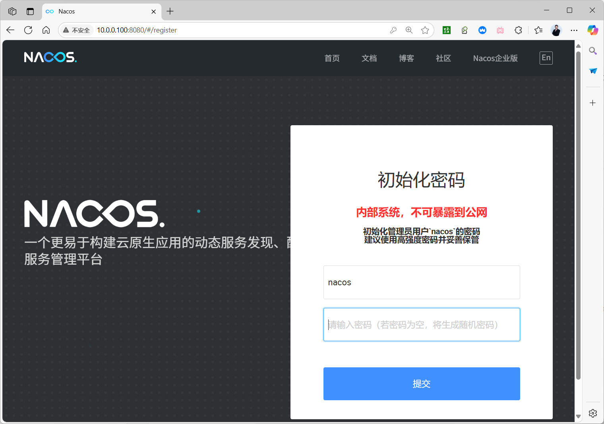
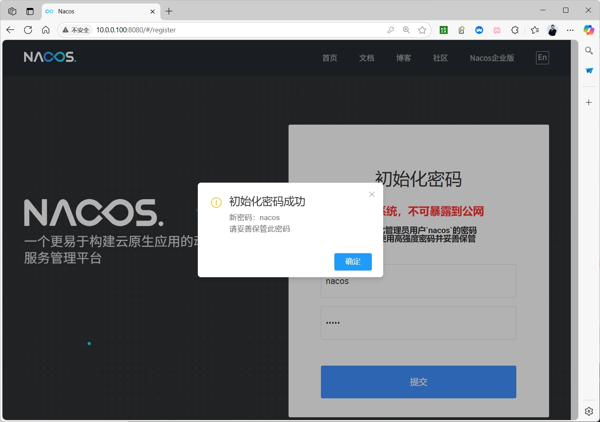
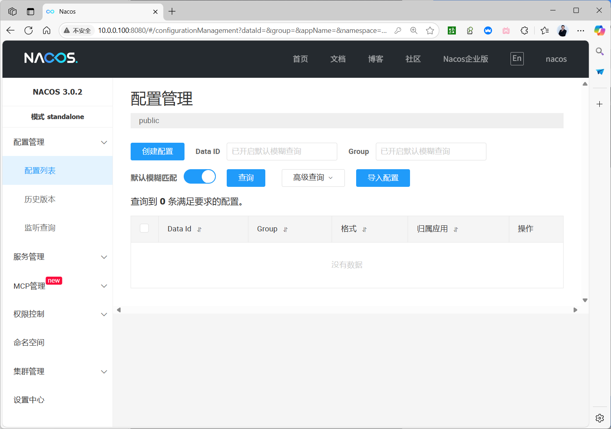
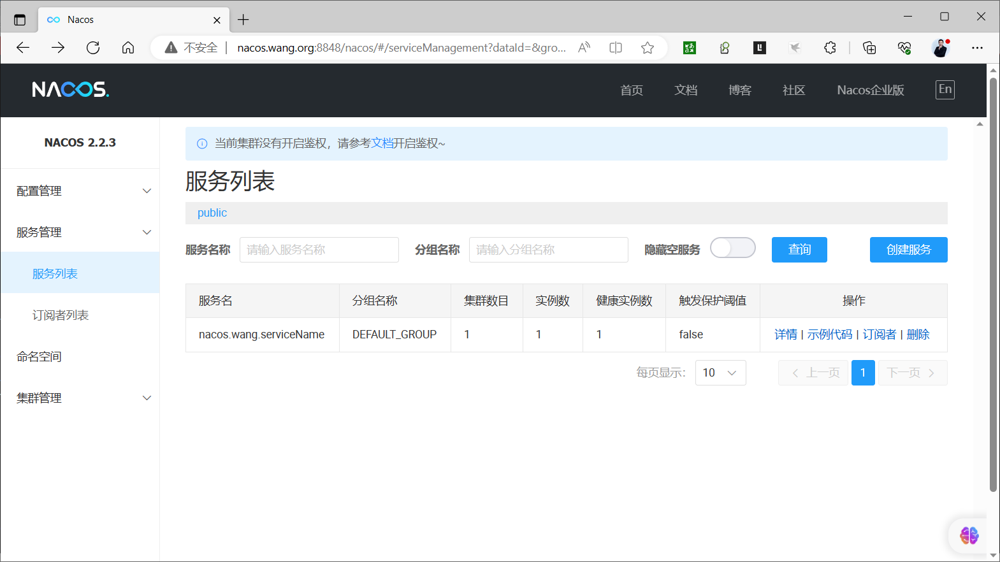
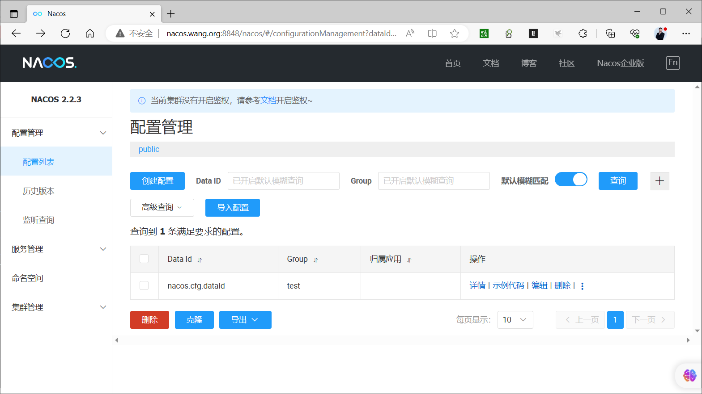

### 2. 用 API 观察注册发现与配置

下列示例针对**未开启鉴权的本地实验环境**，URL 必须写在同一行。手工注册的临时实例还需要持续心跳；因此它可能在一段时间后从列表中消失。真实应用应使用 SDK 或框架 starter 维护注册生命周期。

```bash
BASE=http://127.0.0.1:8848/nacos
curl -X POST "$BASE/v1/ns/instance" --data-urlencode 'serviceName=demo-service' --data-urlencode 'ip=127.0.0.1' --data-urlencode 'port=8080'
curl "$BASE/v1/ns/instance/list?serviceName=demo-service"

curl -X POST "$BASE/v1/cs/configs" --data-urlencode 'dataId=demo.properties' --data-urlencode 'group=DEFAULT_GROUP' --data-urlencode 'content=message=hello'
curl "$BASE/v1/cs/configs?dataId=demo.properties&group=DEFAULT_GROUP"
```

预期结果分别是注册操作成功、实例列表包含测试地址、配置发布返回成功，以及读回 `message=hello`。这些 API 是版本化接口；迁移到 Nacos 3.x 时应核对相应版本的 OpenAPI 和认证方式。

## 二、让配置使用 MySQL

单机内置存储便于试验；外部 MySQL 便于统一备份和后续集群部署，但并不会自动消除数据库单点。先在 MySQL 创建数据库与最小所需权限的账号，再导入**当前 Nacos 发行包自带**的 `conf/mysql-schema.sql`。不要从另一个版本复制表结构。

```sql
CREATE DATABASE nacos CHARACTER SET utf8mb4 COLLATE utf8mb4_general_ci;
CREATE USER 'nacos'@'127.0.0.1' IDENTIFIED BY 'STRONG_DB_PASSWORD';
GRANT ALL PRIVILEGES ON nacos.* TO 'nacos'@'127.0.0.1';
```

```bash
mysql -h 127.0.0.1 -u nacos -p nacos < /usr/local/nacos/conf/mysql-schema.sql
```

在 `/usr/local/nacos/conf/application.properties` 写入完整且**不断行**的属性值，再重启。以下字段适用于本文的 2.2.3 示例；其他版本以其发行包样例为准。

```properties
spring.sql.init.platform=mysql
db.num=1
db.url.0=jdbc:mysql://127.0.0.1:3306/nacos?characterEncoding=utf8&connectTimeout=1000&socketTimeout=3000&useUnicode=true&useSSL=false&serverTimezone=UTC
db.user.0=nacos
db.password.0=STRONG_DB_PASSWORD
```

连接失败时依次检查数据库可达性、账号来源地址、表结构和 Nacos 启动日志。旧笔记中把 JDBC URL 折成多行、把注释放在属性值后面，直接复制会得到错误配置。是否需要指定 MySQL 的认证插件，应按 JDBC 驱动与 MySQL 版本判断，不能一律强制使用旧插件。

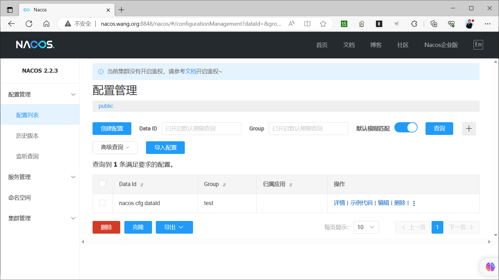

## 三、鉴权与访问边界

Nacos 2.x 某些发行版默认关闭内置鉴权；Nacos 3.x 的初始化流程不同。**不要把未鉴权的控制台或 API 暴露到公网。** 即使开启内置鉴权，也应限制网络访问、使用 TLS 入口、分配独立账号并保护数据库与密钥。集群中每个节点的身份和签名密钥必须一致。

本文 2.2.3 示例在 `application.properties` 中设置：

```properties
nacos.core.auth.system.type=nacos
nacos.core.auth.enabled=true
nacos.core.auth.server.identity.key=INTERNAL_IDENTITY_KEY
nacos.core.auth.server.identity.value=INTERNAL_IDENTITY_VALUE
nacos.core.auth.plugin.nacos.token.secret.key=BASE64_RANDOM_SECRET
```

签名密钥应按对应版本要求生成足够长的随机值；示例槽位不是可直接使用的密钥。重启后确认控制台要求登录，并使用本版本 API 的认证流程验证服务和配置接口。不应将真实密码、访问令牌写进文章、命令历史或 URL。原始记录里展示的 JWT 只是过期的示例输出，不能复用。

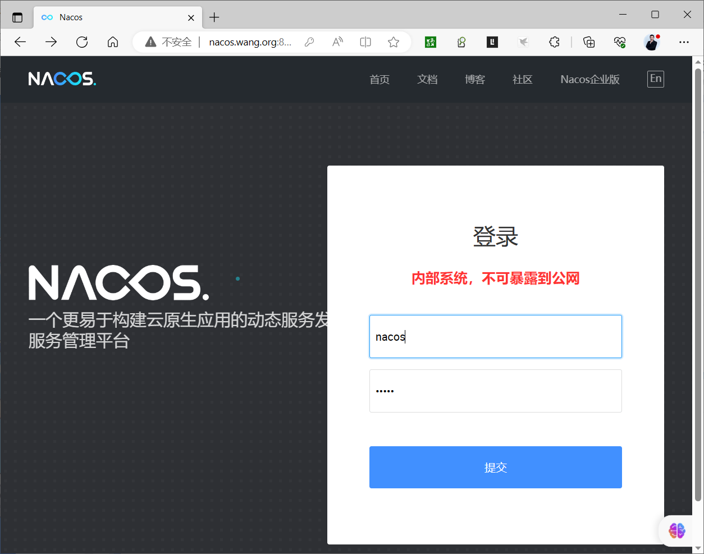
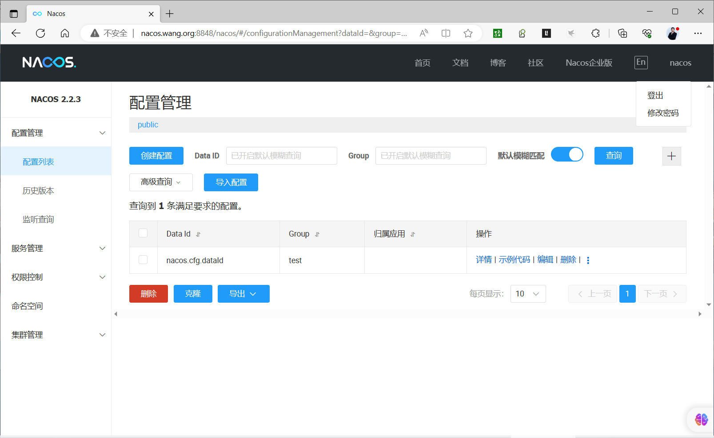
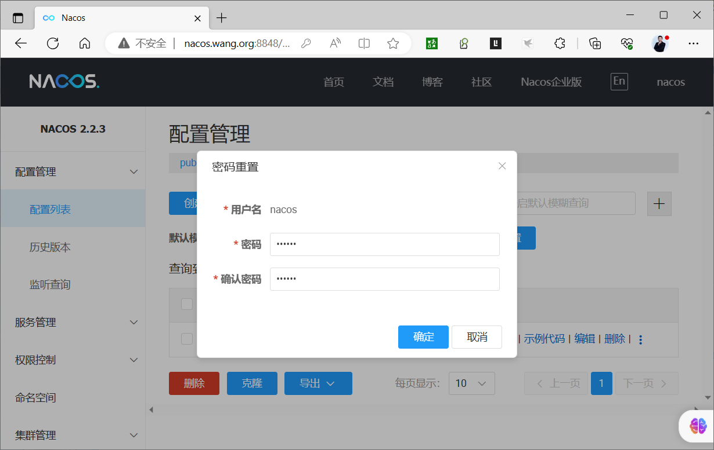
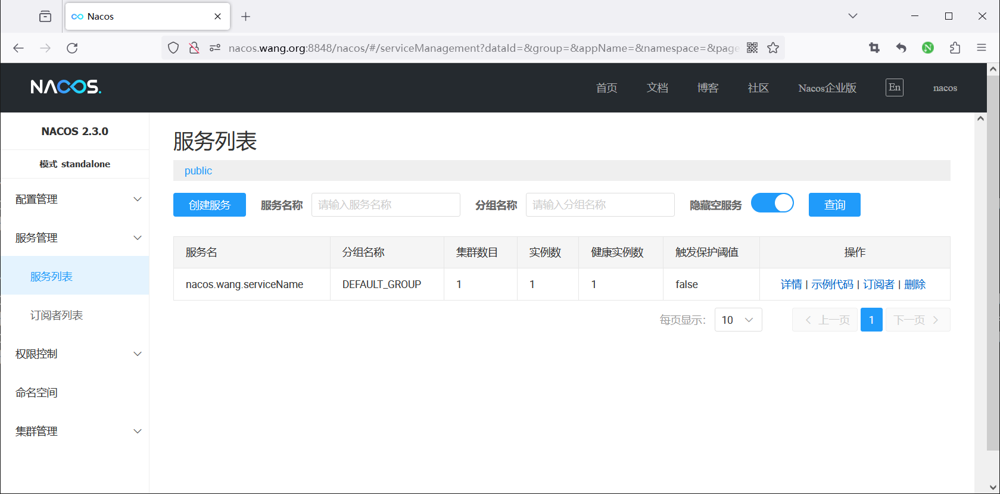
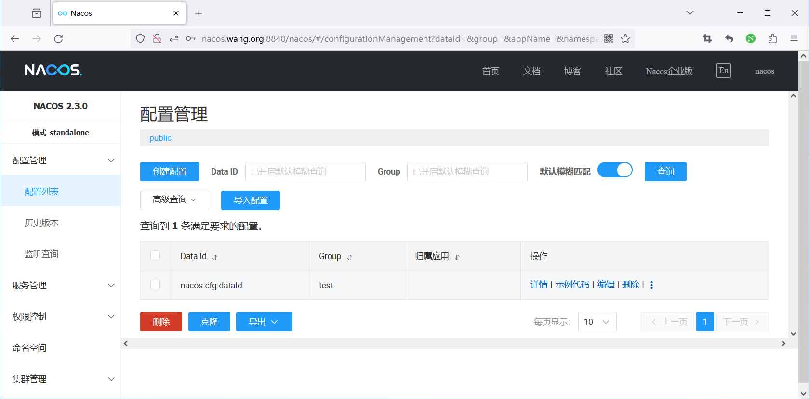

原资料附有一个一键安装脚本，但它使用失效镜像代理、跳过证书验证，还把下载、系统用户、systemd 和启动揉在一起；直接运行难以核对失败位置。实际自动化应拆成发行包校验、配置写入、权限设置、服务启动和健康检查五个步骤，并在失败时保留日志。

## 四、三节点集群与统一入口

下面仍以 Nacos 2.2.3 为例。三台节点分别使用 `10.0.0.201/202/203:8848`；MySQL 位于可达的内网地址。生产数据库也应具备备份和故障切换能力。各节点安装**相同版本**的 Nacos，并使用一致的数据库、鉴权配置。在每台机器的 `conf/cluster.conf` 写入相同成员列表：

```text
10.0.0.201:8848
10.0.0.202:8848
10.0.0.203:8848
```

初始化一次数据库，确保三个节点都能访问，然后在每个节点执行 `bash /usr/local/nacos/bin/startup.sh`，不要加 `-m standalone`。检查启动日志是否显示集群模式，并从每个节点查询成员与健康状态；只看到进程存活不足以确认集群可用。


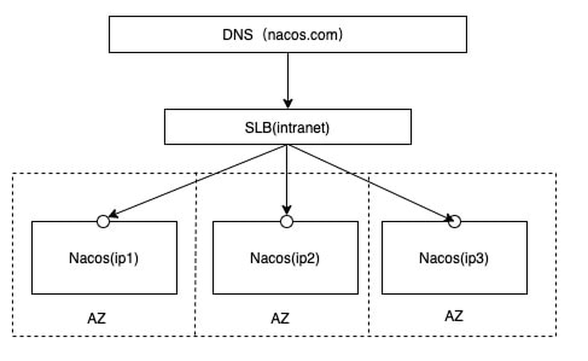
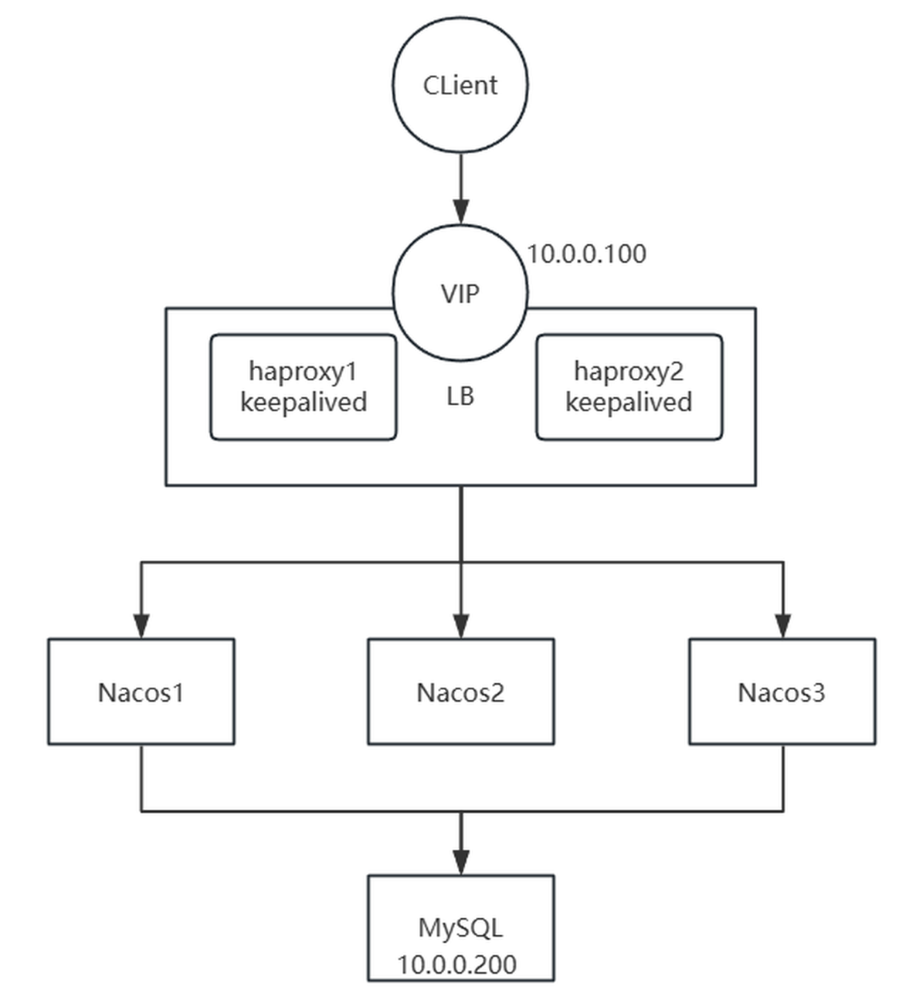

Nacos 2.x 默认端口关系如下，修改主端口后偏移端口也需一并计算：

| 端口 | 用途 | 暴露范围 |
| --- | --- | --- |
| 8848 | HTTP API 与 2.x 控制台 | 仅客户端与管理网段 |
| 9848 | 客户端 gRPC，主端口 +1000 | 客户端可达 |
| 9849 | 服务端间 gRPC，主端口 +1001 | 仅集群节点 |
| 7848 | 服务端间共识通信，主端口 -1000 | 仅集群节点 |

负载均衡入口需要同时让客户端到达 8848 和 9848；只代理 HTTP 端口会导致 2.x 客户端长连接失败。gRPC 通道使用 TCP 透传，不能随意用普通 HTTP 代理代替。后端节点之间仍需直接互通 9849、7848 等内部端口。

例如，HAProxy 可分别为两个客户端端口配置 TCP 后端；下面只展示关键监听段，完整配置仍需包含全局与默认段，并在启动前用 `haproxy -c -f /etc/haproxy/haproxy.cfg` 校验：

```haproxy
listen nacos-http
    mode tcp
    bind 10.0.0.100:8848
    server nacos1 10.0.0.201:8848 check
    server nacos2 10.0.0.202:8848 check
    server nacos3 10.0.0.203:8848 check

listen nacos-grpc
    mode tcp
    bind 10.0.0.100:9848
    server nacos1 10.0.0.201:9848 check
    server nacos2 10.0.0.202:9848 check
    server nacos3 10.0.0.203:9848 check
```

两台 HAProxy 可再用 Keepalived 提供 VIP；验证时应分别测试单个 Nacos 节点故障、负载均衡器故障和数据库故障，而不是仅凭 VIP 能打开控制台就宣称高可用。Keepalived 的网卡、VRRP ID、优先级和健康脚本均须匹配实际网络。

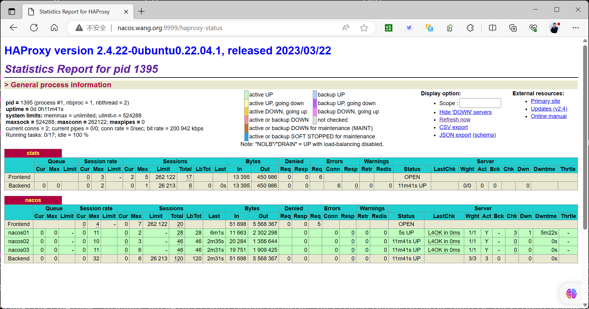
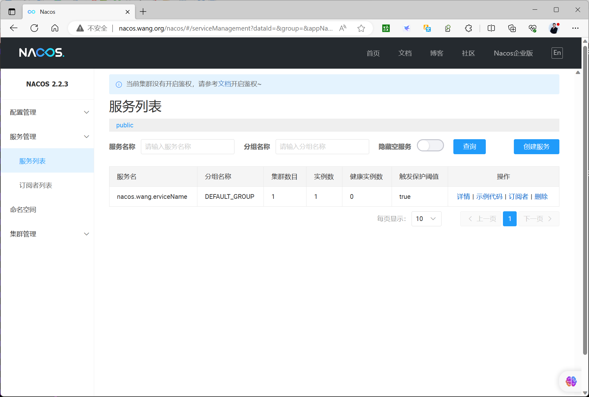
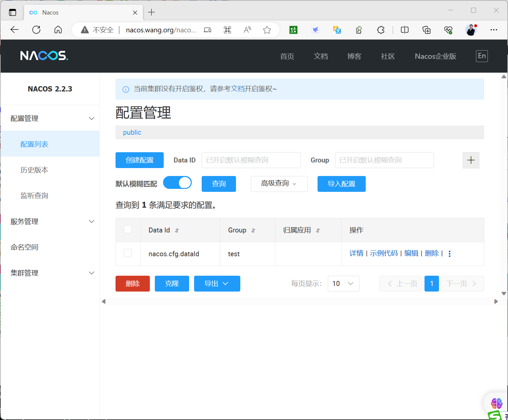

## 五、Docker Compose 与 Kubernetes

单机容器可用于本地体验，但需要固定镜像标签并确认 8848、9848 均可达：

```bash
docker run -d --name nacos-demo -e MODE=standalone -p 8848:8848 -p 9848:9848 nacos/nacos-server:v2.2.3
docker logs -f nacos-demo
```

Compose 集群需要 MySQL、三个 Nacos 实例、统一的版本和鉴权配置。原资料把多份 Compose 文件、`.env` 内容、命令和运行输出塞进同一 YAML 代码块，缩进丢失后不可解析。应从 [nacos-docker 项目](https://github.com/nacos-group/nacos-docker) 选与镜像版本对应的示例文件，逐项核对 `MODE`、`NACOS_SERVERS`、数据库连接、密钥、卷和端口，再执行 `docker compose -f <示例文件> config` 验证配置，最后启动。容器之间使用容器网络的服务名与**容器端口**通信，不要把宿主机映射端口误写入成员列表。

Kubernetes 场景优先检查 [nacos-k8s 项目](https://github.com/nacos-group/nacos-k8s) 当前维护的清单和 Operator 兼容矩阵。典型部署包含 Headless Service、StatefulSet、外部数据库及 Secret；成员地址依靠 StatefulSet 的稳定 DNS 名称。不要直接套用原资料中 Nacos 1.4.1、旧 NFS provisioner、`latest` 镜像和已失去缩进的 YAML：它们属于不同年代的演示，不能拼成一个 2.2.3 集群。数据库密码应置于 Secret，持久卷与备份按数据归属设计；卷本身不等于备份。

若使用 Operator，应先确认 CRD/API 版本和当前镜像支持情况，再安装控制器、创建自定义资源并观察 `kubectl get pods`、事件和集群健康状态。扩容时可用 `kubectl scale statefulset/nacos --replicas=3`，但**副本数变化不等于新节点已加入健康集群**，还要检查成员视图、配置读写和故障恢复。

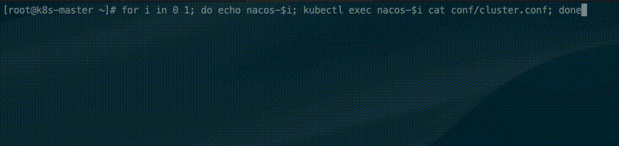


## 六、监控与版本差异

在本文 2.x 示例中，可通过 `management.endpoints.web.exposure.include=prometheus,health` 开放指标端点，随后验证 `http://127.0.0.1:8848/nacos/actuator/prometheus` 是否返回指标。Prometheus 的 `metrics_path` 要与实际 context path 一致；只在受控网络暴露监控端点，并分别采集每个 Nacos 节点，而不只抓取 VIP。

```yaml
scrape_configs:
  - job_name: nacos
    metrics_path: /nacos/actuator/prometheus
    static_configs:
      - targets: ['10.0.0.201:8848', '10.0.0.202:8848', '10.0.0.203:8848']
```

Nacos 3.x 的首次启动、鉴权初始化和控制台端口与 2.x 不同；原资料中的 3.0 演示曾出现控制台 8080、API 8848。升级时应按目标版本发行说明逐项验证，而不是仅替换压缩包或镜像标签。无论哪种部署方式，最终都应完成**版本核对 → 启动日志 → 服务注册发现 → 配置发布读取 → 鉴权 → 节点故障与恢复 → 备份恢复**的闭环。



<nav class="article-end" aria-label="章节导航">
  <a href="{{ '/subjects/Microservices/23-nacos-architecture-and-overview.html' | relative_url }}">← 上一篇：Nacos 介绍和架构</a>
  <a href="{{ '/subjects/Microservices/' | relative_url }}">返回专题目录</a>
  <a href="{{ '/subjects/Microservices/25-nacos-examples.html' | relative_url }}">下一篇：Nacos 示例 →</a>
</nav>
