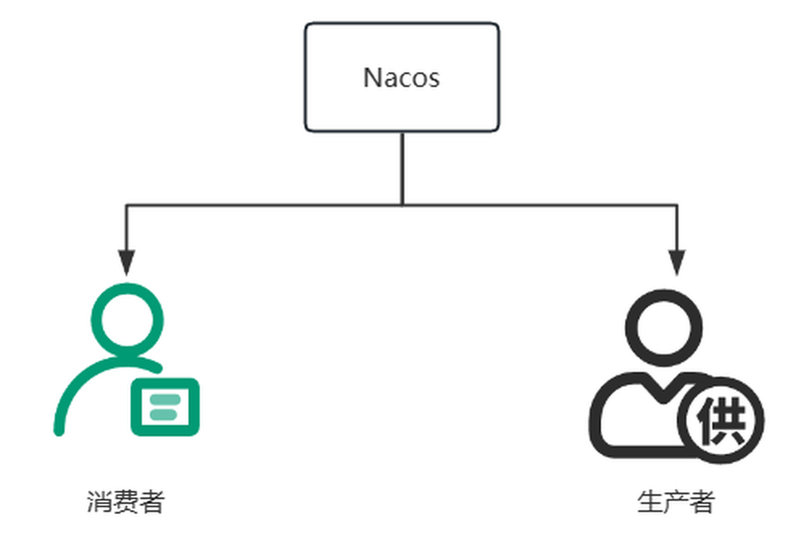
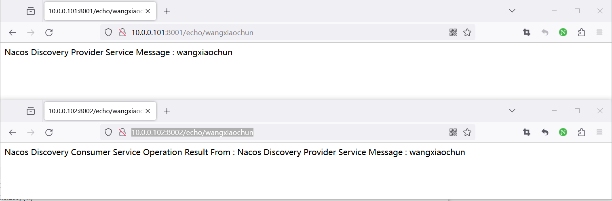
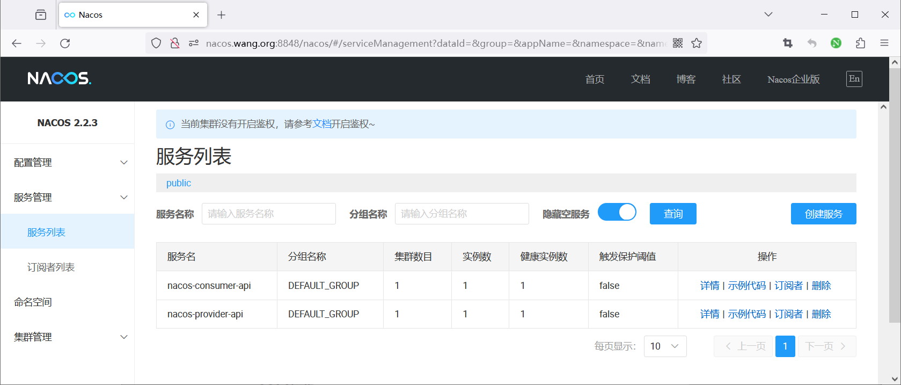
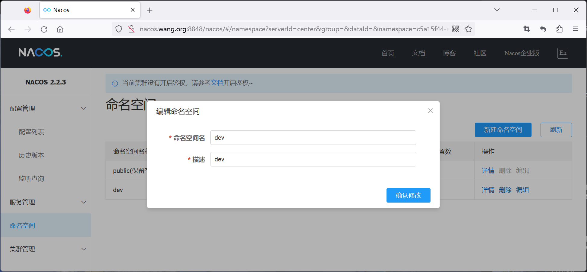
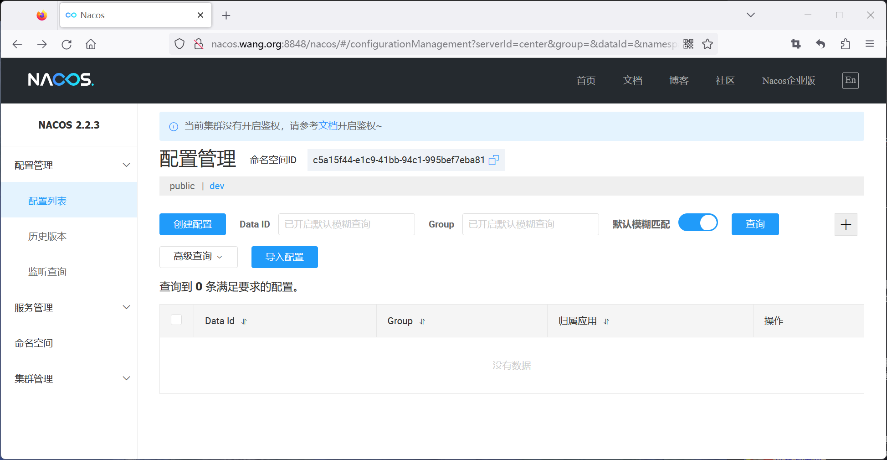
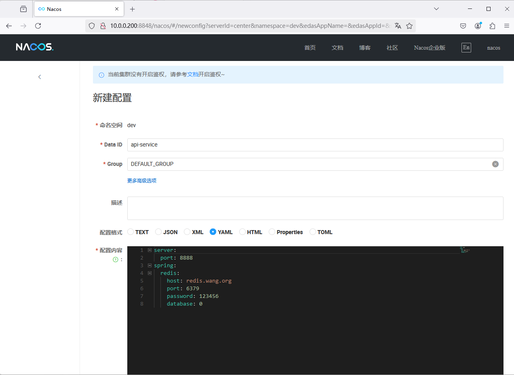
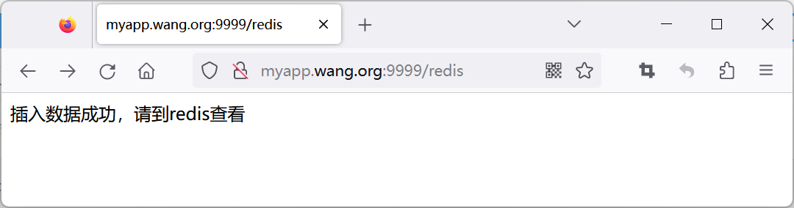
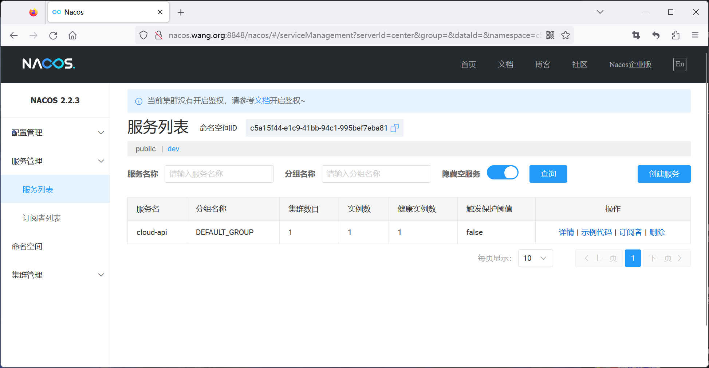
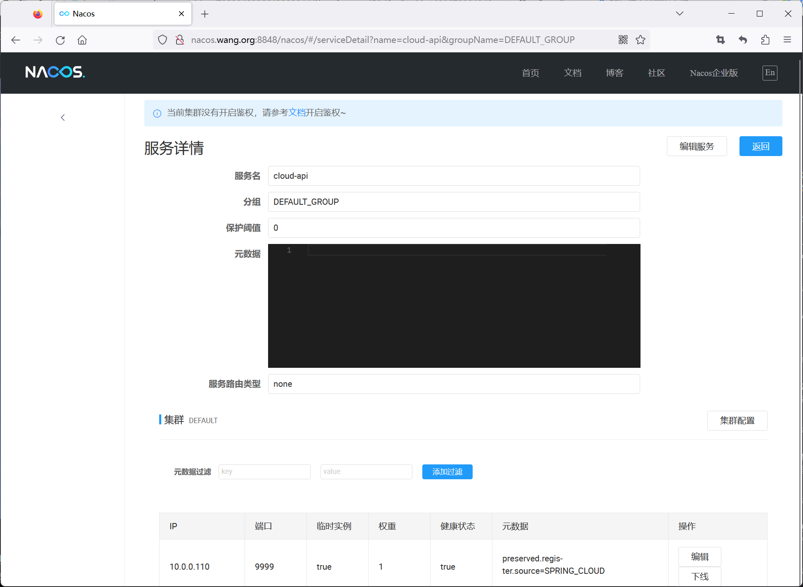

[← 返回微服务架构目录]({{ '/subjects/Microservices/' | relative_url }})



# 25 Nacos 案例

本篇用两个场景串起前面的概念：先让消费者通过服务名找到提供者，再让应用从 Nacos 读取配置。原始记录混有不同 Spring Boot、JDK 和 Nacos 版本的运行输出；实际复现时应选定一组兼容版本，不要把每条安装命令都执行一遍。

## 场景一：服务注册与发现

示意拓扑包含 Nacos（`10.0.0.100:8848`）、提供者（`10.0.0.101:8001`）和消费者（`10.0.0.102:8002`）。这些是原实验网络地址，部署时应替换为当前环境地址。消费者访问 Nacos 获取提供者实例列表，然后向提供者发起请求；业务流量并不经过 Nacos。



### 先验证 Nacos 可用

若已完成第 24 篇的部署，直接复用现有 Nacos。若需临时容器，可选择与本实验客户端兼容的固定 2.x 镜像标签，而不是同时启动原记录中的多个版本：

```bash
docker run -d --name nacos-demo -e MODE=standalone \
  -p 8848:8848 -p 9848:9848 nacos/nacos-server:v2.2.3
docker logs -f nacos-demo
```

确保两台应用主机均能连到 8848 和 9848。若启用了鉴权，还要给客户端配置对应账号。JDK 版本由所选 Spring Boot / Spring Cloud Alibaba 组合决定，不能概括为“JDK 8、17、21 都支持同一个应用”。

### 提供者与消费者分别配置

两个应用都需要各自的 `spring.application.name`，且都指向同一 Nacos 集群。以下展示原资料的核心属性；实际项目还需在构建文件中引入兼容版本的 Nacos Discovery starter，并由提供者实现 `/echo/{name}` 接口、消费者实现按服务名调用提供者的逻辑。

```properties
# 提供者 application.properties
server.port=8001
spring.application.name=nacos-provider-api
spring.cloud.nacos.discovery.server-addr=10.0.0.100:8848
```

```properties
# 消费者 application.properties
server.port=8002
spring.application.name=nacos-consumer-api
spring.cloud.nacos.discovery.server-addr=10.0.0.100:8848
```

在各自源码目录执行 `mvn clean package`，按应用实际生成的 JAR 文件名运行。不要在一条 `java` 命令中把 `-D...` 参数折成两行；如需临时覆盖地址，应把 JVM 系统属性放在 `-jar` 之前，并确认所用配置机制会读取该属性。

```bash
curl http://10.0.0.101:8001/echo/test
curl http://10.0.0.102:8002/echo/test
```

第一条验证提供者自身接口，第二条验证消费者经服务发现完成调用。仅看到两个端口监听，不能证明消费者真的用了 Nacos；还应在控制台检查两个服务的实例与健康状态，并停止提供者观察消费者如何处理实例消失。




## 场景二：从 Nacos 读取应用配置

原例让 Java 应用从 Nacos 获取 Redis 连接参数，然后访问 Redis。它说明的是**配置集中管理**，并不表示 Nacos 本身连接 Redis。正式环境的数据库密码不宜作为普通明文配置长期存放；应结合密钥管理、权限和审计。

### 1. 确定配置的完整身份

在控制台创建 `dev` 命名空间时，记录其**命名空间 ID**。显示名与 ID 未必相同。随后在该命名空间创建 YAML 配置，约定 `group=DEFAULT_GROUP`、`dataId=api-service.yml`。Data ID 必须与客户端实际寻找的名称一致，不能一边写 `api-service`，另一边让客户端拼接 `.yml` 却不验证结果。





```yaml
server:
  port: 9999
spring:
  redis:
    host: REDIS_HOST
    port: 6379
    password: REDIS_PASSWORD
    database: 0
```

以上缩进是有效 YAML；原记录中的无缩进版本会改变结构。若项目使用较新的 Spring Boot，Redis 属性前缀或配置加载方式可能变化，应按所选版本的官方文档核对。

### 2. 指向 Nacos 配置

下面沿用原实验的 `bootstrap.properties` 配置模式。只有项目确实引入相应 bootstrap 支持时它才会在启动阶段加载；新版本项目也可按其版本文档使用 `spring.config.import`。两种方式不要不加区分地混写。

```properties
spring.application.name=cloud-api
spring.cloud.nacos.config.server-addr=10.0.0.100:8848
spring.cloud.nacos.config.namespace=DEV_NAMESPACE_ID
spring.cloud.nacos.config.group=DEFAULT_GROUP
spring.cloud.nacos.config.prefix=api-service
spring.cloud.nacos.config.file-extension=yml
spring.cloud.nacos.discovery.server-addr=10.0.0.100:8848
spring.cloud.nacos.discovery.namespace=DEV_NAMESPACE_ID
```

如果应用拼接出的 Data ID 是 `api-service.yml`，便与控制台配置对应。配置刷新是否影响已创建的连接对象，取决于应用的绑定与刷新实现，不能仅凭控制台“发布成功”判断 Redis 连接已重建。**不要解压修改构建好的 JAR 再改名**：这会破坏可追溯性，也容易引入错误；应修改源码重新构建，或使用该版本支持的外部化配置。

### 3. 逐项验证

先确认应用能连接 Nacos 与 Redis，再启动 JAR 并调用它实际实现的 API。原资料的新旧示例路径分别是 `/api/redis/` 与 `/redis`，应按所运行的项目代码选一个，而不是两个都当作固定接口。验证顺序为：

1. Nacos 控制台确认 `dev` 命名空间下的 `api-service.yml` 已发布，并能读回内容。
2. 应用启动日志确认配置加载和服务注册成功，监听端口为配置中的 9999。
3. 调用应用接口，确认返回成功；再用 Redis 客户端查询**预期键**，避免在生产库执行无边界的 `KEYS *`。
4. 修改可安全热更新的测试配置，观察应用是否收到刷新事件并体现变化；若没有，检查所用版本的刷新机制。





这两个实验分别验证“服务名到实例地址”与“配置身份到配置内容”。排障时先分清是发现失败、配置未加载、还是业务接口或 Redis 自身的问题。



<nav class="article-end" aria-label="章节导航">
  <a href="{{ '/subjects/Microservices/24-deploying-nacos.html' | relative_url }}">← 上一篇：Nacos 部署</a>
  <a href="{{ '/subjects/Microservices/' | relative_url }}">返回专题目录</a>
  <a href="{{ '/subjects/Microservices/26-sentinel-architecture-and-mechanisms.html' | relative_url }}">下一篇：Sentinel 架构与机制 →</a>
</nav>
