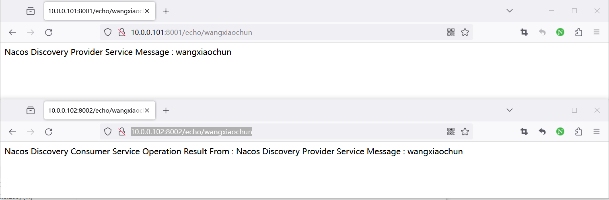
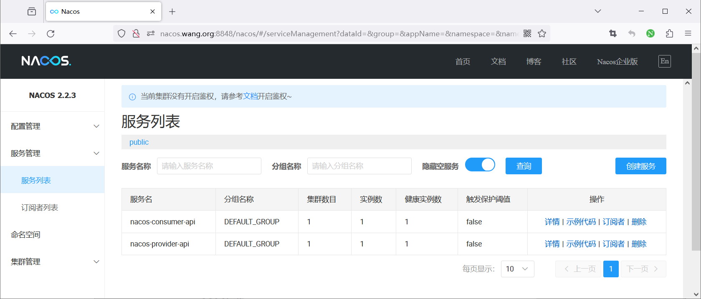
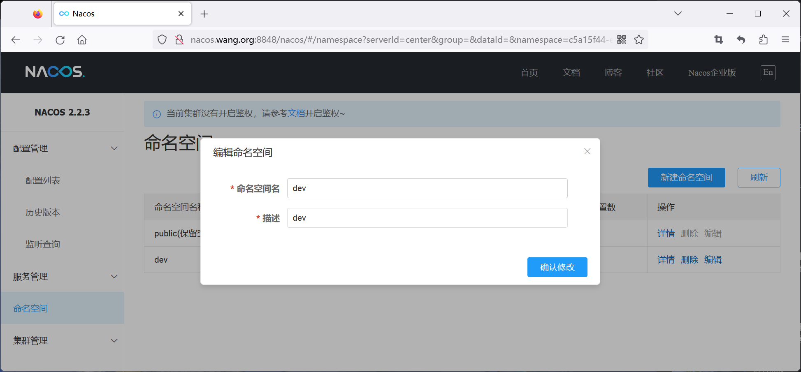
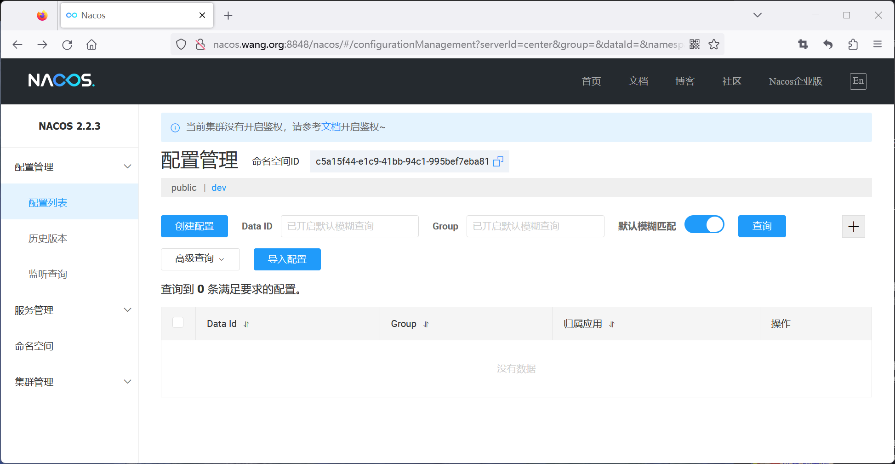
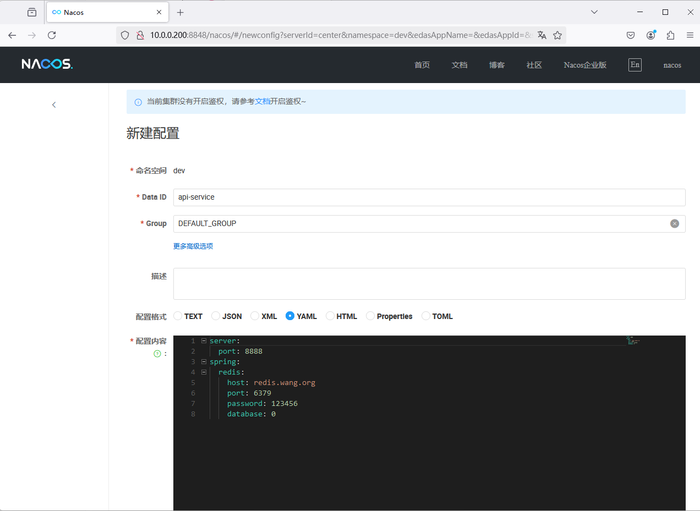
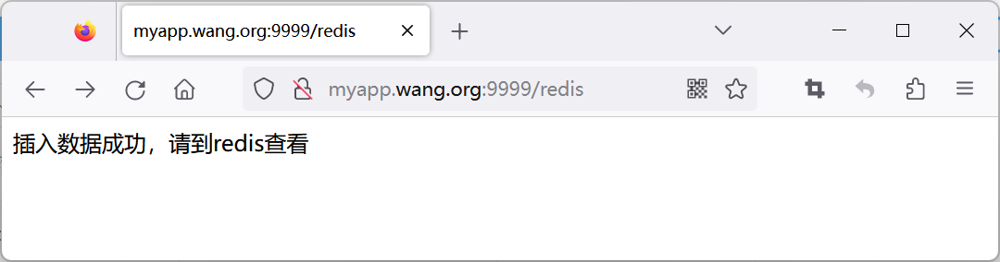
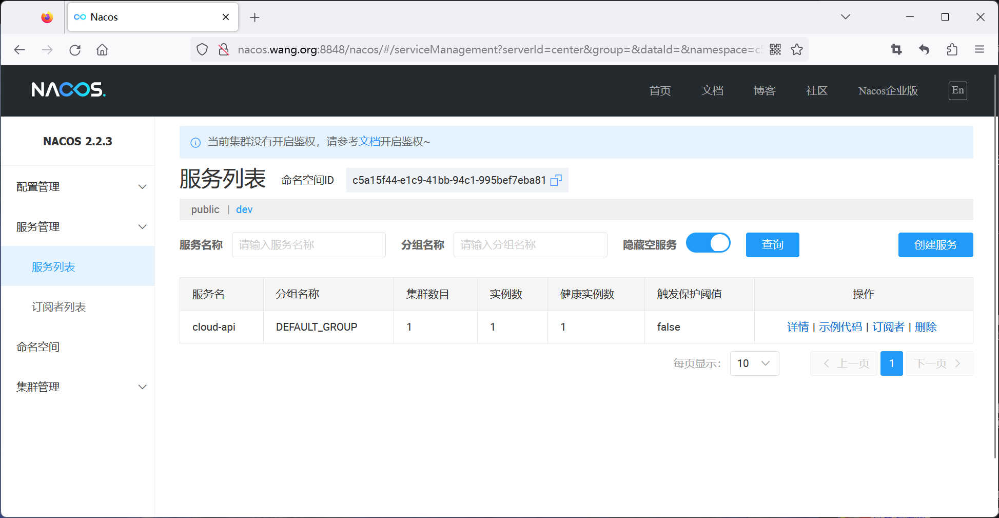
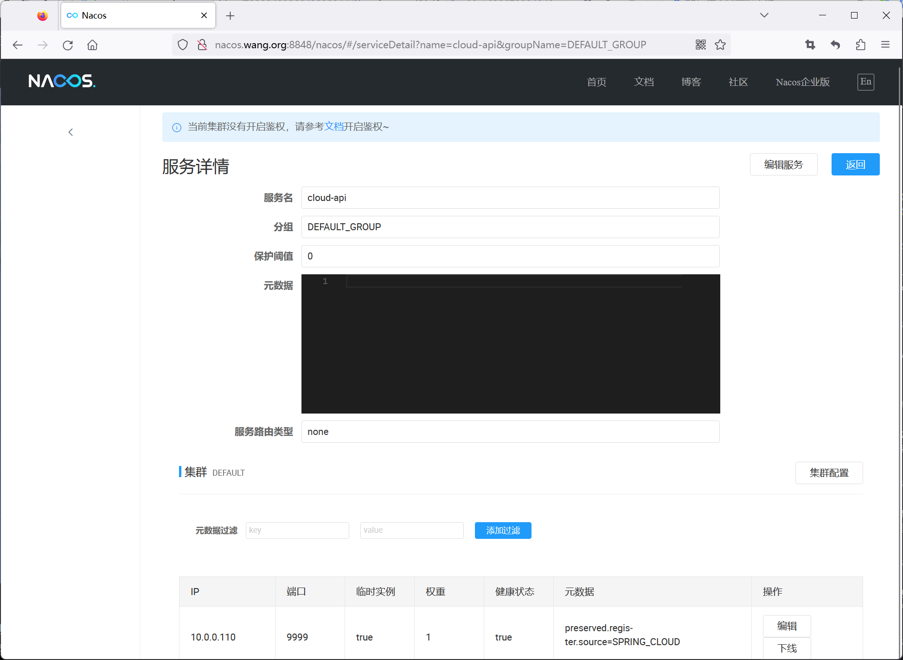

[← Back to Microservices Index]({{ '/subjects/Microservices/' | relative_url }})



# 25 Nacos Examples
### 4.3 Nacos 案例

### Nacos 项目服务注册和发现

利用 Nacos 实现 JAVA 应用消费者和提供者调用


IP 备注

10.0.0.100:8848 Nacos 服务

10.0.0.101:8001 Provider 应用

10.0.0.102:8002 Consumer 应用

### 安装 Nacos

```bash
[root@ubuntu2204 ~]#apt update && apt -y install docker.io
[root@ubuntu2204 ~]#docker run --name nacos -e MODE=standalone -p 8848:8848 -p 9848:9848 -d --restart always
registry.cn-beijing.aliyuncs.com/bowenxiaochun/nacos-server:v2.4.3-slim
[root@ubuntu2204 ~]#docker run --name nacos -e MODE=standalone -p 8848:8848 -p 9848:9848 -d --restart always
nacos/nacos-server:v2.4.3
[root@ubuntu2204 ~]#docker run --name nacos -e MODE=standalone -p 8848:8848 -p 9848:9848 -d --restart always
registry.cn-beijing.aliyuncs.com/bowenxiaochun/nacos-server:v2.2.3-slim
[root@ubuntu2204 ~]#docker images
REPOSITORY           TAG           IMAGE ID       CREATED        SIZE
nacos/nacos-server   v2.2.3-slim   2266763b639b   6 months ago   383MB
[root@ubuntu2204 ~]#docker ps
CONTAINER ID   IMAGE                            COMMAND                  CREATED             STATUS
PORTS                                                                                  NAMES
35671af621ad   nacos/nacos-server:v2.2.3-slim   "bin/docker-startup.…"   About an hour ago   Up About an hour
0.0.0.0:8848->8848/tcp, :::8848->8848/tcp, 0.0.0.0:9848->9848/tcp, :::9848->9848/tcp   nacos
```

### 运行服务提供者的JAVA应用

在10.0.0.101 主机上运行

```bash
#Nacos服务主机的名称解析
[root@ubuntu2204 ~]#cat /etc/hosts
10.0.0.100 nacos.bowen.org
#安装JDK21,17,8都支持
[root@ubuntu2404 ~]#apt update && apt -y install openjdk-21-jdk
[root@ubuntu2404 ~]#apt update && apt -y install openjdk-17-jdk
[root@ubuntu2204 ~]#apt update && apt -y install openjdk-8-jdk
[root@ubuntu2404 ~]#apt update &&apt -y install maven
[root@ubuntu2404 ~]#mvn -v
Apache Maven 3.8.7
Maven home: /usr/share/maven
Java version: 21.0.8, vendor: Ubuntu, runtime: /usr/lib/jvm/java-21-openjdk-amd64
Default locale: en_US, platform encoding: UTF-8
OS name: "linux", version: "6.8.0-48-generic", arch: "amd64", family: "unix"
#准备JAVA应用
[root@ubuntu2204 nacos-provider]#ls
pom.xml  src  target
#配置nacos服务相关信息
[root@ubuntu2204 nacos-provider]#cat src/main/resources/application.properties
server.port=8001
spring.application.name=nacos-provider-api
spring.cloud.nacos.discovery.server-addr=nacos.bowen.org:8848
[root@ubuntu2204 nacos-provider]#mvn clean package -Dmaven.test.skip=true
[INFO] Replacing main artifact with repackaged archive
[INFO] ------------------------------------------------------------------------
[INFO] BUILD SUCCESS
[INFO] ------------------------------------------------------------------------
[INFO] Total time:  02:02 min
[INFO] Finished at: 2024-05-15T11:59:48+08:00
[INFO] ------------------------------------------------------------------------
#运行JAVA应用
[root@ubuntu2204 nacos-provider]#java -jar target/nacos-provider-1.0-SNAPSHOT.jar
#如果临时修改nacos地址信息
[root@ubuntu2204 nacos-provider]#java -Dspring.cloud.nacos.discovery.server-addr=nacos.bowen.org:8848 -
Dspring.cloud.nacos.config.server-addr=nacos.bowen.org:8848 -jar target/nacos-provider-1.0-SNAPSHOT.jar
[root@ubuntu2204 ~]#ss -ntlp|grep java
LISTEN 0      100                *:8001            *:*    users:(("java",pid=4736,fd=30))
```

### 运行服务消费者的JAVA应用

在10.0.0.102 主机上运行

```bash
#Nacos服务主机的名称解析
[root@ubuntu2204 ~]#cat /etc/hosts
10.0.0.100 nacos.bowen.org
#安装JDK21,17,8都支持
[root@ubuntu2404 ~]#apt update && apt -y install openjdk-21-jdk
[root@ubuntu2404 ~]#apt update && apt -y install openjdk-17-jdk
[root@ubuntu2204 ~]#apt update && apt -y install openjdk-8-jdk
[root@ubuntu2404 ~]#apt update &&apt -y install maven
[root@ubuntu2404 ~]#mvn -v
Apache Maven 3.8.7
Maven home: /usr/share/maven
Java version: 21.0.8, vendor: Ubuntu, runtime: /usr/lib/jvm/java-21-openjdk-amd64
Default locale: en_US, platform encoding: UTF-8
OS name: "linux", version: "6.8.0-48-generic", arch: "amd64", family: "unix"
#准备JAVA应用
[root@ubuntu2204 nacos-consumer]#ls
pom.xml  src  target
#配置nacos服务相关信息
[root@ubuntu2204 nacos-consumer]#cat src/main/resources/application.properties
server.port=8002
spring.application.name=nacos-consumer-api
spring.cloud.nacos.discovery.server-addr=nacos.bowen.org:8848
[root@ubuntu2204 nacos-consumer]#mvn clean package -Dmaven.test.skip=true
....
[INFO] Replacing main artifact with repackaged archive
[INFO] ------------------------------------------------------------------------
[INFO] BUILD SUCCESS
[INFO] ------------------------------------------------------------------------
[INFO] Total time:  02:15 min
[INFO] Finished at: 2024-05-15T12:00:09+08:00
[INFO] ------------------------------------------------------------------------
#运行JAVA应用
[root@ubuntu2204 nacos-consumer]#java -jar target/nacos-consumer-1.0-SNAPSHOT.jar
#如果临时修改nacos地址信息
[root@ubuntu2204 nacos-consumer]#java -Dspring.cloud.nacos.discovery.server-addr=nacos.bowen.org:8848 -
Dspring.cloud.nacos.config.server-addr=nacos.bowen.org:8848 -jar target/nacos-consumer-1.0-SNAPSHOT.jar
[root@ubuntu2204 ~]#ss -ntlp|grep java
LISTEN 0      100                *:8002            *:*    users:(("java",pid=4699,fd=30))
```

### 访问 JAVA 应用

```text
#访问服务提供者
http://10.0.0.101:8001/echo/bowenxiaochun
#访问服务消费者
http://10.0.0.102:8002/echo/bowenxiaochun
```



### 确认Nacos服务注册和发现

```text
#2.X之前
http://nacos.bowen.org:8848/nacos/
#从3.0开始
http://nacos.bowen.org:8080
```



### Nacos 项目服务注册和配置管理

基于 Nacos 实现JAVA服务的配置管理

### 安装 Redis 服务

```bash
#方式1:容器运行
[root@ubuntu2204 ~]#apt update && apt -y install docker.io
[root@ubuntu2204 ~]#docker run -d --name redis -p 6379:6379 registry.cn-
beijing.aliyuncs.com/bowenxiaochun/redis:7.2.5  --requirepass 123456
#方式2:传统服务运行
[root@ubuntu2204 ~]#apt update && apt  -y install redis
#修改连接地址和密码
[root@ubuntu2204 ~]#vim /etc/redis/redis.conf
bind 0.0.0.0
requirepass 123456
#重启生效
[root@ubuntu2204 ~]#systemctl restart redis
```

### 安装 Nacos

```bash
#容器运行
[root@ubuntu2204 ~]#apt update && apt -y install docker.io
[root@ubuntu2204 ~]#docker run --name nacos -e MODE=standalone -p 8848:8848 -p 9848:9848 -d --restart always
registry.cn-beijing.aliyuncs.com/bowenxiaochun/nacos-server:v2.2.3-slim
#地址为
http://nacos.bowen.org:8848/nacos
```

### 配置 Nacos

4.3.2.3.1 创建名称空间为 dev



4.3.2.3.2 在dev空间中创建配置

如下





```text
#名称空间：dev
#DataID: api-service
#将JAVA应用连接Redis的配置信息写在Nacos配置中
#YAML格式
server:
port: 9999
spring:
redis:
host: redis.bowen.org
port: 6379
password: 123456
database: 0
```

### 修改 JAVA 应用的配置

范例：方法1，修改配置重新编译

```bash
#安装JDK21,17,8都支持
[root@ubuntu2404 ~]#apt update && apt -y install openjdk-21-jdk
[root@ubuntu2404 ~]#apt update && apt -y install openjdk-17-jdk
[root@ubuntu2204 ~]#apt update && apt -y install openjdk-8-jdk
[root@ubuntu2404 ~]#apt update &&apt -y install maven
[root@ubuntu2404 ~]#mvn -v
Apache Maven 3.8.7
Maven home: /usr/share/maven
Java version: 21.0.8, vendor: Ubuntu, runtime: /usr/lib/jvm/java-21-openjdk-amd64
Default locale: en_US, platform encoding: UTF-8
OS name: "linux", version: "6.8.0-48-generic", arch: "amd64", family: "unix"
[root@ubuntu2204 nacos-redis-demo]#vim src/main/resources/bootstrap.properties
#配置命令空间的ID，修改此行
nacos.server.namespace=dev
#微服务的名称，根据需要随意写
spring.application.name=cloud-api
#nacos的地址
spring.cloud.nacos.server-addr=nacos.bowen.org:8848
#配置命令空间的ID，修改此行
spring.cloud.nacos.config.namespace=dev
#配置文件的组名
spring.cloud.nacos.config.group=DEFAULT_GROUP
#配置文件的名称 Data ID
spring.cloud.nacos.config.prefix=api-service
spring.profiles.active=dev
spring.cloud.nacos.config.auto-refreshed=true
spring.cloud.nacos.config.file-extension=yml
#nacos的地址
spring.cloud.nacos.discovery.server-addr=nacos.bowen.org:8848
#配置命令空间的ID，修改此行
spring.cloud.nacos.discovery.namespace=dev
#编译打包
[root@ubuntu2204 nacos-redis-demo]#mvn clean  package  -Dmaven.test.skip=true
```

范例：方法2，无需重新编译，直接修改 nacos-1.0-SNAPSHOT.jar文件

```text
#修改nacos-1.0-SNAPSHOT.jar后缀为zip，解压缩后，修改下面文件
#按环境修改BOOT-INF/classes/bootstrap.properties即可
#配置命名空间的ID
nacos.server.namespace=dev
#微服务的名称，这个可以随意写
spring.application.name=cloud-api
#nacos的地址
spring.cloud.nacos.server-addr=nacos.bowen.org:8848
#配置命令空间的ID
spring.cloud.nacos.config.namespace=dev
#配文件的组名
spring.cloud.nacos.config.group=DEFAULT_GROUP
#配置文件的名称 data id
spring.cloud.nacos.config.prefix=api-service
spring.profiles.active=dev
spring.cloud.nacos.config.auto-refreshed=true
spring.cloud.nacos.config.file-extension=yml
#nacos的地址
spring.cloud.nacos.discovery.server-addr=nacos.bowen.org:8848
#配置命名空间的ID
spring.cloud.nacos.discovery.namespace=dev
[root@ubuntu2204 nacos-redis-demo]#mv target/nacos-1.0-SNAPSHOT.jar.zip target/nacos-1.0-SNAPSHOT.jar
```

### 运行 JAVA 应用

```bash
#配置名称解析
[root@ubuntu2204 ~]#cat /etc/hosts
10.0.0.100 nacos.bowen.org redis.bowen.org
[root@ubuntu2204 ~]#apt update && apt -y install openjdk-8-jdk
[root@ubuntu2204 ~]#java -version
openjdk version "1.8.0_382"
OpenJDK Runtime Environment (build 1.8.0_382-8u382-ga-1~22.04.1-b05)
OpenJDK 64-Bit Server VM (build 25.382-b05, mixed mode)
#启动应用
#新版
[root@ubuntu2404 nacos-redis-demo]#java -jar target/nacos-redis-demo-1.0.0.jar
#旧版
[root@ubuntu2204 nacos-redis-demo]#java -jar target/nacos-1.0-SNAPSHOT.jar
.   ____          _            __ _ _
/\\ / ___'_ __ _ _(_)_ __  __ _ \ \ \ \
( ( )\___ | '_ | '_| | '_ \/ _` | \ \ \ \
\\/  ___)| |_)| | | | | || (_| |  ) ) ) )
'  |____| .__|_| |_|_| |_\__, | / / / /
=========|_|==============|___/=/_/_/_/
:: Spring Boot ::                (v2.6.7)
......
#检查服务端口打开
[root@ubuntu2204 ~]#ss -ntlp|grep java
LISTEN 0      100                *:9999            *:*    users:(("java",pid=4432,fd=31))
```

### 访问 JAVA 应用

```text
#浏览器访问JAVA应用
#新版
curl http://localhost:9999/api/redis/
数据插入成功! 已保存用户信息和系统信息到Redis
#旧版
http://myapp.bowen.org:9999/redis
```



### 验证结果

验证 nacos 服务注册成功





```bash
#验证redis数据生成
[root@ubuntu2404 ~]#apt update && apt -y  install redis-tools
#新版
[root@ubuntu2404 ~]#redis-cli -a 123456  keys '*'
Warning: Using a password with '-a' or '-u' option on the command line interface may not be safe.
1) "system:version"
2) "user:bowenxiaochun"
3) "system:startup_time"
4) "user:weixinhang"
#旧版
[root@ubuntu2204 ~]#redis-cli -a 123456 keys '*'
Warning: Using a password with '-a' or '-u' option on the command line interface may not be safe.
1) "bowenxiaochun"
2) "weixinhang"
```



<nav class="article-end" aria-label="章节导航">
  <a href="{{ '/subjects/Microservices/24-deploying-nacos.html' | relative_url }}">← Previous: Deploying Nacos</a>
  <a href="{{ '/subjects/Microservices/' | relative_url }}">Back to Microservices Index</a>
  <a href="{{ '/subjects/Microservices/26-sentinel-architecture-and-mechanisms.html' | relative_url }}">Next: Sentinel Architecture and Mechanisms →</a>
</nav>
