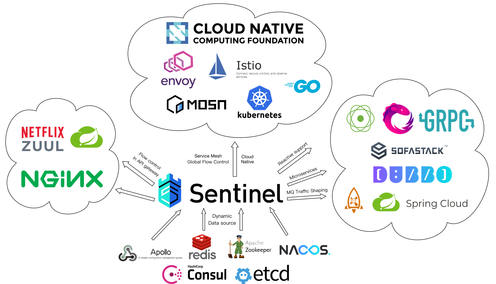
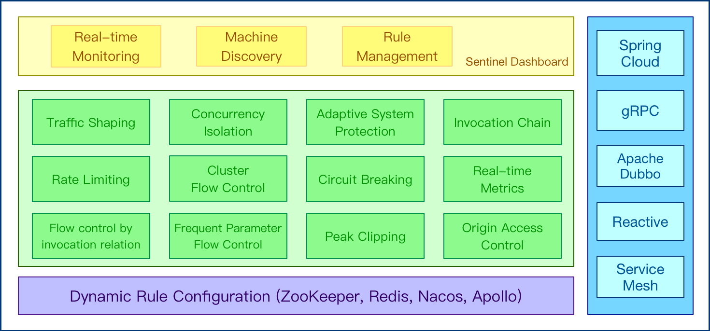
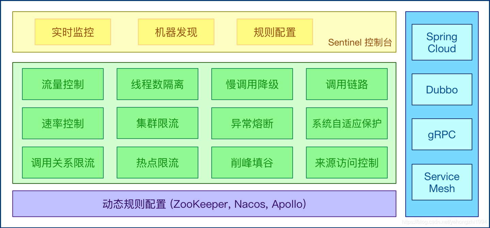
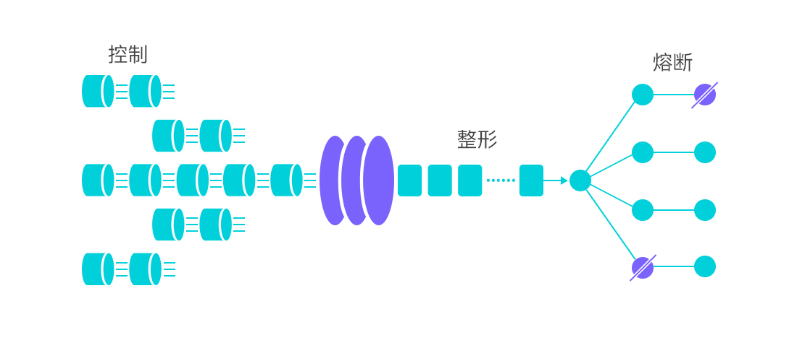
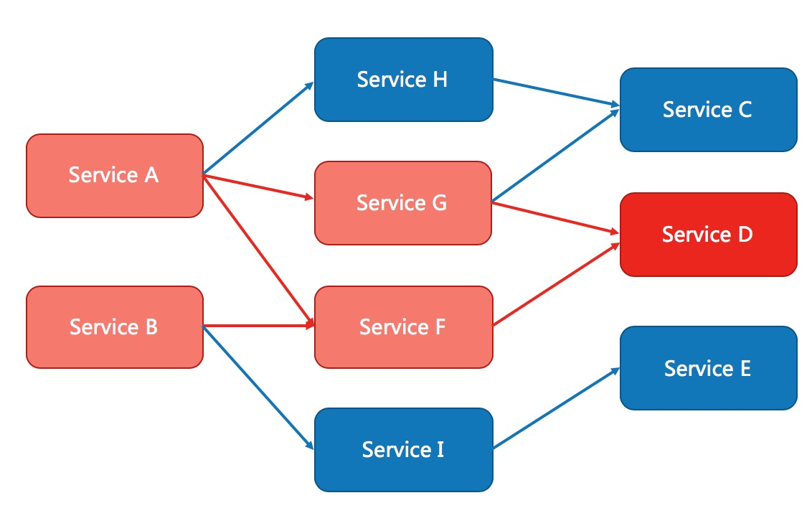
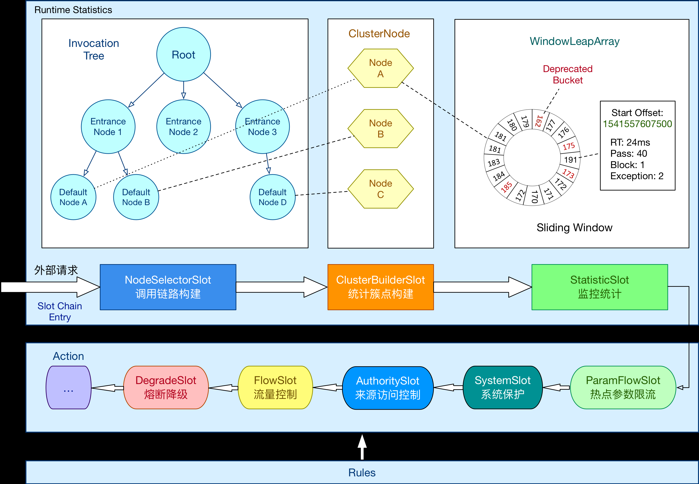
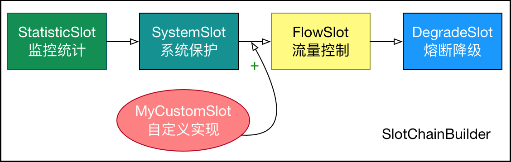
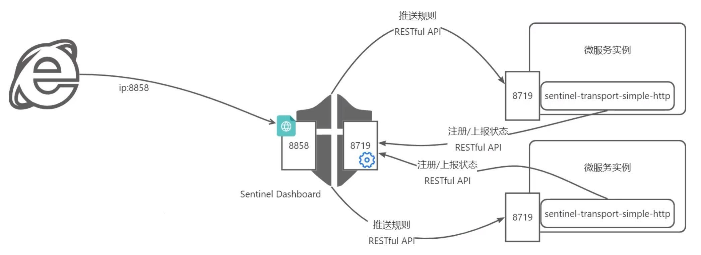

[← 返回微服务架构目录]({{ '/subjects/Microservices/' | relative_url }})



# 26 Sentinel 介绍和工作机制

## 从一次故障理解流量治理

微服务调用链中的某个下游若响应越来越慢，上游线程可能持续等待并堆积；重试又放大请求量，最终把多个服务一起拖垮，这就是常说的级联故障或“雪崩”。应分别处理不同原因，而不是寄希望于单一开关：

- **超时**限制一次调用的最长等待时间；超时后也要考虑下游工作是否仍在继续。
- **限流**限制入口速率或并发数，防止短时请求超过处理能力。
- **熔断**根据慢调用或异常统计暂时拒绝对不稳定资源的调用，让系统快速失败并留出恢复时间。
- **隔离**给不同依赖设置并发边界，避免一个慢依赖占满全部工作线程。
- **降级**在核心能力受压时减少非核心功能；具体返回什么由业务决定。

这些策略相互配合，但都不能替代容量规划、合理重试、监控和故障演练。

## Sentinel 的定位

[Sentinel](https://sentinelguard.io/zh-cn/) 是以流量为切入点的稳定性治理组件，提供流量控制、熔断降级、热点参数保护和系统自适应保护等能力。它可通过框架适配或显式 API 接入；Spring Cloud Alibaba 提供的是与 Spring 项目的集成方式，并不意味着 Sentinel 只能用于该框架。

原资料列出的 Hystrix、Resilience4j 与 Sentinel 功能表涉及不同历史版本，不能把某一时点的支持范围当作永久结论。选择时重点比较：项目维护状态、与现有框架的集成成本、需要的是 QPS 限流还是线程池隔离、规则如何持久化以及监控如何落地。**Sentinel 的并发线程数限制不等于独立线程池隔离**；它减少资源占用，却不提供完全相同的故障边界。

## 两个基础概念：资源与规则

**资源**是被保护的一段调用，可以是 HTTP URL、RPC 接口、方法或手工包裹的代码块。资源名决定规则作用于哪里，因此命名要稳定且粒度合适；把每个动态 URL 参数都当成资源名会造成统计维度膨胀。

**规则**描述对资源的约束，例如 QPS 或并发阈值、熔断条件、授权来源与系统入口保护。规则可以动态更新，但“控制台能编辑”不等于“规则已持久化”：若没有配置持久化数据源，进程重启后规则可能丢失。第 29 篇会展开规则类型。

### 流量控制

入口请求到达的时间不可控，系统容量却有限。Sentinel 可以按资源的 QPS 或并发数限制流量，并结合调用来源和链路关系判断。直接拒绝、预热和匀速排队等效果适合不同业务：排队只是在允许等待的范围内平滑短时流量，并不会提升真实吞吐能力。

### 熔断降级

当某个资源的慢调用比例、异常比例或异常数达到配置条件时，断路器进入打开状态，在熔断窗口内快速拒绝新调用；窗口结束后通常先允许探测请求，成功后再恢复。阈值必须结合**统计窗口、最小请求数、熔断时长和业务错误率**一起设置，不能只写一个“响应时间大于多少”就认为规则完整。被拒绝的请求需要应用提供合适的降级响应，不能让用户看到未处理的异常。

### 系统保护与隔离

系统保护尝试根据入口负载、CPU 使用率等指标抑制过载流量；它保护的是当前实例，不负责自动扩容。并发数规则能防止某个资源长时间占用过多执行线程，但下游调用的超时、连接池与重试仍要单独配置。

## 一次请求如何经过 Sentinel

框架适配、注解或显式 API 会为被保护的调用创建 `Entry`，然后通过一条处理链。可以按职责而不是死记类名来理解：

1. **确定调用上下文与统计维度**：识别资源、调用来源和调用路径。
2. **记录实时指标**：使用滑动窗口统计 QPS、响应时间、异常数和并发线程数等。
3. **检查规则**：依次判断流控、来源授权、熔断和系统保护等条件；不通过时抛出阻断异常或交给适配层处理。
4. **退出资源**：调用结束后正确关闭 `Entry`、记录结果。手工 API 若漏掉退出，统计会失真。

`NodeSelectorSlot`、`ClusterBuilderSlot`、`StatisticSlot`、`FlowSlot`、`AuthoritySlot`、`DegradeSlot`、`SystemSlot` 分别参与上述环节。实际处理链顺序和扩展点应以所用 Sentinel 版本为准；理解“先统计、再按规则决策、结束时更新结果”比机械背诵名称更重要。

## 核心库与控制台的关系

**核心库运行在业务进程中**，负责真正的指标统计与阻断；**Dashboard 是独立的管理界面**，用于发现机器、查看指标和配置规则。控制台失联不意味着已接入应用立即停止保护，但动态规则的推送和持久化方案仍需设计。下一篇先搭建控制台，再将客户端接入并验证流量路径。



<nav class="article-end" aria-label="章节导航">
  <a href="{{ '/subjects/Microservices/25-nacos-examples.html' | relative_url }}">← 上一篇：Nacos 案例</a>
  <a href="{{ '/subjects/Microservices/' | relative_url }}">返回专题目录</a>
  <a href="{{ '/subjects/Microservices/27-sentinel-dashboard.html' | relative_url }}">下一篇：Sentinel Dashboard →</a>
</nav>
