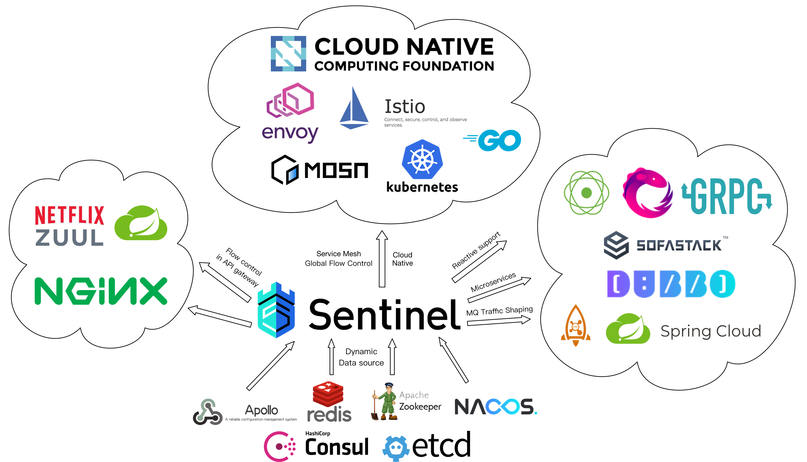
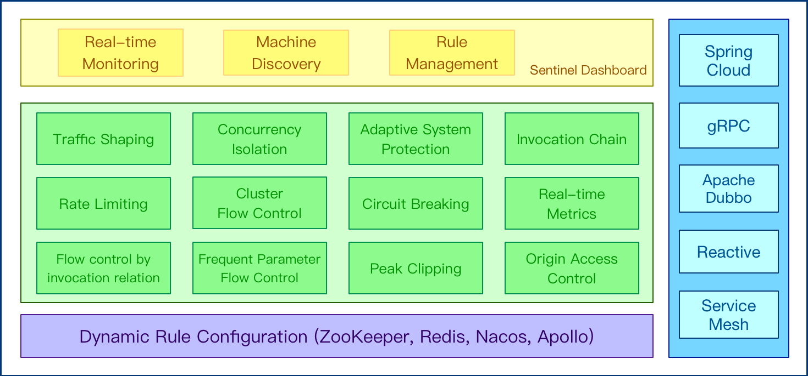
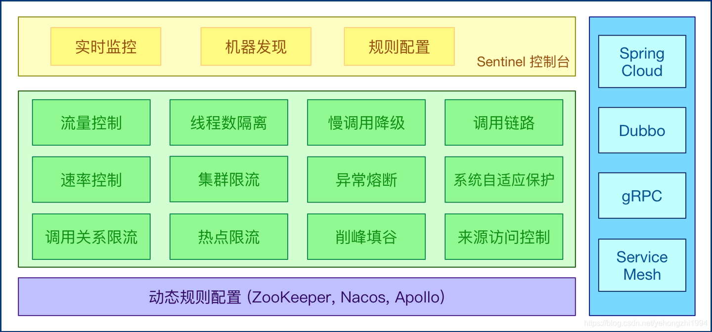
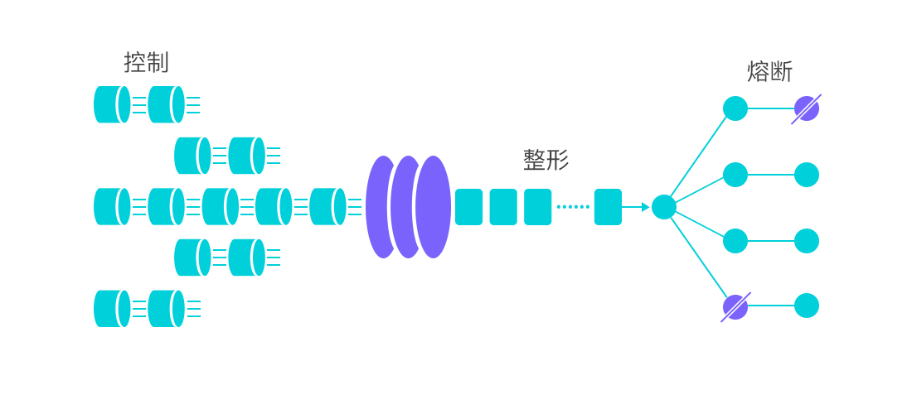
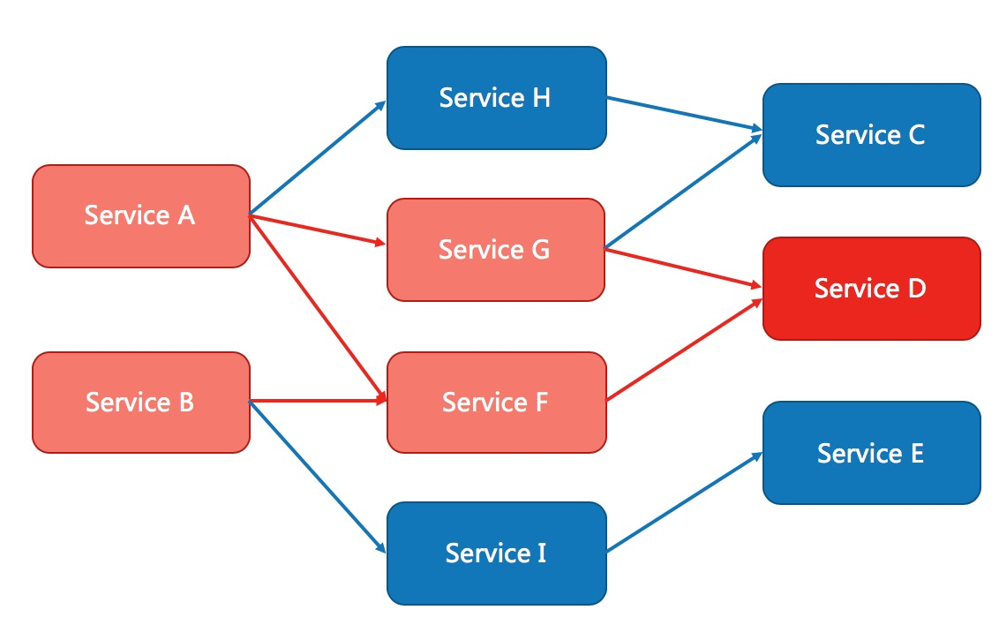
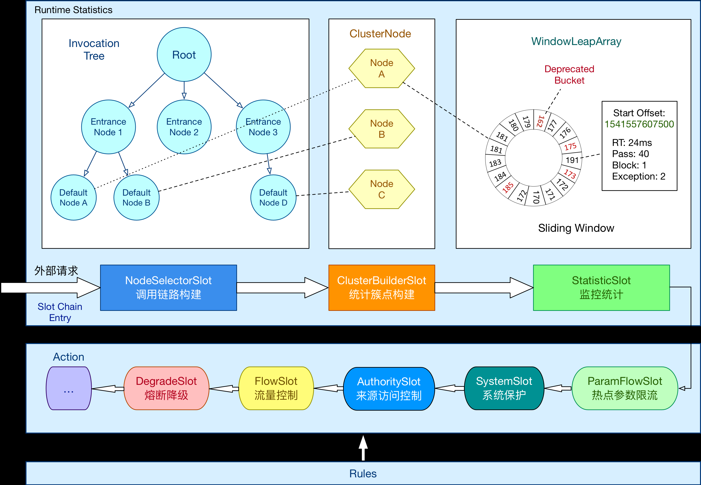
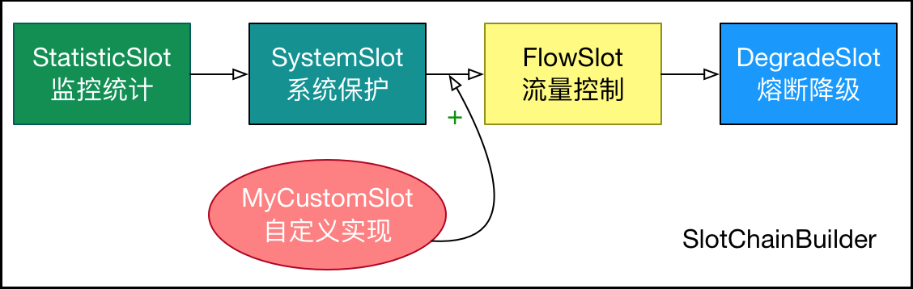
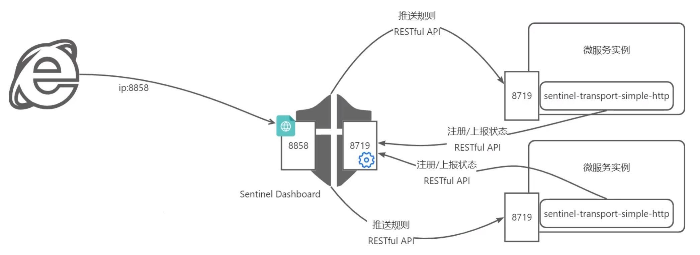

[← Back to Microservices Index]({{ '/subjects/Microservices/' | relative_url }})



# 26 Sentinel Architecture and Mechanisms
## 5 Sentinel（学习）

### 5.1 Sentinel 介绍和工作机制

### 微服务流量治理组件介绍

随着微服务的流行，服务和服务之间的调用导致服务的稳定性问题变得越来越重要

雪崩问题: 微服务调用链路中的某个服务故障，引起整个链路中的所有微服务都不可用，即雪崩。

解决雪崩问题的常见方式有四种:

超时处理:设定超时时间，请求超过一定时间没有响应就返回错误信息，不会无休止等待流量控制:限制业务访问的QPS,避免服务因流量的突增而故障。 熔断降级:由断路器统计业务执行的异常比例，如果超出阈值则会熔断该业务,拦截访问该业务的一切请求。当系统资源（如 CPU、内存、线程池）紧张或某服务负载过高时，主动暂时舍弃部分非核心功能或降低服务质量，以保证核心功能的可用性，通过牺牲部分功能来维持系统整体的可用性，避免因局部问题导致全局崩溃。 舱壁模式:限定每个业务能使用的线程数，避免耗尽整个tomcat的资源， 因此也叫线程隔离。

同类组件功能对比

<https://github.com/alibaba/Sentinel/wiki/%E5%9C%A8%E7%94%9F%E4%BA%A7%E7%8E%AF%E5%A2%83%E4%B8%AD%E4%BD%BF%E7%94%A8-Sentinel>

<https://github.com/Netflix/Hystrix>

Sentinel Hystrix（最后更新2018-

11-17） resilience4j

隔离策略信号量隔离（并发控制） 线程池隔离/信号量隔离信号量隔离

熔断降级策略基于慢调用比例、异常比例、异常数基于异常比例基于异常比例、响应时间

实时统计实现滑动窗口（LeapArray） 滑动窗口（基于 RxJava） Ring Bit Buffer

动态规则配置支持近十种动态数据源支持多种数据源有限支持

扩展性多个扩展点插件的形式接口的形式

基于注解的支持支持支持支持

单机限流基于 QPS，支持基于调用关系的限流有限的支持 Rate Limiter

集群流控支持不支持不支持

流量整形支持预热模式与匀速排队控制效果不支持简单的 Rate Limiter 模式

系统自适应保护支持不支持不支持

热点识别/防护支持不支持不支持

多语言支持 Java/Go/C++ Java Java

Service Mesh 支持支持 Envoy/Istio 不支持不支持

控制台提供开箱即用的控制台，可配置规则、实时监

控、机器发现等简单的监控查看不提供控制台，可对接其它

监控系统

### Sentinel 介绍

<https://sentinelguard.io/zh-cn/>

<https://github.com/alibaba/spring-cloud-alibaba/wiki/Sentinel>

<https://github.com/alibaba/Sentinel/>

<https://github.com/sentinel-group>

<https://github.com/alibaba/sentinel-golang>

Sentinel 是 Spring Cloud Alibaba开发框架的众多组件之一

Sentinel 是阿里巴巴开发的面向云原生微服务的面向分布式、高可用、多语言异构化服务架构的流量治理组件

Sentinel 主要以流量为切入点，从流量路由、流量控制、流量整形、熔断降级、系统自适应过载保护、热点流量防护等多个维度来帮助开发者保障微服务的稳定性。

Sentinel 的历史

2012 年，Sentinel 诞生，主要功能为入口流量控制。 2013-2017 年，Sentinel 在阿里巴巴集团内部迅速发展，成为基础技术模块，覆盖了所有的核心场景。Sentinel 也因此积累了大量的流量归整场景以及生产实践。 2018 年，Sentinel 开源，并持续演进。 2019 年，Sentinel 朝着多语言扩展的方向不断探索，推出 C++ 原生版本，同时针对 Service Mesh 场景也推出了 Envoy 集群流量控制支持，以解决 Service Mesh 架构下多语言限流的问题。 2020 年，推出 Sentinel Go 版本，继续朝着云原生方向演进。 2021 年，Sentinel 正在朝着 2.0 云原生高可用决策中心组件进行演进；同时推出了 Sentinel Rust 原生版本。同时我们也在 Rust 社区进行了 Envoy WASM extension 及 eBPF extension 等场景探索。 2022 年，Sentinel 品牌升级为流量治理，领域涵盖流量路由/调度、流量染色、流控降级、过载保护/实例摘除等；同时社区将流量治理相关标准抽出到 OpenSergo 标准中，Sentinel 作为流量治理标准实现。

Sentinel 具有以下特征:

丰富的应用场景： Sentinel 承接了阿里巴巴近 10 年的双十一大促流量的核心场景，例如秒杀（即突发流量控制在系统容量可以承受的范围）、消息削峰填谷、实时熔断下游不可用应用等。 完备的实时监控： Sentinel 同时提供实时的监控功能。您可以在控制台中看到接入应用的单台机器秒级数据，甚至 500 台以下规模的集群的汇总运行情况。 广泛的开源生态： Sentinel 提供开箱即用的与其它开源框架/库的整合模块，例如与 Spring Cloud、Dubbo、gRPC 的整合。您只需要引入相应的依赖并进行简单的配置即可快速地接入 Sentinel。 完善的 SPI 扩展点： Sentinel 提供简单易用、完善的 SPI 扩展点。您可以通过实现扩展点，快速的定制逻辑。例如定制规则管理、适配数据源等。

### Sentinel 基本概念

资源

资源是 Sentinel 的关键概念。它可以是 Java 应用程序中的任何内容，例如，由应用程序提供的服务，或由应用程序调用的其它应用提供的服务，甚至可以是一段代码。在接下来的文档中，我们都会用资源来描述代码块。

只要通过 Sentinel API 定义的代码，就是资源，能够被 Sentinel 保护起来。大部分情况下，可以使用方法签名，URL，甚至服务名称作为资源名来标示资源。

资源在java中的资源一般是接口方法。通常就是一个URL，比如：/hello/get

规则

围绕资源的实时状态设定的规则，可以包括流量控制规则、熔断降级规则以及系统保护规则。所有规则可以动态实时调整。

### Sentinel 功能和设计理念

<https://sentinelguard.io/zh-cn/docs/introduction.html>

流量控制

流量控制在网络传输中是一个常用的概念，它用于调整网络包的发送数据。然而，从系统稳定性角度考虑，在处理请求的速度上，也有非常多的讲究。任意时间到来的请求往往是随机不可控的，而系统的处理能力是有限的。我们需要根据系统的处理能力对流量进行控制。 Sentinel 作为一个调配器，可以根据需要把随机的请求调整成合适的形状，如下图所示：

流量控制有以下几个角度:

资源的调用关系，例如资源的调用链路，资源和资源之间的关系； 运行指标，例如 QPS、线程池、系统负载等； 控制的效果，例如直接限流、冷启动、排队等。

Sentinel 的设计理念是让您自由选择控制的角度，并进行灵活组合，从而达到想要的效果。

熔断降级

除了流量控制以外，降低调用链路中的不稳定资源也是 Sentinel 的使命之一。由于调用关系的复杂性，如果调用链路中的某个资源出现了不稳定，最终会导致请求发生堆积。

当调用链路中某个资源出现不稳定，例如，表现为 timeout，异常比例升高的时候，则对这个资源的调用进行限制，并让请求快速失败，避免影响到其它的资源而导致产生雪崩的效果。

当资源被降级后，在接下来的降级时间窗口之内，对该资源的调用都自动熔断（默认行为是抛出DegradeException)。当访问系统失败超过一定的次数后，对该接口进行熔断的操作。

熔断降级设计理念

在限制的手段上，Sentinel 和 Hystrix 采取了完全不一样的方法。

Hystrix 通过线程池的方式，来对依赖(在我们的概念中对应资源)进行了隔离。这样做的好处是资源和资源之间做到了最彻底的隔离。缺点是除了增加了线程切换的成本，还需要预先给各个资源做线程池大小的分配。

Sentinel 对这个问题采取了两种手段:

通过并发线程数进行限制

和资源池隔离的方法不同，Sentinel 通过限制资源并发线程的数量，来减少不稳定资源对其它资源的影响。这样不但没有线程切换的损耗， 也不需要您预先分配线程池的大小。当某个资源出现不稳定的情况下，例如响应时间变长，对资源的直接影响就是会造成线程数的逐步堆积。当线程数在特定资源上堆积到一定的数量之后，对该资源的新请求就会被拒绝。堆积的线程完成任务后才开始继续接收请求。

通过响应时间对资源进行降级

除了对并发线程数进行控制以外，Sentinel 还可以通过响应时间来快速降级不稳定的资源。当依赖的资源出现响应时间过长后，所有对该资源的访问都会被直接拒绝，直到过了指定的时间窗口之后才重新恢复。

系统负载保护

Sentinel 同时提供系统维度的自适应保护能力。防止雪崩，是系统防护中重要的一环。当系统负载较高的时候，如果还持续让请求进入，可能会导致系统崩溃，无法响应。在集群环境下，网络负载均衡会把本应这台机器承载的流量转发到其它的机器上去。如果这个时候其它的机器也处在一个边缘状态的时候，这个增加的流量就会导致这台机器也崩溃，最后导致整个集群不可用。

针对此情况，Sentinel 提供了对应的保护机制，让系统的入口流量和系统的负载达到一个平衡，保证系统在能力范围之内处理最多的请求。

### Sentinel 工作主流程

总体的框架如下:

在 Sentinel 里面，所有的资源都对应一个资源名称以及一个 Entry。Entry 可以通过对主流框架的适配自动创建，也可以通过注解的方式或调用 API 显式创建；每一个 Entry 创建的时候，同时也会创建一系列功能插槽（slot chain）。这些插槽有不同的职责，例如:

NodeSelectorSlot 负责收集资源的路径，并将这些资源的调用路径，以树状结构存储起来，用于根据调用路径来限流降级 ClusterBuilderSlot 则用于存储资源的统计信息以及调用者信息，例如该资源的 RT, QPS, thread count 等等，这些信息将用作为多维度限流，降级的依据 StatisticSlot 则用于记录、统计不同纬度的 runtime 指标监控信息,Sentinel底层采用高性能的滑动窗口数据结构LeapArray来统计实时的秒级指标数据,可以很好地支撑写多于读的高并发场景 FlowSlot 则用于根据预设的限流规则以及前面 slot 统计的状态，来进行流量控制 AuthoritySlot 则根据配置的黑白名单和调用来源信息，来做黑白名单控制 DegradeSlot 则通过统计信息以及预设的规则，来做熔断降级 SystemSlot 则通过系统的状态，例如 load1 等，来控制总的入口流量

Sentinel 将 ProcessorSlot 作为 SPI 接口进行扩展（1.7.2 版本以前 SlotChainBuilder 作为 SPI），使得 Slot Chain 具备了扩展的能力。您可以自行加入自定义的 slot 并编排 slot 间的顺序，从而可以给 Sentinel 添加自定义的功能。

### Sentinel 架构

### Sentinel 的构成

Sentinel 的构成可以分为两个部分:

核心库（Java 客户端）： 开发人员通过JAVA调用，不依赖任何框架/库，能够运行于 Java 8 及以上的版本的运行时环境，同时对 Dubbo / Spring Cloud 等框架也有较好的支持（见 主流框架适配）。 控制台（Dashboard）： 可以由运维部署，Dashboard 主要负责管理推送规则、监控、管理机器信息等。



<nav class="article-end" aria-label="章节导航">
  <a href="{{ '/subjects/Microservices/25-nacos-examples.html' | relative_url }}">← Previous: Nacos Examples</a>
  <a href="{{ '/subjects/Microservices/' | relative_url }}">Back to Microservices Index</a>
  <a href="{{ '/subjects/Microservices/27-sentinel-dashboard.html' | relative_url }}">Next: Sentinel Dashboard →</a>
</nav>
