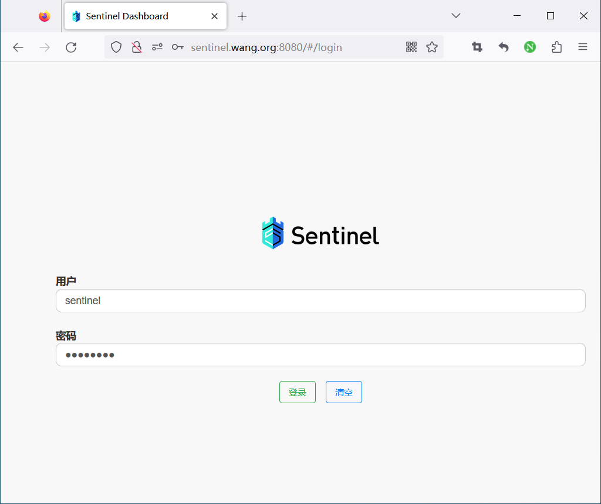
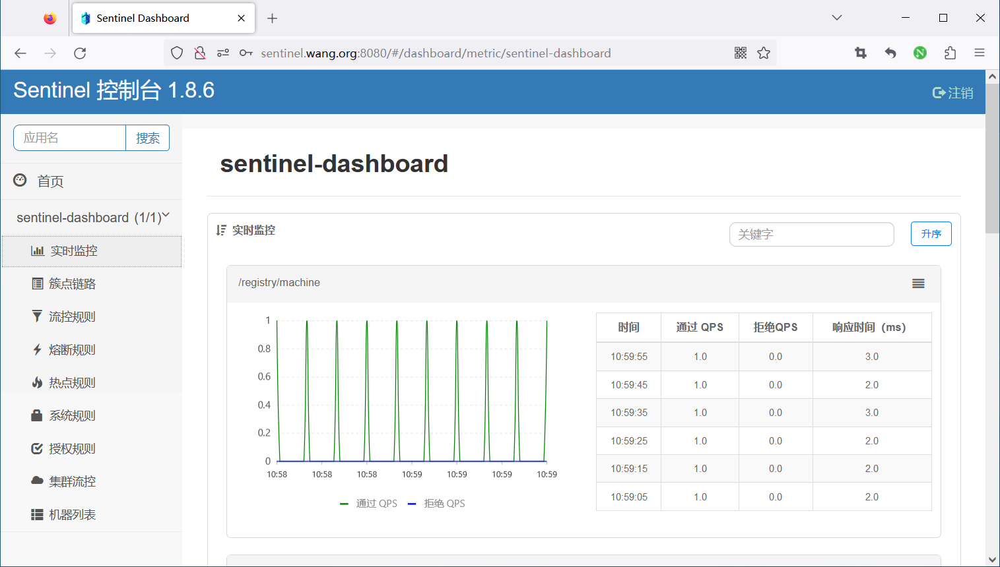
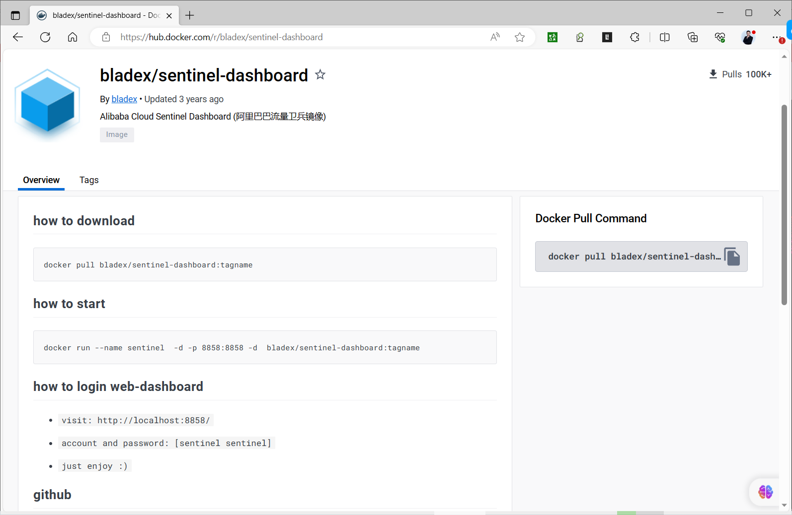
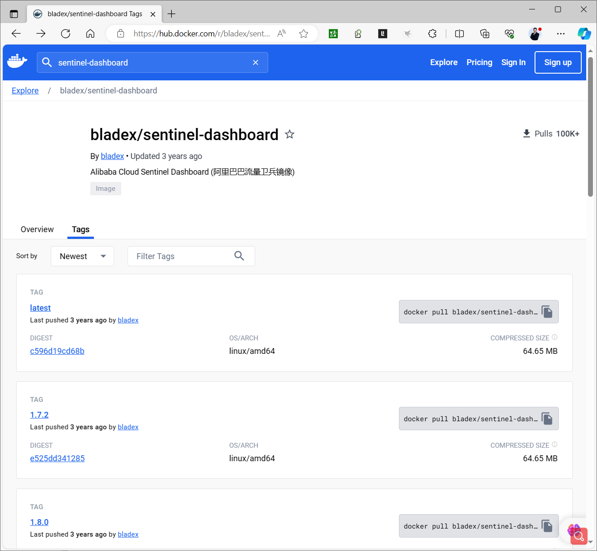
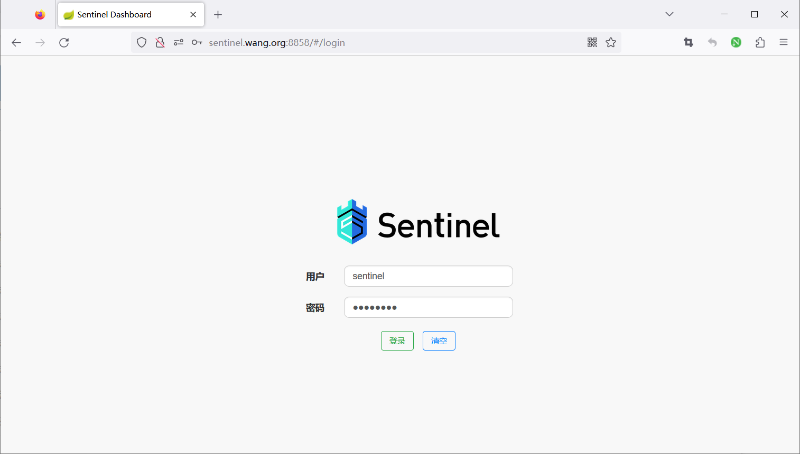
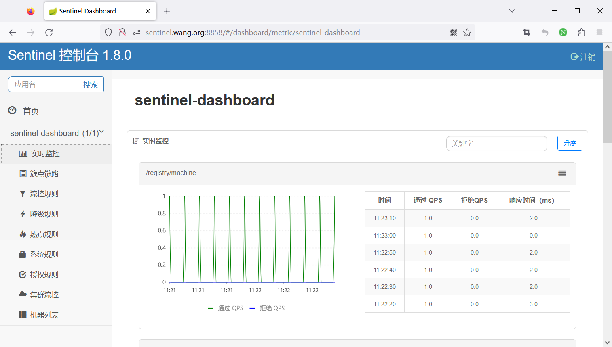
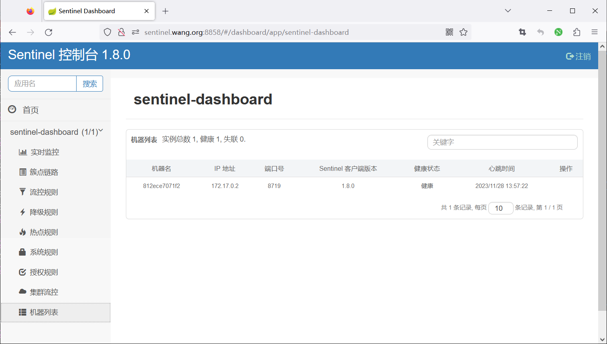

[← Back to Microservices Index]({{ '/subjects/Microservices/' | relative_url }})



# 27 Sentinel Dashboard
### 5.2 Sentinel 控制台

### 概述

Sentinel 提供一个轻量级的开源控制台，它提供机器发现以及健康情况管理、监控（单机和集群），规则管理和推送的功能。

Sentinel 控制台包含如下功能:

查看机器列表以及健康情况：收集 Sentinel 客户端发送的心跳包，用于判断机器是否在线。 监控 (单机和集群聚合)：通过 Sentinel 客户端暴露的监控 API，定期拉取并且聚合应用监控信息，最终可以实现秒级的实时监控。 流量控制降级控制规则管理和推送：统一管理推送规则。 鉴权：生产环境中鉴权非常重要。这里每个开发者需要根据自己的实际情况进行定制。

注意：Sentinel 控制台目前仅支持单机部署。Sentinel 控制台项目提供 Sentinel 功能全集示例，不作为开箱即用的生产环境控制台，若希望在生产环境使用请根据文档自行进行定制和改造。

### 部署和启动控制台

安装方法说明

源码编译安装二进制安装 docker 启动 docker compose 启动

### Java 二进制启动控制台

下载最新版本的控制台 jar 包。

<https://github.com/alibaba/Sentinel/releases>

<https://github.com/alibaba/Sentinel/wiki/%E6%8E%A7%E5%88%B6%E5%8F%B0>

您也可以从最新版本的源码自行构建 Sentinel 控制台：

下载控制台工程

<https://github.com/alibaba/Sentinel/tree/master/sentinel-dashboard>

使用以下命令将代码打包成一个 fat jar: mvn clean package

注意：启动 Sentinel 控制台需要 JDK 版本为 1.8 及以上版本。

Sentinel 控制台是一个标准的 Spring Boot 应用，以 Spring Boot 的方式运行 jar 包即可。

使用如下命令启动控制台：

```text
java -Dserver.port=8080 -Dcsp.sentinel.dashboard.server=localhost:8080 -Dproject.name=sentinel-dashboard -jar
sentinel-dashboard.jar
```

其中 -Dserver.port=8080 用于指定 Sentinel 控制台端口为 8080 。

APP 启动时加入 JVM 参数 -Dcsp.sentinel.dashboard.server=consoleIp:port 指定控制台地址和端口

从 Sentinel 1.6.0 起，Sentinel 控制台引入基本的登录功能，默认用户名和密码都是 sentinel 。可以参考 鉴权模块文档 配置用户名和密码。

范例:  Java 包启动控制台

```bash
#需要做主机名解析，否则可以会解析到互联网IP
[root@ubuntu2404 ~]#cat /etc/hosts
10.0.0.101 ubuntu2404.bowen.org
#安装JDK8或以上版本
[root@ubuntu2404 ~]#apt update && apt -y install openjdk-21-jdk
[root@ubuntu2404 ~]#apt update && apt -y install openjdk-17-jdk
[root@ubuntu2204 ~]#apt update && apt -y install openjdk-8-jdk
[root@ubuntu2204 ~]#apt update && apt -y install openjdk-11-jdk
[root@ubuntu2204 ~]#SENTINEL_VERSION=1.8.8
[root@ubuntu2204 ~]#SENTINEL_VERSION=1.8.6
#下载
[root@ubuntu2204 ~]#wget https://github.com/alibaba/Sentinel/releases/download/${SENTINEL_VERSION}/sentinel-
dashboard-${SENTINEL_VERSION}.jar
#如果下载失败或慢,可以代理加速
[root@ubuntu2204 ~]#wget
https://githubfast.com/alibaba/Sentinel/releases/download/${SENTINEL_VERSION}/sentinel-
dashboard-${SENTINEL_VERSION}.jar
#启动
[root@ubuntu2204 ~]#java -Dserver.port=8080 -Dcsp.sentinel.dashboard.server=localhost:8080 -
Dproject.name=sentinel-dashboard -jar sentinel-dashboard-${SENTINEL_VERSION}.jar
#浏览器使用默认用户名和密码sentinel登录访问
http://sentinel.bowen.org:8080
```





范例：二进制安装Sentinel dashboard脚本

```bash
#!/bin/bash
#
#FileName:          install_sentinel.sh
#Description:       The test script
#支持在线和离线安装
#注意：从国内在线下载可能会失败，建议离线安装
SENTINEL_VERSION=1.8.6
#SENTINEL_VERSION=1.8.0
SENTINEL_FILE=sentinel-dashboard-${SENTINEL_VERSION}.jar
GITHUB_MIRROR=https://mirror.ghproxy.com/
SENTINEL_URL=${GITHUB_MIRROR}https://github.com/alibaba/Sentinel/releases/download/${SENTINEL_VERSION}/$SENTIN
EL_FILE
INSTALL_DIR=/usr/local/sentinel
HOST=`hostname -I|awk '{print $1}'`
.  /etc/os-release
color () {
RES_COL=60
MOVE_TO_COL="echo -en \\033[${RES_COL}G"
SETCOLOR_SUCCESS="echo -en \\033[1;32m"
SETCOLOR_FAILURE="echo -en \\033[1;31m"
SETCOLOR_WARNING="echo -en \\033[1;33m"
SETCOLOR_NORMAL="echo -en \E[0m"
echo -n "$1" && $MOVE_TO_COL
echo -n "["
if [ $2 = "success" -o $2 = "0" ] ;then
${SETCOLOR_SUCCESS}
echo -n $"  OK  "
elif [ $2 = "failure" -o $2 = "1"  ] ;then
${SETCOLOR_FAILURE}
echo -n $"FAILED"
else
${SETCOLOR_WARNING}
echo -n $"WARNING"
fi
${SETCOLOR_NORMAL}
echo -n "]"
echo
}
install_jdk() {
java -version &>/dev/null && { color "JDK 已安装!" 1 ; return;  }
if command -v yum &>/dev/null ; then
yum -y install java-1.8.0-openjdk-devel || { color "安装JDK失败!" 1; exit 1; }
elif command -v apt &>/dev/null ; then
apt update
#apt install openjdk-11-jdk -y || { color "安装JDK失败!" 1; exit 1; }
apt install openjdk-8-jdk -y || { color "安装JDK失败!" 1; exit 1; }
else
color "不支持当前操作系统!" 1
exit 1
fi
java -version && { color "安装 JDK 完成!" 0 ; } || { color "安装JDK失败!" 1; exit 1; }
}
```

```bash
install_sentinel() {
if [ -f ${SENTINEL_FILE} ] ;then
mkdir -p ${INSTALL_DIR}/bin/
cp ${SENTINEL_FILE} ${INSTALL_DIR}
else
wget -P ${INSTALL_DIR} --no-check-certificate ${SENTINEL_URL} || { color  "下载失败!" 1 ;exit 1; }
fi
cat > ${INSTALL_DIR}/bin/startup.sh <<EOF
#!/bin/bash
#
nohup java -Dserver.port=8080 -Dcsp.sentinel.dashboard.server=localhost:8080 -Dproject.name=sentinel-dashboard
-jar ${INSTALL_DIR}/sentinel-dashboard-${SENTINEL_VERSION}.jar &
EOF
chmod +x ${INSTALL_DIR}/bin/startup.sh
cat > /lib/systemd/system/sentinel.service <<EOF
[Unit]
Description=sentinel.service
After=network.target
[Service]
Type=forking
ExecStart=${INSTALL_DIR}/bin/startup.sh
[Install]
WantedBy=multi-user.target
EOF
systemctl daemon-reload
systemctl enable --now sentinel.service
}
start_sentinel () {
systemctl is-active sentinel.service
if [ $? -eq 0 ] ;then
color "sentinel 安装成功!" 0
echo "-------------------------------------------------------------------"
echo -e "请访问链接: \E[32;1mhttp://$HOST:8080/\E[0m"
echo -e "用户/密码: \E[32;1msentinel/sentinel\E[0m"
else
color "sentinel 安装失败!" 1
exit 1
fi
}
```

```text
install_jdk
install_sentinel
start_sentinel
```

### Docker 启动

```text
#非官方镜像,更新缓慢
https://hub.docker.com/r/bladex/sentinel-dashboard
```





```text
docker run --name sentinel -d -p 8858:8858 bladex/sentinel-dashboard:tagname
#默认用户名和密码都是sentinel
```

范例:

```bash
[root@ubuntu2204 ~]#apt update && apt -y install docker.io
[root@ubuntu2204 ~]#docker pull bladex/sentinel-dashboard:latest
[root@ubuntu2204 ~]#docker images
REPOSITORY                  TAG       IMAGE ID       CREATED       SIZE
bladex/sentinel-dashboard   latest    aa398704ebd3   3 years ago   147MB
[root@ubuntu2204 ~]#docker run --name sentinel -d -p 8858:8858 -p 8719:8719 bladex/sentinel-dashboard
[root@ubuntu2204 ~]#docker ps
CONTAINER ID   IMAGE                       COMMAND                  CREATED        STATUS        PORTS
NAMES
812ece7071f2   bladex/sentinel-dashboard   "java -Djava.securit…"   1 second ago   Up 1 second   0.0.0.0:8719-
>8719/tcp, :::8719->8719/tcp, 0.0.0.0:8858->8858/tcp, :::8858->8858/tcp   sentinel
#浏览器使用默认用户名和密码sentinel登录访问
http://sentinel.bowen.org:8858
```







### Docker Compose 启动

范例:   docker-compose 部署 Sentinel dashboard

```yaml
[root@ubuntu2204 sentinel]#cat docker-compose.yaml
version: "3"
services:
sentinel:
image: bladex/sentinel-dashboard:latest
container_name: sentinel
restart: always
ports:
- 8858:8858
- 8719:8719
networks:
- sentinel-net
networks:
sentinel-net:
[root@ubuntu2204 sentinel]#docker-compose up -d
```

范例:  docker-compose 部署Sentinel dashboard和 Nacos

```yaml
[root@ubuntu2204 sentinel-nacos]#cat docker-compose.yaml
version: "2"
services:
sentinel:
image: bladex/sentinel-dashboard:latest
container_name: sentinel
restart: always
networks:
macvlan100:
ipv4_address: 192.168.100.100
nacos:
image: nacos/nacos-server:v2.2.1-slim
container_name: nacos
restart: always
environment:
- PREFER_HOST_MODE=hostname
- MODE=standalone
- SPRING_DATASOURCE_PLATFORM=mysql
- MYSQL_SERVICE_HOST=192.168.100.101
- MYSQL_SERVICE_DB_NAME=nacos
- MYSQL_SERVICE_PORT=3306
- MYSQL_SERVICE_USER=nacos
- MYSQL_SERVICE_PASSWORD=nacos
-
MYSQL_SERVICE_DB_PARAM=characterEncoding=utf8&connectTimeout=1000&socketTimeout=3000&autoReconnect=true&useSSL
=false&allowPublicKeyRetrieval=true
- NACOS_AUTH_IDENTITY_KEY=2222
- NACOS_AUTH_IDENTITY_VALUE=2xxx
- NACOS_AUTH_TOKEN=SecretKey012345678901234567890123456789012345678901234567890123456789
depends_on:
- mysql
networks:
macvlan100:
ipv4_address: 192.168.100.101
mysql:
container_name: mysql
image: mysql:8
volumes:
- ./sql:/docker-entrypoint-initdb.d
restart: always
environment:
- MYSQL_ROOT_PASSWORD=root
- MYSQL_DATABASE=nacos
- MYSQL_USER=nacos
- MYSQL_PASSWORD=nacos
networks:
macvlan100:
ipv4_address: 192.168.100.102
networks:
macvlan100:
driver: macvlan
driver_opts:
parent: eth0
ipam:
driver: default
config:
- subnet: 192.168.100.0/24
ip_range: 192.168.100.0/24
gateway: 192.168.100.1
[root@ubuntu2204 sentinel-nacos]#docker-compose up -d
[root@ubuntu2204 ~]#docker ps
CONTAINER ID   IMAGE                              COMMAND                  CREATED          STATUS
PORTS     NAMES
205177cd6e67   nacos/nacos-server:v2.2.1-slim     "bin/docker-startup.…"   17 seconds ago   Up 15 seconds
nacos
322095462d5f   bladex/sentinel-dashboard:latest   "java -Djava.securit…"   17 seconds ago   Up 16 seconds
sentinel
7b67f782ba9a   mysql:8                            "docker-entrypoint.s…"   17 seconds ago   Up 16 seconds
mysql
```



<nav class="article-end" aria-label="章节导航">
  <a href="{{ '/subjects/Microservices/26-sentinel-architecture-and-mechanisms.html' | relative_url }}">← Previous: Sentinel Architecture and Mechanisms</a>
  <a href="{{ '/subjects/Microservices/' | relative_url }}">Back to Microservices Index</a>
  <a href="{{ '/subjects/Microservices/28-connecting-java-clients-to-sentinel-dashboard.html' | relative_url }}">Next: Connecting Java Clients to Sentinel Dashboard →</a>
</nav>
