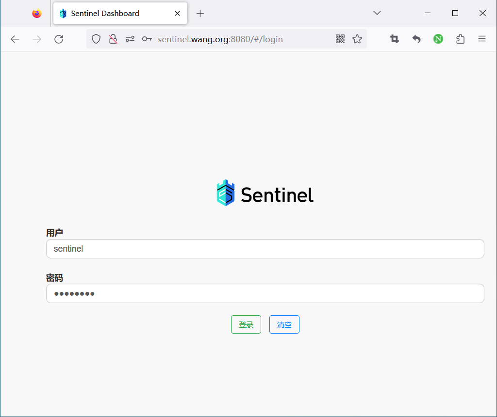
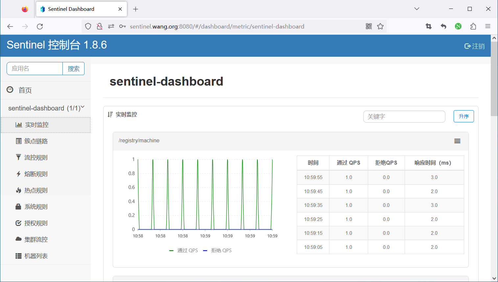
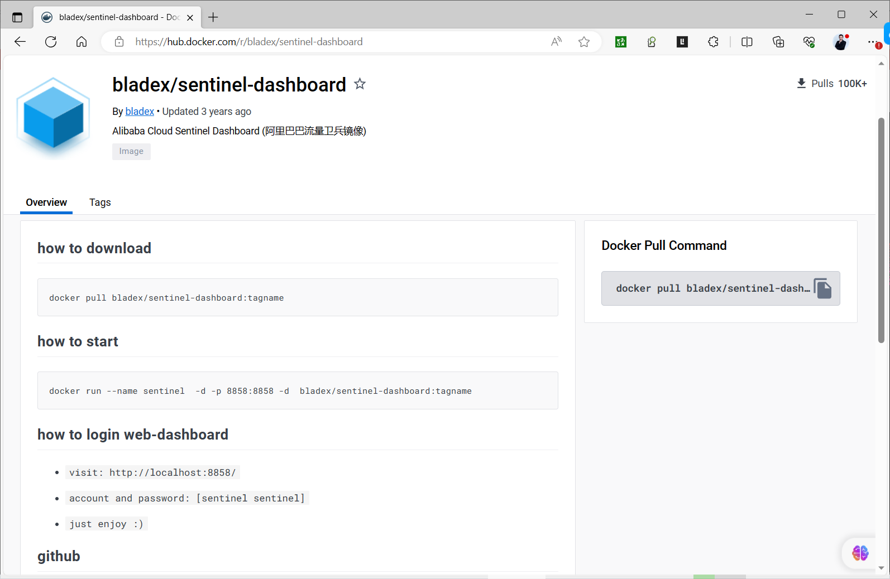
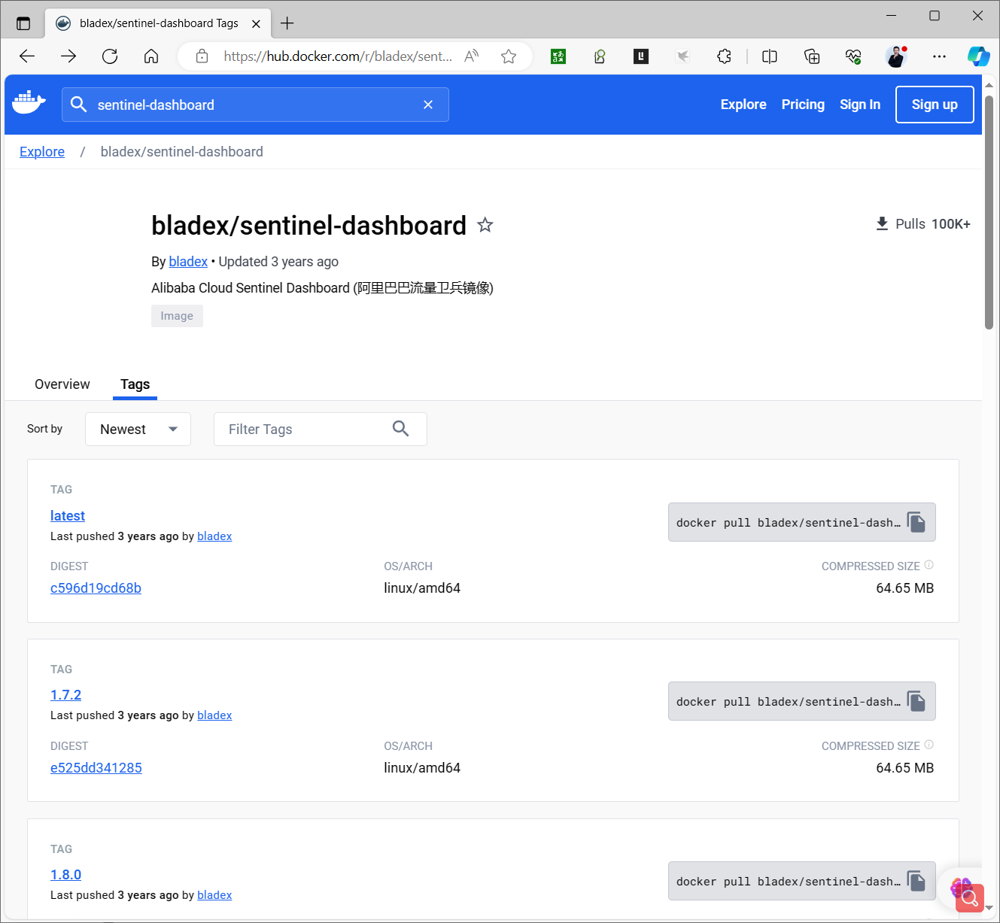
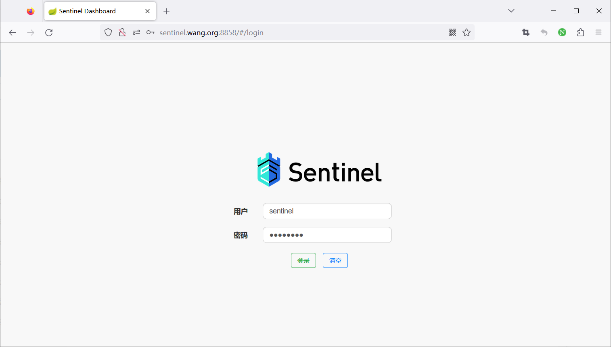
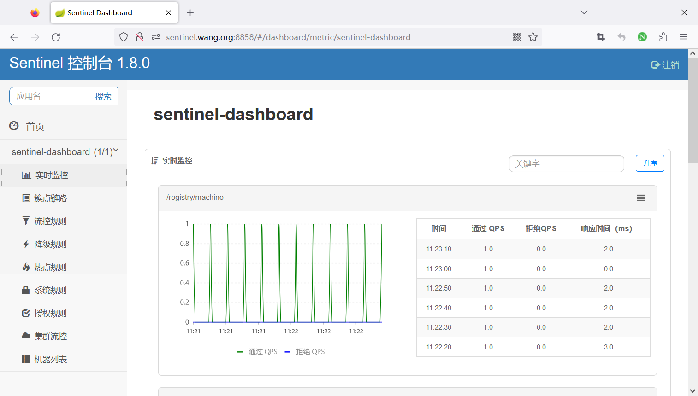
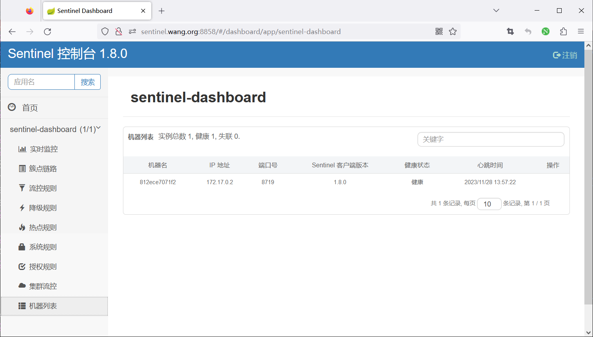

[← 返回微服务架构目录]({{ '/subjects/Microservices/' | relative_url }})



# 27 Sentinel 控制台

## 控制台能做什么

Sentinel Dashboard 是独立于业务应用的管理界面。它接收客户端心跳，展示接入机器和部分实时指标，并通过客户端接口管理流控、熔断等规则。**真正执行流量判断的是业务进程中的 Sentinel 核心库**；控制台没有接管业务请求。应用尚未接入或从未访问过受保护资源时，页面可能没有资源数据，这不一定是控制台启动失败。

开源控制台适合学习和开发验证。若用于生产，需要自行考虑账号权限、网络隔离、持久化规则、监控留存、审计和可用性。控制台页面里临时编辑的规则默认不等于持久配置；重启客户端后可能丢失。

## 用发行包启动

从 [Sentinel Releases](https://github.com/alibaba/Sentinel/releases) 下载与你的客户端兼容的 Dashboard JAR，并核对该版本所需的 JDK。以下沿用原资料的 1.8.6 演示，固定版本是为了避免“下载最新版、运行旧命令”的混用：

```bash
SENTINEL_VERSION=1.8.6
wget "https://github.com/alibaba/Sentinel/releases/download/${SENTINEL_VERSION}/sentinel-dashboard-${SENTINEL_VERSION}.jar"
java -Dserver.port=8080 -Dproject.name=sentinel-dashboard \
  -jar "sentinel-dashboard-${SENTINEL_VERSION}.jar"
```

`-Dserver.port` 决定控制台监听端口。原资料在控制台启动命令里又写了 `-Dcsp.sentinel.dashboard.server=localhost:8080`，这个参数的主要用途是**告诉被监控的客户端控制台在哪里**，并不是 Dashboard 监听地址的替代配置；客户端接入将在下一篇说明。启动后在浏览器访问 `http://DASHBOARD_HOST:8080/`，先确认登录页面，再接入业务应用。




原资料中的安装脚本把下载、跳过证书检查、JDK 安装和 systemd 写入混在一起，且启动脚本中的 Java 命令被拆行，直接复制不可靠。长期运行时应使用受控目录、专用系统账号和明确的服务管理配置，并让 Java 进程以前台方式交给服务管理器托管。发布包下载失败时也不应直接改用未经核验的镜像站。

## 登录与访问限制

1.6.0 之后的演示控制台提供基础登录，历史默认账号常见为 `sentinel/sentinel`。首次运行应按所用版本文档更换凭据。这个登录机制不能代替完整的生产权限体系，更不能把 Dashboard 直接暴露在公网。客户端与控制台之间也要配置合适的网络访问规则；默认客户端通信端口通常从 8719 开始，冲突时可能递增，需看应用日志确认实际端口。

### 容器方式如何判断

原资料使用的 `bladex/sentinel-dashboard` 是**非官方第三方镜像**，其 8858 端口和镜像内配置不能直接套到官方 JAR 的 8080 示例。若项目决定使用该镜像，应固定标签、核对维护状态与镜像来源，并从实际运行日志确认端口和登录方式。下面只保留原实验的验证顺序，而不把旧的 `latest` 镜像作为通用安装命令：

1. 确认镜像对应的 Sentinel 版本、入口命令和监听端口。
2. 映射 Dashboard 的实际 HTTP 端口；8719 是**客户端**可能使用的通信端口，不应因为控制台容器存在就盲目映射。
3. 启动后检查容器日志和登录页面，再按下一篇配置客户端地址。
4. 将 Compose 文件交给 `docker compose config` 校验缩进与插值。原记录把 YAML、Shell 命令及运行输出写进同一代码块，不能直接解析。







## 验证控制台是否真正接入应用

“控制台能登录”只证明 Dashboard 自身运行。还需在客户端设置 Dashboard 地址，调用被保护的资源，观察机器心跳与指标，再下发一条可撤销的测试规则并确认请求行为改变。如果机器始终不出现，应依次检查客户端依赖、控制台地址、客户端实际通信端口、容器/主机网络和防火墙。下一篇按这个顺序完成接入。



<nav class="article-end" aria-label="章节导航">
  <a href="{{ '/subjects/Microservices/26-sentinel-architecture-and-mechanisms.html' | relative_url }}">← 上一篇：Sentinel 介绍和工作机制</a>
  <a href="{{ '/subjects/Microservices/' | relative_url }}">返回专题目录</a>
  <a href="{{ '/subjects/Microservices/28-connecting-java-clients-to-sentinel-dashboard.html' | relative_url }}">下一篇：接入 Java 客户端 →</a>
</nav>
