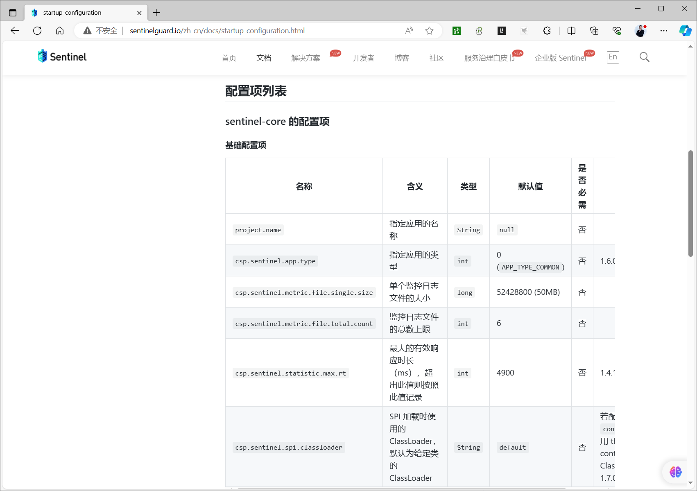
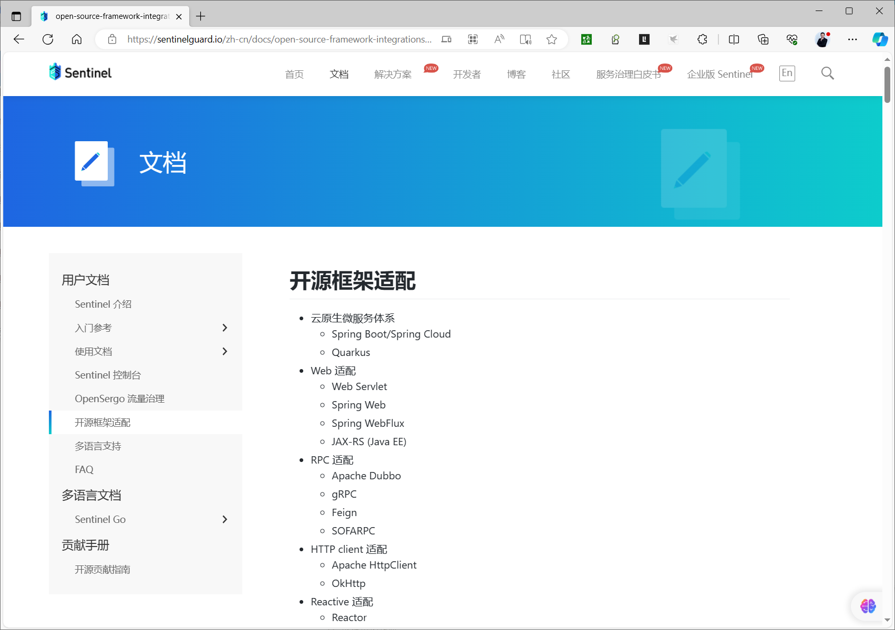
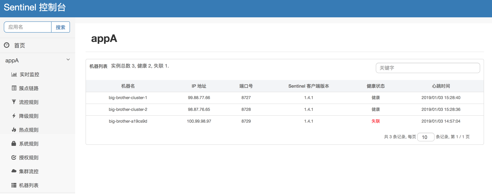
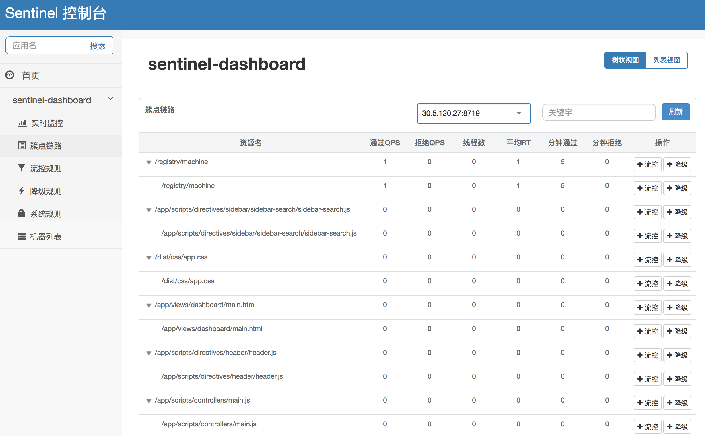
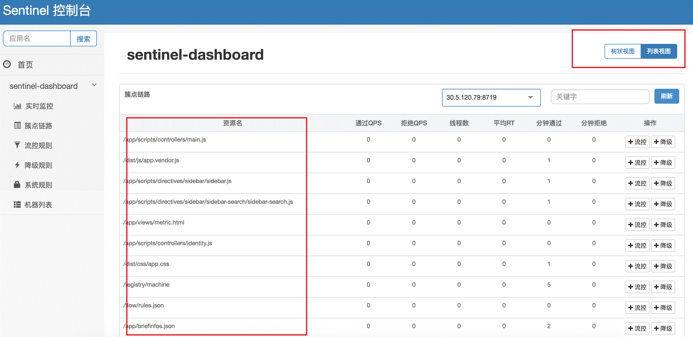
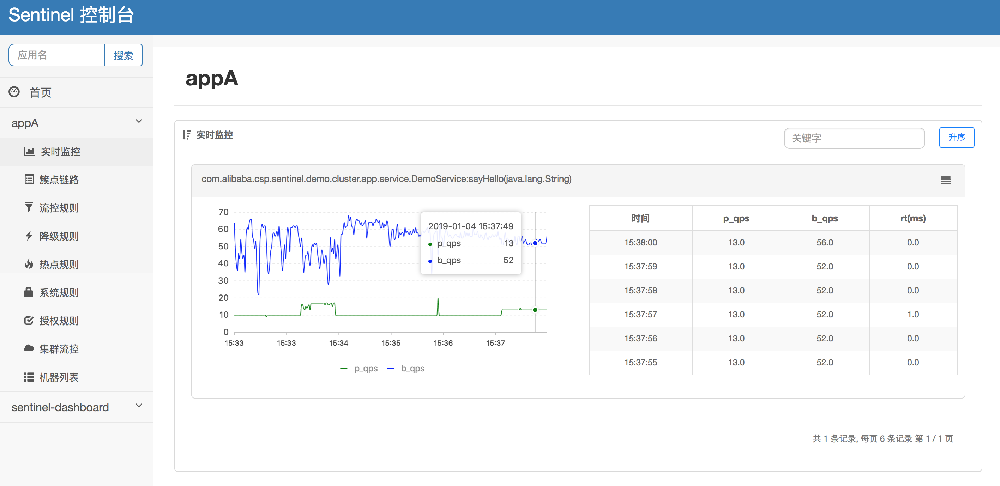

[← 返回微服务架构目录]({{ '/subjects/Microservices/' | relative_url }})



# 28 Java 客户端接入 Sentinel 控制台

控制台已经启动，但它不会自动发现任意 Java 进程。业务应用需要引入 Sentinel 依赖、指定 Dashboard 地址，并实际调用被保护的资源，客户端才会初始化并发送心跳。本篇以此为验证顺序，避免“控制台能打开，却始终没有应用”的困惑。

## 1. 选择与项目版本匹配的依赖

Spring Cloud Alibaba 项目通常引入 `spring-cloud-starter-alibaba-sentinel`，版本由与 Spring Boot、Spring Cloud 匹配的 BOM 管理。不要从 Maven 搜索页随手复制一个 `2022.0.0.0` 版本到所有项目中：

```xml
<dependency>
  <groupId>com.alibaba.cloud</groupId>
  <artifactId>spring-cloud-starter-alibaba-sentinel</artifactId>
</dependency>
```

非 Spring 集成可使用 Sentinel 核心库，再按需加入 `sentinel-transport-simple-http` 与 HTTP/RPC 等适配模块。传输模块负责 Dashboard 通信，适配模块负责把实际请求识别为资源；只有传输依赖而没有资源埋点或适配器，控制台仍可能没有业务指标。依赖版本应相互兼容，具体可对照 [Sentinel 快速开始](https://sentinelguard.io/zh-cn/docs/quick-start.html) 和所用 Spring Cloud Alibaba 版本文档。

## 2. 告诉客户端控制台在哪里

原生 Sentinel 客户端可通过 JVM 参数或 `sentinel.properties` 配置。下面的 `DASHBOARD_HOST` 必须是**应用容器或主机能够访问到的地址**，不是控制台进程自己的 `localhost`：

```bash
java -Dproject.name=sentinel-sample \
  -Dcsp.sentinel.dashboard.server=DASHBOARD_HOST:8080 \
  -Dcsp.sentinel.api.port=8719 \
  -jar sentinel-sample.jar
```

`project.name` 是 Dashboard 中的应用名；`csp.sentinel.api.port` 是客户端暴露给控制台的本地命令 API 端口，通常默认从 8719 开始，端口冲突时可能自动寻找下一个。它不是业务 HTTP 端口，也不是 Dashboard 监听端口。若同机运行多个客户端实例，分别核对它们的实际命令端口。JVM 参数应放在 `-jar` 之前、选项名不可从 `-D` 中间换行。

Spring Cloud Alibaba 项目也可使用其版本支持的 Spring 配置项，例如：

```properties
spring.application.name=sentinel-sample
spring.cloud.sentinel.transport.dashboard=DASHBOARD_HOST:8080
spring.cloud.sentinel.transport.port=8719
```

不要把两套配置混写后凭直觉推断优先级；如同时存在，查看启动日志和最终生效配置。



## 3. 调用资源，触发初始化

Sentinel 的资源统计通常在首次调用被保护资源后才出现。启动应用后，访问一个实际受适配器保护的 HTTP 接口或显式创建的资源，并连续请求几次。再到控制台检查：

1. **机器列表**是否出现应用实例与心跳。
2. **簇点链路**是否出现刚调用的资源名，例如 `/hello/{name}`。
3. **实时监控**是否显示成功、阻断、异常和响应时间等指标。

机器出现只证明客户端与控制台建立了管理联系；资源出现才说明请求被 Sentinel 埋点。若都没有，先看客户端是否真的接入了 Sentinel，再检查地址解析、双向网络、防火墙与实际 8719 端口。若只有机器没有资源，则检查 HTTP/RPC 适配器和资源调用路径。




## 4. 用日志和测试规则核验

客户端日志通常位于 `${user.home}/logs/csp/`，可在 `sentinel-record.log` 中寻找心跳、资源创建与规则接收信息，在指标日志中观察请求计数。原始资料的大段日志包含历史时间戳和被 PDF 换行破坏的类名，不必逐行复制。排障只需抓住三个可验证事实：

- 调用后是否生成了目标资源的指标；
- 控制台下发规则后，客户端日志是否显示规则更新；
- 将测试 QPS 阈值设置得低于请求速率时，是否出现预期的阻断，再撤销规则恢复调用。

簇点链路展示当前进程生命周期内被调用过的资源；实时监控是短时视图，并非长期监控存储。控制台与应用主机时间偏差过大会影响图表。若需要长期趋势、告警和规则持久化，应另接监控及配置数据源。





完成接入后，下一篇再根据资源的业务含义选择流控、熔断和系统保护规则，而不是只凭控制台里出现一个资源名就随意设阈值。



<nav class="article-end" aria-label="章节导航">
  <a href="{{ '/subjects/Microservices/27-sentinel-dashboard.html' | relative_url }}">← 上一篇：Sentinel 控制台</a>
  <a href="{{ '/subjects/Microservices/' | relative_url }}">返回专题目录</a>
  <a href="{{ '/subjects/Microservices/29-resources-and-rules.html' | relative_url }}">下一篇：资源与规则 →</a>
</nav>
