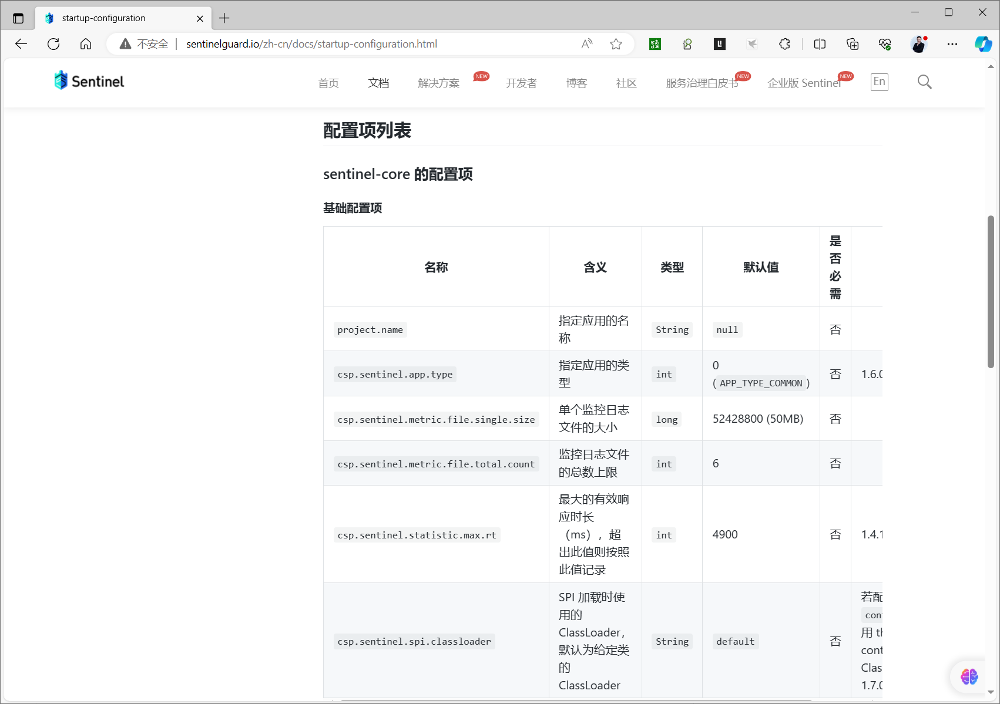
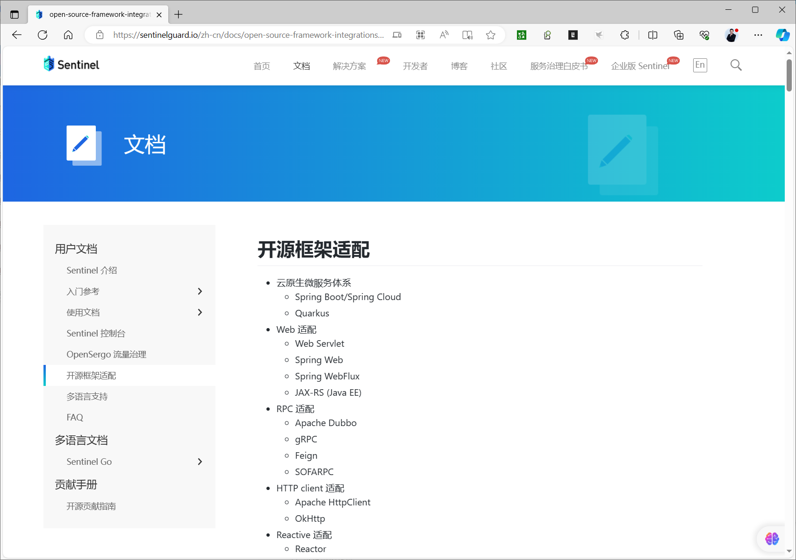
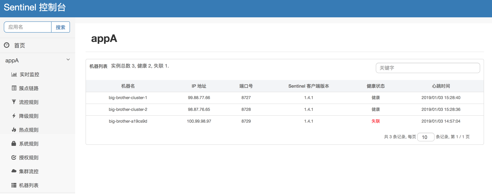
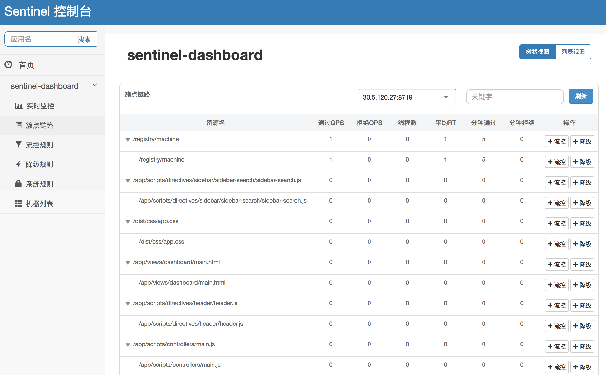
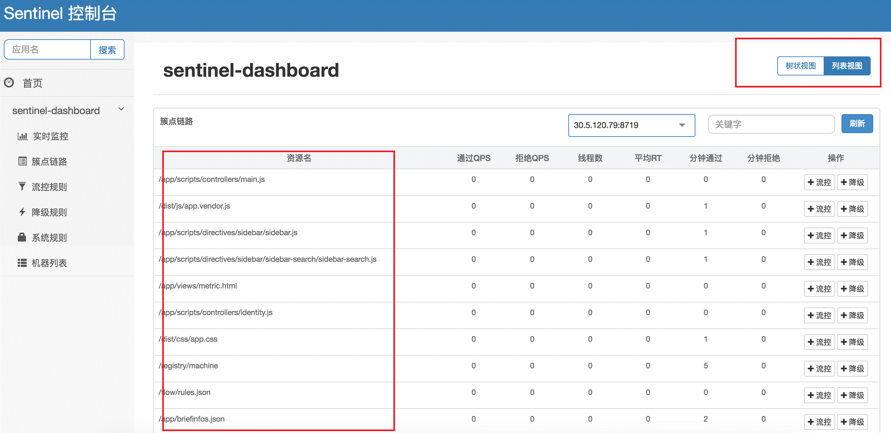
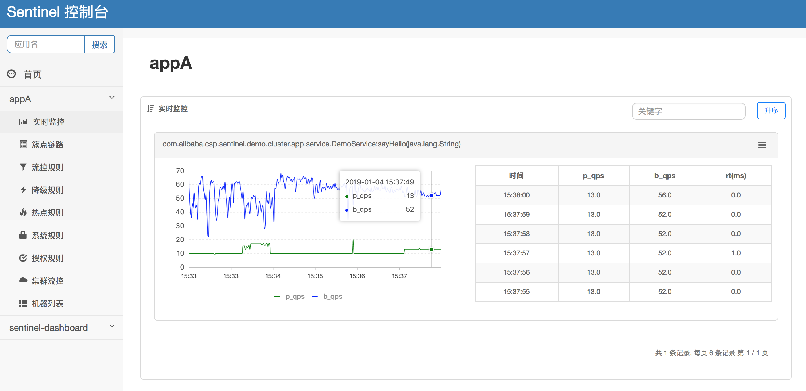

[← Back to Microservices Index]({{ '/subjects/Microservices/' | relative_url }})



# 28 Connecting Java Clients to Sentinel Dashboard
### 5.3 JAVA客户端接入控制台

<https://github.com/alibaba/spring-cloud-alibaba/wiki/Sentinel>

<https://sentinelguard.io/zh-cn/docs/quick-start.html>

<https://github.com/alibaba/Sentinel/tree/master/sentinel-demo>

控制台启动后，JAVA应用的客户端需要按照以下步骤接入到控制台。

### 引入JAR包

查询JAVA依赖

```xml
https://mvnrepository.com/artifact/com.alibaba.cloud/spring-cloud-starter-alibaba-sentinel/2022.0.0.0
<!-- https://mvnrepository.com/artifact/com.alibaba.cloud/spring-cloud-starter-alibaba-sentinel -->
<dependency>
<groupId>com.alibaba.cloud</groupId>
<artifactId>spring-cloud-starter-alibaba-sentinel</artifactId>
<version>2022.0.0.0</version>
</dependency>
#客户端需要引入 Transport 模块来与 Sentinel 控制台进行通信。您可以通过 pom.xml 引入 JAR 包:
<dependency>
<groupId>com.alibaba.csp</groupId>
<artifactId>sentinel-transport-simple-http</artifactId>
<version>x.y.z</version>
</dependency>
```

### 配置方式

参考启动配置项

<http://sentinelguard.io/zh-cn/docs/startup-configuration.html>

<https://sentinelguard.io/zh-cn/docs/general-configuration.html>

<https://github.com/alibaba/spring-cloud-alibaba/wiki/Sentinel>



Sentinel 提供如下的配置方式：

JVM -D 参数方式 properties 文件方式（1.7.0 版本开始支持）

其中，project.name 参数只能通过 JVM -D 参数方式配置（since 1.8.0 取消该限制），其它参数支持所有的配置方式。

优先级顺序：JVM -D 参数的优先级最高。若 properties 和 JVM 参数中有相同项的配置，以 JVM 参数配置的为准。

用户可以通过 -Dcsp.sentinel.config.file 参数配置 properties 文件的路径，支持 classpath 路径配置（如 classpath:sentinel.properties ）。默认 Sentinel 会尝试从 classpath:sentinel.properties 文件读取配置，读取编码默认为 UTF-8。

注：1.7.0 以下版本可以通过旧的 ${user_home}/logs/csp/${project.name}.properties 配置文件进行配置（除 project.name 和日志相关配置项）。

注：若您的应用为 Spring Boot 或 Spring Cloud 应用，您可以使用 Spring Cloud Alibaba，通过 Spring 配置文件来指定配置，详情请参考 Spring Cloud Alibaba Sentinel 文档。

配置项列表

sentinel-core 的配置项

基础配置项

是否

名称含义类型默认值

备注

必需

project.name 指定应用的名称 String null 否

csp.sentinel.app.type 指定应用的类型 int 0

( APP_TYPE_COMMON ) 否 1.6.0 引入

csp.sentinel.metric.file.single.size 单个监控日志文件的大小 long 52428800 (50MB) 否

csp.sentinel.metric.file.total.count 监控日志文件的总数上限 int 6 否

csp.sentinel.statistic.max.rt 最大的有效响应时长（ms），超出此值则按

int 4900 否 1.4.1 引入

照此值记录

csp.sentinel.spi.classloader SPI 加载时使用的 ClassLoader，默认为给定

String default 否若配置 context 则使用 thread context

类的 ClassLoader

ClassLoader。1.7.0 引入

其中 project.name 项用于指定应用名（appName）。若未指定，则默认解析 main 函数的类名作为应用名。实际项目使用中建议手动指定应用名。

日志相关配置项

是否

名称含义类型默认值

备注

必需

csp.sentinel.log.dir Sentinel 日志文件目录 String ${user.home}/logs/csp/ 否 1.3.0

引入

csp.sentinel.log.use.pid 日志文件名中是否加入进程号，用于单机部署多个应用的情

boolean false 否 1.3.0

况

引入

csp.sentinel.log.output.type Record 日志输出的类型，file 代表输出至文件，

String file 否 1.6.2

console 代表输出至终端

引入

注意：若需要在单台机器上运行相同服务的多个实例，则需要加入 -Dcsp.sentinel.log.use.pid=true 来保证不同实例日志的独立性。

sentinel-transport-common 的配置项

名称含义类型默认

是否必需

值

csp.sentinel.dashboard.server 控制台的地址，指定控制台后客户端会自动向该地址

String null 是

发送心跳包。地址格式为：hostIp:port

非必需，若不进行配置，则会

csp.sentinel.heartbeat.interval.ms 心跳包发送周期，单位毫秒 long null

从相应的 HeartbeatSender 中提取默认值

csp.sentinel.api.port 本地启动 HTTP API Server 的端口号 int 8719 否

若不指定则通过

csp.sentinel.heartbeat.client.ip 指定心跳包中本机的 IP String -

HostNameUtil 解析；该配置项多用于多网卡环境

注：csp.sentinel.api.port 可不提供，默认为 8719，若端口冲突会自动向下探测可用的端口。

主要配置

启动时加入 JVM 参数 -Dcsp.sentinel.dashboard.server=consoleIp:port 指定控制台地址和端口。若启动多个应用，则需要通过 - Dcsp.sentinel.api.port=xxxx 指定客户端监控 API 的端口（默认是 8719）。

除了修改 JVM 参数，也可以通过配置文件取得同样的效果。

范例:

```bash
[root@ubuntu2204 sentinel-sample]#java -Dserver.port=8080 -
Dcsp.sentinel.dashboard.server=sentinel.bowen.org:8080 -Dproject.name=sentinel-sample -jar  target/sentinel-
sample-0.0.1-SNAPSHOT.jar
[root@ubuntu2204 ~]#ss -ntlp |grep java
LISTEN 0      100                *:8719            *:*    users:(("java",pid=6121,fd=11))
LISTEN 0      100                *:8080            *:*    users:(("java",pid=6121,fd=15))
```

### 触发客户端初始化

确保客户端有访问量，Sentinel 会在客户端首次调用的时候进行初始化，开始向控制台发送心跳包。

注意：您还需要根据您的应用类型和接入方式引入对应的 适配依赖，否则即使有访问量也不能被 Sentinel 统计。

<https://sentinelguard.io/zh-cn/docs/open-source-framework-integrations.html>



### 查看机器列表以及健康情况

当您在机器列表中看到您的机器，就代表着您已经成功接入控制台；如果没有看到您的机器，请检查配置，并通过 ${user.home}/logs/csp/sentinel-record.log.xxx 日志来排查原因，详细的部分请参考 日志文档。



注意：若接入 Sentinel 控制台不成功，可以参考 FAQ 排查问题。

注意：请确保在使用较新版本的浏览器，我们不保证支持旧版本的浏览器。

范例: 在应用主机上查看日志

```bash
[root@ubuntu2204 ~]#tree logs/
logs/
└── csp
├── command-center.log.2023-11-28.0
├── command-center.log.2023-11-28.0.lck
├── sentinel-record.log.2023-11-28.0
├── sentinel-record.log.2023-11-28.0.lck
├── sentinel-sample-metrics.log.2023-11-28
└── sentinel-sample-metrics.log.2023-11-28.idx
1 directory, 6 files
[root@ubuntu2204 ~]#tail -f logs/csp/sentinel-record.log.2023-11-28.0
2023-11-28 16:29:43.104 INFO [ParamFlowRuleManager] Parameter flow rules received: {}
2023-11-28 16:29:43.106 INFO [DegradeRuleManager] Degrade rules loaded: {}
2023-11-28 16:29:43.106 WARNING No SPI configuration file, filename=META-
INF/services/com.alibaba.csp.sentinel.metric.extension.MetricExtension,
classloader=org.springframework.boot.loader.LaunchedURLClassLoader@4f3f5b24
2023-11-28 16:29:43.107 INFO [MetricExtensionProvider] No existing MetricExtension found
2023-11-28 16:29:43.127 INFO Add child <sayHello> to node </hello/{name}>
2023-11-28 16:29:44.308 INFO [MetricWriter] New metric file created: /root/logs/csp/sentinel-sample-
metrics.log.2023-11-28
2023-11-28 16:29:44.308 INFO [MetricWriter] New metric index file created: /root/logs/csp/sentinel-sample-
metrics.log.2023-11-28.idx
2023-11-28 16:30:34.825 INFO Receiving rule change (type: flow): [{"clusterConfig":
{"acquireRefuseStrategy":0,"clientOfflineTime":2000,"fallbackToLocalWhenFail":true,"resourceTimeout":2000,"res
ourceTimeoutStrategy":0,"sampleCount":10,"strategy":0,"thresholdType":0,"windowIntervalMs":1000},"clusterMode"
:false,"controlBehavior":0,"count":1.0,"grade":1,"limitApp":"default","maxQueueingTimeMs":500,"resource":"/hel
lo/{name}","strategy":0,"warmUpPeriodSec":10}]
2023-11-28 16:30:34.844 INFO [DynamicSentinelProperty] Config will be updated to:
[FlowRule{resource=/hello/{name}, limitApp=default, grade=1, count=1.0, strategy=0, refResource=null,
controlBehavior=0, warmUpPeriodSec=10, maxQueueingTimeMs=500, clusterMode=false,
clusterConfig=ClusterFlowConfig{flowId=null, thresholdType=0, fallbackToLocalWhenFail=true, strategy=0,
sampleCount=10, windowIntervalMs=1000, resourceTimeout=2000, resourceTimeoutStrategy=0,
acquireRefuseStrategy=0, clientOfflineTime=2000}, controller=null}]
2023-11-28 16:30:34.845 INFO [FlowRuleManager] Flow rules received: {/hello/{name}=
[FlowRule{resource=/hello/{name}, limitApp=default, grade=1, count=1.0, strategy=0, refResource=null,
controlBehavior=0, warmUpPeriodSec=10, maxQueueingTimeMs=500, clusterMode=false,
clusterConfig=ClusterFlowConfig{flowId=null, thresholdType=0, fallbackToLocalWhenFail=true, strategy=0,
sampleCount=10, windowIntervalMs=1000, resourceTimeout=2000, resourceTimeoutStrategy=0,
acquireRefuseStrategy=0, clientOfflineTime=2000},
controller=com.alibaba.csp.sentinel.slots.block.flow.controller.DefaultController@af532d2}]}
[root@ubuntu2204 ~]#tail -f logs/csp/sentinel-sample-metrics.log.2023-11-28
1701160183000|2023-11-28 16:29:43|sayHello|1|0|1|0|1|0|0|0
1701160183000|2023-11-28 16:29:43|/hello/{name}|1|0|1|0|59|0|0|1
1701160183000|2023-11-28 16:29:43|__total_inbound_traffic__|1|0|1|0|59|0|0|0
1701160310000|2023-11-28 16:31:50|sayHello|1|0|1|0|1|0|0|0
1701160310000|2023-11-28 16:31:50|/hello/{name}|1|0|1|0|3|0|0|1
1701160310000|2023-11-28 16:31:50|__total_inbound_traffic__|1|0|1|0|3|0|0|0
1701160311000|2023-11-28 16:31:51|/hello/{name}|0|1|0|0|0|0|0|1
1701160311000|2023-11-28 16:31:51|__total_inbound_traffic__|0|1|0|0|0|0|0|0
```

### . 监控

### "簇点链路"中显示刚刚调用的资源（单机实时）

簇点链路（单机调用链路）页面实时的去拉取指定客户端资源的运行情况。它一共提供两种展示模式：一种用树状结构展示资源的调用链路，另外一种则不区分调用链路展示资源的运行情况。

注意: 簇点监控是内存态的信息，它仅展示启动后调用过的资源。

树状链路平铺链路





### "实时监控"汇总资源信息（集群聚合）

同时，同一个服务下的所有机器的簇点信息会被汇总，并且秒级地展示在"实时监控"下。

注意: 实时监控仅存储 5 分钟以内的数据，如果需要持久化，需要通过调用实时监控接口来定制。



注意：请确保 Sentinel 控制台所在的机器时间与自己应用的机器时间保持一致，否则会导致拉不到实时的监控数据。



<nav class="article-end" aria-label="章节导航">
  <a href="{{ '/subjects/Microservices/27-sentinel-dashboard.html' | relative_url }}">← Previous: Sentinel Dashboard</a>
  <a href="{{ '/subjects/Microservices/' | relative_url }}">Back to Microservices Index</a>
  <a href="{{ '/subjects/Microservices/29-resources-and-rules.html' | relative_url }}">Next: Resources and Rules →</a>
</nav>
