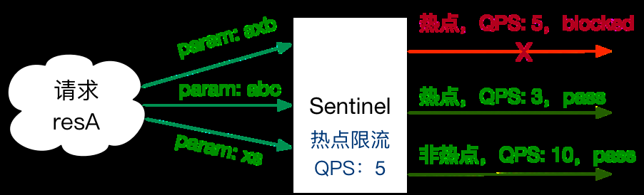
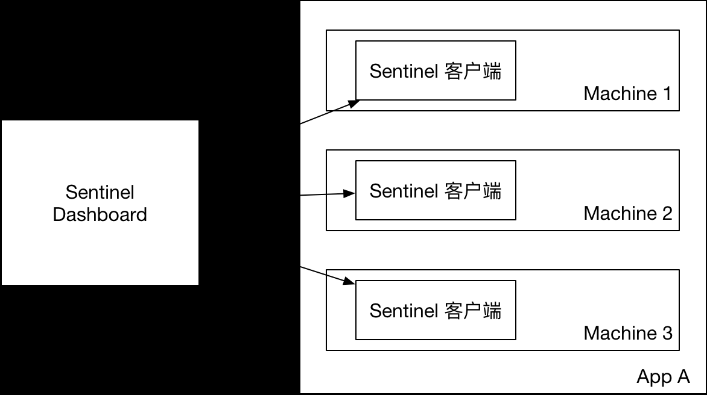
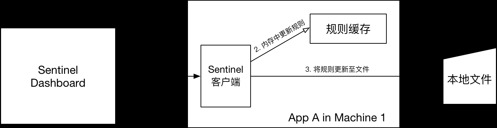
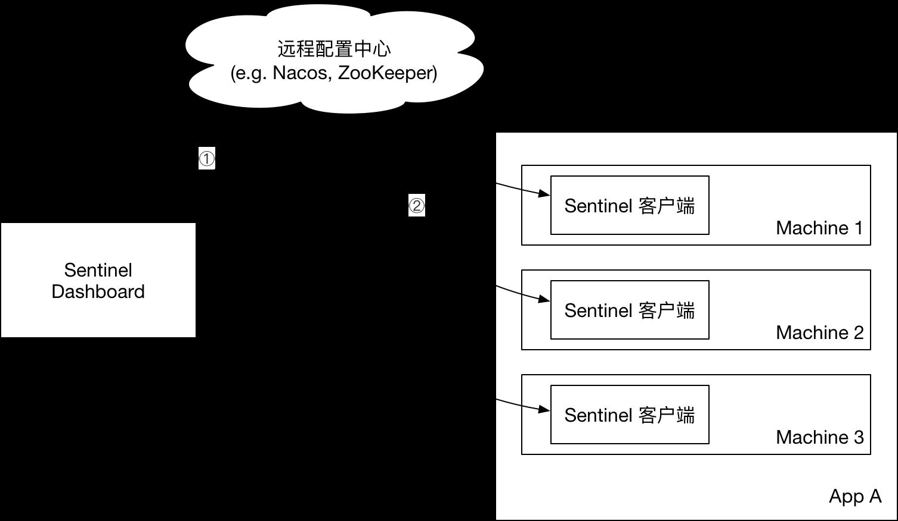
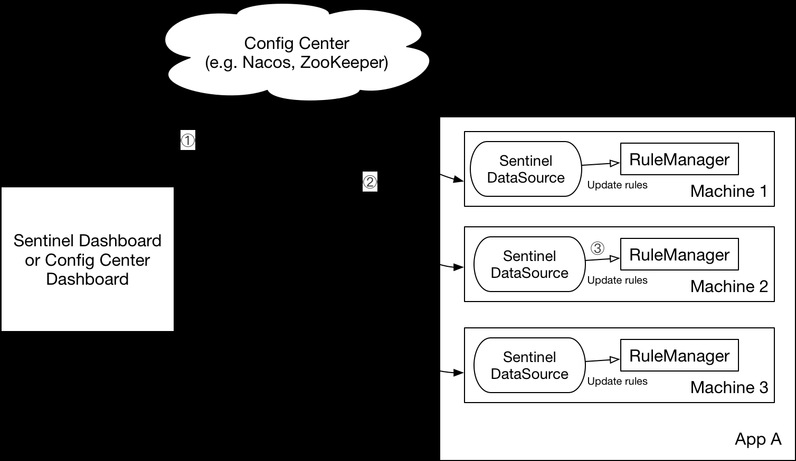
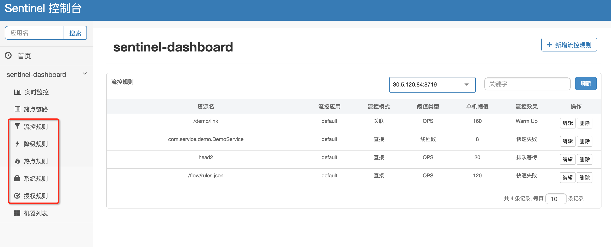
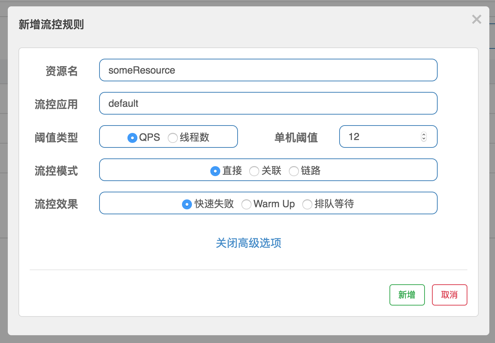

[← 返回微服务架构目录]({{ '/subjects/Microservices/' | relative_url }})



# 29 资源与规则

上一节已让客户端出现在控制台。本节关心的是：**保护哪个资源、根据什么指标做决定、规则如何在重启后保留**。实际落地可按“定义资源 → 观察基线 → 设置规则 → 压测或故障验证 → 持久化与回滚”推进。只看到某条规则被控制台接收，还不能证明它对业务调用生效。

## 资源名先稳定下来

HTTP 适配器常把路由模板如 `/hello/{name}` 作为资源；手工 API 则可给一段代码命名。资源名应稳定、粒度适中，避免把每个用户 ID 拼进名字造成高基数统计。一个资源可以同时受到多类规则约束，任一规则阻断时都应有清晰的响应处理。

## 五类规则各管什么

| 规则 | 主要判断依据 | 典型用途 |
| --- | --- | --- |
| `FlowRule` 流控 | 资源 QPS 或并发线程数，也可结合来源和调用关系 | 控制突发流量、限制慢接口占用 |
| `DegradeRule` 熔断 | 慢调用比例、异常比例或异常数，结合统计窗口和最小请求数 | 下游不稳定时快速失败 |
| `SystemRule` 系统保护 | 入口 QPS、并发数、平均 RT、CPU 或负载 | 防止当前实例过载 |
| `AuthorityRule` 来源授权 | 调用方 origin 黑白名单 | 按来源放行或拒绝，非身份认证替代品 |
| `ParamFlowRule` 热点参数 | 指定参数值的访问频率 | 限制某个商品、用户或键的热点请求 |

### 流控：QPS 与并发不是一回事

`resource` 是目标资源，`count` 是阈值，`grade` 决定按 QPS 还是并发线程数解释该阈值。`limitApp` 可指定调用来源；`strategy` 可表达直接、关联或链路关系；`controlBehavior` 决定直接拒绝、预热或匀速排队等效果。排队只平滑允许等待的请求，不会创造额外处理能力。

下面是用 API 加载单条 QPS 规则的**方法体核心代码**，所需 import 与异常处理应由实际项目补全：

```java
FlowRule rule = new FlowRule();
rule.setResource("/hello/{name}");
rule.setGrade(RuleConstant.FLOW_GRADE_QPS);
rule.setCount(20);
rule.setLimitApp("default");
FlowRuleManager.loadRules(Collections.singletonList(rule));
```

该示例使用硬编码是为了看清字段；生产规则不宜把可变阈值写死在应用包中。

### 熔断：先确定统计窗口

熔断规则至少要一起考虑：`grade` 策略、`count` 阈值、`minRequestAmount` 最小请求数、`statIntervalMs` 统计时长和 `timeWindow` 熔断秒数。慢调用比例模式还要设慢调用比例阈值。异常比例策略中 `count=0.7` 表示 70%，并不是“70 次异常”。

```java
DegradeRule rule = new DegradeRule("downstream-service");
rule.setGrade(CircuitBreakerStrategy.ERROR_RATIO.getType());
rule.setCount(0.7);
rule.setMinRequestAmount(100);
rule.setStatIntervalMs(30_000);
rule.setTimeWindow(10);
DegradeRuleManager.loadRules(Collections.singletonList(rule));
```

原资料把分号放在 `new DegradeRule(...)` 之后，却继续以点号调用 setter，这是无效 Java。上例把规则创建和字段设置分开。达到阈值后仍要观察打开、探测与恢复过程，以及阻断请求的业务响应。

### 系统保护与来源规则

`SystemRule` 面向应用整体入口，而不是某一个 URL。比如 `highestCpuUsage` 是 0 到 1 的 CPU 使用率阈值；`qps` 和 `maxThread` 分别表示入口速率与并发上限。负载阈值应结合机器规格观察，不要直接照抄例子里的数字。

`AuthorityRule` 根据客户端上报的 `origin` 做黑白名单。应用必须可靠地提供来源信息；若来源头可被任意伪造，它不能充当认证授权。真正的身份校验应由网关和业务安全机制完成。

## 热点参数：按值而不是按资源名限流



当一个资源的某些参数值特别热门，例如商品 ID，整体 QPS 阈值可能误伤其他商品。热点规则以 `paramIdx` 指定参数下标，再对参数值计数。`count` 是常规值阈值，`paramFlowItemList` 可给特定值单独设置例外阈值。应用需引入与核心库匹配的 `sentinel-parameter-flow-control` 依赖，并确保进入资源时把参数传给 Sentinel：

```java
Entry entry = null;
try {
    entry = SphU.entry("product-query", EntryType.IN, 1, productId);
    // 查询商品并返回结果
} catch (BlockException ex) {
    // 返回明确的限流响应
} finally {
    if (entry != null) {
        entry.exit(1, productId);
    }
}
```

进入与退出时的参数和计数要一致，否则统计会失真。使用 `@SentinelResource` 时，方法参数可参与热点规则，但是否能覆盖预期调用路径仍应通过测试验证。高基数参数会增加缓存与统计成本，例外项只应配置确有业务理由的值。

## 查询规则不等于持久化规则

客户端传输模块可暴露规则查询接口，例如 `http://127.0.0.1:8719/getRules?type=flow`，热点规则另有 `getParamRules`。8719 是**客户端管理端口**，只应在受控网络内访问。查询结果能证明当前内存中有什么规则，却不能证明重启后仍存在。

原资料讨论了三种管理方式：

1. **直接推送到内存**：Dashboard 调用客户端 API，调试最方便；客户端重启后规则可能消失。
2. **Pull 数据源**：客户端定期从文件或数据库读取。可保存规则，但传播有轮询延迟，多实例一致性要另行处理。
3. **Push 数据源**：配置中心保存并推送，客户端监听变化。较适合需要统一管理的生产环境，但引入配置中心依赖，并需要解决发布、回滚、权限和故障时的旧规则行为。






若采用 Nacos 等配置中心，推荐的写入路径是**规则管理界面 → 配置中心 → 客户端监听数据源 → Sentinel 规则管理器**。只给客户端加一个 Nacos 读数据源，而控制台仍直接改客户端内存，规则不会自动持久化；控制台写入端也需相应改造，或直接通过配置中心管理规则。规则通常按应用名、规则类型分别存放，并采用版本控制和灰度发布，防止一次错误阈值影响所有实例。




## 最后怎样验收

以一个可撤销的测试规则为例：先记录基线 QPS 和错误率；设定阈值后用可控流量验证阻断比例及返回内容；停止流量确认恢复；重启一个客户端确认规则是否重新加载；再撤销规则并核对所有实例状态。这样才能区分“规则配置成功”“规则生效”和“规则被持久保存”三个不同结果。



<nav class="article-end" aria-label="章节导航">
  <a href="{{ '/subjects/Microservices/28-connecting-java-clients-to-sentinel-dashboard.html' | relative_url }}">← 上一篇：Java 客户端接入控制台</a>
  <a href="{{ '/subjects/Microservices/' | relative_url }}">返回专题目录</a>
  <a href="{{ '/subjects/Microservices/30-practical-examples.html' | relative_url }}">下一篇：Sentinel 实战案例 →</a>
</nav>
