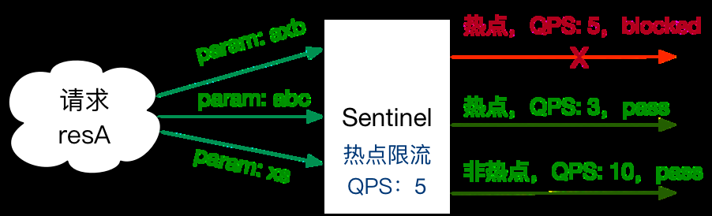
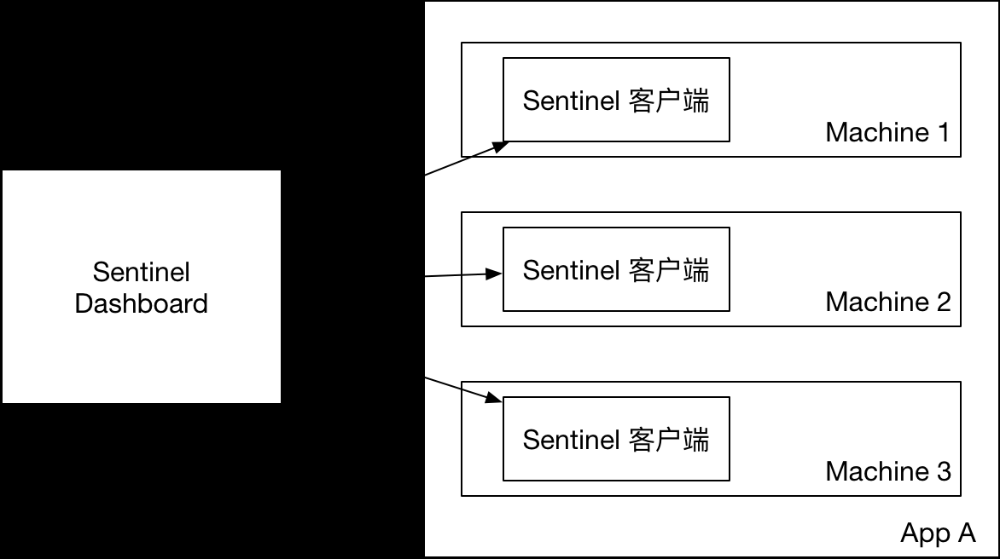
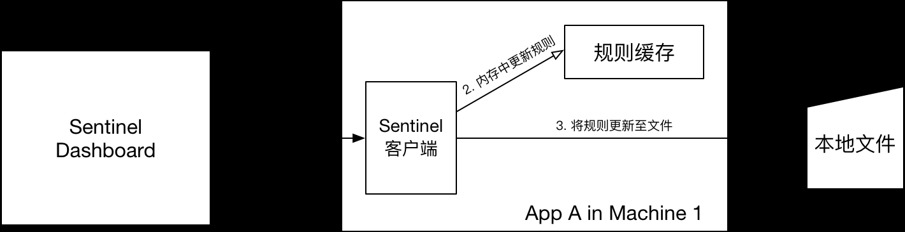
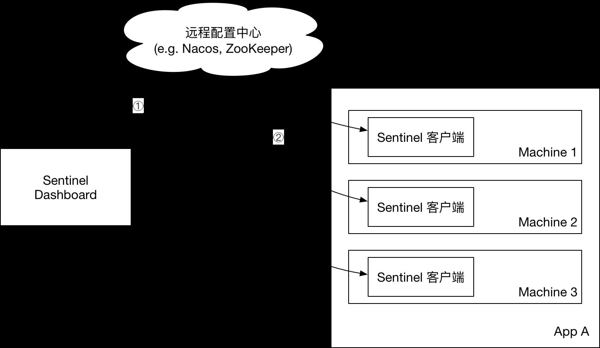
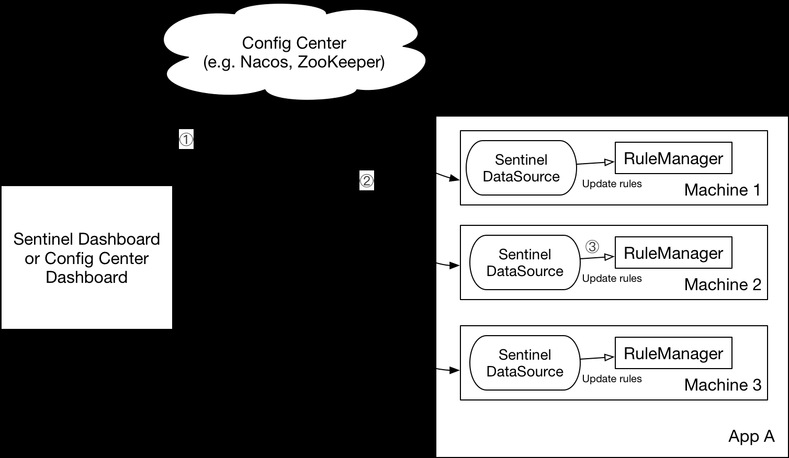
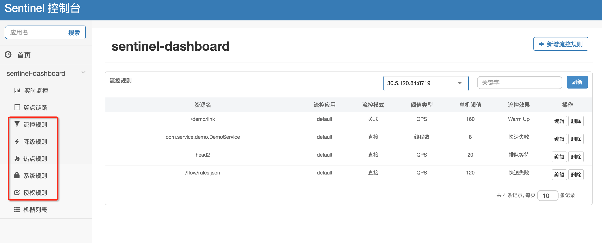
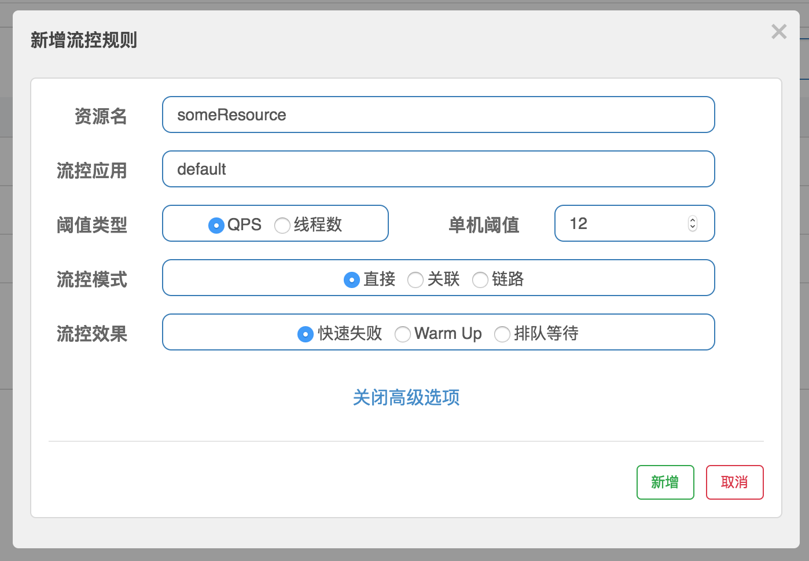

[← Back to Microservices Index]({{ '/subjects/Microservices/' | relative_url }})



# 29 Resources and Rules
### 5.4 资源与规则

### 资源与规则说明

使用 Sentinel 来进行资源保护，主要分为几个步骤:

1. 定义资源

2. 定义规则

3. 检验规则是否生效

先把可能需要保护的资源定义好，之后再配置规则。也可以理解为，只要有了资源，我们就可以在任何时候灵活地定义各种流量控制规则。 在编码的时候，只需要考虑这个代码是否需要保护，如果需要保护，就将之定义为一个资源。

对于主流的框架，我们提供适配，只需要按照适配中的说明配置，Sentinel 就会默认定义提供的服务，方法等为资源。

### 规则的种类

Sentinel 的所有规则都可以在内存态中动态地查询及修改，修改之后立即生效。同时 Sentinel 也提供相关 API，供您来定制自己的规则策略。

Sentinel 支持以下几种规则：流量控制规则、熔断降级规则、系统保护规则、来源访问控制规则 和 热点参数规则。

### 流量控制规则 (FlowRule)

流量规则的定义

重要属性：

Field 说明默认值

resource 资源名，资源名是限流规则的作用对象

count 限流阈值

grade 限流阈值类型，QPS 或线程数模式 QPS 模式

limitApp 流控针对的调用来源 default ，代表不区分调用来源

strategy 调用关系限流策略：直接、链路、关联根据资源本身（直接）

controlBehavior 流控效果（直接拒绝 / 排队等待 / 慢启动模式），不支持按调用关系限流直接拒绝

同一个资源可以同时有多个限流规则。

通过代码定义流量控制规则

理解上面规则的定义之后，我们可以通过调用 FlowRuleManager.loadRules() 方法来用硬编码的方式定义流量控制规则，比如：

```text
private static void initFlowQpsRule() {
List<FlowRule> rules = new ArrayList<>();
FlowRule rule1 = new FlowRule();
rule1.setResource(resource);
// Set max qps to 20
rule1.setCount(20);
rule1.setGrade(RuleConstant.FLOW_GRADE_QPS);
rule1.setLimitApp("default");
rules.add(rule1);
FlowRuleManager.loadRules(rules);
}
```

更多详细内容可以参考 流量控制。

### 熔断降级规则 (DegradeRule)

熔断降级规则包含下面几个重要的属性：

Field 说明默认值

resource 资源名，即规则的作用对象

grade 熔断策略，支持慢调用比例/异常比例/异常数策略慢调用比

例

count 慢调用比例模式下为慢调用临界 RT（超出该值计为慢调用）；异常比例/异常数模式下为对应

的阈值

timeWindow 熔断时长，单位为 s

minRequestAmount 熔断触发的最小请求数，请求数小于该值时即使异常比率超出阈值也不会熔断（1.7.0 引入） 5

statIntervalMs 统计时长（单位为 ms），如 60*1000 代表分钟级（1.8.0 引入） 1000 ms

slowRatioThreshold 慢调用比例阈值，仅慢调用比例模式有效（1.8.0 引入）

同一个资源可以同时有多个降级规则。

理解上面规则的定义之后，我们可以通过调用 DegradeRuleManager.loadRules() 方法来用硬编码的方式定义流量控制规则。

```text
private static void initDegradeRule() {
List<DegradeRule> rules = new ArrayList<>();
DegradeRule rule = new DegradeRule(resource);
.setGrade(CircuitBreakerStrategy.ERROR_RATIO.getType());
.setCount(0.7); // Threshold is 70% error ratio
.setMinRequestAmount(100)
.setStatIntervalMs(30000) // 30s
.setTimeWindow(10);
rules.add(rule);
DegradeRuleManager.loadRules(rules);
}
```

更多详情可以参考 熔断降级。

### 系统保护规则 (SystemRule)

Sentinel 系统自适应限流从整体维度对应用入口流量进行控制，结合应用的 Load、CPU 使用率、总体平均 RT、入口 QPS 和并发线程数等几个维度的监控指标，通过自适应的流控策略，让系统的入口流量和系统的负载达到一个平衡，让系统尽可能跑在最大吞吐量的同时保证系统整体的稳定性。

系统规则包含下面几个重要的属性：

Field 说明默认值

highestSystemLoad load1 触发值，用于触发自适应控制阶段 -1 (不生效)

avgRt 所有入口流量的平均响应时间 -1 (不生效)

maxThread 入口流量的最大并发数 -1 (不生效)

qps 所有入口资源的 QPS -1 (不生效)

highestCpuUsage 当前系统的 CPU 使用率（0.0-1.0） -1 (不生效)

理解上面规则的定义之后，我们可以通过调用 SystemRuleManager.loadRules() 方法来用硬编码的方式定义流量控制规则：

```text
private void initSystemProtectionRule() {
List<SystemRule> rules = new ArrayList<>();
SystemRule rule = new SystemRule();
rule.setHighestSystemLoad(10);
rules.add(rule);
SystemRuleManager.loadRules(rules);
}
```

更多详情可以参考 系统自适应保护。

### 访问控制规则 (AuthorityRule)

很多时候，我们需要根据调用方来限制资源是否通过，这时候可以使用 Sentinel 的访问控制（黑白名单）的功能。黑白名单根据资源的请求来源（origin ）限制资源是否通过，若配置白名单则只有请求来源位于白名单内时才可通过；若配置黑名单则请求来源位于黑名单时不通过，其余的请求通过。

授权规则，即黑白名单规则（AuthorityRule ）非常简单，主要有以下配置项：

resource ：资源名，即限流规则的作用对象 limitApp ：对应的黑名单/白名单，不同 origin 用 , 分隔，如 appA,appB strategy ：限制模式，AUTHORITY_WHITE 为白名单模式，AUTHORITY_BLACK 为黑名单模式，默认为白名单模式

更多详情可以参考 来源访问控制。

### 热点规则 (ParamFlowRule)

详情可以参考 热点参数限流。

何为热点？热点即经常访问的数据。很多时候我们希望统计某个热点数据中访问频次最高的 Top K 数据，并对其访问进行限制。比如：

商品 ID 为参数，统计一段时间内最常购买的商品 ID 并进行限制用户 ID 为参数，针对一段时间内频繁访问的用户 ID 进行限制

热点参数限流会统计传入参数中的热点参数，并根据配置的限流阈值与模式，对包含热点参数的资源调用进行限流。热点参数限流可以看做是一种特殊的流量控制，仅对包含热点参数的资源调用生效。



Sentinel 利用 LRU 策略统计最近最常访问的热点参数，结合令牌桶算法来进行参数级别的流控。

基本使用

要使用热点参数限流功能，需要引入以下依赖：

```xml
<dependency>
<groupId>com.alibaba.csp</groupId>
<artifactId>sentinel-parameter-flow-control</artifactId>
<version>x.y.z</version>
</dependency>
```

然后为对应的资源配置热点参数限流规则，并在 entry 的时候传入相应的参数，即可使热点参数限流生效。

注：若自行扩展并注册了自己实现的 SlotChainBuilder ，并希望使用热点参数限流功能，则可以在 chain 里面合适的地方插入 ParamFlowSlot 。

那么如何传入对应的参数以便 Sentinel 统计呢？我们可以通过 SphU 类里面几个 entry 重载方法来传入：

```text
public static Entry entry(String name, EntryType type, int count, Object... args) throws BlockException
public static Entry entry(Method method, EntryType type, int count, Object... args) throws BlockException
```

其中最后的一串 args 就是要传入的参数，有多个就按照次序依次传入。比如要传入两个参数 paramA 和 paramB ，则可以：

```text
// paramA in index 0, paramB in index 1.
// 若需要配置例外项或者使用集群维度流控，则传入的参数只支持基本类型。
SphU.entry(resourceName, EntryType.IN, 1, paramA, paramB);
```

注意：若 entry 的时候传入了热点参数，那么 exit 的时候也一定要带上对应的参数（exit(count, args) ），否则可能会有统计错误。正确的示例：

```text
Entry entry = null;
try {
entry = SphU.entry(resourceName, EntryType.IN, 1, paramA, paramB);
// Your logic here.
} catch (BlockException ex) {
// Handle request rejection.
} finally {
if (entry != null) {
entry.exit(1, paramA, paramB);
}
}
```

对于 @SentinelResource 注解方式定义的资源，若注解作用的方法上有参数，Sentinel 会将它们作为参数传入 SphU.entry(res, args) 。比如以下的方法里面 uid 和 type 会分别作为第一个和第二个参数传入 Sentinel API，从而可以用于热点规则判断：

```text
@SentinelResource("myMethod")
public Result doSomething(String uid, int type) {
// some logic here...
}
```

热点参数规则热点参数规则（ParamFlowRule ）类似于流量控制规则（FlowRule ）：

属性说明默认值

resource 资源名，必填

count 限流阈值，必填

grade 限流模式 QPS 模

式

durationInSec 统计窗口时间长度（单位为秒），1.6.0 版本开始支持 1s

controlBehavior 流控效果（支持快速失败和匀速排队模式），1.6.0 版本开始支持快速失

败

maxQueueingTimeMs 最大排队等待时长（仅在匀速排队模式生效），1.6.0 版本开始支持 0ms

paramIdx 热点参数的索引，必填，对应 SphU.entry(xxx, args) 中的参数索引位置

paramFlowItemList 参数例外项，可以针对指定的参数值单独设置限流阈值，不受前面 count 阈值的限制。仅支持

基本类型和字符串类型

clusterMode 是否是集群参数流控规则 false

clusterConfig 集群流控相关配置

我们可以通过 ParamFlowRuleManager 的 loadRules 方法更新热点参数规则，下面是一个示例：

```text
ParamFlowRule rule = new ParamFlowRule(resourceName)
.setParamIdx(0)
.setCount(5);
// 针对 int 类型的参数 PARAM_B，单独设置限流 QPS 阈值为 10，而不是全局的阈值 5.
ParamFlowItem item = new ParamFlowItem().setObject(String.valueOf(PARAM_B))
.setClassType(int.class.getName())
.setCount(10);
rule.setParamFlowItemList(Collections.singletonList(item));
ParamFlowRuleManager.loadRules(Collections.singletonList(rule));
```

示例

示例可参见 sentinel-demo-parameter-flow-control。

### 查询更改规则

引入了 transport 模块后，可以通过以下的 HTTP API 来获取所有已加载的规则：

<http://localhost:8719/getRules?type=<XXXX>>

其中，type=flow 以 JSON 格式返回现有的限流规则，degrade 返回现有生效的降级规则列表，system 则返回系统保护规则。

获取所有热点规则：

<http://localhost:8719/getParamRules>

其中，type 可以输入 flow 、degrade 等方式来制定更改的规则种类，data 则是对应的 JSON 格式的规则。

示例：查当前JAVA应用的sentinel流控规则

```json
[root@ubuntu2204 ~]#curl -s http://localhost:8719/getRules?type=flow |jq
[
{
"clusterConfig": {
"acquireRefuseStrategy": 0,
"clientOfflineTime": 2000,
"fallbackToLocalWhenFail": true,
"resourceTimeout": 2000,
"resourceTimeoutStrategy": 0,
"sampleCount": 10,
"strategy": 0,
"thresholdType": 0,
"windowIntervalMs": 1000
},
"clusterMode": false,
"controlBehavior": 0,
"count": 1,
"grade": 1,
"limitApp": "default",
"maxQueueingTimeMs": 500,
"resource": "/hello/{name}",
"strategy": 0,
"warmUpPeriodSec": 10
}
]
```

### 定制自己的持久化规则

上面的规则配置，都是存在内存中的。即如果应用重启，这个规则就会失效。因此我们提供了开放的接口，您可以通过实现 DataSource 接口的方式，来自定义规则的存储数据源。通常我们的建议有：

整合动态配置系统，如 ZooKeeper、Nacos 等，动态地实时刷新配置规则结合 RDBMS、NoSQL、VCS 等来实现该规则配合 Sentinel Dashboard 使用

### 规则管理

### 规则管理及推送模式说明

<https://github.com/alibaba/Sentinel/wiki/%E5%9C%A8%E7%94%9F%E4%BA%A7%E7%8E%AF%E5%A2%83%E4%B8%AD%E4%BD%BF%E7%94%A8-Sentinel>

一般来说，规则的推送有下面三种模式:

推送模式说明优点缺点

不保证一致性；规则保

简单，

API 将规则推送至客户端并直接更新到内存中，扩展写数据源

原始

存在内存中，重启即消

无任何

（WritableDataSource ）

模式

失。严重不建议用于生

依赖

产环境

简单， 无任何

不保证一致性；实时性

扩展写数据源（WritableDataSource ）， 客户端主动向某个规则管理中心定期

Pull

依赖；

不保证，拉取过于频繁

轮询拉取规则，这个规则中心可以是 RDBMS、文件等

模式

规则持

也可能会有性能问题。

久化

规则持

扩展读数据源（ReadableDataSource ），规则中心统一推送，客户端通过注册监

久化；

Push

听器的方式时刻监听变化，比如使用 Nacos、Zookeeper 等配置中心。这种方式

一致

引入第三方依赖

模式

有更好的实时性和一致性保证。生产环境下一般采用 push 模式的数据源。

性；快速

原始模式

如果不做任何修改，Sentinel Dashboard 的推送规则方式是通过 API 将规则推送至客户端并直接更新到内存中：



这种做法的好处是简单，无依赖；坏处是应用重启规则就会消失，仅用于简单测试，不能用于生产环境。

Pull模式

pull 模式的数据源（如本地文件、RDBMS 等）一般是可写入的。使用时需要在客户端注册数据源：

将对应的读数据源注册至对应的 RuleManager，将写数据源注册至 transport 的 WritableDataSourceRegistry 中。

以本地文件数据源为例：

```text
public class FileDataSourceInit implements InitFunc {
@Override
public void init() throws Exception {
String flowRulePath = "/path/file";
ReadableDataSource<String, List<FlowRule>> ds = new FileRefreshableDataSource<>(
flowRulePath, source -> JSON.parseObject(source, new TypeReference<List<FlowRule>>() {})
);
// 将可读数据源注册至 FlowRuleManager.
FlowRuleManager.register2Property(ds.getProperty());
WritableDataSource<List<FlowRule>> wds = new FileWritableDataSource<>(flowRulePath, this::encodeJson);
// 将可写数据源注册至 transport 模块的 WritableDataSourceRegistry 中.
// 这样收到控制台推送的规则时，Sentinel 会先更新到内存，然后将规则写入到文件中.
WritableDataSourceRegistry.registerFlowDataSource(wds);
}
private <T> String encodeJson(T t) {
return JSON.toJSONString(t);
}
}
#示例代码：
https://github.com/alibaba/Sentinel/wiki/%E5%9C%A8%E7%94%9F%E4%BA%A7%E7%8E%AF%E5%A2%83%E4%B8%AD%E4%BD%BF%E7%94
%A8-Sentinel
```

本地文件数据源会定时轮询文件的变更，读取规则。这样我们既可以在应用本地直接修改文件来更新规则，也可以通过 Sentinel 控制台推送规则。以本地文件数据源为例，推送过程如下图所示：



首先 Sentinel 控制台通过 API 将规则推送至客户端并更新到内存中，接着注册的写数据源会将新的规则保存到本地的文件中。使用 pull 模式的数据源时一般不需要对 Sentinel 控制台进行改造。

这种实现方法好处是简单，不引入新的依赖，坏处是无法保证监控数据的一致性。

Push模式

生产环境下一般更常用的是 push 模式的数据源。对于 push 模式的数据源,如远程配置中心（ZooKeeper, Nacos, Apollo等等），推送的操作不应由 Sentinel 客户端进行，而应该经控制台统一进行管理，直接进行推送，数据源仅负责获取配置中心推送的配置并更新到本地。因此推送规则正确做法应该是 配置中心控制台/Sentinel 控制台 → 配置中心 → Sentinel 数据源 → Sentinel，而不是经 Sentinel 数据源推送至配置中心。这样的流程就非常清晰了：



我们推荐通过控制台设置规则后将规则推送到统一的规则中心，客户端实现 ReadableDataSource 接口端监听规则中心实时获取变更，流程如下：

<https://github.com/alibaba/Sentinel/wiki/%E5%8A%A8%E6%80%81%E8%A7%84%E5%88%99%E6%89%A9%E5%B1%95#结合nacos的示例代码>

<https://github.com/alibaba/Sentinel/blob/master/sentinel-extension/sentinel-datasource-nacos/src/main/java/com/alibaba/csp/sentinel/datasource/nacos/NacosDataSource.java>



我们提供了 ZooKeeper, Apollo, Nacos 等的动态数据源实现。以 ZooKeeper 为例子，如果要使用第三方的配置中心作为配置管理，您需要做下面的几件事情:

1. 实现一个公共的 ZooKeeper 客户端用于推送规则，在 Sentinel 控制台配置项中需要指定 ZooKeeper 的地址，启动时即创建

ZooKeeper Client。

2. 我们需要针对每个应用（appName），每种规则设置不同的 path（可随时修改）；或者约定大于配置（如 path 的模式统一为

/sentinel_rules/{appName}/{ruleType} ，e.g. sentinel_rules/appA/flowRule ）。

3. 规则配置页需要进行相应的改造，直接针对应用维度进行规则配置；修改同个应用多个资源的规则时可以批量进行推送，也可以分别推

送。Sentinel 控制台将规则缓存在内存中（如 InMemFlowRuleStore ），可以对其进行改造使其支持应用维度的规则缓存（key 为 appName），每次添加/修改/删除规则都先更新内存中的规则缓存，然后需要推送的时候从规则缓存中获取全量规则，然后通过上面实现的 Client 将规则推送到 ZooKeeper 即可。

4. 应用客户端需要注册对应的读数据源以监听变更，可以参考 相关文档。

### 规则管理

下面是原始模式说明规则管理

5.4.5.2.1 规则查询

可以在控制台通过接入端暴露的 HTTP API 来查询规则。



5.4.5.2.2 规则推送



目前控制台的规则推送也是通过 规则查询更改 HTTP API 来更改规则。这也意味着这些规则仅在内存态生效，应用重启之后，该规则会丢失。

以上是原始模式。当了解了原始模式之后，我们非常鼓励您通过 动态规则 并结合各种外部存储来定制自己的规则源。我们推荐通过动态配置源的控制台来进行规则写入和推送，而不是通过 Sentinel 客户端直接写入到动态配置源中。在生产环境中，我们推荐 push 模式，具体可以参考：在生产环境使用 Sentinel。



<nav class="article-end" aria-label="章节导航">
  <a href="{{ '/subjects/Microservices/28-connecting-java-clients-to-sentinel-dashboard.html' | relative_url }}">← Previous: Connecting Java Clients to Sentinel Dashboard</a>
  <a href="{{ '/subjects/Microservices/' | relative_url }}">Back to Microservices Index</a>
  <a href="{{ '/subjects/Microservices/30-practical-examples.html' | relative_url }}">Next: Practical Examples →</a>
</nav>
