[← 返回微服务架构目录]({{ '/subjects/Microservices/' | relative_url }})



# 30 实战案例
### 5.5 实战案例

### 基于 JAVA 应用的 Sentinel 实战案例

### 启动 Sentinel-dashboard

```bash
#安装docker环境
[root@ubuntu2404 ~]#apt update && apt -y install docker.io
[root@ubuntu2204 ~]#apt update && apt -y install docker.io
#拉取最新版析镜像v1.8.8
[root@ubuntu2204 ~]#docker pull bladex/sentinel-dashboard
[root@ubuntu2204 ~]#docker pull registry.cn-beijing.aliyuncs.com/bowenxiaochun/sentinel-dashboard:1.8.8
[root@ubuntu2204 ~]#docker images
REPOSITORY                  TAG           IMAGE ID       CREATED        SIZE
bladex/sentinel-dashboard   latest        aa398704ebd3   3 years ago    147MB
#启动Sentinel-dashboard
[root@ubuntu2204 ~]#docker run --name sentinel -d -p 8080:8858 -p 8719:8719 bladex/sentinel-dashboard
[root@ubuntu2204 ~]#docker run --name sentinel -d -p 8080:8858 -p 8719:8719 registry.cn-
beijing.aliyuncs.com/bowenxiaochun/sentinel-dashboard:1.8.8
#确认启动
[root@ubuntu2204 ~]#docker ps
CONTAINER ID   IMAGE                            COMMAND                  CREATED         STATUS         PORTS
NAMES
7e5270b7718d   bladex/sentinel-dashboard        "java -Djava.securit…"   2 seconds ago   Up 2 seconds
0.0.0.0:8719->8719/tcp, :::8719->8719/tcp, 0.0.0.0:8080->8858/tcp, :::8080->8858/tcp   sentinel
#登录Sentinel,默认用户和密码都是sentinel
http://sentinel.bowen.org:8080/
```

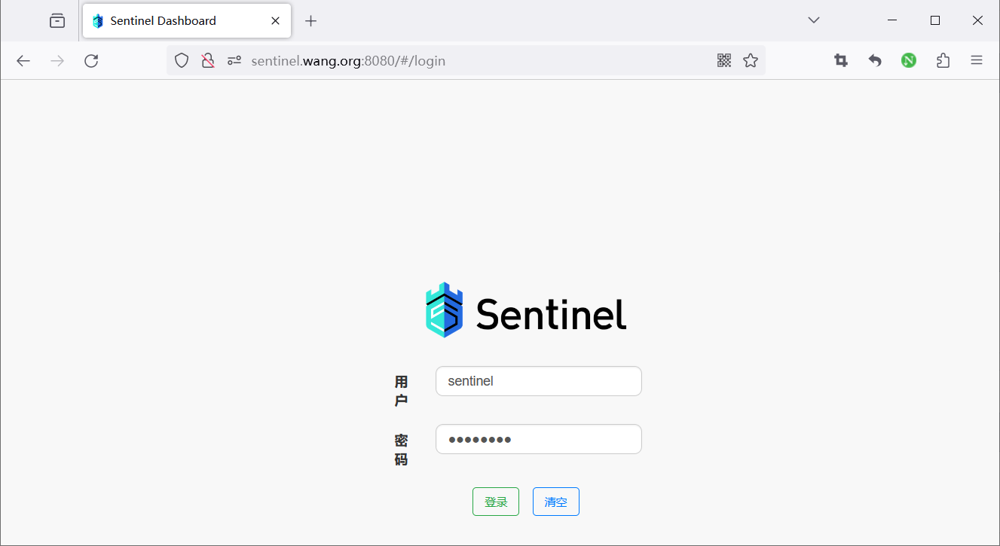

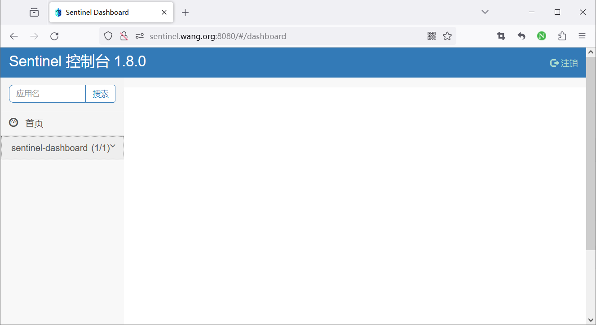

### 启动 JAVA 应用

```bash
#安装工具
[root@ubuntu2204 ~]#apt update && apt -y install openjdk-17-jdk maven
#确认版本
[root@ubuntu2204 ~]#mvn -v
Apache Maven 3.6.3
Maven home: /usr/share/maven
Java version: 17.0.9, vendor: Private Build, runtime: /usr/lib/jvm/java-17-openjdk-amd64
Default locale: en_US, platform encoding: UTF-8
OS name: "linux", version: "5.15.0-67-generic", arch: "amd64", family: "unix"
#主机解析
[root@ubuntu2204 ~]#cat /etc/hosts
10.0.0.100 sentinel.bowen.org
#配置应用
[root@ubuntu2204 sentinel-sample]#cat src/main/resources/application.yml
spring:
application:
name: sentinel-sample
cloud:
sentinel:
eager: true
transport:
port: 8719
dashboard: sentinel.bowen.org:8080
#编译
[root@ubuntu2204 sentinel-sample]#mvn clean package -Dmaven.test.skip=true
.....
Downloaded from aliyun-repos: https://maven.aliyun.com/repository/public/org/apache/commons/commons-
lang3/3.7/commons-lang3-3.7.jar (500 kB at 230 kB/s)
[INFO] Replacing main artifact with repackaged archive
[INFO] ------------------------------------------------------------------------
[INFO] BUILD SUCCESS
[INFO] ------------------------------------------------------------------------
[INFO] Total time:  01:46 min
[INFO] Finished at: 2024-05-15T15:29:57+08:00
[INFO] ------------------------------------------------------------------------
#运行
[root@ubuntu2204 sentinel-sample]#java -version
openjdk version "17.0.9" 2023-10-17
OpenJDK Runtime Environment (build 17.0.9+9-Ubuntu-122.04)
OpenJDK 64-Bit Server VM (build 17.0.9+9-Ubuntu-122.04, mixed mode, sharing)
#方法1：启动默认端口8080
[root@ubuntu2204 sentinel-sample]#java -jar target/sentinel-sample-0.0.1-SNAPSHOT.jar
#方法2：指定端口
[root@ubuntu2404 ~]#java -jar target/sentinel-sample-0.0.1-SNAPSHOT.jar --server.port=8888
#方法3：如果临时修改sentinel和nacos地址信息,可以不用修改application.yml文件重新编译,直接添加下面选项再执行
[root@ubuntu2204 sentinel-sample]#java -Dspring.cloud.sentinel.transport.dashboard=10.0.0.100:8080 -jar
target/sentinel-sample-0.0.1-SNAPSHOT.jar
#测试访问应用
#浏览器访问,多次刷新可以正常访问
http://10.0.0.101:8080/hello/bowen
```

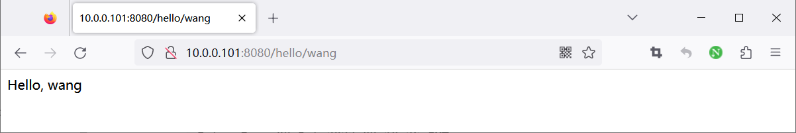

### Sentinel Dashboard 定义规则

范例:限制并发访问

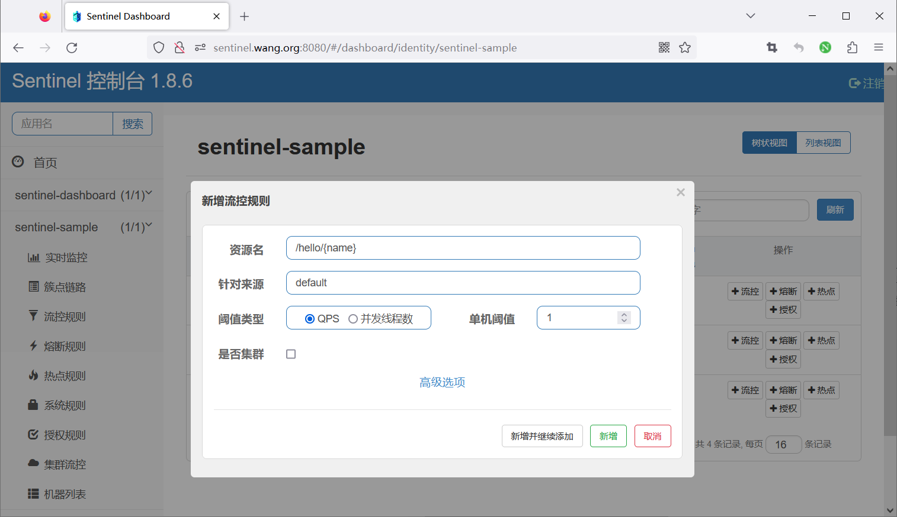

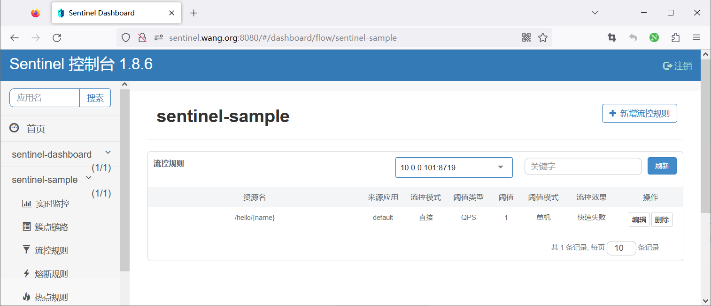

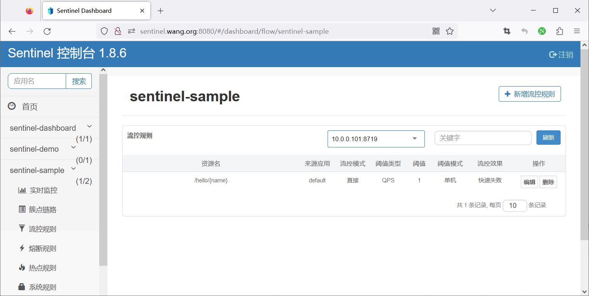

```bash
#https://sentinelguard.io/zh-cn/docs/flow-control.html
[root@ubuntu2204 ~]#curl http://sentinel.bowen.org:8719/cnode?id=sentinel-sample
idx id                                 thread    pass      blocked   success    total    aRt   1m-pass   1m-
block   1m-all   exception
2   /app/sentinel-sample/machines.json 0         0.0       0.0       0.0        0.0      0.0   0         0
0        0.0
#其中：
thread： 代表当前处理该资源的线程数；
pass： 代表一秒内到来到的请求；
blocked： 代表一秒内被流量控制的请求数量；
success： 代表一秒内成功处理完的请求；
total： 代表到一秒内到来的请求以及被阻止的请求总和；
RT： 代表一秒内该资源的平均响应时间；
1m-pass： 则是一分钟内到来的请求；
1m-block： 则是一分钟内被阻止的请求；
1m-all： 则是一分钟内到来的请求和被阻止的请求的总和；
exception： 则是一秒内业务本身异常的总和。
```


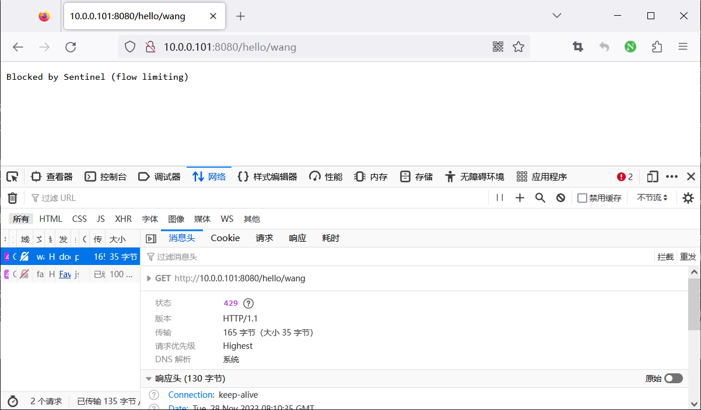

范例:关联流控

表示当/registry/machine访问超过1QPS,会限制/version访问

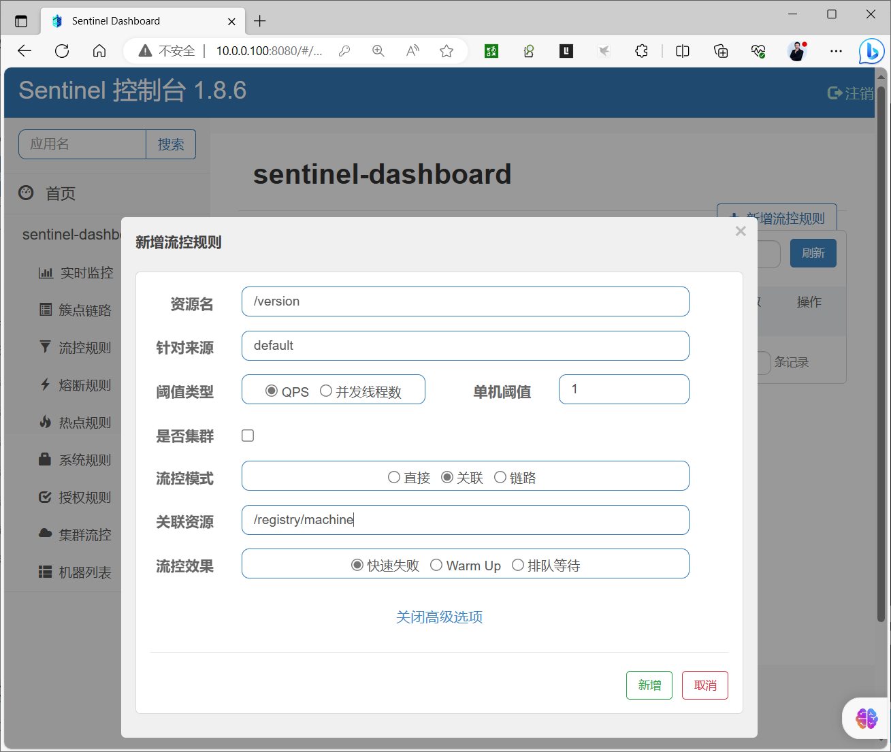

当快速访问/registry/machine时,/versoin会出现下面显示

<http://10.0.0.100:8080/registry/machine>

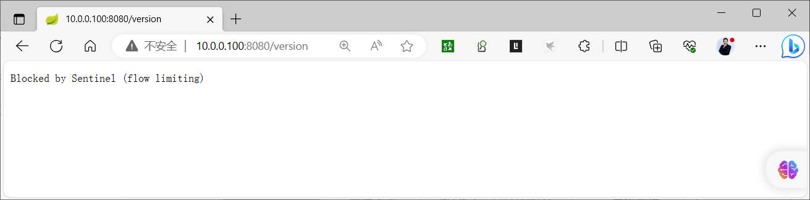

范例: 限制关发,超过并发则进行排队访问

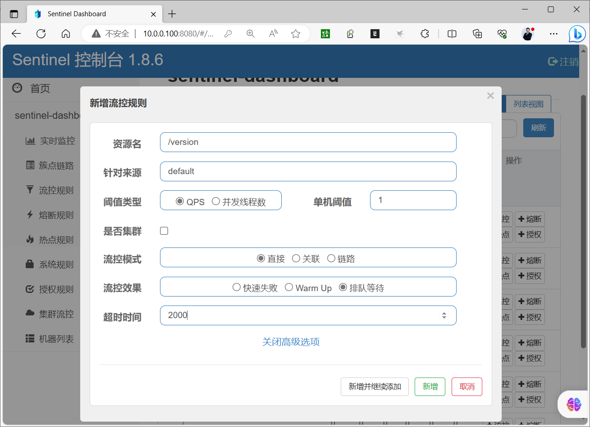

```bash
#发现一秒访问成功一次
[root@ubuntu2204 ~]#for i in {1..10};do curl -I http://10.0.0.100:8080/version ;done
HTTP/1.1 200
Content-Type: application/json;charset=UTF-8
Content-Length: 56
Date: Sun, 08 Oct 2023 09:01:25 GMT
HTTP/1.1 200
Content-Type: application/json;charset=UTF-8
Content-Length: 56
Date: Sun, 08 Oct 2023 09:01:25 GMT
HTTP/1.1 200
Content-Type: application/json;charset=UTF-8
Content-Length: 56
Date: Sun, 08 Oct 2023 09:01:27 GMT
HTTP/1.1 200
Content-Type: application/json;charset=UTF-8
Content-Length: 56
Date: Sun, 08 Oct 2023 09:01:27 GMT
HTTP/1.1 200
Content-Type: application/json;charset=UTF-8
Content-Length: 56
Date: Sun, 08 Oct 2023 09:01:29 GMT
HTTP/1.1 200
Content-Type: application/json;charset=UTF-8
Content-Length: 56
Date: Sun, 08 Oct 2023 09:01:29 GMT
```

### 基于 JAVA 应用的 Sentinel 和 Nacos 实战案例

### 启动 Sentinel dashboard

<https://hub.docker.com/r/bladex/sentinel-dashboard>

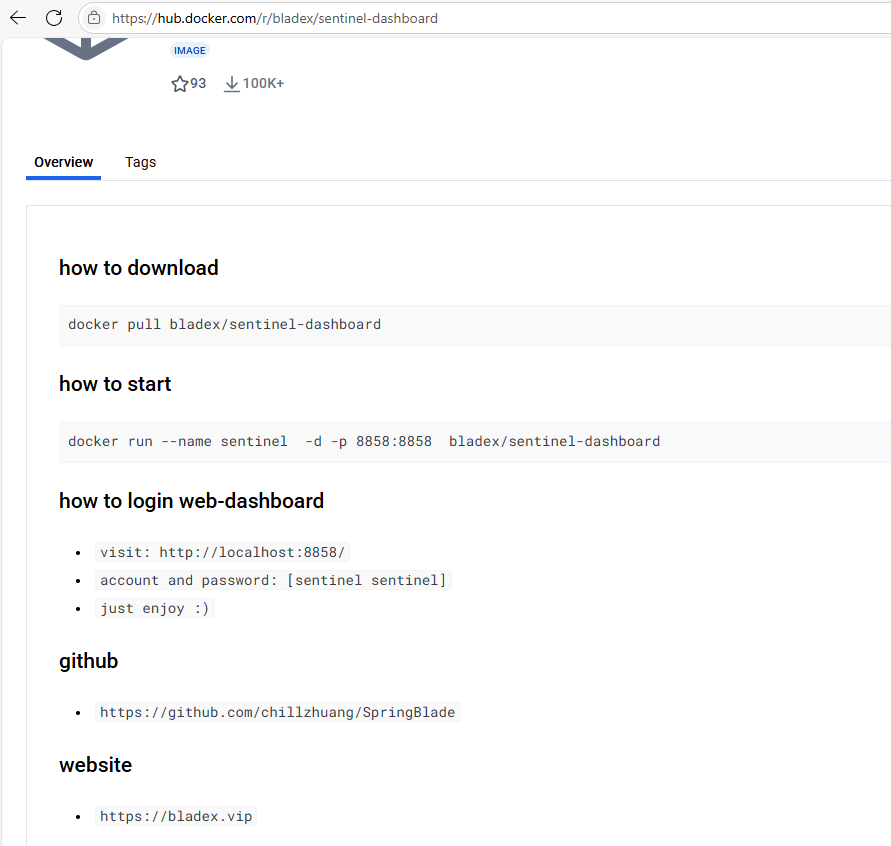

```xml
#安装docker环境
[root@ubuntu2204 ~]#apt update && apt -y install docker.io
#拉取最新版析镜像v1.8.8
[root@ubuntu2204 ~]#docker pull bladex/sentinel-dashboard
[root@ubuntu2204 ~]#docker pull registry.cn-beijing.aliyuncs.com/bowenxiaochun/sentinel-dashboard:1.8.8
[root@ubuntu2204 ~]#docker images
REPOSITORY                  TAG           IMAGE ID       CREATED        SIZE
bladex/sentinel-dashboard   latest        aa398704ebd3   3 years ago    147MB
#启动,注意：官方文档说明的8858端口是错误的，应该是8080
[root@ubuntu2404 ~]#docker history  registry.cn-beijing.aliyuncs.com/bowenxiaochun/sentinel-dashboard:1.8.8
IMAGE          CREATED       CREATED BY                                      SIZE      COMMENT
6e693075c827   3 weeks ago   /bin/sh -c #(nop)  ENTRYPOINT ["java" "-jar"…   0B
<missing>      3 weeks ago   /bin/sh -c #(nop) WORKDIR /home/sentinel        0B
<missing>      3 weeks ago   /bin/sh -c #(nop)  EXPOSE 8080                  0B
<missing>      3 weeks ago   /bin/sh -c #(nop) COPY file:1dbd5f3f0d85d9d8…   22.7MB
<missing>      3 weeks ago   /bin/sh -c ln -sf /usr/share/zoneinfo/Asia/S…   33B
<missing>      3 weeks ago   /bin/sh -c #(nop)  ENV VERSION=1.8.8            0B
<missing>      6 years ago   /bin/sh -c set -x  && apk add --no-cache   o…   79.4MB
<missing>      6 years ago   /bin/sh -c #(nop)  ENV JAVA_ALPINE_VERSION=8…   0B
<missing>      6 years ago   /bin/sh -c #(nop)  ENV JAVA_VERSION=8u212       0B
<missing>      6 years ago   /bin/sh -c #(nop)  ENV PATH=/usr/local/sbin:…   0B
<missing>      6 years ago   /bin/sh -c #(nop)  ENV JAVA_HOME=/usr/lib/jv…   0B
<missing>      6 years ago   /bin/sh -c {   echo '#!/bin/sh';   echo 'set…   87B
<missing>      6 years ago   /bin/sh -c #(nop)  ENV LANG=C.UTF-8             0B
<missing>      6 years ago   /bin/sh -c #(nop)  CMD ["/bin/sh"]              0B
<missing>      6 years ago   /bin/sh -c #(nop) ADD file:a86aea1f3a7d68f6a…   5.53MB
[root@ubuntu2204 ~]#docker run --name sentinel -d -p -p 8080:8080 -p 8719:8719 registry.cn-
beijing.aliyuncs.com/bowenxiaochun/sentinel-dashboard:1.8.8
[root@ubuntu2204 ~]#docker run --name sentinel -d -p 8080:8080 -p 8719:8719 bladex/sentinel-dashboard
#确认启动
[root@ubuntu2204 ~]#docker ps
CONTAINER ID   IMAGE                            COMMAND                  CREATED         STATUS         PORTS
NAMES
7e5270b7718d   bladex/sentinel-dashboard        "java -Djava.securit…"   2 seconds ago   Up 2 seconds
0.0.0.0:8719->8719/tcp, :::8719->8719/tcp, 0.0.0.0:8080->8858/tcp, :::8080->8858/tcp   sentinel
#登录Sentinel,默认用户和密码都是sentinel
http://sentinel.bowen.org:8080/
```


### 启动 Nacos

```bash
#如果和sentinel安装在同一台主机,可以省略安装工具
[root@ubuntu2204 ~]#apt update && apt -y install docker.io
#拉取镜像
[root@ubuntu2204 ~]#docker pull registry.cn-beijing.aliyuncs.com/bowenxiaochun/nacos-server:v2.4.3-slim
[root@ubuntu2204 ~]#docker pull registry.cn-beijing.aliyuncs.com/bowenxiaochun/nacos-server:v2.2.3-slim
[root@ubuntu2204 ~]#docker pull nacos/nacos-server:v2.2.3-slim
[root@ubuntu2204 ~]#docker images
REPOSITORY                  TAG           IMAGE ID       CREATED        SIZE
nacos/nacos-server          v2.2.3-slim   2266763b639b   6 months ago   383MB
[root@ubuntu2204 ~]#docker run --name nacos -e MODE=standalone -p 8848:8848 -p 9848:9848 -d registry.cn-
beijing.aliyuncs.com/bowenxiaochun/nacos-server:v2.4.3-slim
[root@ubuntu2204 ~]#docker run --name nacos -e MODE=standalone -p 8848:8848 -p 9848:9848 -d registry.cn-
beijing.aliyuncs.com/bowenxiaochun/nacos-server:v2.2.3-slim
[root@ubuntu2204 ~]#docker run --name nacos -e MODE=standalone -p 8848:8848 -p 9848:9848 -d nacos/nacos-
server:v2.2.3-slim
[root@ubuntu2204 ~]#docker ps
CONTAINER ID   IMAGE                            COMMAND                  CREATED          STATUS         PORTS
NAMES
852f9991653b   nacos/nacos-server:v2.2.3-slim   "bin/docker-startup.…"   4 minutes ago    Up 4 minutes
0.0.0.0:8848->8848/tcp, :::8848->8848/tcp, 0.0.0.0:9848->9848/tcp, :::9848->9848/tcp   nacos
#登录nacos
http://nacos.bowen.org:8848/nacos/
```

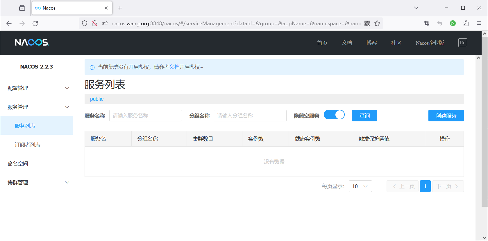

### 启动 JAVA 应用

```bash
#安装工具
[root@ubuntu2404 ~]#apt update && apt -y install openjdk-21-jdk maven
[root@ubuntu2204 ~]#apt update && apt -y install openjdk-17-jdk maven
#确认版本
[root@ubuntu2204 ~]#mvn -v
Apache Maven 3.6.3
Maven home: /usr/share/maven
Java version: 17.0.9, vendor: Private Build, runtime: /usr/lib/jvm/java-17-openjdk-amd64
Default locale: en_US, platform encoding: UTF-8
OS name: "linux", version: "5.15.0-67-generic", arch: "amd64", family: "unix"
[root@ubuntu2204 ~]#hostname
ubuntu2204.bowen.org
#主机解析
[root@ubuntu2204 ~]#cat /etc/hosts
10.0.0.100 sentinel.bowen.org nacos.bowen.org
10.0.0.101 ubuntu2204.bowen.org #添加本机主机名的解析，否则可能反向解析到互联网的主机
#配置应用
[root@ubuntu2204 sentinel-nacos-demo]#cat src/main/resources/application.yml
spring:
application:
name: sentinel-nacos-demo
cloud:
nacos:
discovery:
server-addr: nacos.bowen.org:8848
sentinel:
eager: true
transport:
port: 8719
dashboard: sentinel.bowen.org:8080
#编译
[root@ubuntu2204 sentinel-nacos-demo]#mvn clean package -Dmaven.test.skip=true
....
[INFO] Replacing main artifact with repackaged archive
[INFO] ------------------------------------------------------------------------
[INFO] BUILD SUCCESS
[INFO] ------------------------------------------------------------------------
[INFO] Total time:  21.558 s
[INFO] Finished at: 2024-05-15T15:40:06+08:00
[INFO] ------------------------------------------------------------------------
#运行
[root@ubuntu2204 sentinel-nacos-demo]#java -version
openjdk version "17.0.9" 2023-10-17
OpenJDK Runtime Environment (build 17.0.9+9-Ubuntu-122.04)
OpenJDK 64-Bit Server VM (build 17.0.9+9-Ubuntu-122.04, mixed mode, sharing)
#执行
#方法1,默认8080
[root@ubuntu2204 sentinel-nacos-demo]#java -jar target/sentinel-nacos-demo-0.0.1-SNAPSHOT.jar
#方法2：指定端口
[root@ubuntu2404 ~]#java -jar sentinel-nacos-demo-0.0.1-SNAPSHOT.jar --server.port=8888
#方法3：如果临时修改sentinel和nacos地址信息,可以不用修改application.yml文件重新编译,直接添加下面选项再执行
[root@ubuntu2204 sentinel-nacos-demo]#java -Dspring.cloud.nacos.discovery.server-addr=10.0.0.100:8848 -
Dspring.cloud.nacos.config.server-addr=10.0.0.100:8848 -
Dspring.cloud.sentinel.transport.dashboard=10.0.0.100:8080 -jar target/sentinel-nacos-demo-0.0.1-SNAPSHOT.jar
```

### 测试访问应用

```text
#浏览器访问,多次刷新可以正常访问
http://10.0.0.101:8080/hello/bowenxiaochun
```

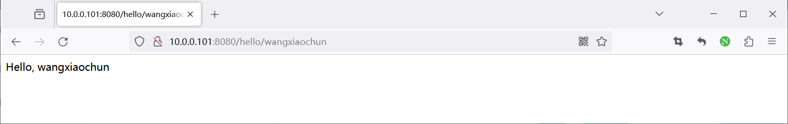

查看Sentinel控制台


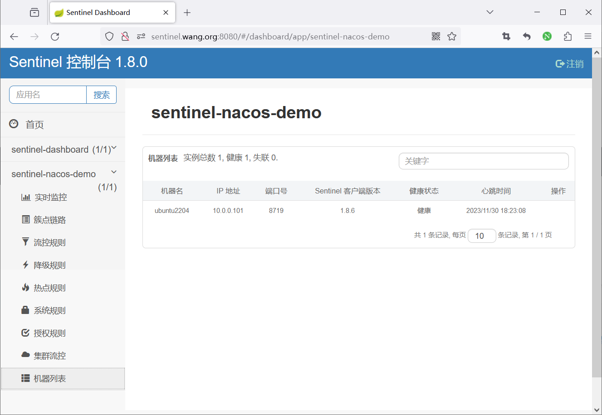

查看Nacos 控制台

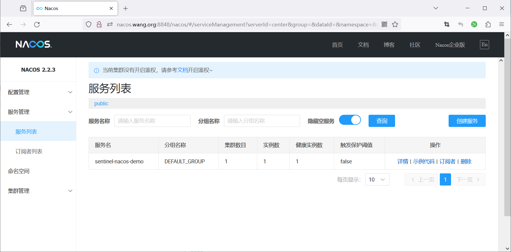

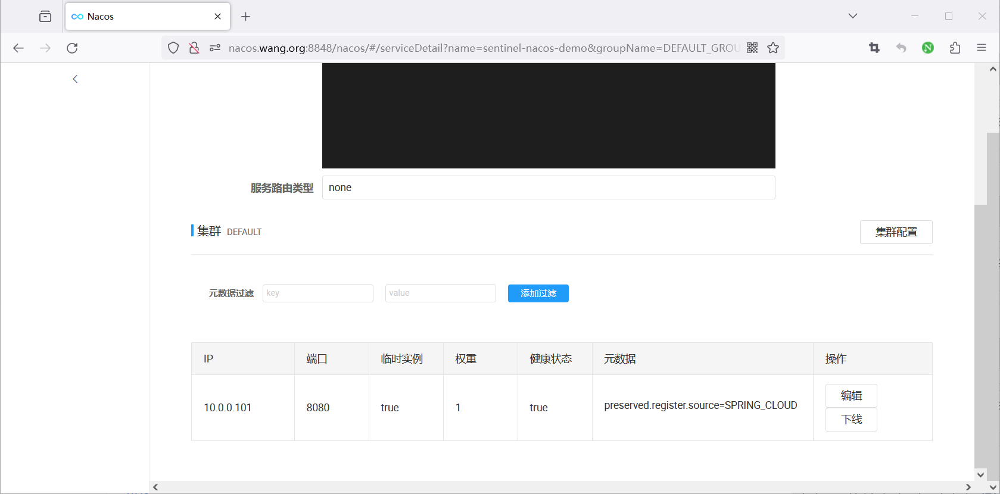

### 定制流控策略

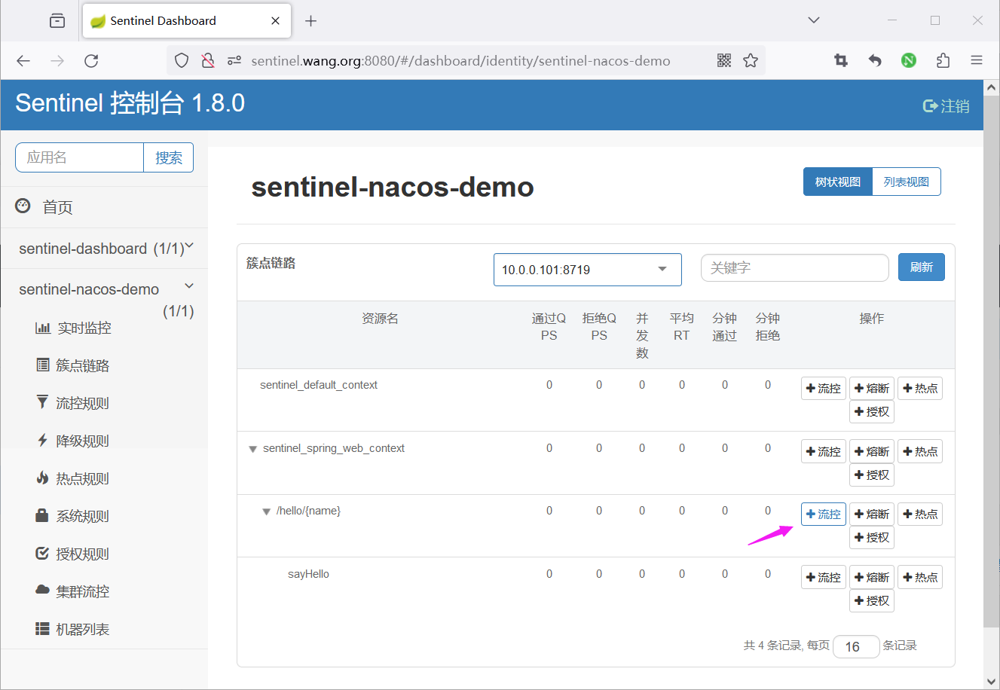

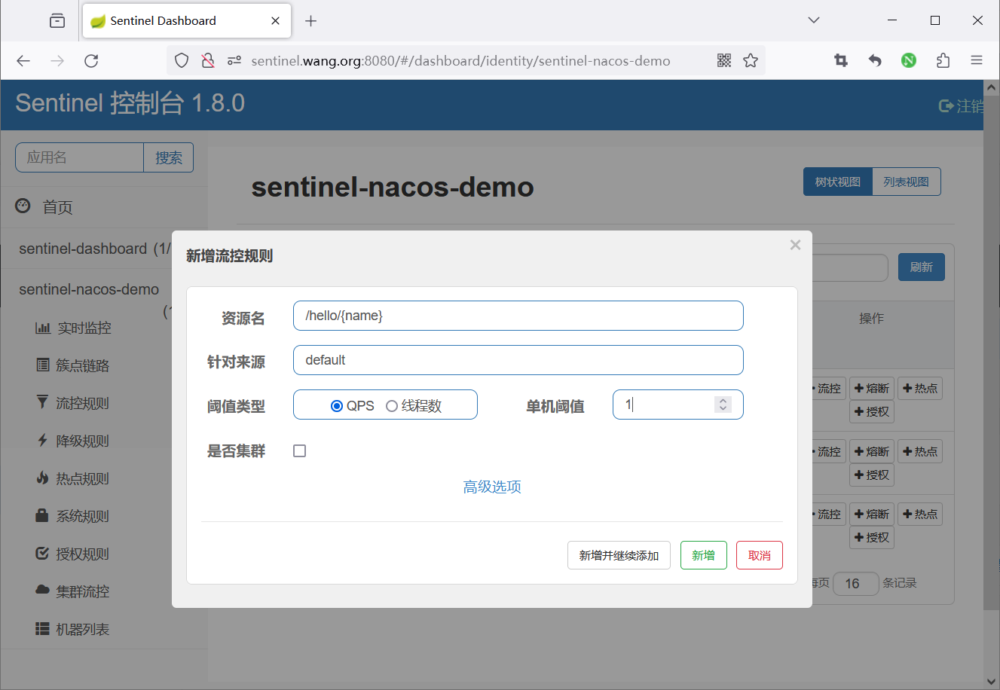

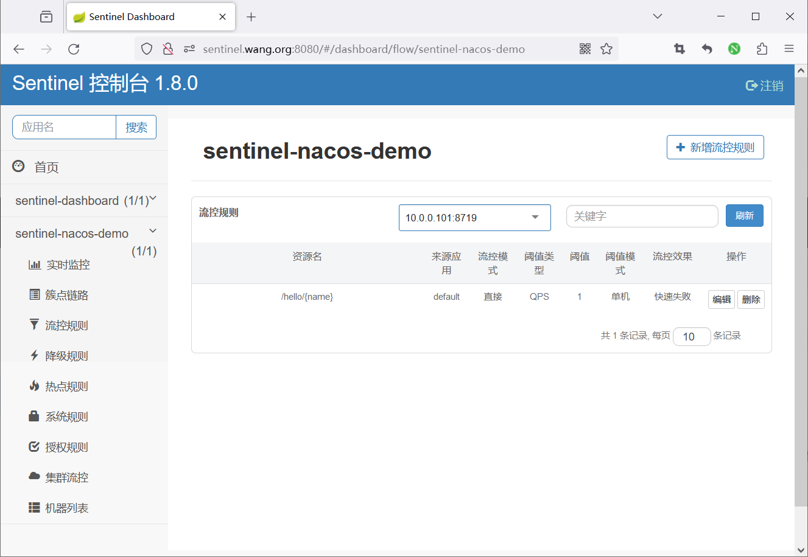

### 测试访问应用观察流控制策略效果

```text
#快速刷新页面,观察效果
http://10.0.0.101:8080/hello/bowenxiaochun
```

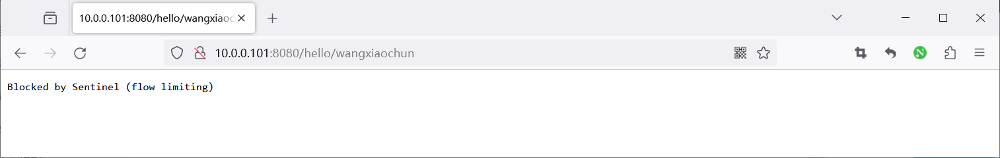

```bash
[root@ubuntu2204 ~]#for i in {1..5};do curl -I http://10.0.0.101:8080/hello/bowenxiaochun;echo;sleep 0.5;done
HTTP/1.1 200
Content-Type: text/plain;charset=UTF-8
Content-Length: 19
Date: Thu, 30 Nov 2023 10:22:29 GMT
HTTP/1.1 429
Transfer-Encoding: chunked
Date: Thu, 30 Nov 2023 10:22:29 GMT
HTTP/1.1 200
Content-Type: text/plain;charset=UTF-8
Content-Length: 19
Date: Thu, 30 Nov 2023 10:22:30 GMT
HTTP/1.1 429
Transfer-Encoding: chunked
Date: Thu, 30 Nov 2023 10:22:30 GMT
HTTP/1.1 200
Content-Type: text/plain;charset=UTF-8
Content-Length: 19
Date: Thu, 30 Nov 2023 10:22:31 GMT
```



<nav class="article-end" aria-label="章节导航">
  <a href="{{ '/subjects/Microservices/29-resources-and-rules.html' | relative_url }}">← Previous: Resources and Rules</a>
  <a href="{{ '/subjects/Microservices/' | relative_url }}">Back to Microservices Index</a>
  <a href="{{ '/subjects/Microservices/31-seata-architecture-and-mechanisms.html' | relative_url }}">Next: Seata Architecture and Mechanisms →</a>
</nav>
