[← 返回微服务架构目录]({{ '/subjects/Microservices/' | relative_url }})



# 30 Sentinel 实战案例

本篇把前面的接入、规则和验证串成两个实验。**实验 A** 只用 Sentinel Dashboard 和一个 Java 应用验证限流；**实验 B** 再加入 Nacos 服务注册。原资料交替使用第三方镜像、多个 JDK 版本和不同端口，下面按职责划清边界，避免把“能打开控制台”误判为规则生效。

## 实验 A：对 Java 接口限流

### 1. 准备控制台与应用

按第 27 篇启动 Dashboard，假设地址为 `DASHBOARD_HOST:8080`。若使用原资料的第三方容器镜像，先核对镜像内实际监听的是 8858 还是 8080，再设置宿主机端口映射；两种镜像不能互换命令。控制台进程本身不需要映射业务客户端的 8719 端口。

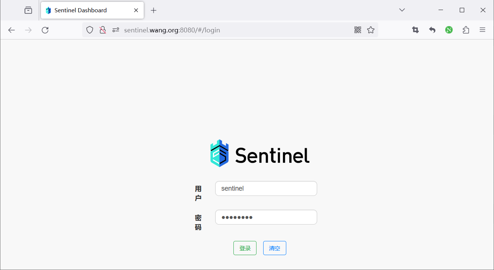
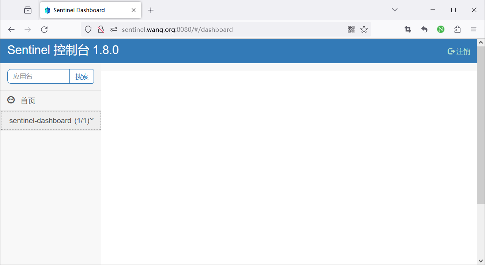

在有 Sentinel starter 的 Spring 应用中，配置文件应保留 YAML 缩进。以下假设应用的业务接口监听 8081，避免与同机 Dashboard 的 8080 冲突：

```yaml
server:
  port: 8081
spring:
  application:
    name: sentinel-sample
  cloud:
    sentinel:
      eager: true
      transport:
        dashboard: DASHBOARD_HOST:8080
        port: 8719
```

`eager: true` 可让客户端更早初始化，但仍需实际访问受保护资源才能看到它的指标。按项目所选 JDK/Spring 版本构建和运行，不必依次安装 JDK 8、17、21。若改用 JVM 属性覆盖配置，选项必须完整且放在 `-jar` 前面。

### 2. 先观察正常请求

假设应用实现 `GET /hello/{name}`，执行 `curl http://APP_HOST:8081/hello/test`，确认返回正常。再检查 Dashboard 的机器列表和簇点链路，看到该资源。此时还没有规则，不应出现限流响应。

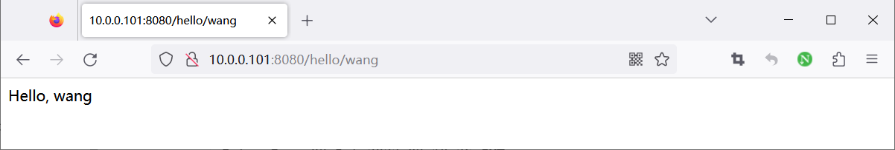

### 3. 设置规则并验证阻断

在 Dashboard 为**实际显示的资源名**创建 QPS 流控规则，例如每秒 1 次、直接拒绝。随后用可控速率并发请求，观察成功数与阻断数、客户端日志以及接口的 HTTP 状态。原资料中的 429 是其示例应用对 `BlockException` 的处理结果；Sentinel 核心库本身不保证所有框架和应用都返回 429，响应码与文案需由适配器或业务处理器定义。

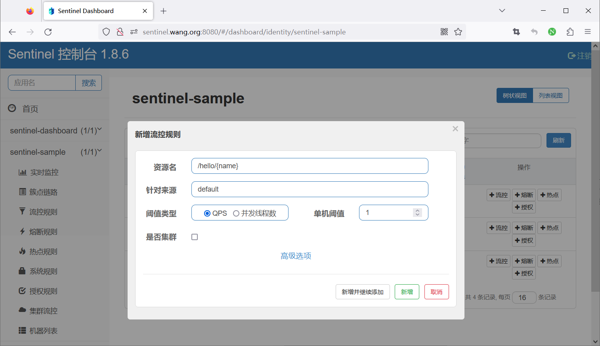
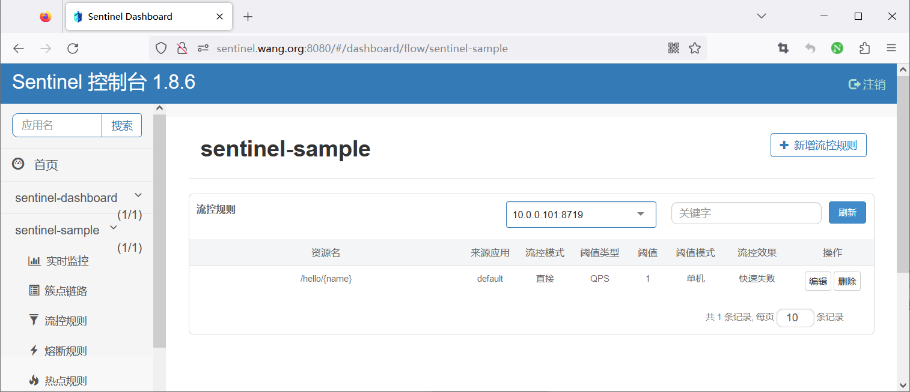
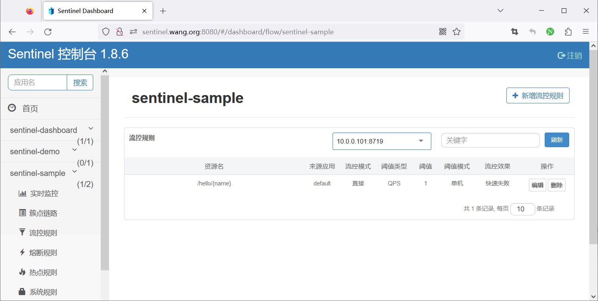
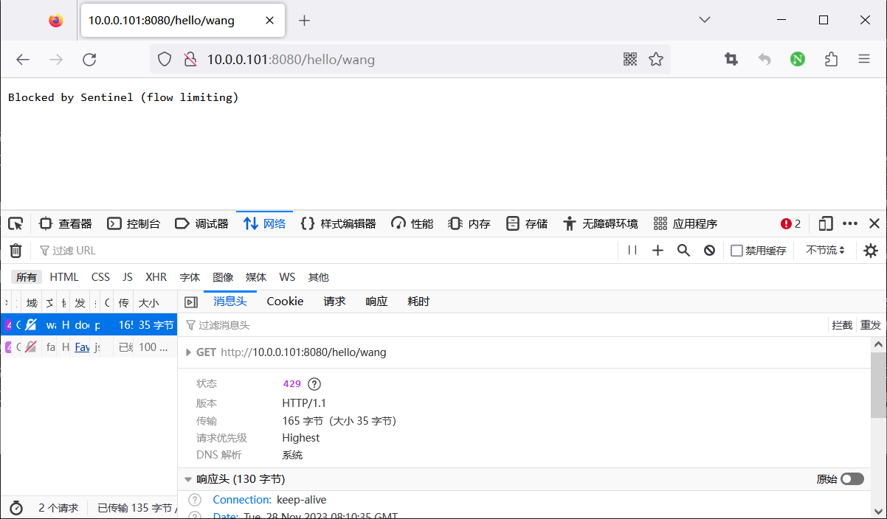

可在**应用所在主机**查询客户端命令端口，例如 `http://127.0.0.1:8719/cnode?id=sentinel-sample`；不要把这个端口写成 Dashboard 主机的地址。Dashboard 的 8080 是界面端口，客户端的 8719 是管理 API 端口，应用的 8081 是业务端口。请求被阻断后撤销测试规则，确认接口恢复。

关联流控的意思是“关联资源达到阈值时，限制当前资源”，因此要先确认两个资源都在**同一应用的资源树中**且请求确实命中它们。原资料举了 `/registry/machine` 与 `/version`，还把 URL 拼错；这些通常是控制台自身接口，不宜作为业务应用的通用示例。匀速排队则把允许等待的请求平滑处理，超出最大等待时长仍会被拒绝；它不等于“限制并发数”。

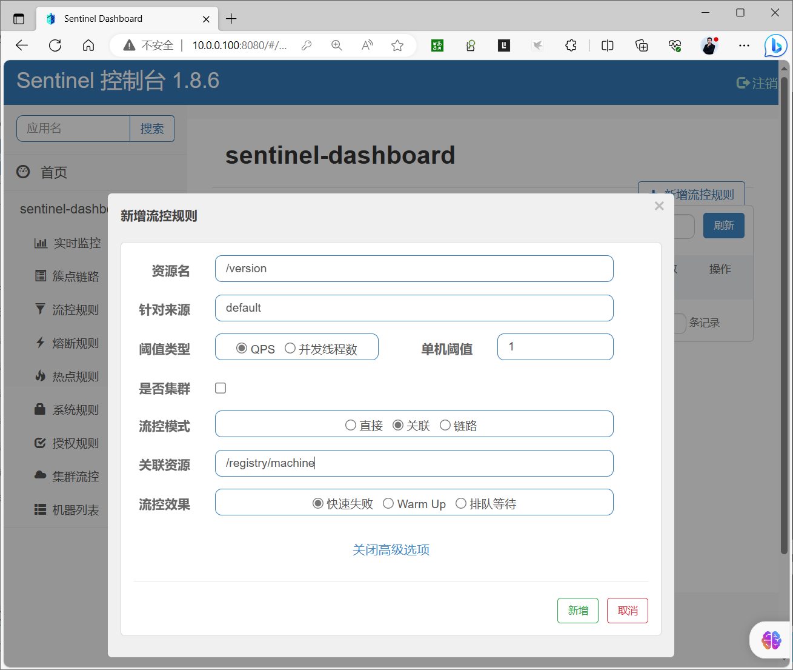
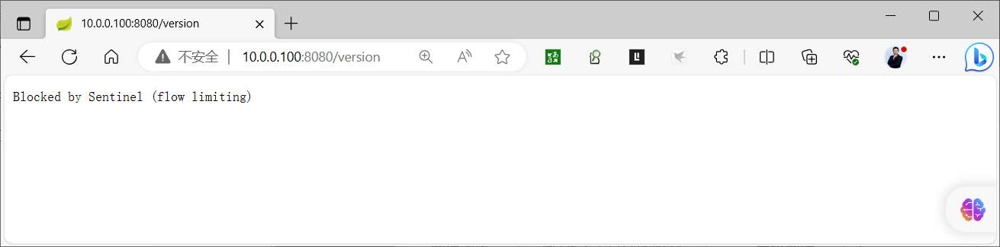
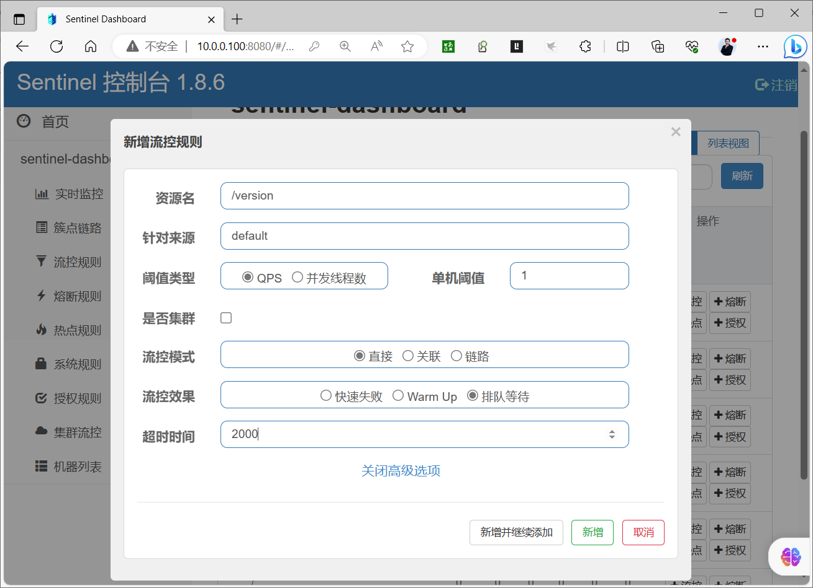

## 实验 B：加入 Nacos 注册发现

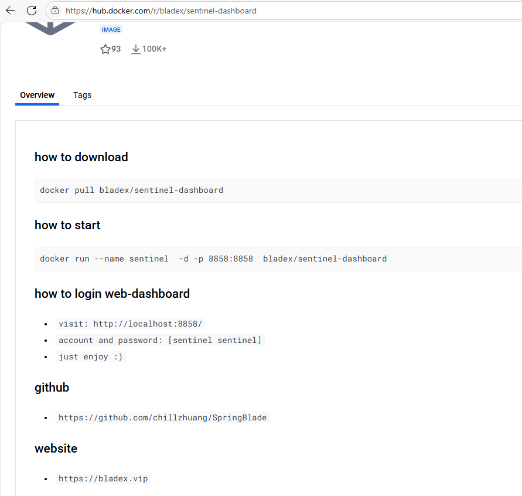

按第 24 篇启动与客户端兼容的 Nacos，假设地址为 `NACOS_HOST:8848`；2.x 客户端通常还需可达 9848。Nacos 保存服务实例，Sentinel 管理流量规则：**让应用注册进 Nacos 并不会自动把 Sentinel 规则保存在 Nacos**。规则持久化需要第 29 篇所说的配置数据源及写入路径。

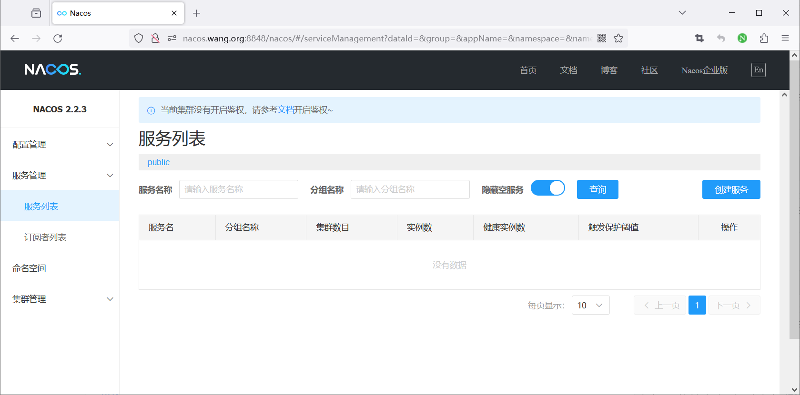

应用引入兼容版本的 Nacos Discovery 和 Sentinel starter，分别配置两个地址：

```yaml
server:
  port: 8081
spring:
  application:
    name: sentinel-nacos-demo
  cloud:
    nacos:
      discovery:
        server-addr: NACOS_HOST:8848
    sentinel:
      eager: true
      transport:
        dashboard: DASHBOARD_HOST:8080
        port: 8719
```

构建并启动后，分别验证三个不同事实：业务接口 `/hello/test` 可访问；Nacos 中出现 `sentinel-nacos-demo` 的健康实例；Sentinel Dashboard 中出现机器和资源。若其中一项失败，不要把问题统称为“微服务没启动”，而应按业务端口、注册连接或 Sentinel 客户端接入分别排查。

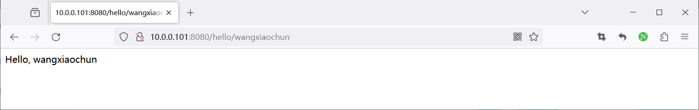

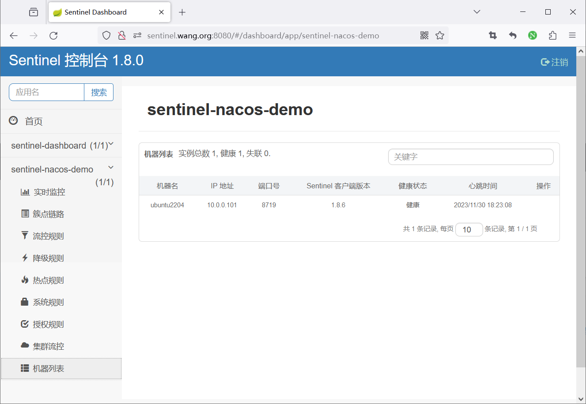
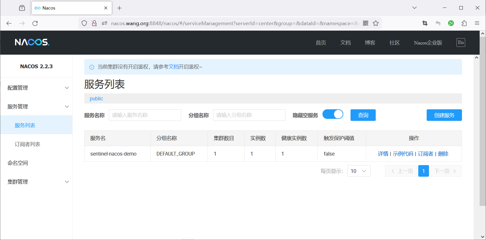
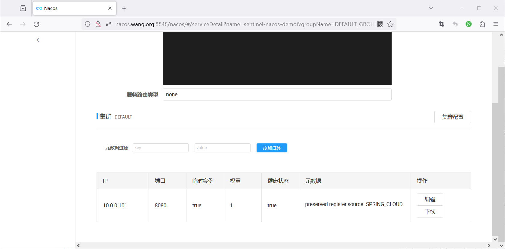

最后在 Dashboard 为业务资源设置一个低于测试流量的 QPS 阈值。用一组有间隔且总量可控的请求观察 200 与限流响应，再删除规则恢复访问。**客户端规则默认仍在内存中**：重启应用后再次查询规则，若消失是预期现象，不代表 Nacos 服务注册失败。

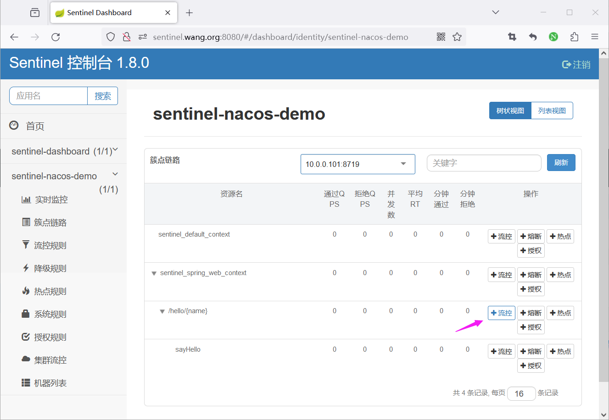
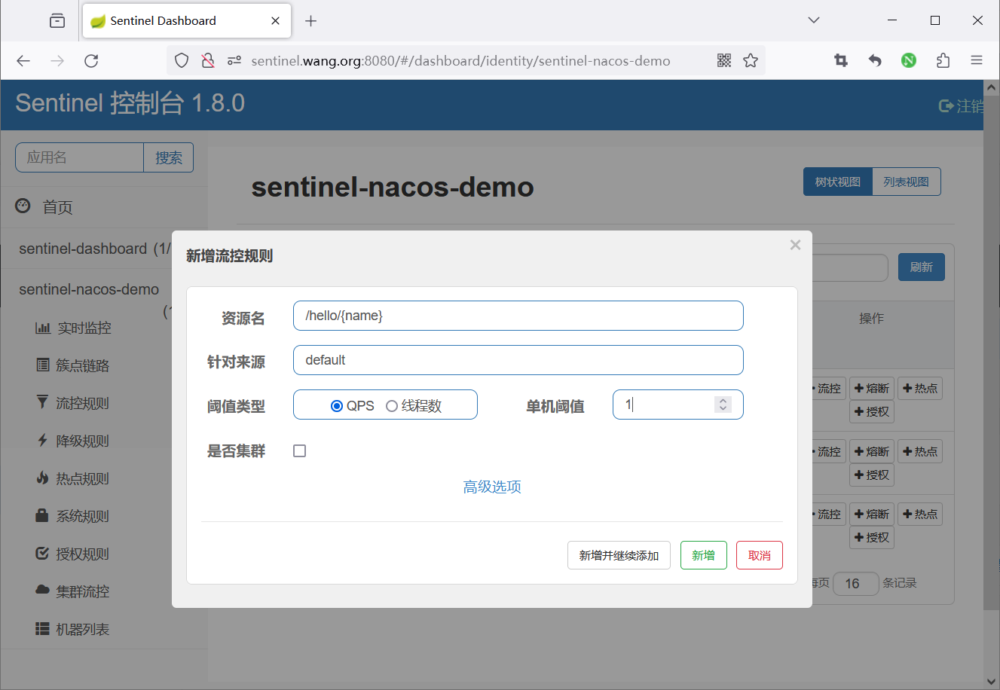
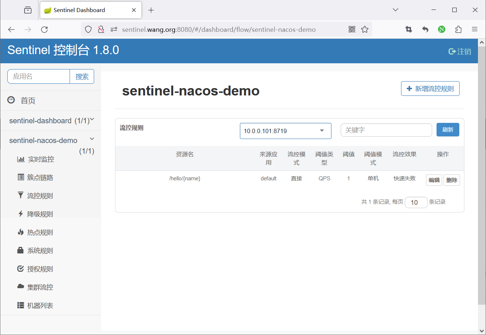
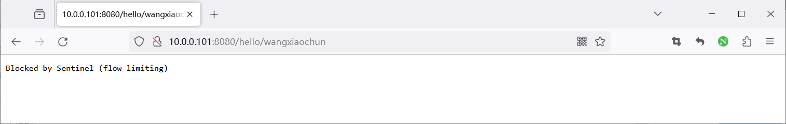

原资料中重复的控制台和 Nacos 容器启动记录只是不同实验环境的日志，并不表示需要启动多份同名容器。整个案例的验收顺序是**应用正常 → Nacos 注册 → Sentinel 资源出现 → 阈值生效 → 撤销规则恢复**。



<nav class="article-end" aria-label="章节导航">
  <a href="{{ '/subjects/Microservices/29-resources-and-rules.html' | relative_url }}">← 上一篇：资源与规则</a>
  <a href="{{ '/subjects/Microservices/' | relative_url }}">返回专题目录</a>
  <a href="{{ '/subjects/Microservices/31-seata-architecture-and-mechanisms.html' | relative_url }}">下一篇：Seata 架构与机制 →</a>
</nav>
