[← 返回微服务架构目录]({{ '/subjects/Microservices/' | relative_url }})



# 31 Seata 介绍和工作机制

## 为什么本地事务不够

在单体应用中，订单、账户和库存若共用同一个数据库，数据库本地事务可把“创建订单、扣款、扣库存”作为一个提交单元。拆成独立服务和数据库后，每个服务只能保证自己的本地事务：订单成功而库存失败时，整体业务状态如何收敛就成了跨服务问题。分布式事务方案需要明确参与者、失败补偿、隔离边界和超时行为，而不是简单把多个本地事务拼在一起。

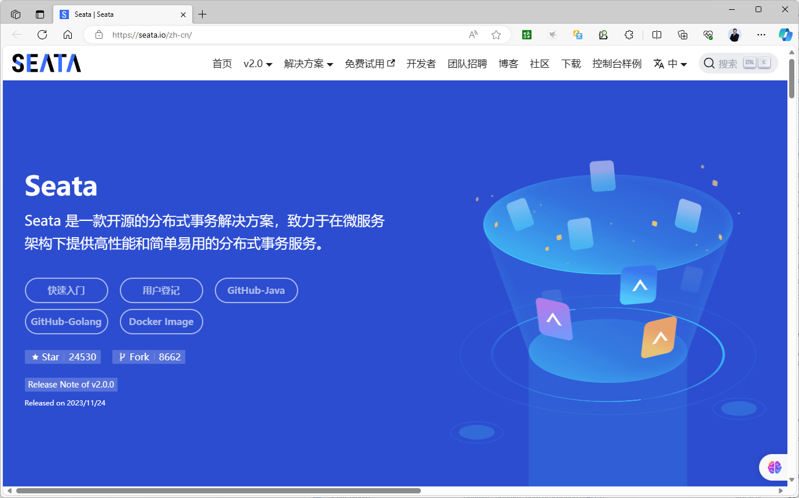
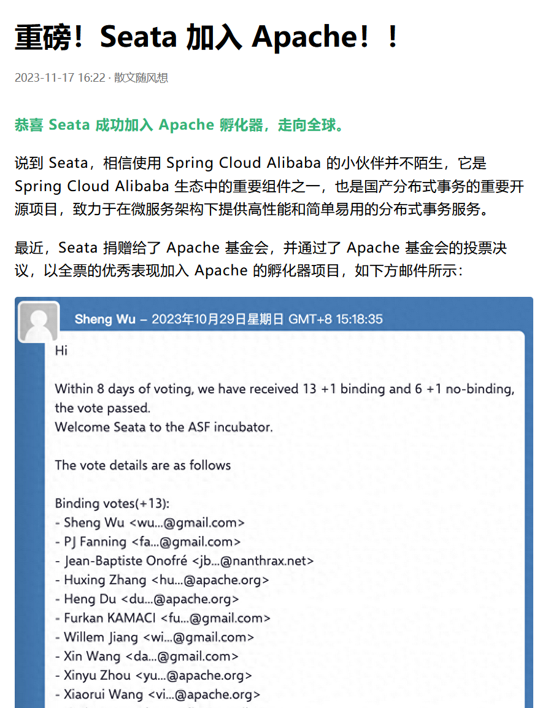
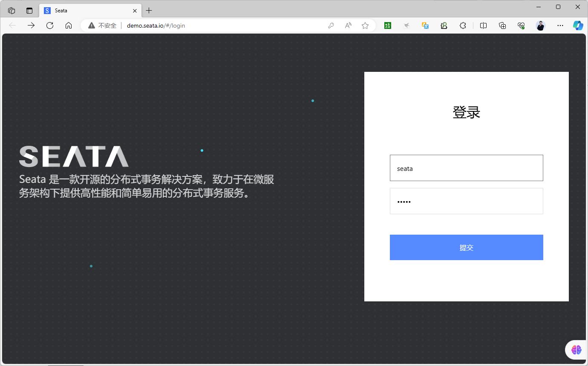
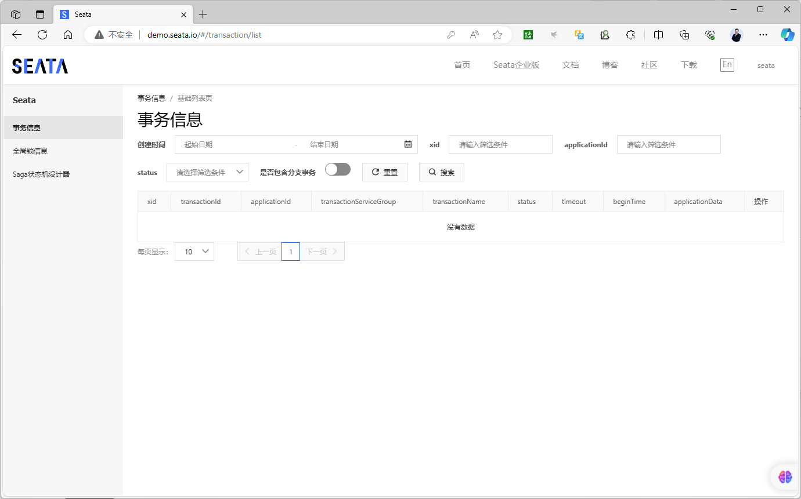

[Seata](https://seata.apache.org/) 是分布式事务框架，提供 AT、XA、TCC 和 Saga 等模式。原资料中的“最新版本 1.8.0”“Spring Cloud Alibaba 是 Spring Cloud 官方顶级项目”等属于过时或错误的绝对判断；部署与选型应以目标版本文档、数据库支持矩阵和实际业务约束为准。

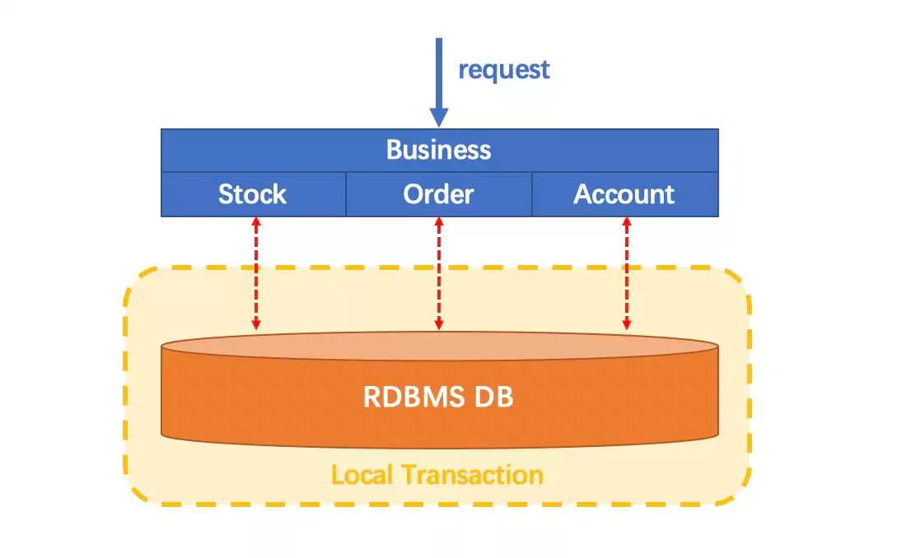
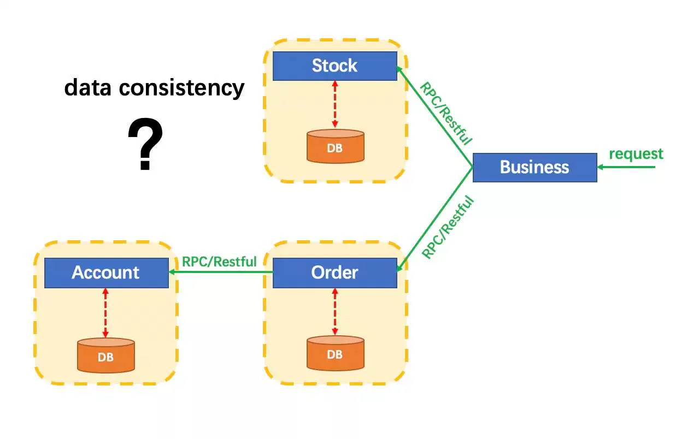
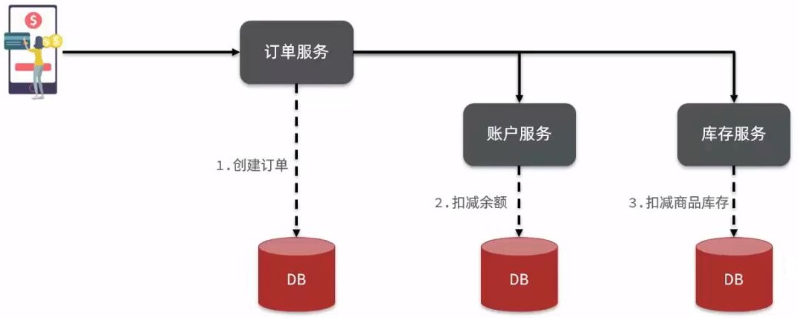
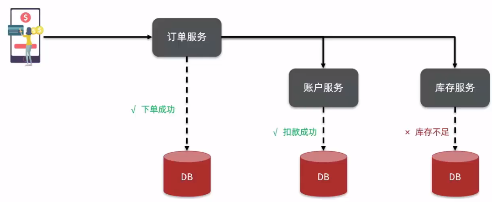

## Seata 的三个角色

一个**全局事务**由若干分支事务组成，`XID` 标识全局事务，须沿服务调用链正确传播。三个角色分工如下：

| 角色 | 所在位置与职责 |
| --- | --- |
| TC（Transaction Coordinator） | Seata Server，维护全局与分支状态，协调提交或回滚。 |
| TM（Transaction Manager） | 发起全局事务的应用，界定事务边界，向 TC 申请开始、提交或回滚。 |
| RM（Resource Manager） | 参与者应用中的资源管理部分，向 TC 注册分支、报告状态，并按模式完成分支提交或回滚。 |

典型过程是：TM 开启全局事务并获得 XID；调用链传播 XID；各 RM 注册分支并执行各自的一阶段；TM 发出全局提交或回滚请求；TC 协调各分支完成后续动作。这里的“两阶段”是**框架层面的协调模型**，并不意味着 AT、TCC、Saga 都使用数据库 XA 的 prepare/commit 协议。网络超时、重试和部分分支长期失败时，还需要事务日志、重试、人工处理与对账机制。

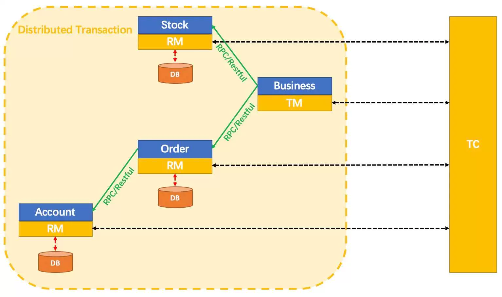
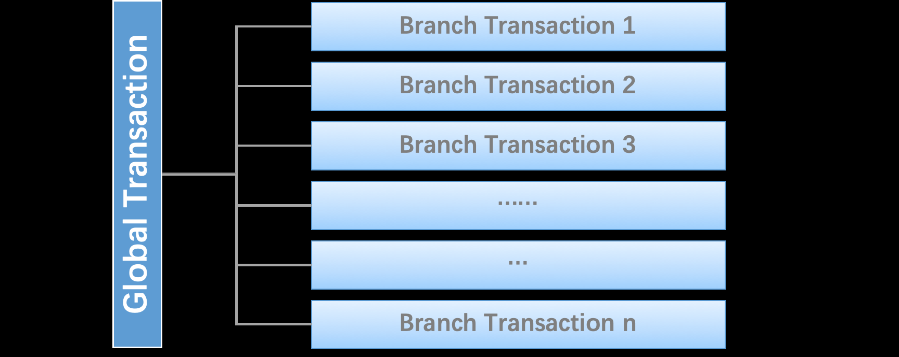
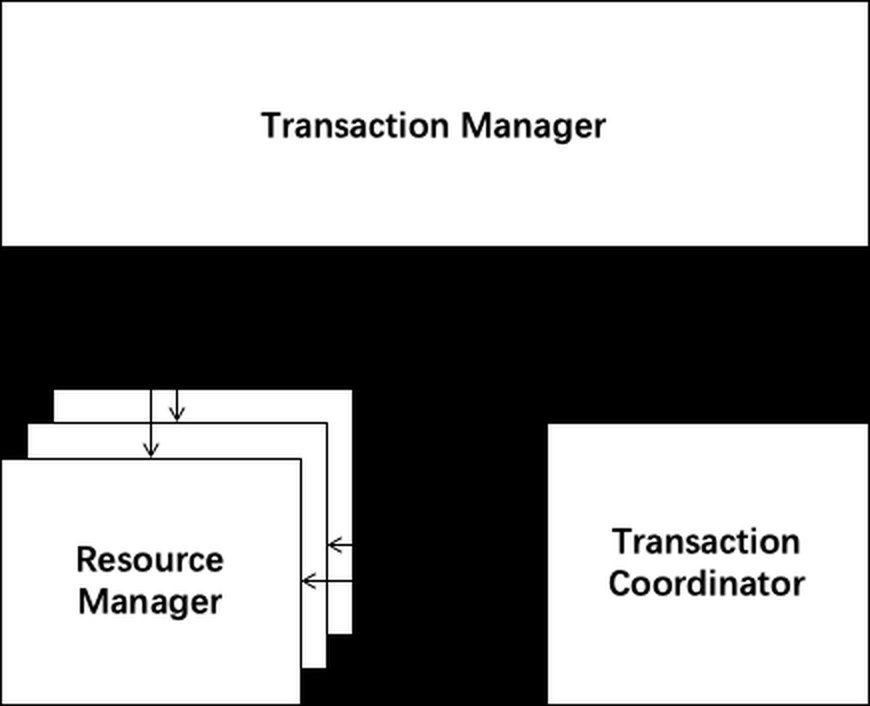
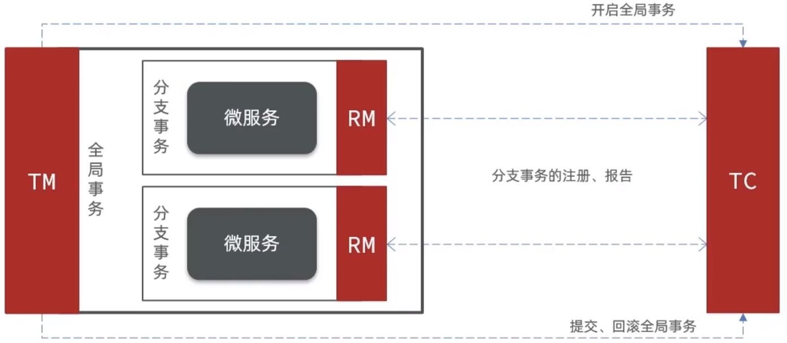
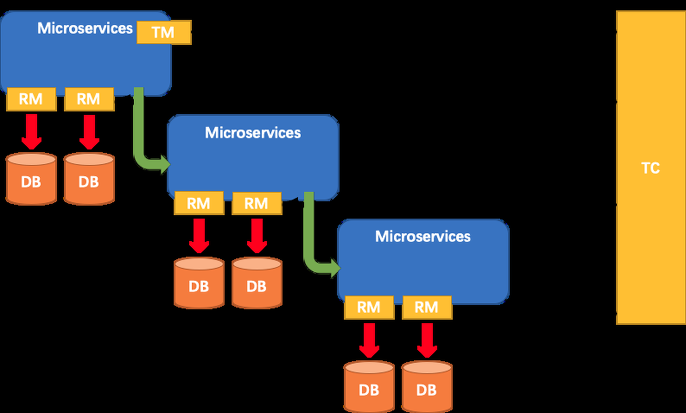

## 四种模式按业务条件选择

| 模式 | 一阶段与二阶段 | 业务改造 | 主要代价 |
| --- | --- | --- | --- |
| XA | 数据库分支准备后等待全局提交或回滚 | 相对少，但依赖 XA 数据源与正确代理 | 锁和连接占用时间长，故障时可能阻塞 |
| AT | 本地事务提交时保存 undo log；全局回滚再补偿 | 相对少，需数据库与 SQL 适配 | 中间状态可见，需全局锁与脏写防护 |
| TCC | Try 预留；Confirm 完成或 Cancel 释放 | 高，需要业务实现三个动作 | 幂等、空回滚、悬挂与资源预留逻辑复杂 |
| Saga | 一系列本地事务；失败时执行补偿 | 高，需要状态机与补偿设计 | 隔离弱，补偿可能无法完全“撤销”外部效果 |

不要用“XA 必然 CP、其他模式必然 AP”替代业务分析：CAP 描述网络分区时的系统取舍，不能直接给事务模式贴质量标签。性能也不是固定排名，要看锁等待、事务时长、冲突率、数据库能力和补偿成本。

### XA：数据库参与的两阶段提交

XA 模式要求数据库和 JDBC 访问链路支持 XA。一阶段执行 SQL 并准备分支但不释放相关事务资源；TC 收集各分支结果后，二阶段通知提交或回滚。它提供较强的事务隔离语义，但长时间等待协调器会占住锁与连接。原资料中 `DataSourceProxyXA` 相对 `DataSourceProxy` 的差异说明了模式切换点；实际代码还需按当前 Seata 版本核对依赖和代理配置。

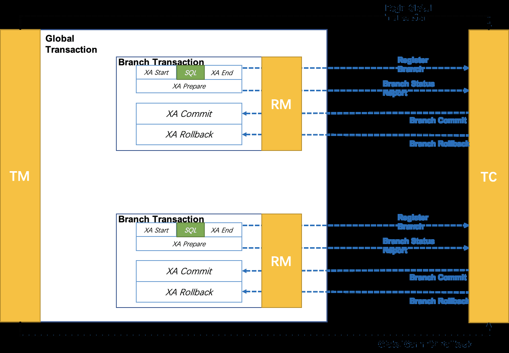
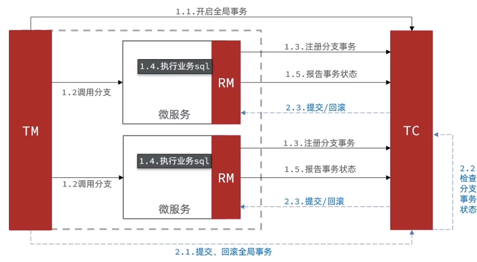

### AT：快速提交本地事务，必要时用快照补偿

AT 模式由代理数据源在本地事务中记录 `undo_log` 和业务变更。一阶段本地提交后释放数据库锁；全局提交时清理 undo 信息，回滚时依据 before/after image 尝试恢复。每个参与数据库都需使用与目标版本匹配的 `undo_log` 表结构，不能复制早期示例 SQL 到所有版本。AT 的全局锁用于协调写冲突，但**普通数据库查询不自动获得 XA 式的完整隔离**；与非 Seata 写入方交互时要特别防范脏写、快照冲突和回滚失败。

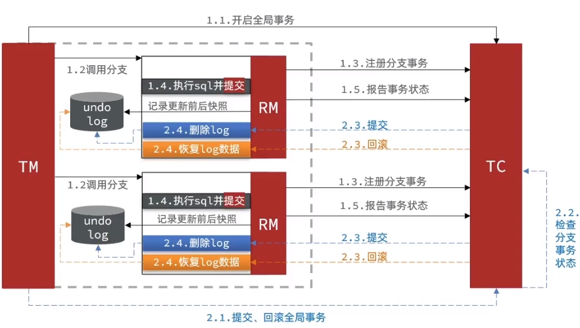

### TCC：业务显式预留和确认

Try 检查并预留资源，Confirm 完成操作，Cancel 释放预留。比如扣款不是在 Try 中立即把余额永久扣除，而是冻结一笔可确认或可释放的金额。三个方法由业务实现，因此可作用于数据库之外的资源，但需要保证**幂等、空回滚防护和悬挂防护**。Confirm 或 Cancel 也会失败，必须允许重试并提供对账途径，不能写成“Try 成功后 Confirm 一定成功”。

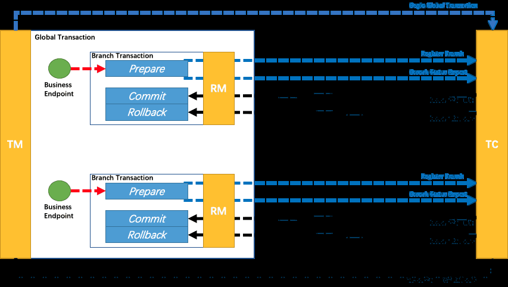
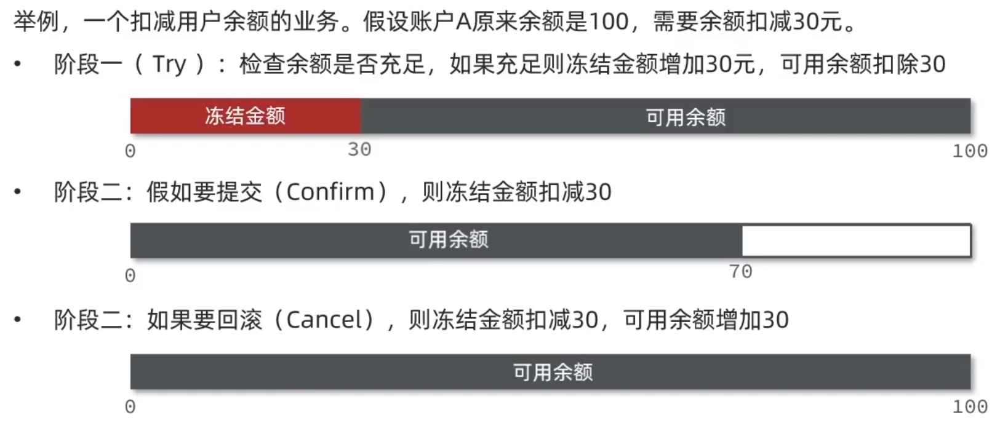
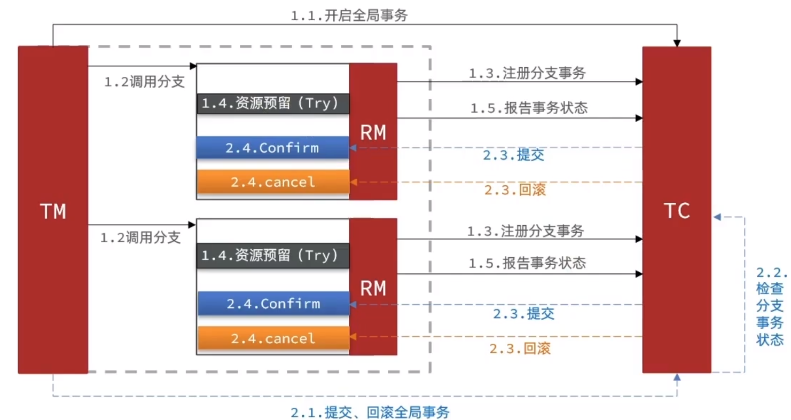

### Saga：长流程的补偿

Saga 将长业务拆成多个可独立提交的本地事务。后续步骤失败时，按业务定义调用已完成步骤的补偿动作，例如退款、撤销预订或释放库存。补偿不一定能让外部世界回到“从未发生”的状态：消息已经被消费、通知已经送达、第三方可能收手续费。因此要明确补偿语义、幂等键、重试期限和人工介入条件。Saga 适合包含异构系统、第三方服务或长时等待的流程，但隔离性通常需要业务额外设计。

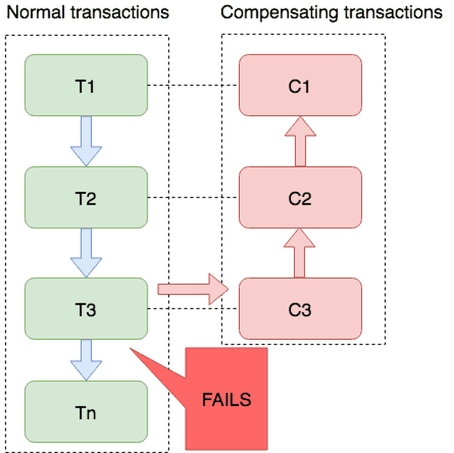

## 选型问题清单

先问参与资源是否支持 XA、是否允许短暂不一致、是否能修改业务接口、全局事务可能持续多久、失败补偿是否真正可执行。若全是可控关系库且事务较短，可比较 XA 与 AT；若需要对业务资源精确预留，考虑 TCC；跨第三方或长流程更常考虑 Saga。无论哪种模式，都要演练 TC 故障、参与者超时、重复请求与补偿失败，并用对账确认最终结果。下一篇再进入 Seata Server 的部署。



<nav class="article-end" aria-label="章节导航">
  <a href="{{ '/subjects/Microservices/30-practical-examples.html' | relative_url }}">← 上一篇：Sentinel 实战案例</a>
  <a href="{{ '/subjects/Microservices/' | relative_url }}">返回专题目录</a>
  <a href="{{ '/subjects/Microservices/32-installing-seata-server.html' | relative_url }}">下一篇：安装 Seata Server →</a>
</nav>
