[← Back to Microservices Index]({{ '/subjects/Microservices/' | relative_url }})



# 31 Seata Architecture and Mechanisms
## 6 Seata（了解）

### 6.1 Seata 介绍和工作机制

### Seata 介绍


Seata（Simple Extensible Autonomous Transaction Architecture 简单可扩展自主交易架构）是一款开源的分布式事务解决方案，致力于在微服务架构下提供高性能和简单易用的分布式事务服务。

在Seata 开源之前，Seata对应的内部版本在阿里经济体内部一直扮演着分布式一致性中间件的角色，帮助经济体平稳的度过历年的双11， 对各BU业务进行了有力的支撑。经过多年沉淀与积累，商业化产品先后在阿里云、金融云进行售卖。

2019年1月为了打造更加完善的技术生态和普惠技术成果，Seata 正式宣布对外开源，未来Seata 将以社区共建的形式帮助其技术更加可靠与完备。

2023年10月29日周日 Seata 捐赠给了 Apache 基金会，并通过了 Apache 基金会的投票决议，以全票的优秀表现加入 Apache 的孵化器项目，如下方邮件所示：

<https://lists.apache.org/thread/srxq8tqc9ssg6110xy5kwyqll549yrbm>

这次投票包含了 13 个约束性投票和 6 个无约束性投票，所有的投票都持赞同意见，没有弃权票和反对票。

这意味着 Seata 不只是国内开发者认可的分布式事务解决方案，更是得到了国际开源社区 Apache 的认可，这是对 Seata 项目本身的一种认可，也是对其背后大量贡献者、开发者和社区的一种肯定。

```text
https://seata.io/
https://seata.apache.org/
https://github.com/seata/seata
#Seata 已经加入孵化器项目了，项目主页如下：
https://incubator.apache.org/projects/seata.html
```

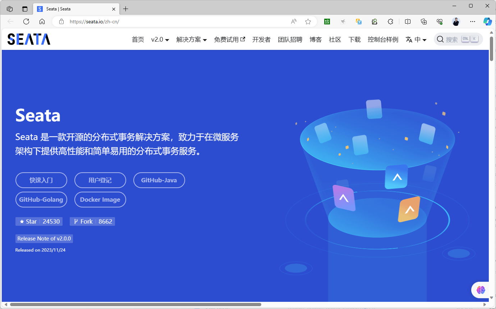

Seata 的重要发展历程

2007 年：

阿里巴巴和蚂蚁集团内部开始开发分布式事务中间件，以解决电商、支付、物流等业务场景中应用数据的一致性问题，经过多年的发展和完善，这个项目被命名为：Seata。

Seata 的架构起源于阿里集团的五彩石项目，该项目是在集团内去 IOE，从单体架构过渡到分布式架构的过程中诞生的。

2019 年 1 月：

Seata 正式宣布开源，发布第一个版本：v0.1.0，目的是以社区共建的形式帮助用户快速落地分布式事务解决方案。

2019 年 12 月：

Seata 正式发布第一个 GA 版本：v1.0.0-GA，意味着项目已经基本生产可用了。

2023 年 10 月：

为了 Seata 更好的未来，让全球开发者参与开源进来，阿里巴巴正式将 Seata 捐赠给 Apache 基金会，并且该提案通过了 Apache 基金会的全票通过，暂时成为 Apache 的孵化器项目，成为正式项目也是时间问题而已。 目前，Seata 最新版本为两周前刚发布的 v1.8.0。

<https://www.toutiao.com/article/7302343258473054731/?log_from=b9cb3ebbecd5f_1700310025337&wid=1702546095144>

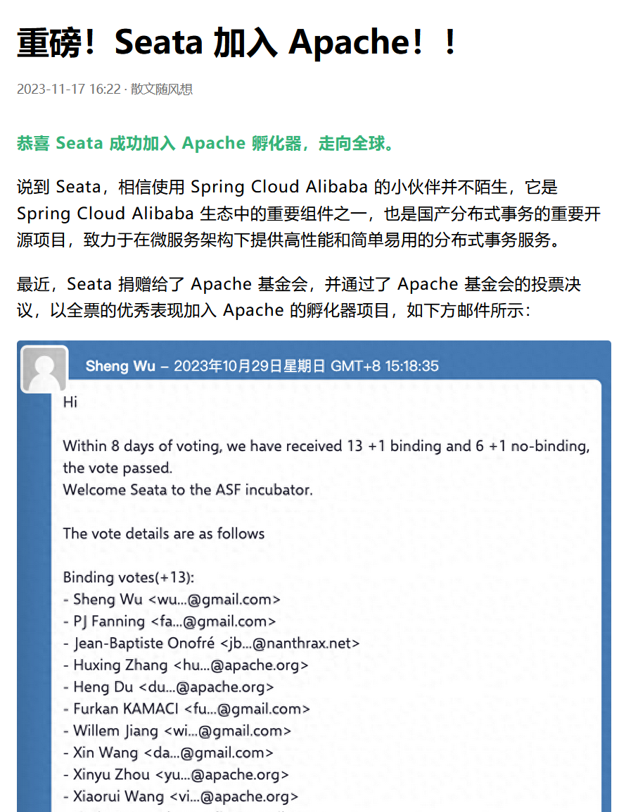

Seata 的成功并非偶然，而是其在解决微服务架构下应用数据一致性问题的能力的证明，Seata 能在微服务架构下构建高性能和简单易用的分布式事务服务，并且支持主流的 AT、TCC、SAGA 和 XA 事务模式，为用户打造一站式的分布式解决方案。

Spring Cloud Alibaba 是国内的主流微服务框架，它涵盖了阿里巴巴这些年开源的重要中间件，它通过 Spring Cloud 结合阿里中间件迅速搭建分布式、微服务架构的系统。

Spring Cloud Alibaba 基于 Spring Cloud 构建，只是提供了对 Alibaba 组件的封装而已，比如：Nacos、Sentinel 等，其最顶层的抽象还是 Spring Cloud，所以学习 Spring Cloud Alibaba 就是学习 Spring Cloud。

Spring Cloud Alibaba 作为 Spring Cloud 的官方顶级项目，也是国内最强微服务框架及事实上的标准，没有之一。

Seata 测试网站

<http://demo.seata.io/>

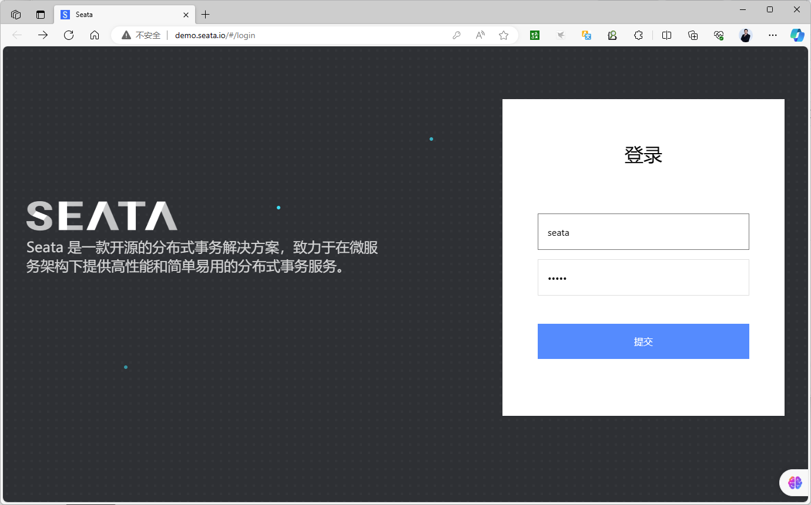

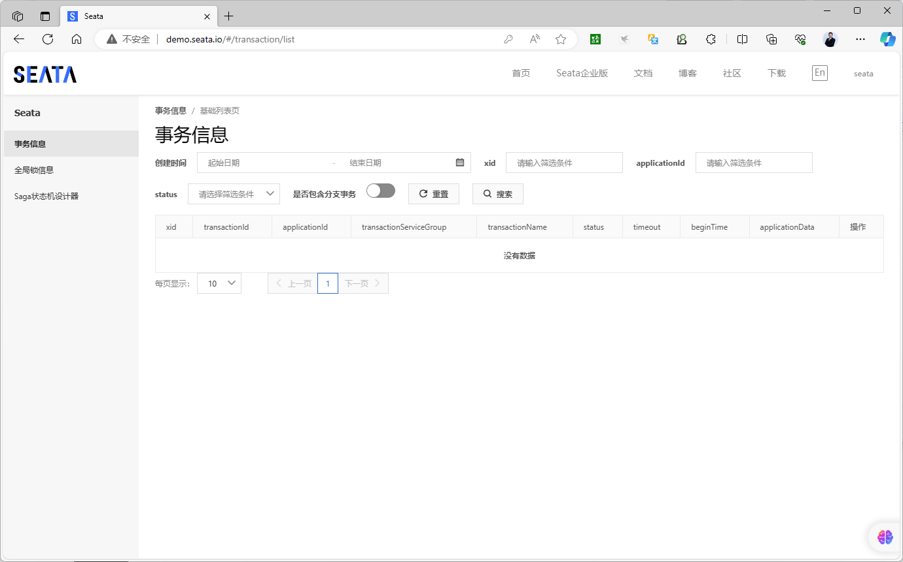

### Seata 工作机制

<https://github.com/seata/seata#distributed-transaction-problem-in-microservices>

<https://seata.io/zh-cn/docs/overview/what-is-seata.html>

<https://github.com/seata/seata#how-seata-do>

Seata 是一款开源的分布式事务解决方案，致力于提供高性能和简单易用的分布式事务服务。

### 微服务中的分布式事务问题

让我们想象一个传统的单体应用程序。其业务由3个模块组成。它们使用单个本地数据源。

当然，本地交易将保证数据一致性。

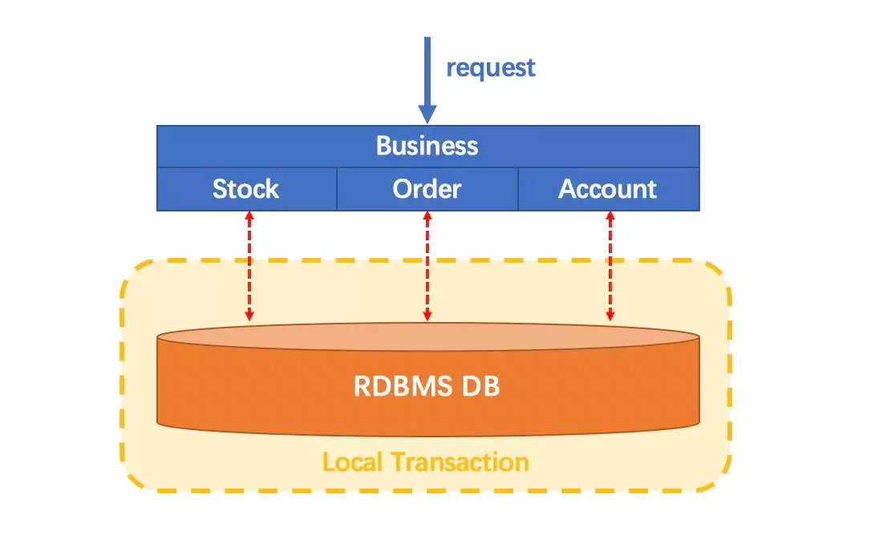

在微服务架构中，情况发生了变化。上面提到的 3 个模块被设计为 3 个不同数据源之上的 3 个服务（模式：每个服务的数据库）。

每个服务中的数据一致性自然是由本地事务来保证的。

但是整个业务逻辑范围呢？

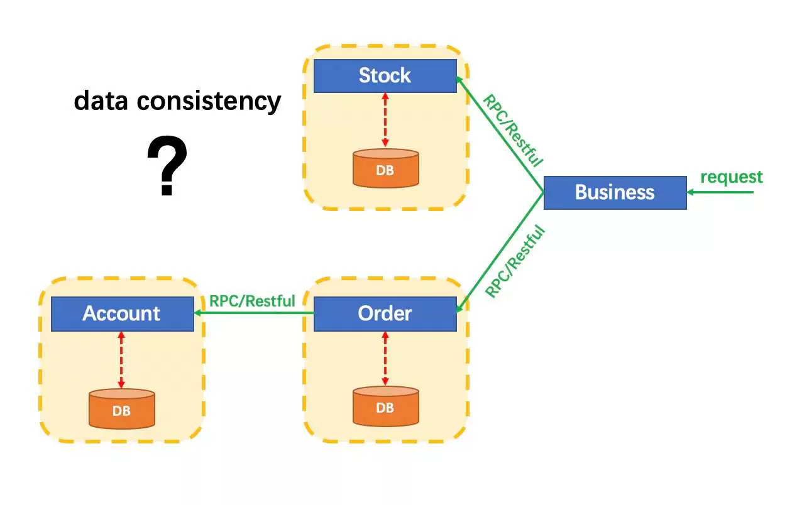

分布式服务案例

微服务下单业务，在下单时会调用订单服务，创建订单并写入数据库。 然后订单服务调用账户服务和库存服务账户服务负责扣减用户余额库存服务负责扣减商品库存

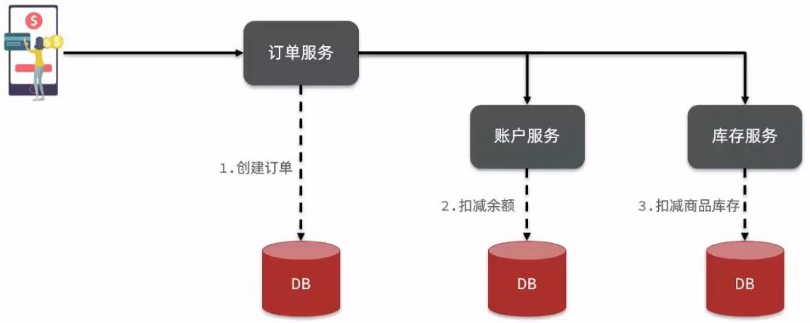

分布式服务的事务问题

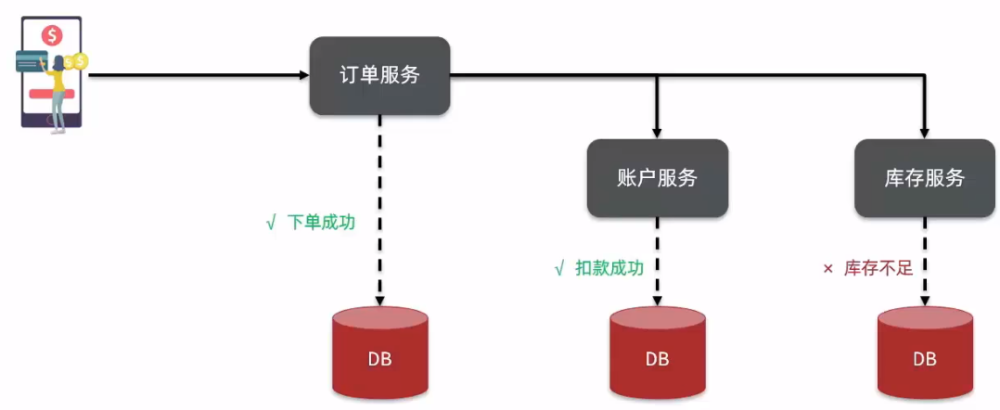

### Seata 如何解决分布式事务

Seata就是上述问题的解决方案。

首先，如何定义分布式事务？

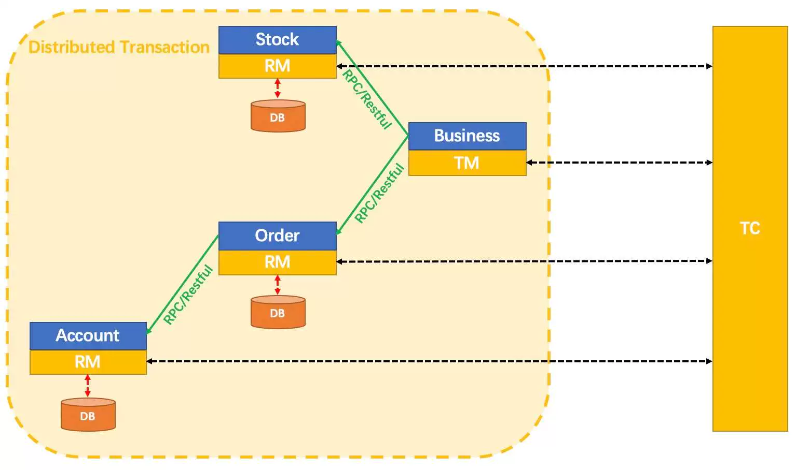

分布式事务

我们说，一个分布式事务是一个全局事务，它是由一批分支事务组成的，而通常分支事务就是本地事务。

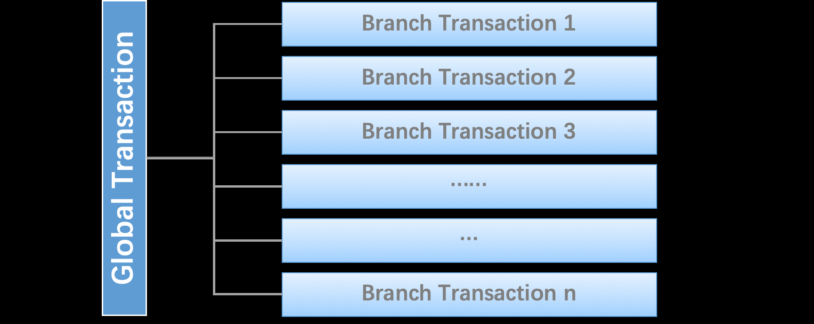

Seata Framework 中有三个角色：

Transaction Coordinator（TC）：事务协调器，维护所有全局和分支事务的状态，驱动全局提交或回滚，由Seata Server 实现 Transaction Manager（TM）：事务管理器，定义一个全局事务的范围，开始全局事务、提交或回滚全局事务。由应用实现 Resource Manager（RM）：资源管理器，管理分支事务处理的资源，与TC通信以注册分支事务并报告分支事务的状态，并驱动分支事务提交或回滚。由应用实现

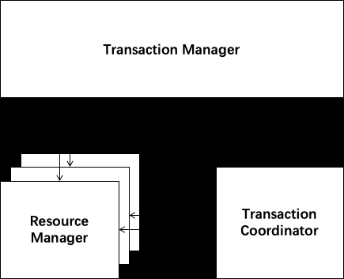

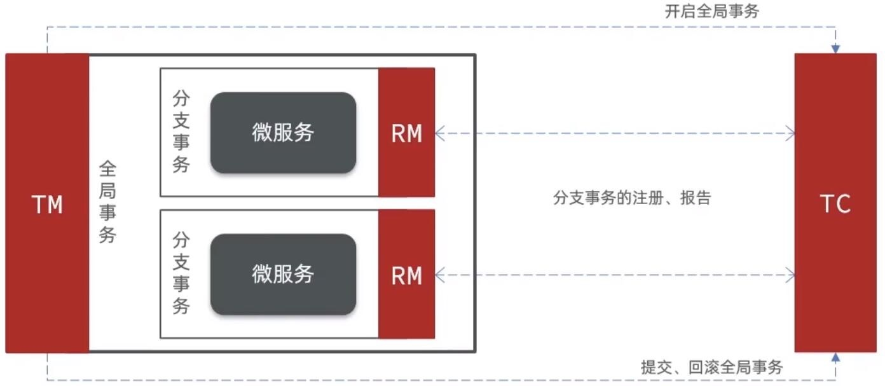

Seata 管理的分布式事务的典型生命周期：

1. TM 请求 TC 开始新的全局事务。 TC 生成代表全局事务的 XID。

2. XID 通过微服务的调用链传播。

3. RM 将本地事务作为XID对应的全局事务的分支注册到TC。

4. TM 请求 TC 提交或回滚XID对应的全局事务。

5. TC 驱动 XID 对应的全局事务下的所有分支事务完成分支提交或回滚。


分布务事务的工作模型

一个分布式的全局事务，整体是 两阶段提交 的模型。全局事务是由若干分支事务组成的，分支事务要满足 两阶段提交 的模型要求，即需要每个分支事务都具备自己的：

一阶段 prepare 行为二阶段 commit 或 rollback 行为

在两阶段提交协议中，资源管理器（RM, Resource Manager）需要提供“准备”、“提交”和“回滚” 3 个操作； 而事务管理器（TM, Transaction Manager）分 2 阶段协调所有资源管理器，

在第一阶段询问所有资源管理器“准备”是否成功

如果所有资源均“准备”成功则在第二阶段执行所有资源的“提交”操作

否则在第二阶段执行所有资源的“回滚”操作

保证所有资源的最终状态是一致的，要么全部提交要么全部回滚。

### Seata 事务模式

Seata 将为用户提供了 AT、TCC、SAGA 和 XA 事务模式，为用户打造一站式的分布式解决方案。

Seata提供了四种不同的分布式事务解决方案:

AT模式：最终一致的分阶段事务模式，无业务侵入，也是Seata的默认模式. XA模式：强一致性分阶段事务模式，牺牲了一定的可用性，无业务侵入 TCC模式：最终一致的分阶段事务模式，有业务侵入 SAGA模式：长事务模式，有业务侵入

### XA 模式 eXtended Architecture Mode

<https://seata.io/zh-cn/docs/next/user/mode/xa>

<https://seata.io/zh-cn/docs/dev/mode/xa-mode.html>

XA 模式是从 1.2 版本支持的事务模式。

XA 规范是 X/Open 组织定义的分布式事务处理（DTP，Distributed Transaction Processing）标准。

XA规范描述了全局的TM与局部的RM之间的接口，几乎所有主流的数据库都对xA规范提供了支持。

XA模式只支持实现了XA协议的数据库。Seata支持MySQL、Oracle、PostgreSQL和MariaDB。

Seata XA 模式是在Seata定义的分布式事务框架内，利用事务资源（数据库、消息服务等）对 XA 协议的支持，以XA协议的机制来管理分支事务的一种事务模式。

Seata XA 模式前提

支持XA 事务的数据库。 Java 应用，通过 JDBC 访问数据库。

Seata 的 XA 模式工作机制

基于XA规范做了一些调整，但大体相似

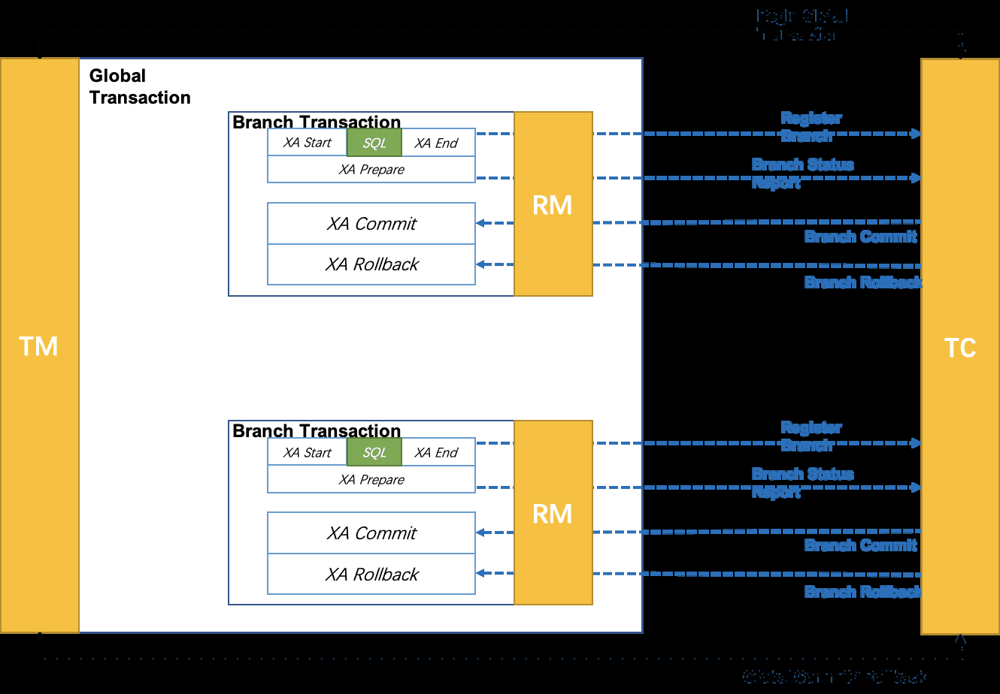

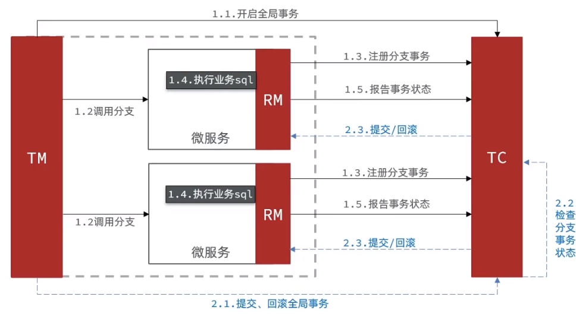

RM第一阶段的工作:

注册分支事务到TC 执行分支业务SQL，但不提交发送执行状态到TC

TC第二阶段的工作:

TC检测各分支事务执行状态如果都成功，通知所有RM提交事务如果有失败，通知所有RM回滚事务

RM第二阶段的工作:

接收TC指令，提交或回滚事务

XA 特点

基于数据库的XA协议来实现2PC，也称为XA方案 CP 模式工作，强一致性难易程度: 简单，基于数据库自带特性实现，无需改表使用要求: 使用支持XA方案的关系型数据库（主流都支持)

优势

与 Seata 支持的其它事务模式不同，XA 协议要求事务资源本身提供对规范和协议的支持，所以事务资源（如数据库）可以保障从任意视角对数据的访问有效隔离，满足全局数据一致性。此外的一些优势还包括：

1. 业务无侵入：和 AT 一样，XA 模式将是业务无侵入的，不给应用设计和开发带来额外负担。

2. 数据库的支持广泛：XA 协议被主流关系型数据库广泛支持，不需要额外的适配即可使用。

缺点

XA prepare 后，分支事务进入阻塞阶段，收到 XA commit 或 XA rollback 前必须阻塞等待。

事务资源长时间得不到释放，锁定周期长，而且在应用层上面无法干预，性能差。

适用场景

适用于想要迁移到 Seata 平台基于 XA 协议的老应用，使用 XA 模式将更平滑，还有 AT 模式未适配的数据库应用。

金融行业，并发量不大，但数据很重要的场景

基本使用

XA 模式使用起来与 AT 模式基本一致，用法上的唯一区别在于数据源代理的替换：使用 DataSourceProxyXA 来替代 DataSourceProxy 。

```text
public class DataSourceProxy {
@Bean("dataSourceProxy")
public DataSource dataSource(DruidDataSource druidDataSource) {
// DataSourceProxyXA for XA mode
return new DataSourceProxyXA(druidDataSource);
// DataSourceProxy for AT mode
// return new DataSourceProxy(druidDataSource);
}
}
```

### AT 模式 Automatic Transaction Mode

<https://seata.io/zh-cn/docs/next/user/mode/at>

<https://seata.io/zh-cn/docs/next/dev/mode/at-mode>

阿里SEATA独有模式，通过生成反向SQL实现数据回滚，需要在数据库额外附加UNDO_LOG表

AT模式同样是分阶段提交的事务模型，不过缺弥补了XA模型中资源锁定周期过长的缺陷。

AT模式建议使用，也应用最多

AT模式支持的数据库有：MySQL、Oracle、PostgreSQL、 TiDB、MariaDB。

AT 模式前提

基于支持本地 ACID 事务的关系型数据库。 Java 应用，通过 JDBC 访问数据库。

AT 模式工作原理

第一阶段RM的工作:

注册分支事务记录undo-log（数据快照) 执行业务SQL并提交报告事务状态

第二阶段提交时RM的工作:

删除undo-log即可

第二阶段回滚时RM的工作:

根据undo-log恢复数据到更新前

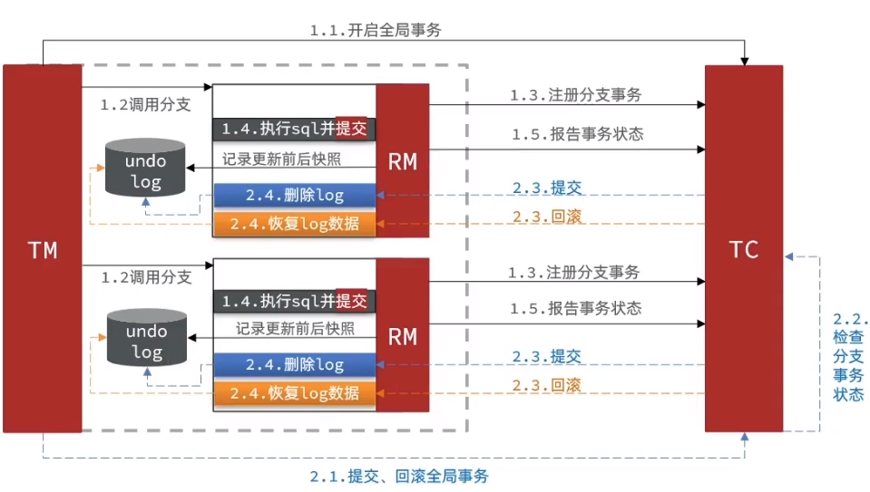

AT 模式特点

性能高 AP 模式工作，存在数据不一致的中间状态难易程度相对简单，靠SEATA自己解析反向SQL并回滚使用要求: 所有服务与数据库必须要自己拥有管理权，因为要创建UNDO_LOG表，支持的最好MySQL，也支持PgSQL 应用场景: 高并发互联网应用，允许数据出现短时不一致，可通过对账程序或补录来保证最终一致性。

AT模式的优点

一阶段完成直接提交事务，释放数据库资源，性能比较好利用全局锁实现读写隔离没有代码侵入，框架自动完成回滚和提交

AT模式的缺点

两阶段之间属于软状态，属于最终一致框架的快照功能会影响性能，但比XA模式要好很多

AT模式与XA模式主要区别

XA模式第一阶段不提交事务，锁定资源 AT模式第一阶段直接提交，不锁定资源。 XA模式依赖数据库机制实现回滚 AT模式利用数据快照实现数据回滚 XA模式强一致CP AT模式最终一致，AP

回滚日志表

UNDO_LOG Table：不同数据库在类型上会略有差别。

以 MySQL 为例：

Field Type

branch_id bigint PK

xid varchar(100)

context varchar(128)

rollback_info longblob

log_status tinyint

log_created datetime

log_modified datetime

```sql
-- 注意此处0.7.0+ 增加字段 context
CREATE TABLE `undo_log` (
`id` bigint(20) NOT NULL AUTO_INCREMENT,
`branch_id` bigint(20) NOT NULL,
`xid` varchar(100) NOT NULL,
`context` varchar(128) NOT NULL,
`rollback_info` longblob NOT NULL,
`log_status` int(11) NOT NULL,
`log_created` datetime NOT NULL,
`log_modified` datetime NOT NULL,
PRIMARY KEY (`id`),
UNIQUE KEY `ux_undo_log` (`xid`,`branch_id`)
) ENGINE=InnoDB AUTO_INCREMENT=1 DEFAULT CHARSET=utf8;
```

### TCC 模式 Try-Confirm-Cancel Mode

<https://seata.io/zh-cn/docs/next/user/mode/tcc>

<https://seata.io/zh-cn/docs/next/dev/mode/tcc-mode>

TCC 模式是 Seata 支持的一种由业务方细粒度控制的侵入式分布式事务解决方案，是继 AT 模式后第二种支持的事务模式，最早由蚂蚁金服贡献。其分布式事务模型直接作用于服务层，不依赖底层数据库，可以灵活选择业务资源的锁定粒度，减少资源锁持有时间，可扩展性好， 可以说是为独立部署的 SOA 服务而设计的。

TCC 是一种比较成熟的分布式事务解决方案，可用于解决跨数据库、跨服务业务操作的数据一致性问题

TCC 模式不依赖数据源(1.4.2版本及之前)，1.4.2版本之后增加了TCC防悬挂措施，需要数据源支持。

TCC模式原理

TCC 即 Try 尝试、Confirm确认、Cancel取消

TCC 其 Try、Confirm、Cancel 3 个方法均由业务编码实现，故 TCC 可以被称为是服务化的资源管理器。

TCC 的 Try 操作作为一阶段，负责资源的检查和预留；Confirm 操作作为二阶段提交操作，执行真正的业务；Cancel 是二阶段回滚操作，执行预留资源的取消，使资源回到初始状态。

TCC模式与AT模式非常相似，每阶段都是独立事务，不同的是TCC通过人工编码来实现数据恢复。

在代码与数据表中扩展字段，实现对数据资源的锁定。

需要用户自行实现三个方法:

Try：资源的检测和预留 Confirm：完成资源操作业务，要求Try成功Confirm 一定要能成功 Cancel：预留资源释放，可以理解为try的反向操作。

TCC模式原理

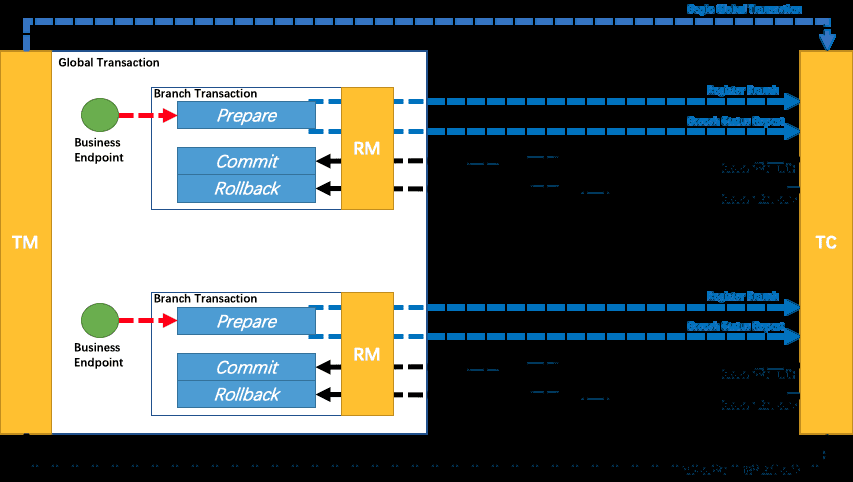

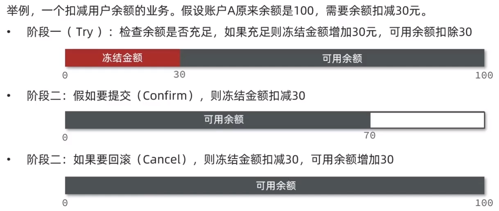

TCC 工作模型图

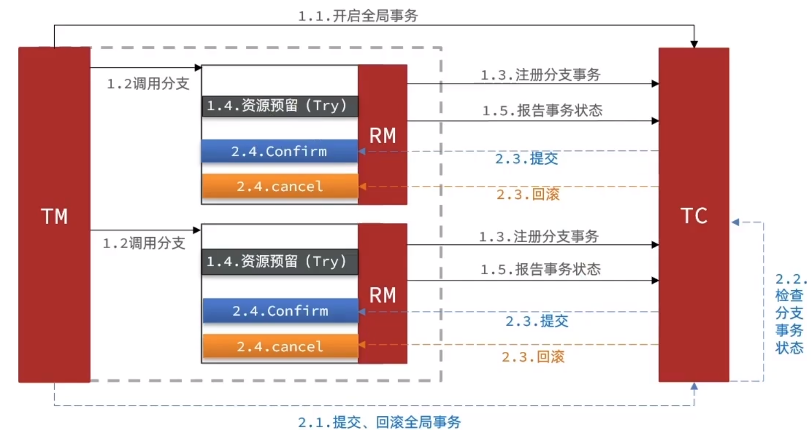

TCC的优点

性能好，一阶段完成直接提交事务，释放数据库资源相比AT模型，无需生成快照，无需使用全局锁，性能最强不依赖数据库事务，而是依赖补偿操作，可以用于非事务型数据库 TCC 完全不依赖底层数据库，能够实现跨数据库、跨应用资源管理，可以提供给业务方更细粒度的控制。

TCC的缺点

有代码侵入，每个相关微服务都可能需要人为编写try、Confirm和Cancel接口及额外相关的数据库表的设计，太麻烦需要考虑Confirm和Cancel的失败情况，做好幂等处理实现复杂，SEATATC只负责全局事务的提交与回滚指令，具体的回滚处理全靠程序员自己实现，实际使用不多所有服务与数据库必须要自己拥有管理权·支持异构数据库，可以使用不同选型实现 AP 模式工作，存在数据不一致的中间状态, 软状态，事务是最终一致

适用场景

TCC 模式是高性能分布式事务解决方案，适用于核心系统等对性能有很高要求的场景。

高并发互联网应用，允许数据出现短时间的 不一致，可通过对账程序或补录来保证最终一致性。

### Saga 模式

<https://seata.io/zh-cn/docs/overview/what-is-seata.html>

<https://seata.io/zh-cn/docs/next/user/mode/saga>

<https://seata.io/zh-cn/docs/next/dev/mode/saga-mode>

Saga模式是SEATA提供的长事务解决方案

Saga 其名称来源于挪威语中的“长篇故事”或“英雄传奇”。

在分布式系统中，Saga 模式指的是将一个长事务拆分成一系列短事务，每个短事务都可以独立提交。

如果某个短事务失败，则会执行相应的补偿操作来撤销之前已经完成的操作，从而达到事务最终一致性的目的。

Saga 模式的核心思想是将复杂的全局事务分解成多个可独立执行和补偿的小事务，通过补偿机制来处理可能的失败和回滚。这样不仅提高了系统的并发性和性能，还避免了传统两阶段提交（2PC）带来的性能瓶颈和锁等待问题。

Saga模式中，业务流程中每个参与者都提交本地事务

当出现某一个参与者失败则补偿前面已经成功的参与者，一阶段正向服务和二阶段补偿服务都由业务开发实现。

Saga模式不依赖数据源。

Saga模式分为两个阶段

一阶段：直接提交本地事务二阶段：成功则什么都不做;失败则通过编写补偿业务来回滚


理论基础：Hector & Kenneth 发表论⽂ Sagas （1987）

优势：

一阶段提交本地事务，无锁，高性能事件驱动架构，参与者可异步执行，高吞吐不用编写TCC中的三个阶段，补偿服务易于实现

缺点：

软状态持续时间不确定，时效性差不保证隔离性，没有锁，没有事务隔离，会有脏写，应对方案见用户文档）

<https://seata.io/zh-cn/docs/next/user/mode/saga>

Saga 特点

性能:不一定，取决于第三方服务

AP模式工作，存在数据不一致的中间状态难易程度:复杂，提交与回滚流程全靠程序员编排

使用要求:在当前架构引入状态机机制，类似于工作流，无法保证隔离性

适用场景：

业务流程长、业务流程多参与者包含其它公司或遗留系统服务，无法提供 TCC 模式要求的三个接口需要与第三方交互时才会考虑，例如:调用支付宝支付接口->出库失败->调用支付宝退款接口

### 四种模式对比

XA AT TCC SAGA

一致

强一致弱一致弱一致最终一致

性

隔离

完全隔离基于全局锁隔离基于资源预留隔离无隔离

性

代码

无无有，要编写三个接口要编写状态机和补偿业务

侵入

性能差好非常好非常好

对性能要求较高的事

对一致性、隔离

业务流程长、业务流程多

场

基于关系型数据库的大多数

务

性有高要求的业

参与者包含其它公司或遗留无法提供的系统服

景

分布式事务场景都可以

有非关系型数据库要

务，无法提供TCC模式要求的三个接口

务

参有高要求的业务



<nav class="article-end" aria-label="章节导航">
  <a href="{{ '/subjects/Microservices/30-practical-examples.html' | relative_url }}">← Previous: Practical Examples</a>
  <a href="{{ '/subjects/Microservices/' | relative_url }}">Back to Microservices Index</a>
  <a href="{{ '/subjects/Microservices/32-installing-seata-server.html' | relative_url }}">Next: Installing Seata Server →</a>
</nav>
