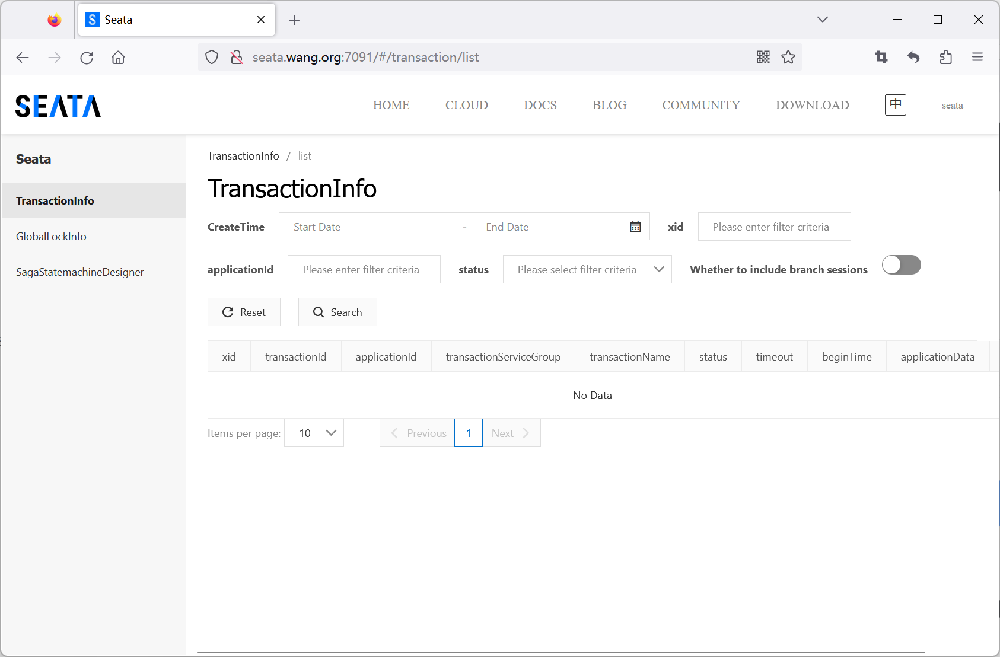
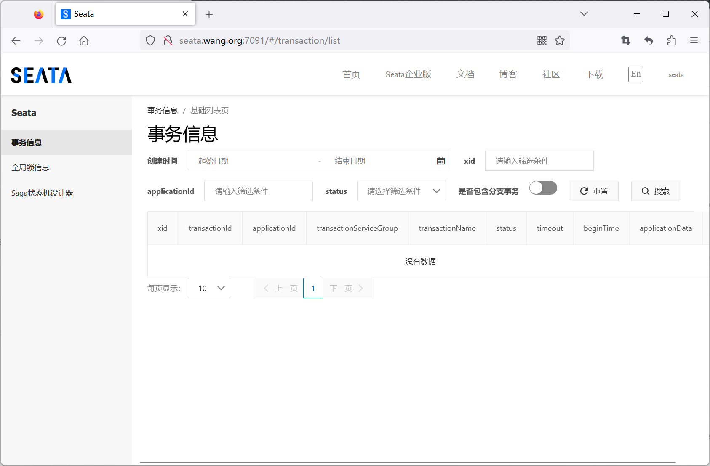
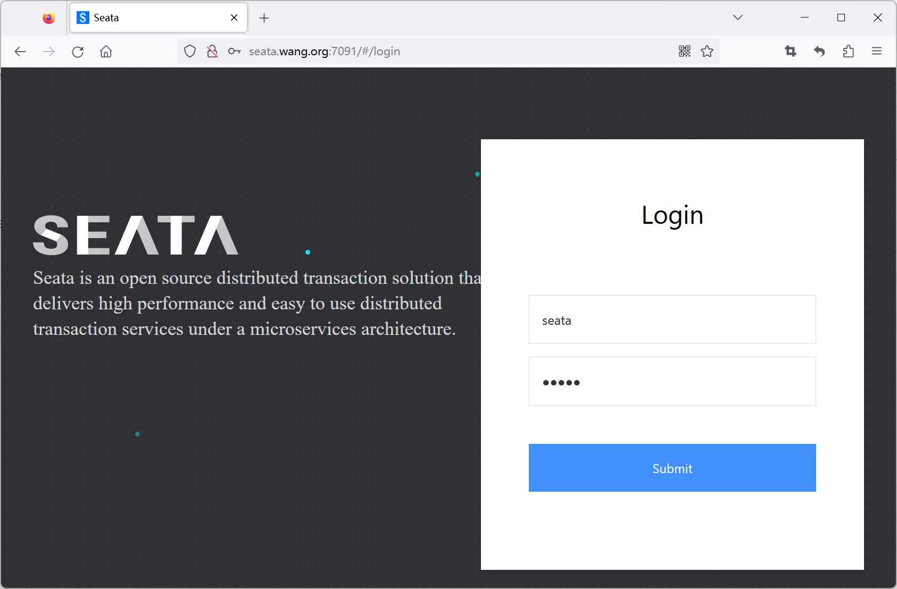
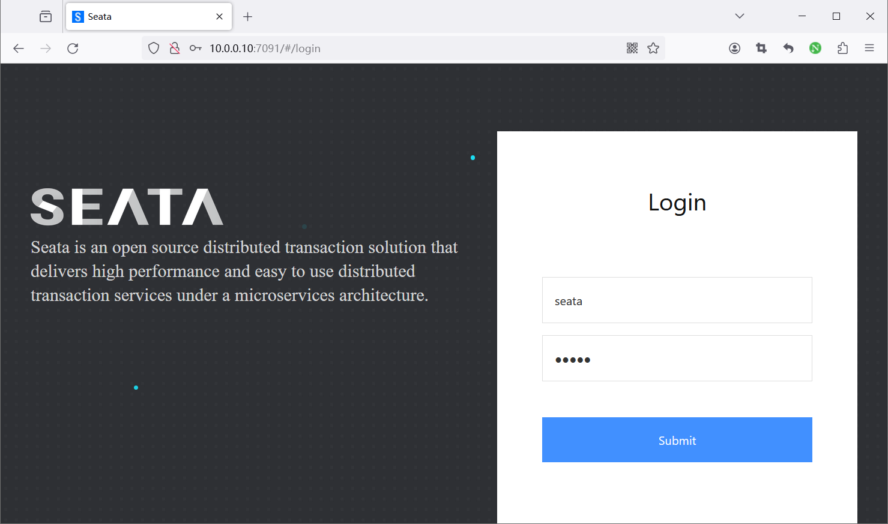

[← 返回微服务架构目录]({{ '/subjects/Microservices/' | relative_url }})



# 32 Seata Server 安装

第 31 篇的 TC 是独立运行的 **Seata Server**；TM 和 RM 是业务应用集成的客户端。安装 Server 并不能自动让业务事务生效，还需要客户端依赖、事务分组、XID 传播以及对应事务模式的数据源配置。本篇将“能启动单节点”与“可用于多节点故障恢复”分开说明。

## 部署前先确定四件事

1. **版本**：Server、客户端及 Spring Cloud Alibaba 适配层应按兼容矩阵选择。原始记录把 1.5.2、1.8.0、2.0.0、2.2.0 和 `latest` 的命令与配置混写；下文的概念和示例以 **Seata 2.0.0** 为主，其他版本按对应发行包文档调整。
2. **注册中心**：单节点可用本地配置直接连接；多节点通常由 Nacos 等注册中心供客户端发现 TC。
3. **配置中心**：可选，用于集中管理参数；它与注册中心是两项职责，即便都用 Nacos 也要分别配置。
4. **事务状态存储**：`file` 便于单机试验；`db` 或当前版本支持的其他共享存储适合多节点。TC 存储的 `global_table`、`branch_table`、`lock_table` 与 AT 业务库的 `undo_log` 不是同一组表。

官方资料可从 [Seata 部署文档](https://seata.apache.org/docs/ops/deploy-guide-beginner/) 和 [发行版本](https://github.com/apache/incubator-seata/releases) 开始查阅；仓库路径、包名随项目阶段变化，应以所选版本实际内容为准。

## 一、单节点文件模式验证

发行包内通常包含 `bin/`、`conf/application.yml`、日志和数据库脚本。先检查 JDK 与发行包要求是否匹配，再解压**一个固定版本**并启动：

```bash
java -version
# 解压已从目标版本发布页下载并校验的发行包
tar -xzf seata-server-2.0.0.tar.gz -C /usr/local
cd /usr/local/seata/bin
bash seata-server.sh -p 8091 -m file
```

实际解压目录名可能不同，以上路径需以发行包为准。`-p 8091` 是事务客户端连接端口；控制台常用 7091，但应查看 `conf/application.yml` 的 `server.port`，不能仅凭图中的端口猜测。启动脚本输出的长串 JVM 参数只是日志，不应作为手敲命令。

验证时检查启动日志、8091 端口和控制台页面。默认账号若仍存在，首次登录后立即修改并限制管理网络。文件模式的事务状态依赖本机文件，容器删除、主机损坏或多节点各自保存文件都会带来恢复问题，因此只适合学习或受限测试。





## 二、从文件模式转向共享数据库

多节点 TC 应共享同一个事务状态存储，并确保该数据库本身有备份和故障恢复方案。先从**同一 Seata 版本**的 `script/server/db/mysql.sql` 初始化 Server 库，再为应用配置数据库连接。不要把客户端 `undo_log` 建在 TC 数据库里，也不要用旧版本脚本覆盖现有表结构。

下面是说明配置层级的 YAML 片段，放入目标版本的 `conf/application.yml` 相应位置；密码从受控密钥渠道注入，属性名以该版本样例校验：

```yaml
server:
  port: 7091

seata:
  config:
    type: file
  registry:
    type: file
  store:
    mode: db
    db:
      db-type: mysql
      driver-class-name: com.mysql.cj.jdbc.Driver
      url: jdbc:mysql://DB_HOST:3306/seata?useUnicode=true&characterEncoding=utf8&useSSL=false
      user: SEATA_DB_USER
      password: SEATA_DB_PASSWORD
```

不同版本可能采用 `dbType`、`driverClassName` 等不同字段名，所以不能把这段当作跨版本通用文件；关键是理解：`registry` 决定客户端如何发现 TC，`config` 决定配置从何处读取，`store` 决定 TC 的事务状态写到哪里。启动前应从目标发行包的 `application.example.yml` 核对字段与缩进，并检查数据库权限和表结构。

## 三、容器部署

对于本地单节点验证，可以固定镜像标签，而不是使用 `latest`：

```bash
docker run -d --name seata-demo \
  -p 7091:7091 -p 8091:8091 \
  -e STORE_MODE=file \
  seataio/seata-server:2.0.0
docker logs -f seata-demo
```

该命令演示端口和模式，不代表生产持久化方案。Docker 中 `SEATA_IP` 应设为**客户端能访问的地址**；设成容器内部地址却让外部客户端发现，会出现“注册中心有实例但连接失败”。自定义配置应挂载到该版本镜像实际读取的位置，并验证容器内文件内容。原记录中的 `docker cp` 路径随版本变化，不能直接照搬。




Compose 文件必须把服务、端口、环境变量和卷写成有效 YAML，并在启动前执行 `docker compose config`。原记录中有 `${latest-release-version}` 未定义占位符、无缩进 YAML、命令与输出混入代码块，以及第二个实例宿主机映射端口与容器监听端口不一致等问题。多节点 Compose 的关键不是复制两份 `docker run`，而是**统一版本、统一注册与配置、共享可恢复状态存储、各节点唯一身份和可达地址**。

## 四、Kubernetes 与 Helm

Kubernetes 上单副本文件存储只适合临时验证；副本数增加不会自动得到高可用。若部署多副本，应使用目标版本的官方清单或 Helm chart，在其基础上配置 Nacos 注册、共享 DB、Secret、资源限额、健康探针和可用性策略。不要直接复制原资料中的 `latest` 镜像、旧版 `registry.conf` ConfigMap 或暴露到公网的 LoadBalancer；那些片段来自不同 Seata 版本，无法保证相互兼容。

实施顺序可以是：

```bash
# 在选定版本的官方 chart 目录，根据其 values.yaml 填写配置
helm template seata-server ./seata-server -f values.yaml > rendered.yaml
kubectl apply --dry-run=client -f rendered.yaml
helm install seata-server ./seata-server -f values.yaml
kubectl get pods,svc
```

`helm template` 和 `kubectl --dry-run` 只能检查渲染与部分资源结构；仍需查看 Pod 日志、数据库连接、注册中心实例及客户端事务调用。集群内部仅为客户端开放事务端口；控制台管理端口应单独限制访问。



## 五、验收与故障恢复

Server 显示“启动成功”只是第一层。至少要验证：

- 客户端能发现并连接到 8091 事务端口；控制台端口 7091 不能替代它。
- TC 的全局事务、分支和锁状态写入预期存储，重启后可恢复。
- 测试业务事务成功提交；让一个参与者失败，观察回滚或补偿与业务数据。
- 多节点时停掉一个 TC，检查客户端能否切到其他节点，并确认数据库、注册中心没有成为新的单点。
- 监控未完成事务、重试、超时与回滚失败；定期演练数据库备份恢复。

下一篇把 Nacos 注册和配置接入这个部署框架，并说明事务分组到 TC 集群的映射。



<nav class="article-end" aria-label="章节导航">
  <a href="{{ '/subjects/Microservices/31-seata-architecture-and-mechanisms.html' | relative_url }}">← 上一篇：Seata 介绍和工作机制</a>
  <a href="{{ '/subjects/Microservices/' | relative_url }}">返回专题目录</a>
  <a href="{{ '/subjects/Microservices/33-integrating-seata-with-nacos.html' | relative_url }}">下一篇：Seata 集成 Nacos →</a>
</nav>
