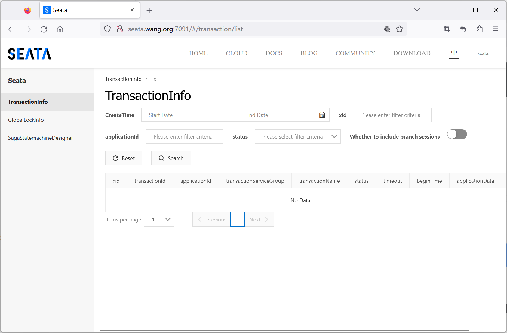
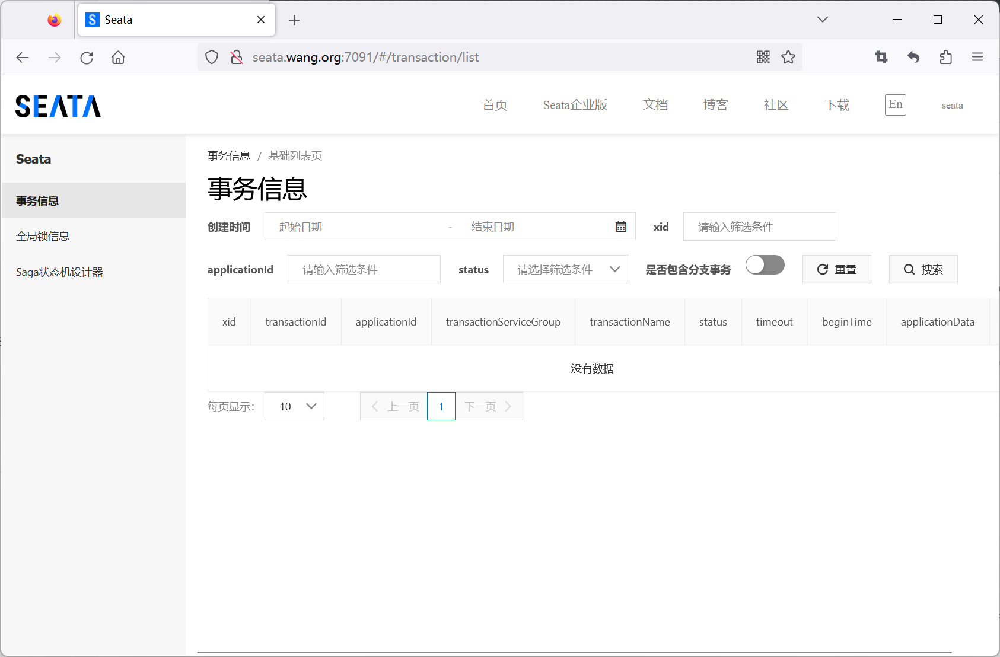
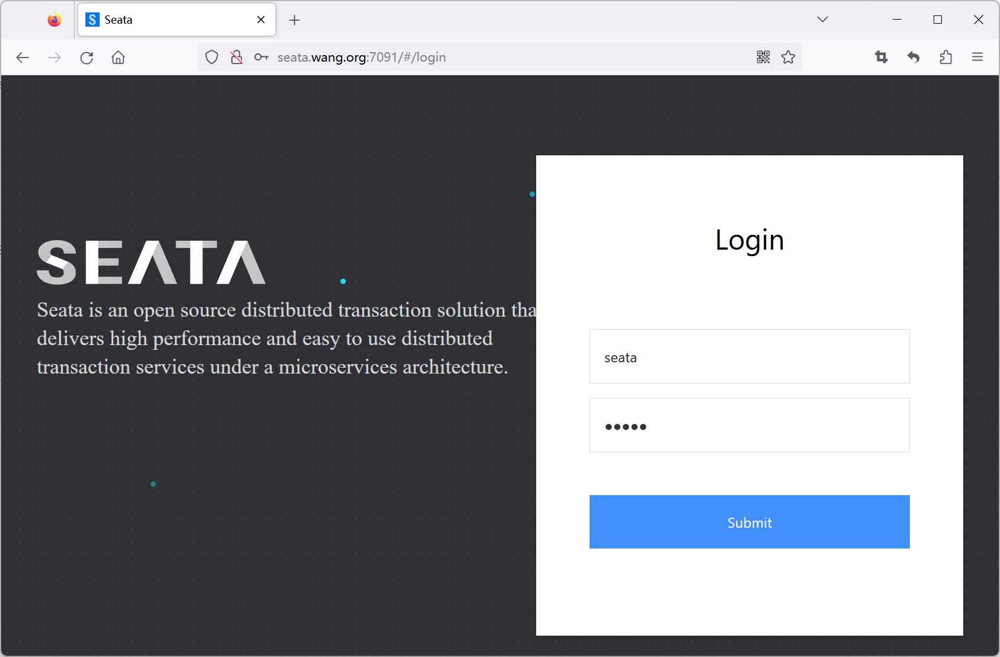
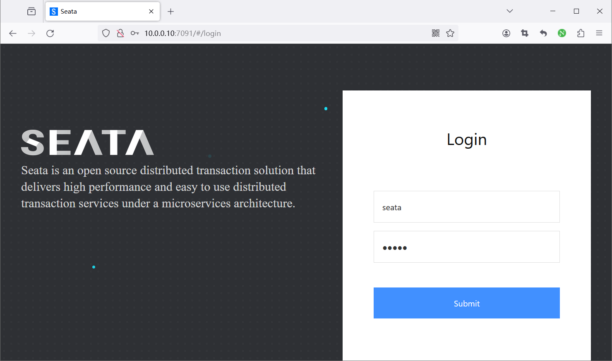

[← 返回微服务架构目录]({{ '/subjects/Microservices/' | relative_url }})



# 32 Seata Server 安装
### 6.2 Seata Server 安装

<https://seata.io/zh-cn/docs/ops/deploy-server>

<https://seata.io/zh-cn/docs/ops/deploy-guide-beginner>

### 部署指南

<https://seata.io/zh-cn/docs/ops/deploy-guide-beginner#seata新手部署指南>

Seata分TC、TM和RM三个角色

TC（Server端）为单独服务端部署 TM和RM（Client端）由业务系统集成

资源目录介绍

<https://seata.io/zh-cn/docs/ops/deploy-guide-beginner#资源目录介绍>

点击查看(或根据版本分支选择对应的资源目录

<https://github.com/seata/seata/tree/master/script>

点击查看或根据版本分支选择对应的资源目录)

client

存放client端sql脚本 (包含 undo_log表) ，参数配置

config-center

各个配置中心参数导入脚本，config.txt(包含server和client，原名nacos-config.txt)为通用参数文件

server

server端数据库脚本 (包含 lock_table、branch_table 与 global_table) 及各个容器配置

支持多种安装方法

直接部署 Docker 部署 Docker-compose 部署 Kubernetes 部署使用 Helm 部署

部署模式

无注册中心，file存储无注册中心，db存储 nacos注册中心，db存储高可用部署

### 二进制部署

### 二进制部署说明

<https://seata.io/zh-cn/docs/ops/deploy-server#直接部署#下载链接>

<https://github.com/seata/seata/releases>

在 Linux/Mac 下

```text
$ sh ./bin/seata-server.sh
```

在 Windows 下

```text
bin\seata-server.bat
```

支持的启动参数

<https://seata.io/zh-cn/docs/ops/deploy-server#支持的启动参数)>

参数全写作用备注

-h --host 指定在注册中心注册的 IP 不指定时获取当前的 IP，外部访问部署在云环境和容器中的 server 建议指

定

-p --port 指定 server 启动的端口默认为 8091

-m --storeMode 事务日志存储方式支持file , db , redis ，默认为 file 注:redis需seata-server 1.3版本及以

上

-n --

用于指定seata-server节点

如 1 , 2 , 3 ..., 默认为 1

serverNode

ID

-e --seataEnv 指定 seata-server 运行环境如 dev , test 等, 服务启动时会使用 registry-dev.conf 这样的配置

示例：

```text
$ sh ./bin/seata-server.sh -p 8091 -h 127.0.0.1 -m file
```

### 基于二进制的文件存储部署案例

范例：二进制直接部署

```bash
[root@ubuntu2404 ~]#apt update && apt -y install openjdk-21-jdk
[root@ubuntu2404 ~]#apt update && apt -y install openjdk-17-jdk
[root@ubuntu2204 ~]#apt update && apt -y install openjdk-8-jdk
#新版下载路径
[root@ubuntu2204 ~]#wget https://dist.apache.org/repos/dist/release/incubator/seata/2.2.0/apache-seata-2.2.0-
incubating-bin.tar.gz
#旧版下载路径
[root@ubuntu2204 ~]#wget https://github.com/seata/seata/releases/download/v2.0.0/seata-server-2.0.0.tar.gz
[root@ubuntu2204 ~]#tar xf seata-server-2.0.0.tar.gz -C /usr/local
#新版路径
[root@ubuntu2204 ~]#tree /usr/local/seata-server/ |grep -v 'jar'
#旧版路径
[root@ubuntu2204 ~]#tree /usr/local/seata/ |grep -v 'jar'
/usr/local/seata/
├── bin
│   ├── seata-server.bat
│   ├── seata-server.sh
│   ├── seata-setup.sh
│   └── startup.sh
├── conf
│   ├── application.example.yml
│   ├── application.raft.example.yml
│   ├── application.yml
│   ├── logback
│   │   ├── console-appender.xml
│   │   ├── file-appender.xml
│   │   ├── kafka-appender.xml
│   │   ├── logstash-appender.xml
│   │   └── metric-appender.xml
│   └── logback-spring.xml
├── Dockerfile
├── ext
│   └── apm-skywalking
│       ├── plugins
├── lib
│   ├── jdbc
├── LICENSE
├── logs
│   └── start.out
├── script
│   ├── config-center
│   │   ├── apollo
│   │   │   ├── apollo-config-interactive.sh
│   │   │   └── apollo-config.sh
│   │   ├── config.txt
│   │   ├── consul
│   │   │   ├── consul-config-interactive.sh
│   │   │   └── consul-config.sh
│   │   ├── etcd3
│   │   │   ├── etcd3-config-interactive.sh
│   │   │   └── etcd3-config.sh
│   │   ├── nacos
│   │   │   ├── nacos-config-interactive.py
│   │   │   ├── nacos-config-interactive.sh
│   │   │   ├── nacos-config.py
│   │   │   └── nacos-config.sh
│   │   ├── README.md
│   │   └── zk
│   │       ├── zk-config-interactive.sh
│   │       └── zk-config.sh
│   ├── logstash
│   │   └── config
│   │       ├── logstash-kafka.conf
│   │       └── logstash-logback.conf
│   └── server
│       ├── db
│       │   ├── dm.sql
│       │   ├── mysql.sql
│       │   ├── oracle.sql
│       │   ├── postgresql.sql
│       │   └── sqlserver.sql
│       ├── docker-compose
│       │   └── docker-compose.yaml
│       ├── helm
│       │   └── seata-server
│       │       ├── Chart.yaml
│       │       ├── templates
│       │       │   ├── deployment.yaml
│       │       │   ├── _helpers.tpl
│       │       │   ├── NOTES.txt
│       │       │   ├── service.yaml
│       │       │   └── tests
│       │       │       └── test-connection.yaml
│       │       └── values.yaml
│       └── kubernetes
│           └── seata-server.yaml
└── target
27 directories, 284 files
#启动
[root@ubuntu2204 ~]#/usr/local/seata-server/bin/seata-server.sh
apm-skywalking not enabled
JMX disabled
/usr/bin/java  -Dlog.home=/root/logs/seata -server -Dloader.path=/usr/local/seata/lib -Xmx2048m -Xms2048m -
Xss640k -XX:SurvivorRatio=10 -XX:MetaspaceSize=128m -XX:MaxMetaspaceSize=256m -XX:MaxDirectMemorySize=1024m -
XX:-OmitStackTraceInFastThrow -XX:-UseAdaptiveSizePolicy -XX:+HeapDumpOnOutOfMemoryError -
XX:HeapDumpPath=/root/logs/seata/java_heapdump.hprof -XX:+DisableExplicitGC -
Xloggc:/root/logs/seata/seata_gc.log -verbose:gc -XX:+PrintGCDetails  -XX:+PrintGCDateStamps -
XX:+PrintGCTimeStamps -XX:+UseGCLogFileRotation -XX:NumberOfGCLogFiles=10 -XX:GCLogFileSize=100M -
XX:+UnlockExperimentalVMOptions -XX:+UseG1GC -Dio.netty.leakDetectionLevel=advanced -Dapp.name=seata-server -
Dapp.pid=89467 -Dapp.home=/usr/local/seata -Dbasedir=/usr/local/seata  -Dspring.config.additional-
location=/usr/local/seata/conf/ -Dspring.config.location=/usr/local/seata/conf/application.yml -
Dlogging.config=/usr/local/seata/conf/logback-spring.xml -jar /usr/local/seata/target/seata-server.jar  >>
/dev/null 2>&1 &
seata-server is starting, you can check the /root/logs/seata/ *.log
[root@ubuntu2204 ~]#ss -ntlp|grep java
LISTEN 0      100                *:7091             *:*    users:(("java",pid=89511,fd=310))
LISTEN 0      1024               *:8091             *:*    users:(("java",pid=89511,fd=353))
#浏览器访问，默认账号/密码：seata/seata
http://seata.bowen.org:7091
```


默认是英文环境



切换为中文



### 使用 Docker 部署

```text
#Seata Server (1.5.0及以上)
https://seata.io/zh-cn/docs/ops/deploy-by-docker/
#查看1.4.2版本
https://seata.io/zh-cn/docs/ops/deploy-by-docker-142
```

注意事项

避免直接拉取latest版本镜像，latest版本并不一定是稳定版本，为避免不必要的问题，请到docker镜像仓库 确定要拉取的镜像版本。 若docker显示的date时间不正确，可通过以下方式之一设置。

加入docker环境变量 TZ=Asia/Shanghai 挂载宿主机的时区配置 -v /etc/localtime:/etc/localtime -v /etc/timezone:/etc/timezone

启动seata-server实例

```bash
$ docker run --name seata-server -p 8091:8091 -p 7091:7091 seataio/seata-server:1.5.0
```

范例：

```bash
[root@ubuntu2204 ~]#docker pull registry.cn-beijing.aliyuncs.com/bowenxiaochun/seata-server:1.8.0.2
[root@ubuntu2204 ~]#docker pull seataio/seata-server:latest
[root@ubuntu2204 ~]#docker images
REPOSITORY             TAG       IMAGE ID       CREATED        SIZE
seataio/seata-server   latest    b52d91ee6539   23 hours ago   695MB
#容器启动
[root@ubuntu2204 ~]#docker run -d -p 8091:8091 -p 7091:7091  --name seata-server --restart always
seataio/seata-server:latest
[root@ubuntu2204 ~]#docker run -d -p 8091:8091 -p 7091:7091  --name seata-server --restart always registry.cn-
beijing.aliyuncs.com/bowenxiaochun/seata-server:1.8.0.2
[root@ubuntu2204 ~]#docker ps
CONTAINER ID   IMAGE                         COMMAND                   CREATED         STATUS         PORTS
NAMES
5c516a906fa6   seataio/seata-server:latest   "/bin/bash /seata-se…"   4 seconds ago   Up 2 seconds
0.0.0.0:7091->7091/tcp, :::7091->7091/tcp, 0.0.0.0:8091->8091/tcp, :::8091->8091/tcp   seata-server
[root@ubuntu2204 ~]#docker logs seata-server
apm-skywalking not enabled
JMX disabled
Affected JVM parameters: -Dlog.home=/root/logs/seata -server -Dloader.path=/lib -Xmx2048m -Xms2048m -Xss640k -
XX:SurvivorRatio=10 -XX:MetaspaceSize=128m -XX:MaxMetaspaceSize=256m -XX:MaxDirectMemorySize=1024m -XX:-
OmitStackTraceInFastThrow -XX:-UseAdaptiveSizePolicy -XX:+HeapDumpOnOutOfMemoryError -
XX:HeapDumpPath=/root/logs/seata/java_heapdump.hprof -XX:+DisableExplicitGC -
Xloggc:/root/logs/seata/seata_gc.log -verbose:gc -XX:+PrintGCDetails  -XX:+PrintGCDateStamps -
XX:+PrintGCTimeStamps -XX:+UseGCLogFileRotation -XX:NumberOfGCLogFiles=10 -XX:GCLogFileSize=100M -
XX:+UnlockExperimentalVMOptions -XX:+UseG1GC -Dio.netty.leakDetectionLevel=advanced -Dapp.name=seata-server -
Dapp.pid=1 -Dapp.home=/ -Dbasedir=/
OpenJDK 64-Bit Server VM warning: Cannot open file /root/logs/seata/seata_gc.log due to No such file or
directory
███████╗███████╗ █████╗ ████████╗ █████╗
██╔════╝██╔════╝██╔══██╗╚══██╔══╝██╔══██╗
███████╗█████╗  ███████║   ██║   ███████║
╚════██║██╔══╝  ██╔══██║   ██║   ██╔══██║
███████║███████╗██║  ██║   ██║   ██║  ██║
╚══════╝╚══════╝╚═╝  ╚═╝   ╚═╝   ╚═╝  ╚═╝
21:16:49.951  INFO --- [                     main] [ta.config.ConfigurationFactory] [                load]  []
: load Configuration from :Spring Configuration
21:16:49.967  INFO --- [                     main] [ta.config.ConfigurationFactory] [  buildConfiguration]  []
: load Configuration from :Spring Configuration
21:16:50.227  INFO --- [                     main] [seata.server.ServerApplication] [         logStarting]  []
: Starting ServerApplication using Java 1.8.0_342 on 5c516a906fa6 with PID 1 (/seata-server/classes started by
root in /seata-server)
21:16:50.228  INFO --- [                     main] [seata.server.ServerApplication] [ogStartupProfileInfo]  []
: No active profile set, falling back to 1 default profile: "default"
21:16:51.579  INFO --- [                     main] [mbedded.tomcat.TomcatWebServer] [          initialize]  []
: Tomcat initialized with port(s): 7091 (http)
21:16:51.595  INFO --- [                     main] [oyote.http11.Http11NioProtocol] [                 log]  []
: Initializing ProtocolHandler ["http-nio-7091"]
21:16:51.596  INFO --- [                     main] [.catalina.core.StandardService] [                 log]  []
: Starting service [Tomcat]
21:16:51.596  INFO --- [                     main] [e.catalina.core.StandardEngine] [                 log]  []
: Starting Servlet engine: [Apache Tomcat/9.0.82]
21:16:51.710  INFO --- [                     main] [rBase.[Tomcat].[localhost].[/]] [                 log]  []
: Initializing Spring embedded WebApplicationContext
21:16:51.710  INFO --- [                     main] [letWebServerApplicationContext] [ebApplicationContext]  []
: Root WebApplicationContext: initialization completed in 1420 ms
#浏览器访问，默认账号密码：seata
http://seata.bowen.org:7091
```




范例：指定seata-server IP和端口 启动

```bash
#https://seata.io/zh-cn/docs/ops/deploy-by-docker/#指定seata-server-ip和端口-启动
$ docker run --name seata-server \
-p 8091:8091 \
-p 7091:7091 \
-e SEATA_IP=192.168.1.1 \
-e SEATA_PORT=8091 \
seataio/seata-server
#容器命令行及查看日志
$ docker exec -it seata-server sh
$ docker logs -f seata-server
```

使用自定义配置文件

<https://seata.io/zh-cn/docs/ops/deploy-by-docker/#使用自定义配置文件>

自定义配置文件需要通过挂载文件的方式实现，将宿主机上的 application.yml 挂载到容器中相应的目录

首先启动一个用户将resources目录文件拷出的临时容器

```text
docker run -d -p 8091:8091 -p 7091:7091  --name seata-server seataio/seata-server:latest
docker cp seata-server:/seata-server/resources /User/seata/config
```

拷出后可以,可以选择修改application.yml再cp进容器,或者rm临时容器,如下重新创建,并做好映射路径设置

指定 application.yml

```bash
$ docker run --name seata-server \
-p 8091:8091 \
-p 7091:7091 \
-v /User/seata/config:/seata-server/resources  \
seataio/seata-server
```

其中 -e 用于配置环境变量， -v 用于挂载宿主机的目录,如果是以file存储模式运行,请加上-v /User/seata/sessionStore :/seataserver/sessionStore 将file的数据文件映射到宿主机,以防数据丢失(注:/User/seata/config和/User/seata/sessionStore可自定义宿主机目录, 无需照搬)

接下来你可以看到宿主机对应目录下已经有了,logback-spring.xml,application.example.yml,application.yml 如果比较熟悉springboot,那么接下来就很简单了,只需要修改application.yml即可,详细配置可以参考application.example.yml,该文件存放了所有可使用的详细配置

环境变量

<https://seata.io/zh-cn/docs/ops/deploy-by-docker/#环境变量>

seata-server 支持以下环境变量：

SEATA_IP

可选, 指定seata-server启动的IP, 该IP用于向注册中心注册时使用, 如eureka等

SEATA_PORT 可选, 指定seata-server启动的端口, 默认为 8091

STORE_MODE

可选, 指定seata-server的事务日志存储方式, 支持db , file ,redis(Seata-Server 1.3及以上版本支持), 默认是 file

SERVER_NODE

可选, 用于指定seata-server节点ID, 如 1 , 2 , 3 ..., 默认为 根据ip生成

SEATA_ENV

可选, 指定 seata-server 运行环境, 如 dev , test 等, 服务启动时会使用 registry-dev.conf 这样的配置

SEATA_CONFIG_NAME

可选, 指定配置文件位置, 如 file:/root/registry , 将会加载 /root/registry.conf 作为配置文件，如果需要同时指定 file.conf 文件，需要将registry.conf 的config.file.name 的值改为类似file:/root/file.conf ：

### 使用 docker-compose 部署 Seata Server

<https://seata.io/zh-cn/docs/ops/deploy-by-docker-compose#历史版本部署>

历史版本部署

1.5.0以前版本

1.5.0以后版本(含1.5.0)

注意事项

避免直接拉取latest版本镜像，latest版本并不一定是稳定版本，为避免不必要的问题，请到docker镜像仓库确定要拉取的镜像版本。 Seata Server 1.5.0版本开始，配置文件改为application.yml，所以在使用自定义配置的时候，需要先把原生配置拷贝出来。

使用自定义配置文件

<https://seata.io/zh-cn/docs/ops/deploy-by-docker-compose#使用自定义配置文件>

Docker compose 启动

<https://seata.io/zh-cn/docs/ops/deploy-by-docker/#docker-compose-启动>

docker-compose.yaml 示例

```yaml
version: "3"
services:
seata-server:
image: seataio/seata-server:${latest-release-version}
hostname: seata-server
ports:
- "8091:8091"
- "7091:7091"
environment:
- SEATA_PORT=8091
- STORE_MODE=file
```

为了获取seata server 1.5.0的配置文件，我们需要先启动一个seata server 1.5.0的服务，然后再从启动的容器实例中把默认的配置文件复制出来，再进行修改。

docker-compose.yaml

```yaml
version: "3.1"
services:
seata-server:
image: seataio/seata-server:${latest-release-version}
ports:
- "7091:7091"
- "8091:8091"
```

接下来通过docker cp 命令把容器中/seata-server/resources 位置的资源文件拷贝到宿主机指定位置。 在宿主机指定位置我们就可以看到对应的application.yml 配置文件，相关的配置只需要修改这个文件即可。

application.yml 配置可参考application.example.yml

快速开始

<https://seata.io/zh-cn/docs/ops/deploy-by-docker-compose#快速开始>

无注册中心，file存储无注册中心，db存储 nacos注册中心，db存储高可用部署

无注册中心，file存储

<https://seata.io/zh-cn/docs/ops/deploy-by-docker-compose#无注册中心file存储>

该模式下，不需要注册中心，也不需要任何第三方存储中心。

docker-compose.yaml

```yaml
version: "3.1"
services:
seata-server:
image: seataio/seata-server:${latest-release-version}
hostname: seata-server
ports:
- "7091:7091"
- "8091:8091"
environment:
- SEATA_PORT=8091
- STORE_MODE=file
```

无注册中心，DB存储

```text
[](https://seata.io/zh-cn/docs/ops/deploy-by-docker-compose#无注册中心db存储)
```

db模式需要在数据库创建对应的表结构，[建表脚本]。

（1）application.yml配置文件

application.yml 配置可参考application.example.yml

更多存储模式支持可参考更多存储模式

```text
server:
port: 7091
spring:
application:
name: seata-server
logging:
config: classpath:logback-spring.xml
file:
path: ${user.home}/logs/seata
extend:
logstash-appender:
destination: 127.0.0.1:4560
kafka-appender:
bootstrap-servers: 127.0.0.1:9092
topic: logback_to_logstash
console:
user:
username: seata
password: seata
seata:
config:
# support: nacos, consul, apollo, zk, etcd3
type: file
registry:
# support: nacos, eureka, redis, zk, consul, etcd3, sofa
type: file
store:
# support: file 、 db 、 redis
mode: db
db:
datasource: druid
dbType: mysql
# 需要根据mysql的版本调整driverClassName
# mysql8及以上版本对应的driver：com.mysql.cj.jdbc.Driver
# mysql8以下版本的driver：com.mysql.jdbc.Driver
driverClassName: com.mysql.cj.jdbc.Driver
url: jdbc:mysql://127.0.0.1:3306/seata-server?
useUnicode=true&characterEncoding=utf8&connectTimeout=1000&socketTimeout=3000&autoReconnect=true&useSSL=false
user: 用户名
password: 密码
#  server:
#    service-port: 8091 #If not configured, the default is '${server.port} + 1000'
security:
secretKey: SeataSecretKey0c382ef121d778043159209298fd40bf3850a017
tokenValidityInMilliseconds: 1800000
ignore:
urls: /,/**/*.css,/**/*.js,/**/*.html,/**/*.map,/**/*.svg,/**/*.png,/**/*.ico,/console-
fe/public/**,/api/v1/auth/login
```

（2）准备docker-compose.yaml文件

```yaml
version: "3.1"
services:
seata-server:
image: seataio/seata-server:1.5.2
ports:
- "7091:7091"
- "8091:8091"
environment:
- STORE_MODE=db
# 以SEATA_IP作为host注册seata server
- SEATA_IP=seata_ip
- SEATA_PORT=8091
volumes:
- "/usr/share/zoneinfo/Asia/Shanghai:/etc/localtime"        #设置系统时区
- "/usr/share/zoneinfo/Asia/Shanghai:/etc/timezone"  #设置时区
# 假设我们通过docker cp命令把资源文件拷贝到相对路径`./seata-server/resources`中
# 如有问题，请阅读上面的[注意事项]以及[使用自定义配置文件]
- "./seata-server/resources:/seata-server/resources"
```

nacos注册中心，db存储

<https://seata.io/zh-cn/docs/ops/deploy-by-docker-compose#nacos注册中心db存储>

db模式需要在数据库创建对应的表结构，[建表脚本]。

（1）application.yml配置文件

application.yml 配置可参考application.example.yml

nacos注册中心。

```text
server:
port: 7091
spring:
application:
name: seata-server
logging:
config: classpath:logback-spring.xml
file:
path: ${user.home}/logs/seata
extend:
logstash-appender:
destination: 127.0.0.1:4560
kafka-appender:
bootstrap-servers: 127.0.0.1:9092
topic: logback_to_logstash
console:
user:
username: seata
password: seata
seata:
config:
# support: nacos, consul, apollo, zk, etcd3
type: nacos
nacos:
server-addr: nacos_ip:nacos_port
namespace: seata-server
group: SEATA_GROUP
username: nacos
password: nacos
data-id: seataServer.properties
registry:
# support: nacos, eureka, redis, zk, consul, etcd3, sofa
type: nacos
nacos:
application: seata-server
server-addr: nacos_ip:nacos_port
group: SEATA_GROUP
namespace: seata-server
# tc集群名称
cluster: default
username: nacos
password: nacos
#  server:
#    service-port: 8091 #If not configured, the default is '${server.port} + 1000'
security:
secretKey: SeataSecretKey0c382ef121d778043159209298fd40bf3850a017
tokenValidityInMilliseconds: 1800000
ignore:
urls: /,/**/*.css,/**/*.js,/**/*.html,/**/*.map,/**/*.svg,/**/*.png,/**/*.ico,/console-
fe/public/**,/api/v1/auth/login
```

（2）准备nacos配置中心配置

更多存储模式支持可参考更多存储模式

你需要在nacos新建配置，此处dataId为seataServer.properties

```text
store.mode=db
#-----db-----
store.db.datasource=druid
store.db.dbType=mysql
# 需要根据mysql的版本调整driverClassName
# mysql8及以上版本对应的driver：com.mysql.cj.jdbc.Driver
# mysql8以下版本的driver：com.mysql.jdbc.Driver
store.db.driverClassName=com.mysql.cj.jdbc.Driver
store.db.url=jdbc:mysql://127.0.0.1:3306/seata-server?
useUnicode=true&characterEncoding=utf8&connectTimeout=1000&socketTimeout=3000&autoReconnect=true&useSSL=false
store.db.user= 用户名
store.db.password=密码
# 数据库初始连接数
store.db.minConn=1
# 数据库最大连接数
store.db.maxConn=20
# 获取连接时最大等待时间 默认5000，单位毫秒
store.db.maxWait=5000
# 全局事务表名 默认global_table
store.db.globalTable=global_table
# 分支事务表名 默认branch_table
store.db.branchTable=branch_table
# 全局锁表名 默认lock_table
store.db.lockTable=lock_table
# 查询全局事务一次的最大条数 默认100
store.db.queryLimit=100
# undo保留天数 默认7天,log_status=1（附录3）和未正常清理的undo
server.undo.logSaveDays=7
# undo清理线程间隔时间 默认86400000，单位毫秒
server.undo.logDeletePeriod=86400000
# 二阶段提交重试超时时长 单位ms,s,m,h,d,对应毫秒,秒,分,小时,天,默认毫秒。默认值-1表示无限重试
# 公式: timeout>=now-globalTransactionBeginTime,true表示超时则不再重试
# 注: 达到超时时间后将不会做任何重试,有数据不一致风险,除非业务自行可校准数据,否者慎用
server.maxCommitRetryTimeout=-1
# 二阶段回滚重试超时时长
server.maxRollbackRetryTimeout=-1
# 二阶段提交未完成状态全局事务重试提交线程间隔时间 默认1000，单位毫秒
server.recovery.committingRetryPeriod=1000
# 二阶段异步提交状态重试提交线程间隔时间 默认1000，单位毫秒
server.recovery.asynCommittingRetryPeriod=1000
# 二阶段回滚状态重试回滚线程间隔时间  默认1000，单位毫秒
server.recovery.rollbackingRetryPeriod=1000
# 超时状态检测重试线程间隔时间 默认1000，单位毫秒，检测出超时将全局事务置入回滚会话管理器
server.recovery.timeoutRetryPeriod=1000
```

（3）准备docker-compose.yaml文件

```yaml
version: "3.1"
services:
seata-server:
image: seataio/seata-server:1.5.2
ports:
- "7091:7091"
- "8091:8091"
environment:
- STORE_MODE=db
# 以SEATA_IP作为host注册seata server
- SEATA_IP=seata_ip
- SEATA_PORT=8091
volumes:
- "/usr/share/zoneinfo/Asia/Shanghai:/etc/localtime"        #设置系统时区
- "/usr/share/zoneinfo/Asia/Shanghai:/etc/timezone"  #设置时区
# 假设我们通过docker cp命令把资源文件拷贝到相对路径`./seata-server/resources`中
# 如有问题，请阅读上面的[注意事项]以及[使用自定义配置文件]
- "./seata-server/resources:/seata-server/resources"
```

高可用部署

<https://seata.io/zh-cn/docs/ops/deploy-by-docker-compose#高可用部署>

seata高可用依赖于注册中心、数据库，可不依赖配置中心。

请保证多个Seata Server使用同一个注册中心和同一个存储中心，这样才能形成高可用部署

db模式需要在数据库创建对应的表结构，[建表脚本]。

（1）application.yml配置文件

application.yml 配置可参考application.example.yml

更多存储模式支持可参考更多存储模式

```text
server:
port: 7091
spring:
application:
name: seata-server
logging:
config: classpath:logback-spring.xml
file:
path: ${user.home}/logs/seata
extend:
logstash-appender:
destination: 127.0.0.1:4560
kafka-appender:
bootstrap-servers: 127.0.0.1:9092
topic: logback_to_logstash
console:
user:
username: seata
password: seata
seata:
config:
# support: nacos, consul, apollo, zk, etcd3
type: nacos
nacos:
server-addr: nacos_ip:nacos_port
namespace: seata-server
group: SEATA_GROUP
usernam: nacos
password: nacos
data-id: seataServer.properties
registry:
# support: nacos, eureka, redis, zk, consul, etcd3, sofa
type: nacos
nacos:
application: seata-server
server-addr: nacos_ip:nacos_port
group: SEATA_GROUP
namespace: seata-server
# tc集群名称
cluster: default
username: nacos
password: nacos
#  store:
# support: file 、 db 、 redis
#    mode: file
#  server:
#    service-port: 8091 #If not configured, the default is '${server.port} + 1000'
security:
secretKey: SeataSecretKey0c382ef121d778043159209298fd40bf3850a017
tokenValidityInMilliseconds: 1800000
ignore:
urls: /,/**/*.css,/**/*.js,/**/*.html,/**/*.map,/**/*.svg,/**/*.png,/**/*.ico,/console-
fe/public/**,/api/v1/auth/login
```

（2）准备nacos配置中心配置

更多存储模式支持可参考更多存储模式

你需要在nacos新建配置，此处dataId为seataServer.properties

```text
store.mode=db
#-----db-----
store.db.datasource=druid
store.db.dbType=mysql
# 需要根据mysql的版本调整driverClassName
# mysql8及以上版本对应的driver：com.mysql.cj.jdbc.Driver
# mysql8以下版本的driver：com.mysql.jdbc.Driver
store.db.driverClassName=com.mysql.cj.jdbc.Driver
store.db.url=jdbc:mysql://127.0.0.1:3306/seata-server?
useUnicode=true&characterEncoding=utf8&connectTimeout=1000&socketTimeout=3000&autoReconnect=true&useSSL=false
store.db.user= 用户名
store.db.password=密码
# 数据库初始连接数
store.db.minConn=1
# 数据库最大连接数
store.db.maxConn=20
# 获取连接时最大等待时间 默认5000，单位毫秒
store.db.maxWait=5000
# 全局事务表名 默认global_table
store.db.globalTable=global_table
# 分支事务表名 默认branch_table
store.db.branchTable=branch_table
# 全局锁表名 默认lock_table
store.db.lockTable=lock_table
# 查询全局事务一次的最大条数 默认100
store.db.queryLimit=100
# undo保留天数 默认7天,log_status=1（附录3）和未正常清理的undo
server.undo.logSaveDays=7
# undo清理线程间隔时间 默认86400000，单位毫秒
server.undo.logDeletePeriod=86400000
# 二阶段提交重试超时时长 单位ms,s,m,h,d,对应毫秒,秒,分,小时,天,默认毫秒。默认值-1表示无限重试
# 公式: timeout>=now-globalTransactionBeginTime,true表示超时则不再重试
# 注: 达到超时时间后将不会做任何重试,有数据不一致风险,除非业务自行可校准数据,否者慎用
server.maxCommitRetryTimeout=-1
# 二阶段回滚重试超时时长
server.maxRollbackRetryTimeout=-1
# 二阶段提交未完成状态全局事务重试提交线程间隔时间 默认1000，单位毫秒
server.recovery.committingRetryPeriod=1000
# 二阶段异步提交状态重试提交线程间隔时间 默认1000，单位毫秒
server.recovery.asynCommittingRetryPeriod=1000
# 二阶段回滚状态重试回滚线程间隔时间  默认1000，单位毫秒
server.recovery.rollbackingRetryPeriod=1000
# 超时状态检测重试线程间隔时间 默认1000，单位毫秒，检测出超时将全局事务置入回滚会话管理器
server.recovery.timeoutRetryPeriod=1000
```

（3）准备docker-compose.yaml文件

只要保持配置一致，seata服务可在一台机器上部署多实例，也可同时部署在多台不同的主机下面实现服务高可用。 高可用部署

```yaml
version: "3.1"
services:
seata-server-1:
image: seataio/seata-server:${latest-release-version}
ports:
- "7091:7091"
- "8091:8091"
environment:
- STORE_MODE=db
# 以SEATA_IP作为host注册seata server
- SEATA_IP=seata_ip
- SEATA_PORT=8091
volumes:
- "/usr/share/zoneinfo/Asia/Shanghai:/etc/localtime"        #设置系统时区
- "/usr/share/zoneinfo/Asia/Shanghai:/etc/timezone"  #设置时区
# 假设我们通过docker cp命令把资源文件拷贝到相对路径`./seata-server/resources`中
# 如有问题，请阅读上面的[注意事项]以及[使用自定义配置文件]
- "./seata-server/resources:/seata-server/resources"
seata-server-2:
image: seataio/seata-server:${latest-release-version}
ports:
- "7092:7091"
- "8092:8092"
environment:
- STORE_MODE=db
# 以SEATA_IP作为host注册seata server
- SEATA_IP=seata_ip
- SEATA_PORT=8092
volumes:
- "/usr/share/zoneinfo/Asia/Shanghai:/etc/localtime"        #设置系统时区
- "/usr/share/zoneinfo/Asia/Shanghai:/etc/timezone"  #设置时区
# 假设我们通过docker cp命令把资源文件拷贝到相对路径`./seata-server/resources`中
# 如有问题，请阅读上面的[注意事项]以及[使用自定义配置文件]
- "./seata-server/resources:/seata-server/resources"
# seata服务3......seata服务N
```

环境变量

<https://seata.io/zh-cn/docs/ops/deploy-by-docker-compose#环境变量>

seata-server 支持以下环境变量：

SEATA_IP

可选, 指定seata-server启动的IP, 该IP用于向注册中心注册时使用, 如eureka等

SEATA_PORT

可选, 指定seata-server启动的端口, 默认为 8091

STORE_MODE

可选, 指定seata-server的事务日志存储方式, 支持db , file , redis (Seata-Server 1.3及以上版本支持), 默认是 file

SERVER_NODE

可选, 用于指定seata-server节点ID, 如 1 , 2 , 3 ..., 默认为 根据ip生成

SEATA_ENV

可选, 指定 seata-server 运行环境, 如 dev , test 等, 服务启动时会使用 registry-dev.conf 这样的配置

SEATA_CONFIG_NAME

可选, 指定配置文件位置, 如 file:/root/registry , 将会加载 /root/registry.conf 作为配置文件，如果需要同时指定 file.conf 文件，需要将registry.conf 的config.file.name 的值改为类似file:/root/file.conf ：

### Kubernetes 基于 YAML 部署 Seata Server

快速启动

<https://seata.io/zh-cn/docs/ops/deploy-by-kubernetes#快速启动>

创建 seata-server.yaml

```yaml
apiVersion: v1
kind: Service
metadata:
name: seata-server
namespace: default
labels:
k8s-app: seata-server
spec:
#type: NodePort
type: LoadBalancer  #清加此行
ports:
- port: 7091        #清加下面三行
protocol: TCP
name: console
- port: 8091
#nodePort: 30091
protocol: TCP
name: http
selector:
k8s-app: seata-server
---
apiVersion: apps/v1
kind: Deployment
metadata:
name: seata-server
namespace: default
labels:
k8s-app: seata-server
spec:
replicas: 1
selector:
matchLabels:
k8s-app: seata-server
template:
metadata:
labels:
k8s-app: seata-server
spec:
containers:
- name: seata-server
image: docker.io/seataio/seata-server:latest
imagePullPolicy: IfNotPresent
env:
- name: SEATA_PORT
value: "8091"
- name: STORE_MODE
value: file
ports:
- name: http
containerPort: 8091
protocol: TCP
```

```bash
$ kubectl apply -f seata-server.yaml
[root@master1 ~]#kubectl get svc
NAME           TYPE           CLUSTER-IP       EXTERNAL-IP   PORT(S)                         AGE
kubernetes     ClusterIP      10.96.0.1        <none>        443/TCP                         429d
seata-server   LoadBalancer   10.107.248.181   10.0.0.10     7091:32060/TCP,8091:30736/TCP   4s
#访问
http://10.0.0.10:7091/#/login
```



自定义配置

<https://seata.io/zh-cn/docs/ops/deploy-by-kubernetes#自定义配置>

环境变量

<https://seata.io/zh-cn/docs/ops/deploy-by-kubernetes#环境变量>

支持的环境变量和 Docker 相同，可以参考 使用 Docker 部署 Seata Server

使用自定义配置文件

<https://seata.io/zh-cn/docs/ops/deploy-by-kubernetes#使用自定义配置文件>

指定配置文件可以通过挂载文件或使用 ConfigMap 的方式实现，挂载后需要通过指定 SEATA_CONFIG_NAME 指定配置文件位置，并且环境变量的值需要以file: 开始, 如: file:/root/seata-config/registry

Deployment

```yaml
apiVersion: apps/v1
kind: Deployment
metadata:
name: seata-server
namespace: default
labels:
k8s-app: seata-server
spec:
replicas: 1
selector:
matchLabels:
k8s-app: seata-server
template:
metadata:
labels:
k8s-app: seata-server
spec:
containers:
- name: seata-server
image: docker.io/seataio/seata-server:latest
imagePullPolicy: IfNotPresent
env:
- name: SEATA_CONFIG_NAME
value: file:/root/seata-config/registry
ports:
- name: http
containerPort: 8091
protocol: TCP
volumeMounts:
- name: seata-config
mountPath: /root/seata-config
volumes:
- name: seata-config
configMap:
name: seata-server-config
---
apiVersion: v1
kind: ConfigMap
metadata:
name: seata-server-config
data:
registry.conf: |
registry {
type = "nacos"
nacos {
application = "seata-server"
serverAddr = "192.168.199.2"
}
}
config {
type = "nacos"
nacos {
serverAddr = "192.168.199.2"
group = "SEATA_GROUP"
}
}
```

### Kubernetes 基于 Helm 部署 Seata Server

<https://seata.io/zh-cn/docs/ops/deploy-by-helm>

使用 Helm 部署 Seata Server

快速启动

```text
https://seata.io/zh-cn/docs/ops/deploy-by-helm#快速启动
$ cd ./script/server/helm/seata-server
$ helm install seata-server ./seata-server
```

自定义配置

环境变量

<https://seata.io/zh-cn/docs/ops/deploy-by-helm#环境变量>

支持的环境变量和 Docker 相同，可以参考 使用 Docker 部署 Seata Server

使用自定义配置文件

<https://seata.io/zh-cn/docs/ops/deploy-by-helm#使用自定义配置文件>

指定配置文件可以通过挂载的方式实现，如将/root/workspace/seata/seata-config/file 下的配置文件挂载到 pod 中，挂载后需要通过指定 SEATA_CONFIG_NAME 指定配置文件位置，并且环境变量的值需要以file: 开始, 如: file:/root/seata-config/registry

Values.yaml

```text
replicaCount: 1
namespace: default
image:
repository: seataio/seata-server
tag: latest
pullPolicy: IfNotPresent
service:
type: NodePort
port: 30091
env:
seataPort: "8091"
storeMode: "file"
seataIp: "127.0.0.1"
seataConfigName: "file:/root/seata-config/registry"
volume:
- name: seata-config
mountPath: /root/seata-config
hostPath: /root/workspace/seata/seata-config/file
```

Seata 高可用部署

Seata 的高可用依赖于注册中心、配置中心和数据库来实现

<https://seata.io/zh-cn/docs/ops/deploy-ha#seata-server>

Seata-Server

Seata-Server 需要使用注册中心，并把事务数据保存到数据库中，以 Nacos 为例

修改registry.conf 的注册中心配置

```text
registry {
type = "nacos"
nacos {
application = "seata-server"
serverAddr = "192.168.199.2"
namespace = ""
cluster = "default"
username = ""
password = ""
}
}
config {
type = "nacos"
nacos {
serverAddr = "192.168.199.2"
namespace = ""
group = "SEATA_GROUP"
username = ""
password = ""
}
}
```

需要修改配置中心的以下几个配置(含db与redis,二者选其一 注:redis需seata-server 1.3版本及以上)

```text
service.vgroupMapping.my_test_tx_group=default
store.mode=db|redis
-----db-----
store.db.datasource=druid
store.db.dbType=mysql
store.db.driverClassName=com.mysql.jdbc.Driver
store.db.url=jdbc:mysql://127.0.0.1:3306/seata?useUnicode=true
store.db.user=root
store.db.password=123456
----redis----
store.redis.host=127.0.0.1
store.redis.port=6379
store.redis.maxConn=10
store.redis.minConn=1
store.redis.database=0
store.redis.password=null
store.redis.queryLimit=100
```

db模式需要在数据库创建 global_table , branch_table , lock_table 表

相应的脚本在GitHub 的 /script/server/db/ 目录下

这样，启动多个seata-server，即可实现其高可用

以 Kubernetes 为例，部署文件参考:

```yaml
apiVersion: v1
kind: Service
metadata:
name: seata-ha-server
namespace: default
labels:
app.kubernetes.io/name: seata-ha-server
spec:
type: ClusterIP
ports:
- port: 8091
protocol: TCP
name: http
selector:
app.kubernetes.io/name: seata-ha-server
---
apiVersion: apps/v1
kind: Deployment
metadata:
name: seata-ha-server
namespace: default
labels:
app.kubernetes.io/name: seata-ha-server
spec:
replicas: 3
selector:
matchLabels:
app.kubernetes.io/name: seata-ha-server
template:
metadata:
labels:
app.kubernetes.io/name: seata-ha-server
spec:
containers:
- name: seata-ha-server
image: docker.io/seataio/seata-server:latest
imagePullPolicy: IfNotPresent
env:
- name: SEATA_CONFIG_NAME
value: file:/root/seata-config/registry
ports:
- name: http
containerPort: 8091
protocol: TCP
volumeMounts:
- name: seata-config
mountPath: /root/seata-config
volumes:
- name: seata-config
configMap:
name: seata-ha-server-config
---
apiVersion: v1
kind: ConfigMap
metadata:
name: seata-ha-server-config
data:
registry.conf: |
registry {
type = "nacos"
nacos {
application = "seata-server"
serverAddr = "192.168.199.2"
}
}
config {
type = "nacos"
nacos {
serverAddr = "192.168.199.2"
group = "SEATA_GROUP"
}
}
```



<nav class="article-end" aria-label="章节导航">
  <a href="{{ '/subjects/Microservices/31-seata-architecture-and-mechanisms.html' | relative_url }}">← Previous: Seata Architecture and Mechanisms</a>
  <a href="{{ '/subjects/Microservices/' | relative_url }}">Back to Microservices Index</a>
  <a href="{{ '/subjects/Microservices/33-integrating-seata-with-nacos.html' | relative_url }}">Next: Integrating Seata with Nacos →</a>
</nav>
