[← 返回微服务架构目录]({{ '/subjects/Microservices/' | relative_url }})



# 33 综合案例：Seata 结合 Nacos

本例是下单业务：business-service 发起购买，storage-service 扣库存，order-service 创建订单，account-service 扣余额。希望其中任一步失败时，前面已经完成的数据库修改也能回滚。Nacos 负责**服务发现及可选的配置管理**；Seata Server 负责**全局事务协调**；MySQL 保存业务数据和 TC 状态。三个组件互不替代。

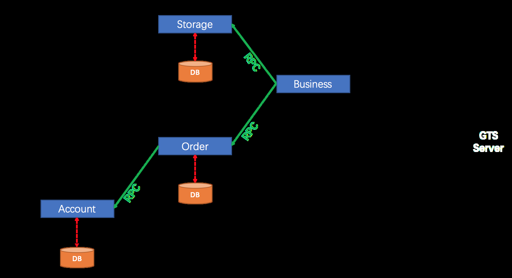

## 先固定实验边界

原资料来自 [Spring Cloud Alibaba 2022.x 的 Seata 示例](https://github.com/alibaba/spring-cloud-alibaba/tree/2022.x/spring-cloud-alibaba-examples/seata-example)，但同时混入多种 Seata、Nacos 和 JDK 版本。复现时应取同一发布分支的示例代码及其依赖，再选择兼容的 Seata Server 和 Nacos；不要单凭“JDK 8、11、17、21 都能安装”推断该示例可运行。拓扑中的 `10.0.0.101/102/103` 仅是原实验地址，关键要求是每个客户端能解析并连接 Nacos、TC 与数据库。

不必因为 Docker 可能产生 `172.17.0.1` 就断言这些组件不能同机或容器化。真正的问题是 **TC 向注册中心公布的地址是否从业务应用所在网络可达**；可按目标版本设置注册 IP，或配置正确的容器网络和服务名，再从客户端验证 8091 端口连通。

## 1. 初始化数据与服务

在 MySQL 创建实验数据库，并导入与所选示例版本匹配的 SQL。原示例的 `all.sql` 把业务表与 Seata Server 表放在一个库中，便于教学；生产应按职责分库、分账号。确认表的用途：

| 表 | 用途 |
| --- | --- |
| `storage_tbl`、`order_tbl`、`account_tbl` | 业务状态 |
| `undo_log` | AT 模式各业务数据库的分支回滚信息 |
| `global_table`、`branch_table`、`lock_table`、`distributed_lock` | TC 在数据库模式下保存全局事务与协调状态；具体表以当前 Server 脚本为准 |

先确认 Nacos 自身可用，再启动数据库和 TC。Nacos 2.x 的客户端通常还需 9848 gRPC 端口。控制台能登录只是第一步，还要验证 API 与客户端连接。

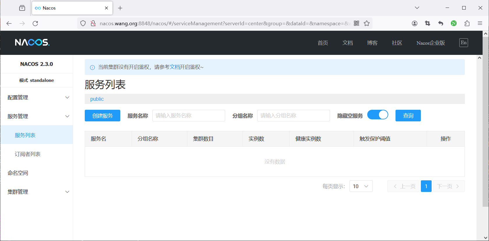
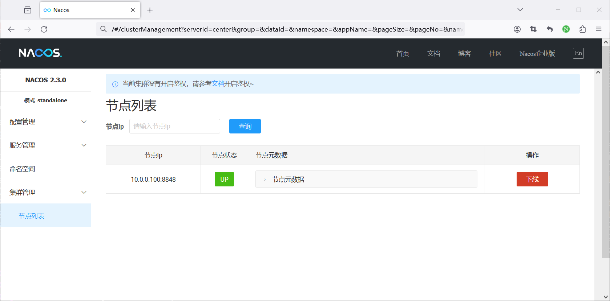

## 2. 对齐 Nacos 的注册与配置身份

Seata 与 Nacos 之间至少有两条配置路径：

1. **注册中心**：Seata Server 以应用名 `seata-server`、命名空间、分组及集群名注册；客户端按这些维度发现可用 TC。
2. **配置中心**：Server 或客户端从 Nacos 读取配置，配置由 namespace ID、group 和 dataId 精确定位。是否使用配置中心是独立决定，不能因为已注册成功就假设配置已加载。

原资料在多个地方把 `SEATA_GROUP` 注释掉来躲避 “no available service endpoint found”。正确排查方法是对照 Server **实际注册的** namespace ID、group、application、cluster 和客户端查询条件，让它们一致；随意删掉分组只是让两边碰巧落入同一个默认组。命名空间的显示名也不等于 ID。

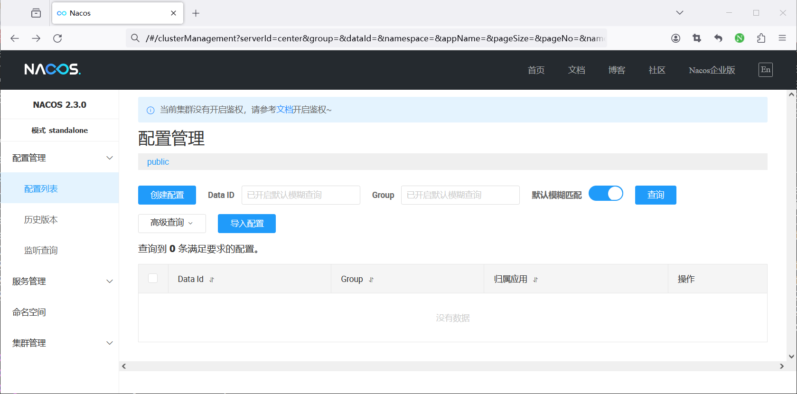
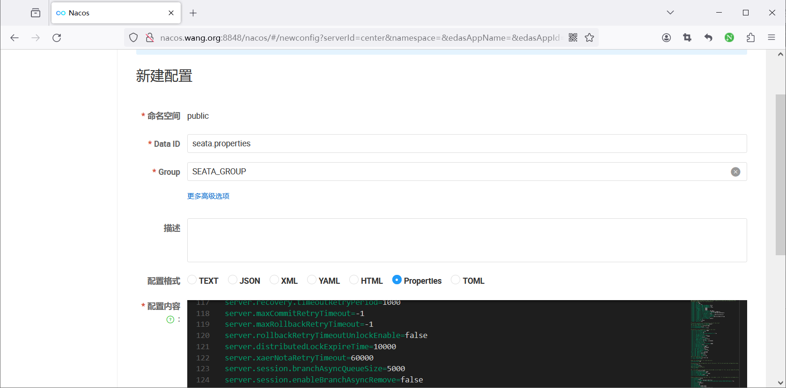
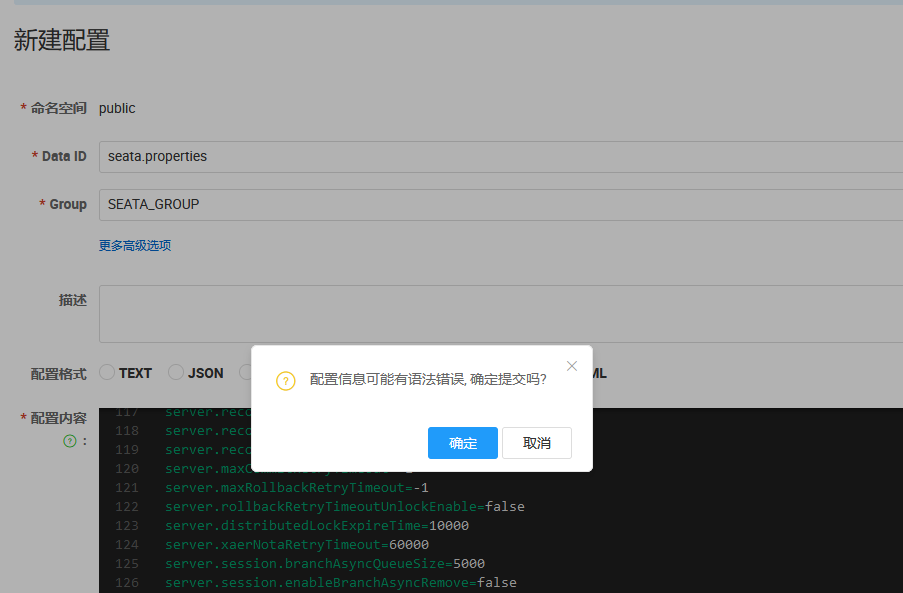
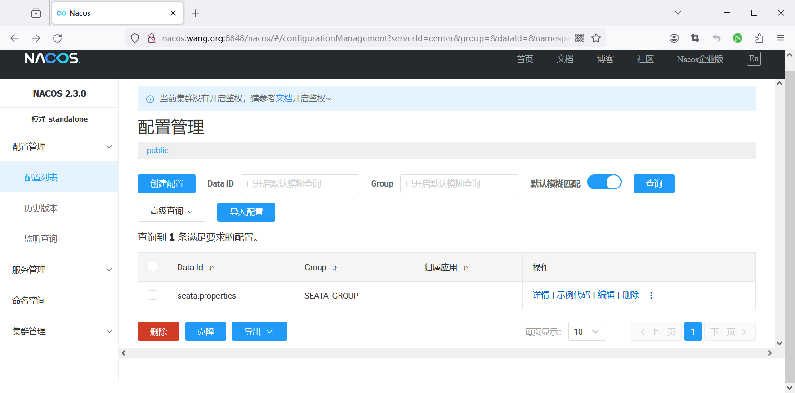

如果客户端采用旧式 `seata.properties` 配置，事务分组到 TC 集群的映射应为**完整且同一行**的属性，例如：

```properties
service.vgroupMapping.business-service-tx-group=default
service.vgroupMapping.order-service-tx-group=default
service.vgroupMapping.storage-service-tx-group=default
service.vgroupMapping.account-service-tx-group=default
```

左边的分组名必须与各应用 `seata.tx-service-group` 一致；右边的 `default` 必须与 TC 注册的 cluster 一致。这里的配置数据 ID、Nacos group 和 TC cluster 是三个不同概念。配置具体是放在 Nacos 还是本地文件，以及属性格式是否仍适用于当前版本，应对照所选客户端版本的文档。

## 3. 配置并启动 Seata Server

按照第 32 篇先决定 TC 存储模式。单节点实验可用文件模式；若选数据库模式，则初始化 TC 表并在 Server 的有效配置中指定 DB。不能把 `store.mode=file` 写在 `application.yml`，同时在另一份 Nacos 配置里写 `store.mode=db`，却不确认最终谁生效。Server 的 Nacos 注册配置和客户端配置必须指向同一 Nacos 环境，且对外发布的 TC 地址从业务应用可达。

检查日志里的两个独立事实：**Nacos 注册成功**以及 **TC 状态存储初始化成功**；随后在 Nacos 服务列表中查看 `seata-server` 实例 IP、8091 端口和集群名。原始 `application.yml` 被 PDF 提取时缩进全部丢失、JDBC URL 断行，不能原样作为配置文件。

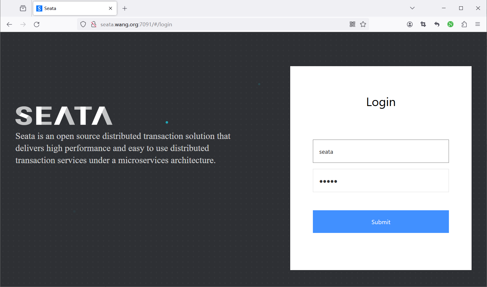
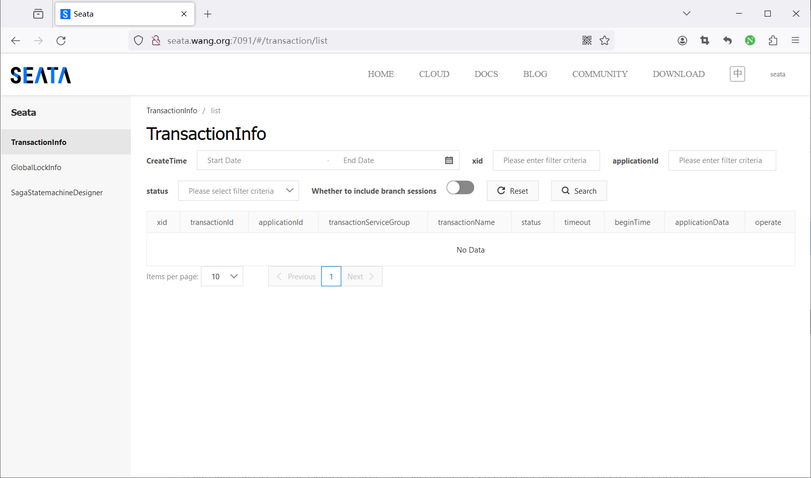

## 4. 启动四个业务服务

在同一兼容版本下构建 account、order、storage、business 四个模块。每个服务应有自己的应用名、业务端口、数据库连接和 Nacos Discovery 配置；参与 AT 的数据源需正确代理，且业务库有 `undo_log`。Seata 客户端还要配置与 Server 对齐的注册 namespace/group/cluster 与事务分组。以 storage-service 为例，**结构**如下，具体属性名按该发布分支核对：

```yaml
spring:
  application:
    name: storage-service
  cloud:
    nacos:
      discovery:
        server-addr: NACOS_HOST:8848
seata:
  enabled: true
  application-id: storage-service
  tx-service-group: storage-service-tx-group
  registry:
    type: nacos
    nacos:
      server-addr: NACOS_HOST:8848
      application: seata-server
      group: SEATA_GROUP
      cluster: default
```

其他三个服务的 `application-id` 和 `tx-service-group` 对应改成自己的名字。若采用统一事务分组，也应在四个服务和映射中统一约定。数据库密码不要写进示例仓库；使用环境变量或受控配置源。原资料的 Maven HTTP 镜像和 `-Dmaven.test.skip=true` 只是在当时跳过验证，不应作为默认构建步骤。

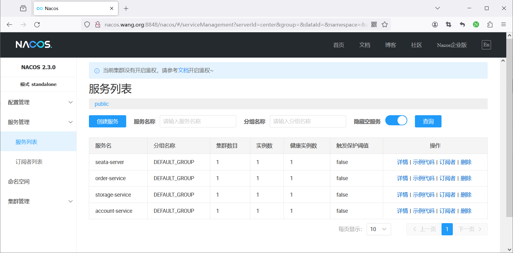

## 5. 用成功与失败两条路径验收

先记录库存、账户余额和订单数的**基线**，再发起一次成功下单，确认库存与余额按预期减少、订单增加，且各服务日志中的 XID 一致。随后在受控测试环境使账户服务抛出模拟异常，再发起一次下单：

- 请求失败是表层现象；重点看 TC 是否发出全局回滚、分支是否成功回滚。
- 再查库存、余额和订单数据，确认与失败请求前的基线一致。
- 若只看到 HTTP 500 而数据仍变化，应检查 XID 传播、数据源代理、分支注册和 `undo_log`。
- 若 TC 控制台里的事务很快消失，不等于一定提交或回滚成功；应结合日志和数据库结果判断。

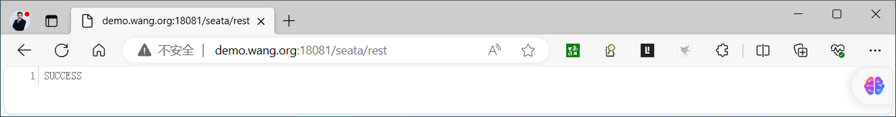
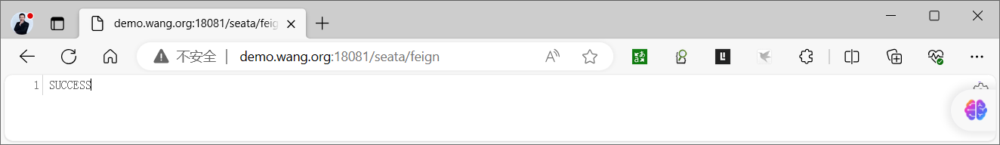
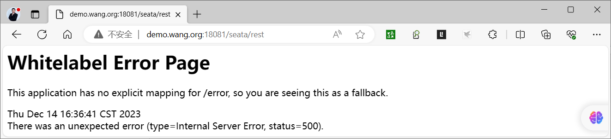
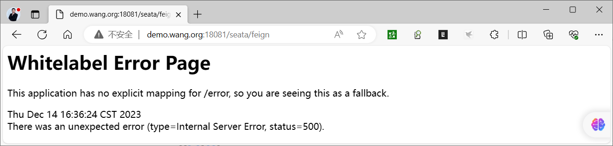
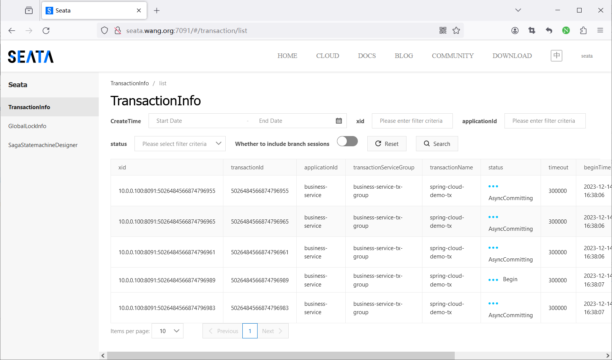
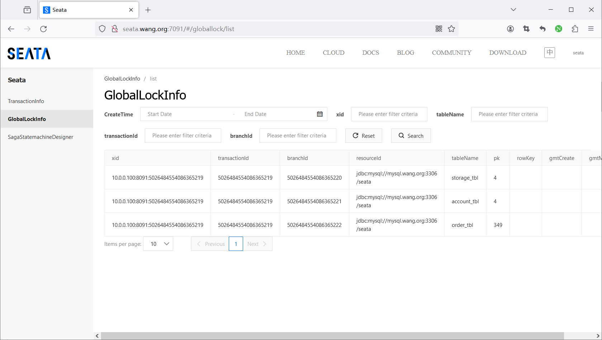

原资料用无限循环请求观察控制台，容易持续改动数据库且难以对比基线。应使用有限次数的测试请求，并为每次测试记录业务 ID 与 XID。完成后撤销模拟异常，再演练重启一个业务服务和一个 TC 节点，验证配置与状态恢复。



<nav class="article-end" aria-label="章节导航">
  <a href="{{ '/subjects/Microservices/32-installing-seata-server.html' | relative_url }}">← 上一篇：Seata Server 安装</a>
  <a href="{{ '/subjects/Microservices/' | relative_url }}">返回专题目录</a>
  <a href="{{ '/subjects/Microservices/34-introduction-to-spring-cloud-gateway.html' | relative_url }}">下一篇：Spring Cloud Gateway 介绍 →</a>
</nav>
