[← Back to Microservices Index]({{ '/subjects/Microservices/' | relative_url }})



# 33 Integrating Seata with Nacos
### 6.3 综合案例: Seata 结合 Nacos

Seata Example

<https://github.com/alibaba/spring-cloud-alibaba/blob/2022.x/spring-cloud-alibaba-examples/seata-example/readme-zh.md>

用例

用户购买商品的业务逻辑。整个业务逻辑由3个微服务提供支持：

仓储服务：对给定的商品扣除仓储数量。 订单服务：根据采购需求创建订单。 帐户服务：从用户帐户中扣除余额。

架构图

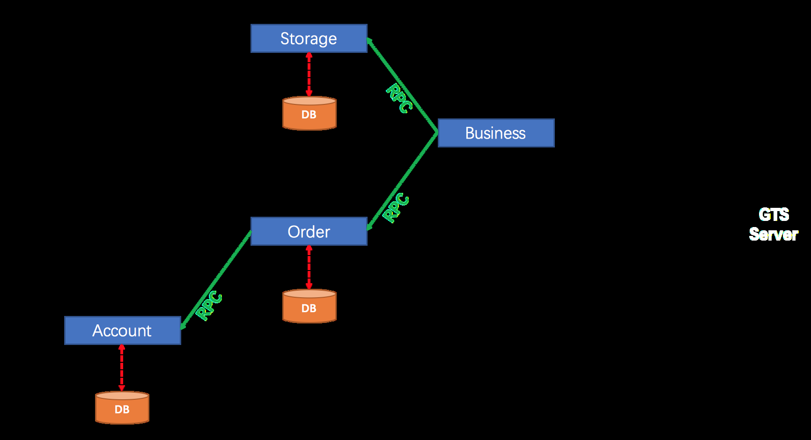

### 配置所需服务对应节点的名称解析

需要三台主机

一台主机运行MySQL，Nacos 一台主机运行 Seata-Server，使用 JDK-8,11,17,21 一台主机运行四个微服务，使用JDK-21，JDK-17

此案例需要用于三个基础服务Seata,Nacos,MySQL,可以将三个服务放在相同或不同的主机节点,但需要对其节点做名称解析

```bash
#方式1：三台主机
[root@ubuntu2204 ~]#cat /etc/hosts
10.0.0.101 nacos.bowen.org mysql.bowen.org
10.0.0.102 seata.bowen.org #建议 Seata Server 不要和Nacos放在同一台主机，可能会导致Seata注册为容器网卡的IP：172.17.0.1
10.0.0.103 demo.bowen.org
#方式2：如果将三个服务放在同一个主机节点，不要安装docker，可能会导致Seata注册为容器网卡的IP：172.17.0.1
[root@ubuntu2204 ~]#cat /etc/hosts
10.0.0.101 seata.bowen.org nacos.bowen.org mysql.bowen.org
```

### 安装和配置 MySQL

```bash
#方式1：容器化启动MySQL：不建议容器化，可能会导致Seata注册为容器网卡的IP：172.17.0.1
[root@ubuntu2204 ~]#apt update && apt -y install docker.io
#直接使用宿主机网络
[root@ubuntu2204 ~]#docker run --name mysql --network host -d -e MYSQL_ROOT_PASSWORD=123456 -e
MYSQL_DATABASE=seata -e MYSQL_USER=seata -e MYSQL_PASSWORD=123456 --restart always registry.cn-
beijing.aliyuncs.com/bowenxiaochun/mysql:8.0.29-oracle
[root@ubuntu2204 ~]#docker run --name mysql -p 3306:3306 -d -e MYSQL_ROOT_PASSWORD=123456 -e
MYSQL_DATABASE=seata -e MYSQL_USER=seata -e MYSQL_PASSWORD=123456 --restart always registry.cn-
beijing.aliyuncs.com/bowenxiaochun/mysql:8.0.29-oracle
#方式2：传统方式
[root@ubuntu2404 ~]#apt update && apt -y install mysql-server
[root@ubuntu2204 ~]#apt update && apt -y install mysql-server
[root@ubuntu2204 ~]#sed -i '/127.0.0.1/s/^/#/' /etc/mysql/mysql.conf.d/mysqld.cnf
[root@ubuntu2204 ~]#systemctl restart mysql.service
[root@ubuntu2204 ~]#mysql
Welcome to the MySQL monitor.  Commands end with ; or \g.
Your MySQL connection id is 9
Server version: 8.0.40-0ubuntu0.22.04.1 (Ubuntu)
mysql> create database seata;
#使用新和旧的验证插件都支持
mysql> create user seata@'%' identified by '123456';
mysql> create user seata@'%' identified with  mysql_native_password by '123456';
mysql> grant all on seata.* to seata@'%';
mysql> SHOW GRANTS FOR seata@'%';
+--------------------------------------------------+
| Grants for seata@%                               |
+--------------------------------------------------+
| GRANT USAGE ON *.* TO `seata`@`%`                |
| GRANT ALL PRIVILEGES ON `seata`.* TO `seata`@`%` |
+--------------------------------------------------+
2 rows in set (0.00 sec)
#下载示例业务和seata服务所需的SQL脚本文件all.sql
https://github.com/alibaba/spring-cloud-alibaba/blob/2022.x/spring-cloud-alibaba-examples/seata-
example/all.sql
#为简单起见，本示例中业务数据和seata使用同一个数据库seata
[root@ubuntu2204 ~]#mysql -useata -p123456 -hmysql.bowen.org seata < all.sql
#确认创建表
[root@ubuntu2204 ~]#mysql -useata -p123456 -hmysql.bowen.org  -e 'show tables in seata'
mysql: [Warning] Using a password on the command line interface can be insecure.
+------------------+
| Tables_in_seata  |
+------------------+
| account_tbl      |
| branch_table     |
| distributed_lock |
| global_table     |
| lock_table       |
| order_tbl        |
| storage_tbl      |
| undo_log         |
+------------------+
```

### 安装和配置 Nacos

```bash
#方法1：二进制安装nacos
[root@ubuntu2204 ~]#bash install_nacos_single_node.sh
#方法2：容器运行,不建议容器化，可能会导致Seata注册为容器网卡的IP：172.17.0.1
[root@ubuntu2204 ~]#docker run --name nacos -e MODE=standalone --network host -d --restart always registry.cn-
beijing.aliyuncs.com/bowenxiaochun/nacos-server:v2.4.3-slim
#登录nacos
http://nacos.bowen.org:8848/nacos
```

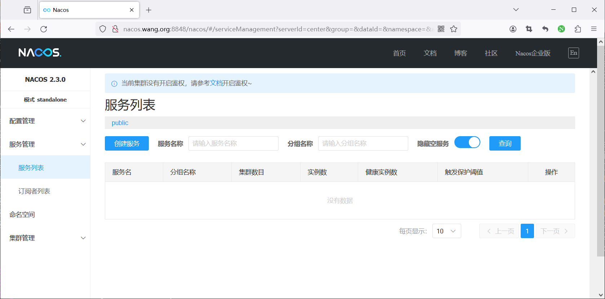

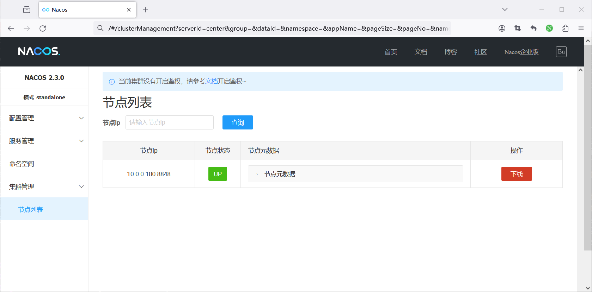

创建 Seata 的 Nacos 配置：

```text
data-id: seata.properties
Group: SEATA_GROUP (seata 1.8.0 默认分组) ,
```

导入 Seata Config

在 seata.properties 配置文件中增加应用示例中需要的以下配置项：事务群组配置

<https://github.com/seata/seata/blob/develop/script/config-center/config.txt>

<https://github.com/seata/seata/blob/1.8.0/script/config-center/config.txt>

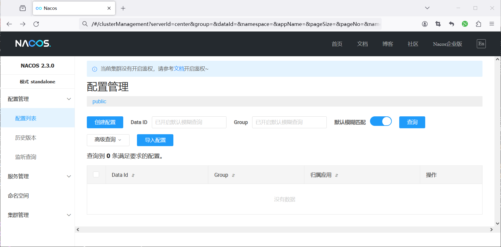

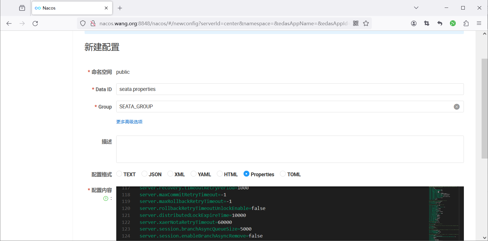

提示下面的错误忽略

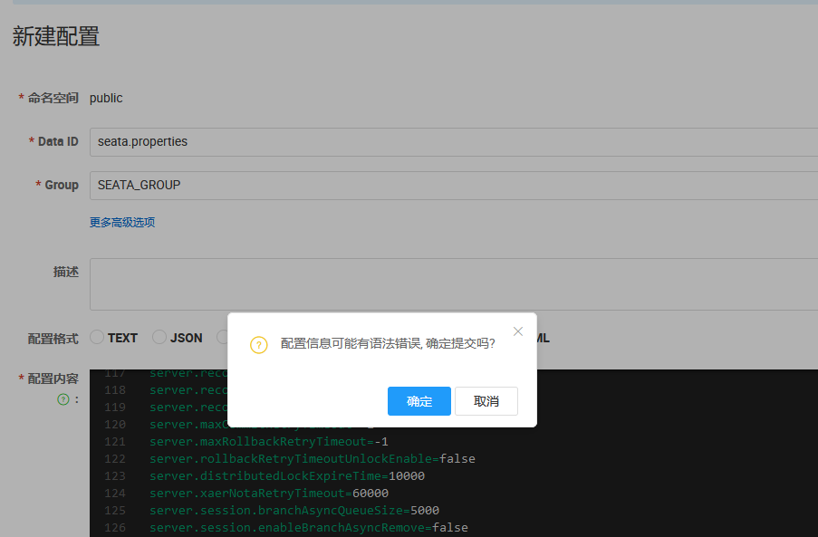

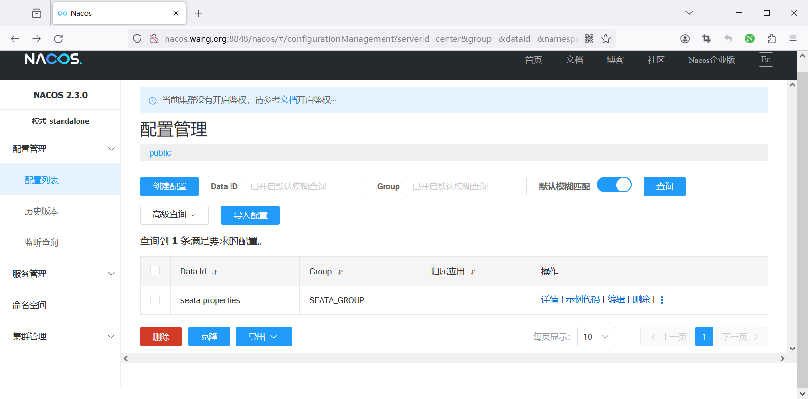

配置完整内容如下

```text
#For details about configuration items, see https://seata.io/zh-cn/docs/user/configurations.html
#Transport configuration, for client and server
transport.type=TCP
transport.server=NIO
transport.heartbeat=true
transport.enableTmClientBatchSendRequest=false
transport.enableRmClientBatchSendRequest=true
transport.enableTcServerBatchSendResponse=false
transport.rpcRmRequestTimeout=30000
transport.rpcTmRequestTimeout=30000
transport.rpcTcRequestTimeout=30000
transport.threadFactory.bossThreadPrefix=NettyBoss
transport.threadFactory.workerThreadPrefix=NettyServerNIOWorker
transport.threadFactory.serverExecutorThreadPrefix=NettyServerBizHandler
transport.threadFactory.shareBossWorker=false
transport.threadFactory.clientSelectorThreadPrefix=NettyClientSelector
transport.threadFactory.clientSelectorThreadSize=1
transport.threadFactory.clientWorkerThreadPrefix=NettyClientWorkerThread
transport.threadFactory.bossThreadSize=1
transport.threadFactory.workerThreadSize=default
transport.shutdown.wait=3
transport.serialization=seata
transport.compressor=none
#Transaction routing rules configuration, only for the client
service.vgroupMapping.default_tx_group=default
#If you use a registry, you can ignore it
service.default.grouplist=seata.bowen.org:8091
service.enableDegrade=false
service.disableGlobalTransaction=false
#Transaction rule configuration, only for the client
client.rm.asyncCommitBufferLimit=10000
client.rm.lock.retryInterval=10
client.rm.lock.retryTimes=30
client.rm.lock.retryPolicyBranchRollbackOnConflict=true
client.rm.reportRetryCount=5
client.rm.tableMetaCheckEnable=true
client.rm.tableMetaCheckerInterval=60000
client.rm.sqlParserType=druid
client.rm.reportSuccessEnable=false
client.rm.sagaBranchRegisterEnable=false
client.rm.sagaJsonParser=fastjson
client.rm.tccActionInterceptorOrder=-2147482648
client.tm.commitRetryCount=5
client.tm.rollbackRetryCount=5
client.tm.defaultGlobalTransactionTimeout=60000
client.tm.degradeCheck=false
client.tm.degradeCheckAllowTimes=10
client.tm.degradeCheckPeriod=2000
client.tm.interceptorOrder=-2147482648
client.undo.dataValidation=true
client.undo.logSerialization=jackson
client.undo.onlyCareUpdateColumns=true
server.undo.logSaveDays=7
server.undo.logDeletePeriod=86400000
client.undo.logTable=undo_log
client.undo.compress.enable=true
client.undo.compress.type=zip
client.undo.compress.threshold=64k
#For TCC transaction mode
tcc.fence.logTableName=tcc_fence_log
tcc.fence.cleanPeriod=1h
#Log rule configuration, for client and server
log.exceptionRate=100
#Transaction storage configuration, only for the server. The file, db, and redis configuration values are
optional.
store.mode=file
store.lock.mode=file
store.session.mode=file
#Used for password encryption
store.publicKey=
#If `store.mode,store.lock.mode,store.session.mode` are not equal to `file`, you can remove the configuration
block.
store.file.dir=file_store/data
store.file.maxBranchSessionSize=16384
store.file.maxGlobalSessionSize=512
store.file.fileWriteBufferCacheSize=16384
store.file.flushDiskMode=async
store.file.sessionReloadReadSize=100
#These configurations are required if the `store mode` is `db`. If
`store.mode,store.lock.mode,store.session.mode` are not equal to `db`, you can remove the configuration block.
store.db.datasource=druid
store.db.dbType=mysql
#############################修改内容##########################
store.db.driverClassName=com.mysql.jdbc.Driver
store.db.url=jdbc:mysql://mysql.bowen.org:3306/seata?useUnicode=true&rewriteBatchedStatements=true
store.db.user=seata
store.db.password=123456
##########################################################
store.db.minConn=5
store.db.maxConn=30
store.db.globalTable=global_table
store.db.branchTable=branch_table
store.db.distributedLockTable=distributed_lock
store.db.queryLimit=100
store.db.lockTable=lock_table
store.db.maxWait=5000
#These configurations are required if the `store mode` is `redis`. If
`store.mode,store.lock.mode,store.session.mode` are not equal to `redis`, you can remove the configuration
block.
store.redis.mode=single
store.redis.single.host=127.0.0.1
store.redis.single.port=6379
store.redis.sentinel.masterName=
store.redis.sentinel.sentinelHosts=
store.redis.sentinel.sentinelPassword=
store.redis.maxConn=10
store.redis.minConn=1
store.redis.maxTotal=100
store.redis.database=0
store.redis.password=
store.redis.queryLimit=100
#Transaction rule configuration, only for the server
server.recovery.committingRetryPeriod=1000
server.recovery.asynCommittingRetryPeriod=1000
server.recovery.rollbackingRetryPeriod=1000
server.recovery.timeoutRetryPeriod=1000
server.maxCommitRetryTimeout=-1
server.maxRollbackRetryTimeout=-1
server.rollbackRetryTimeoutUnlockEnable=false
server.distributedLockExpireTime=10000
server.xaerNotaRetryTimeout=60000
server.session.branchAsyncQueueSize=5000
server.session.enableBranchAsyncRemove=false
server.enableParallelRequestHandle=false
#Metrics configuration, only for the server
metrics.enabled=false
metrics.registryType=compact
metrics.exporterList=prometheus
metrics.exporterPrometheusPort=9898
service.vgroupMapping.order-service-tx-group=default
service.vgroupMapping.account-service-tx-group=default
service.vgroupMapping.business-service-tx-group=default
service.vgroupMapping.storage-service-tx-group=default
```

### 安装和配置 Seata

<https://github.com/alibaba/spring-cloud-alibaba/blob/2022.x/spring-cloud-alibaba-examples/seata-example/readme-zh.md#2-%E9%85%8D%E7%BD%AE-seata-server>

范例：不要安装在和Nacos同一台主机上，可能导致Seata注册为容器网卡的IP：172.17.0.1

```bash
#二进制安装Seata-Server
[root@ubuntu2204 ~]#bash install_seata.sh
#新版路径
[root@ubuntu2204 ~]#vim /usr/local/seata-server/conf/application.yml
#旧版路径
[root@ubuntu2204 ~]#vim /usr/local/seata/conf/application.yml
#  Copyright 1999-2019 Seata.io Group.
#
#  Licensed under the Apache License, Version 2.0 (the "License");
#  you may not use this file except in compliance with the License.
#  You may obtain a copy of the License at
#
#  http://www.apache.org/licenses/LICENSE-2.0
#
#  Unless required by applicable law or agreed to in writing, software
#  distributed under the License is distributed on an "AS IS" BASIS,
#  WITHOUT WARRANTIES OR CONDITIONS OF ANY KIND, either express or implied.
#  See the License for the specific language governing permissions and
#  limitations under the License.
server:
port: 7091
spring:
application:
name: seata-server
logging:
config: classpath:logback-spring.xml
file:
path: ${log.home:${user.home}/logs/seata}
extend:
logstash-appender:
destination: 127.0.0.1:4560
kafka-appender:
bootstrap-servers: 127.0.0.1:9092
topic: logback_to_logstash
console:
user:
username: seata
password: seata
seata:
#######################################修改或复制如下内容########################################
config:
type: nacos
nacos:
server-addr: nacos.bowen.org:8848
namespace:
# group: SEATA_GROUP   #注释此行，可选
#username: nacos
#password: nacos
context-path:
data-id: seata.properties
##if use MSE Nacos with auth, mutex with username/password attribute
#access-key:
#secret-key:
registry:
# nacos配置
type: nacos
nacos:
application: seata-server
server-addr: nacos.bowen.org:8848
# group: SEATA_GROUP #注释此行，否则应用无法找到seata服务，提示ERROR 4929 no available service endpoint found
in cluster 'default', please make sure registry config correct and keep your seata-server is running
namespace:
cluster: default     #指定集群名称
#username: nacos
#password: nacos
#################################################################################
store:
# support: file 、 db 、 redis 、 raft
mode: file
#  server:
#    service-port: 8091 #If not configured, the default is '${server.port} + 1000'
security:
secretKey: SeataSecretKey0c382ef121d778043159209298fd40bf3850a017
tokenValidityInMilliseconds: 1800000
ignore:
urls:
/,/**/*.css,/**/*.js,/**/*.html,/**/*.map,/**/*.svg,/**/*.png,/**/*.jpeg,/**/*.ico,/api/v1/auth/login,/metadat
a/v1/**
[root@ubuntu2204 ~]#systemctl restart seata
#使用默认用户和密码都是seata登录
http://seata.bowen.org:7091/
```

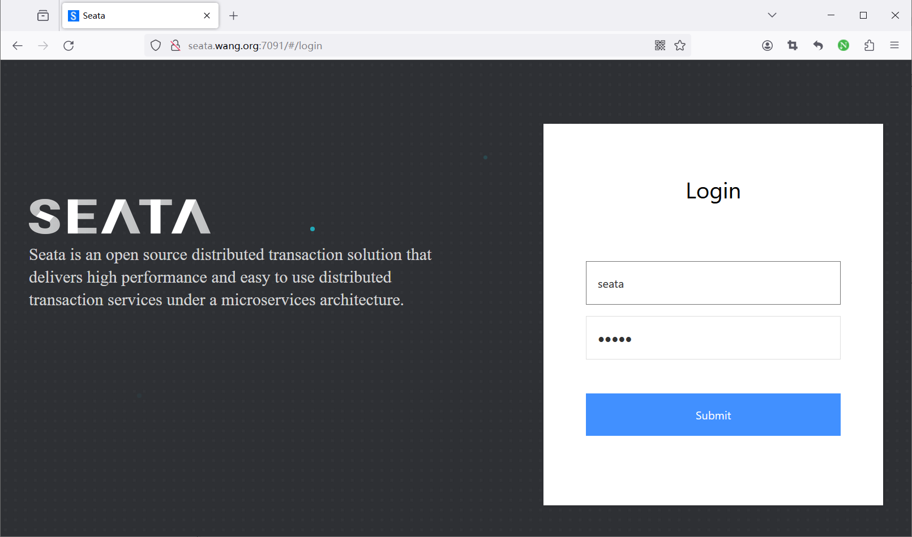

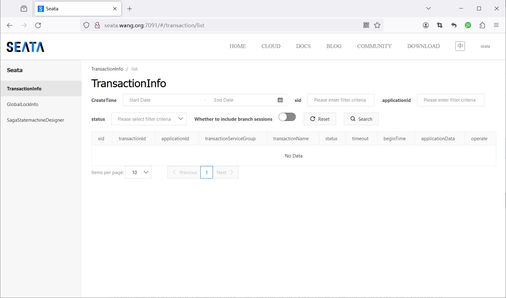

### 编译 JAVA 应用并运行

注意:此应用基于 JDK-17

分别运行 account-server 、order-service 、storage-service 和 business-service 这三个应用的 Main 函数，启动示例。

```bash
#查看应用的配置信息
[root@ubuntu2204 ~]#vim spring-cloud-alibaba-2022.x/spring-cloud-alibaba-examples/seata-example/storage-
service/src/main/resources/application.yml
base:
config:
mdb:
hostname: mysql.bowen.org #your mysql server ip address
dbname: seata #your database name for test
port: 3306 #your mysql server listening port
username: 'seata' #your mysql server username
password: '123456' #your mysql server password
server:
port: 18082
spring:
cloud:
nacos:
discovery:
server-addr: nacos.bowen.org:8848
#username: 'nacos'
#password: 'nacos'
application:
name: storage-service
main:
allow-bean-definition-overriding: true
datasource:
name: storageDataSource
#    druid don't support GraalVM now because of there is CGlib proxy
#    type: com.alibaba.druid.pool.DruidDataSource
driver-class-name: com.mysql.cj.jdbc.Driver
url: jdbc:mysql://${base.config.mdb.hostname}:${base.config.mdb.port}/${base.config.mdb.dbname}?
useSSL=false&serverTimezone=UTC
username: ${base.config.mdb.username}
password: ${base.config.mdb.password}
#    druid:
#      max-active: 20
#      min-idle: 2
#      initial-size: 2
seata:
enabled: true
application-id: ${spring.application.name}
tx-service-group: ${spring.application.name}-tx-group
config:
type: nacos
nacos:
serverAddr: nacos.bowen.org:8848
dataId: "seata.properties"
#username: 'nacos'
#password: 'nacos'
registry:
type: nacos
nacos:
application: seata-server
server-addr: nacos.bowen.org:8848
#username: 'nacos'
#password: 'nacos'
#安装编译工具
[root@ubuntu2204 ~]#apt update && apt -y  install openjdk-17-jdk && apt -y  install maven
[root@ubuntu2204 ~]#mvn -v
Apache Maven 3.6.3
Maven home: /usr/share/maven
Java version: 17.0.9, vendor: Private Build, runtime: /usr/lib/jvm/java-17-openjdk-amd64
Default locale: en_US, platform encoding: UTF-8
OS name: "linux", version: "5.15.0-91-generic", arch: "amd64", family: "unix"
#加速配置
[root@ubuntu2204 ~]#vim /etc/maven/settings.xml
<mirror>
<id>nexus-aliyun</id>
<mirrorOf>*</mirrorOf>
<name>Nexus aliyun</name>
<url>http://maven.aliyun.com/nexus/content/groups/public</url>
</mirror>
#编译
[root@ubuntu2204 spring-cloud-alibaba-examples]#mvn clean package -Dmaven.test.skip=true
#启动应用
[root@ubuntu2204 seata-example]#java -jar business-service/target/business-service-2022.0.0.0.jar
[root@ubuntu2204 seata-example]#java -jar account-service/target/account-service-2022.0.0.0.jar
[root@ubuntu2204 seata-example]#java -jar order-service/target/order-service-2022.0.0.0.jar
[root@ubuntu2204 seata-example]#java -jar storage-service/target/storage-service-2022.0.0.0.jar
```

在nacos 观察到服务注册成功

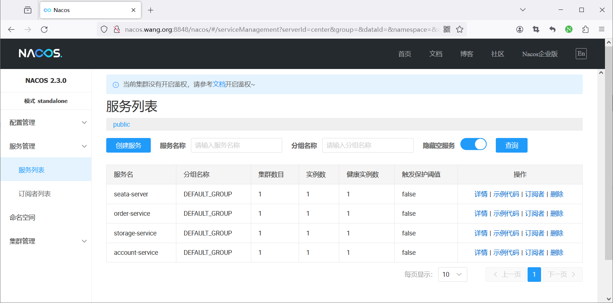

### 测试访问应用

```bash
#访问应用
http://demo.bowen.org:18081/seata/rest
http://demo.bowen.org:18081/seata/feign
[root@ubuntu2204 ~]#while true;do curl http://127.0.0.1:18081/seata/rest;echo;sleep 1;done
#调用服务接口时，随机出现两种返回
SUCCESS：调用接口服务成功；
500 异常，business-service mock 异常。
```

访问成功


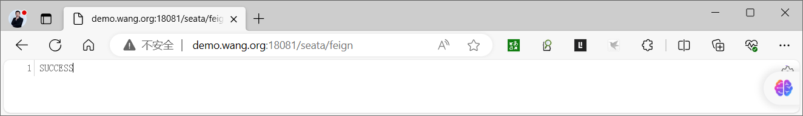

访问失败

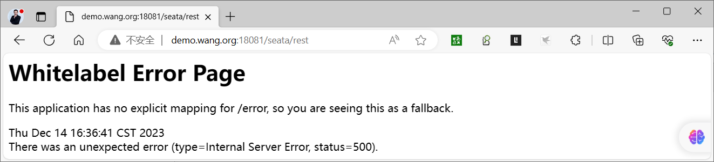

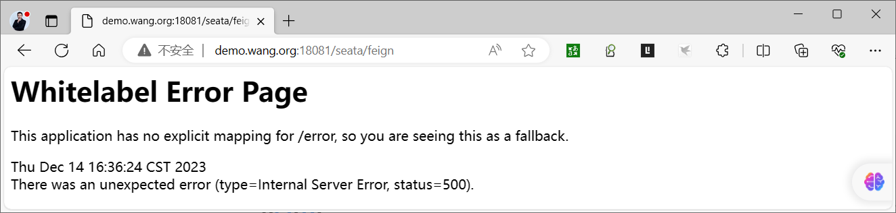

观察应用成功和失败的提示

```bash
[root@ubuntu2204 seata-example]#java -jar account-service/target/account-service-2022.0.0.0.jar
#成功
2023-12-14T11:42:00.983+08:00  INFO 98354 --- [io-18084-exec-9] c.a.cloud.examples.AccountController     :
Account Service ... xid: 10.0.0.102:8091:991259213033464173
2023-12-14T11:42:00.990+08:00  INFO 98354 --- [io-18084-exec-9] c.a.cloud.examples.AccountController     :
Account Service End ...
#失败
2023-12-14T11:53:57.478+08:00  INFO 98354 --- [io-18084-exec-1] c.a.cloud.examples.AccountController     :
Account Service ... xid: 10.0.0.102:8091:991259213033464176
2023-12-14T11:53:57.479+08:00 ERROR 98354 --- [io-18084-exec-1] o.a.c.c.C.[.[.[/].[dispatcherServlet]    :
Servlet.service() for servlet [dispatcherServlet] in context with path [] threw exception [Request processing
failed: java.lang.RuntimeException: this is a mock Exception] with root cause
java.lang.RuntimeException: this is a mock Exception
at com.alibaba.cloud.examples.AccountController.account(AccountController.java:55) ~[classes!/:2022.0.0.0]
at jdk.internal.reflect.GeneratedMethodAccessor33.invoke(Unknown Source) ~[na:na]
at
java.base/jdk.internal.reflect.DelegatingMethodAccessorImpl.invoke(DelegatingMethodAccessorImpl.java:43) ~
[na:na]
.....
[root@ubuntu2204 seata-example]#java -jar business-service/target/business-service-2022.0.0.0.jar
2023-12-14T12:04:01.479+08:00 DEBUG 118944 --- [ctor_RMROLE_1_1] i.s.c.rpc.netty.AbstractNettyRemoting    :
io.seata.core.rpc.netty.RmNettyRemotingClient@417f4038 msgId:2, body:services pong
2023-12-14T12:04:01.480+08:00 DEBUG 118944 --- [ctor_RMROLE_1_1] i.s.c.r.p.c.ClientHeartbeatProcessor     :
received PONG from /10.0.0.102:8091
........
[root@ubuntu2204 order-service]#java -jar target/order-service-2022.0.0.0.jar
#成功
2023-12-14T11:42:00.978+08:00  INFO 112013 --- [io-18083-exec-9] c.a.cloud.examples.OrderController       :
Order Service Begin ... xid: 10.0.0.102:8091:991259213033464173
2023-12-14T11:42:01.001+08:00  INFO 112013 --- [io-18083-exec-9] io.seata.rm.AbstractResourceManager      :
branch register success, xid:10.0.0.102:8091:991259213033464173, branchId:991259213033464175,
lockKeys:order_tbl:8
2023-12-14T11:42:01.010+08:00  INFO 112013 --- [io-18083-exec-9] c.a.cloud.examples.OrderController       :
Order Service End ... Created Order{id=8, userId='U100001', commodityCode='C00321', count=2, money=4}
2023-12-14T11:42:01.896+08:00  INFO 112013 --- [ch_RMROLE_1_4_4] i.s.c.r.p.c.RmBranchCommitProcessor      : rm
client handle branch commit process:BranchCommitRequest{xid='10.0.0.102:8091:991259213033464173',
branchId=991259213033464175, branchType=AT, resourceId='jdbc:mysql://mysql.bowen.org:3306/seata',
applicationData='null'}
2023-12-14T11:42:01.896+08:00  INFO 112013 --- [ch_RMROLE_1_4_4] io.seata.rm.AbstractRMHandler            :
Branch committing: 10.0.0.102:8091:991259213033464173 991259213033464175
jdbc:mysql://mysql.bowen.org:3306/seata null
2023-12-14T11:42:01.896+08:00  INFO 112013 --- [ch_RMROLE_1_4_4] io.seata.rm.AbstractRMHandler            :
Branch commit result: PhaseTwo_Committed
#失败
2023-12-14T11:53:57.474+08:00  INFO 112013 --- [io-18083-exec-1] c.a.cloud.examples.OrderController       :
Order Service Begin ... xid: 10.0.0.102:8091:991259213033464176
2023-12-14T11:53:57.487+08:00 ERROR 112013 --- [io-18083-exec-1] o.a.c.c.C.[.[.[/].[dispatcherServlet]    :
Servlet.service() for servlet [dispatcherServlet] in context with path [] threw exception [Request processing
failed: org.springframework.web.client.HttpServerErrorException$InternalServerError: 500 : "
{"timestamp":"2023-12-14T03:53:57.483+00:00","status":500,"error":"Internal Server Error","path":"/account"}"]
with root cause
org.springframework.web.client.HttpServerErrorException$InternalServerError: 500 : "{"timestamp":"2023-12-
14T03:53:57.483+00:00","status":500,"error":"Internal Server Error","path":"/account"}"
at org.springframework.web.client.HttpServerErrorException.create(HttpServerErrorException.java:103) ~
[spring-web-6.0.4.jar!/:6.0.4]
[root@ubuntu2204 storage-service]#java -jar target/storage-service-2022.0.0.0.jar
#成功
2023-12-14T11:42:00.954+08:00  INFO 114386 --- [io-18082-exec-1] c.a.c.e.controller.StorageController     :
Storage Service Begin ... xid: 10.0.0.102:8091:991259213033464173
2023-12-14T11:42:00.965+08:00  INFO 114386 --- [io-18082-exec-1] io.seata.rm.AbstractResourceManager      :
branch register success, xid:10.0.0.102:8091:991259213033464173, branchId:991259213033464174,
lockKeys:storage_tbl:2
2023-12-14T11:42:00.969+08:00  INFO 114386 --- [io-18082-exec-1] c.a.c.e.controller.StorageController     :
Storage Service End ...
2023-12-14T11:42:01.893+08:00  INFO 114386 --- [ch_RMROLE_1_3_4] i.s.c.r.p.c.RmBranchCommitProcessor      : rm
client handle branch commit process:BranchCommitRequest{xid='10.0.0.102:8091:991259213033464173',
branchId=991259213033464174, branchType=AT, resourceId='jdbc:mysql://mysql.bowen.org:3306/seata',
applicationData='null'}
2023-12-14T11:42:01.893+08:00  INFO 114386 --- [ch_RMROLE_1_3_4] io.seata.rm.AbstractRMHandler            :
Branch committing: 10.0.0.102:8091:991259213033464173 991259213033464174
jdbc:mysql://mysql.bowen.org:3306/seata null
2023-12-14T11:42:01.893+08:00  INFO 114386 --- [ch_RMROLE_1_3_4] io.seata.rm.AbstractRMHandler            :
Branch commit result: PhaseTwo_Committed
#失败
2023-12-14T11:53:57.447+08:00  INFO 114386 --- [io-18082-exec-4] c.a.c.e.controller.StorageController     :
Storage Service Begin ... xid: 10.0.0.102:8091:991259213033464176
2023-12-14T11:53:57.465+08:00  INFO 114386 --- [io-18082-exec-4] io.seata.rm.AbstractResourceManager      :
branch register success, xid:10.0.0.102:8091:991259213033464176, branchId:991259213033464177,
lockKeys:storage_tbl:2
2023-12-14T11:53:57.469+08:00  INFO 114386 --- [io-18082-exec-4] c.a.c.e.controller.StorageController     :
Storage Service End ...
2023-12-14T11:53:57.495+08:00  INFO 114386 --- [ch_RMROLE_1_2_4] i.s.c.r.p.c.RmBranchRollbackProcessor    : rm
handle branch rollback process:BranchRollbackRequest{xid='10.0.0.102:8091:991259213033464176',
branchId=991259213033464177, branchType=AT, resourceId='jdbc:mysql://mysql.bowen.org:3306/seata',
applicationData='null'}
2023-12-14T11:53:57.495+08:00  INFO 114386 --- [ch_RMROLE_1_2_4] io.seata.rm.AbstractRMHandler            :
Branch Rollbacking: 10.0.0.102:8091:991259213033464176 991259213033464177
jdbc:mysql://mysql.bowen.org:3306/seata
2023-12-14T11:53:57.506+08:00  INFO 114386 --- [ch_RMROLE_1_2_4] i.s.r.d.undo.AbstractUndoLogManager      :
xid 10.0.0.102:8091:991259213033464176 branch 991259213033464177, undo_log deleted with GlobalFinished
2023-12-14T11:53:57.507+08:00  INFO 114386 --- [ch_RMROLE_1_2_4] i.seata.rm.datasource.DataSourceManager  :
branch rollback success, xid:10.0.0.102:8091:991259213033464176, branchId:991259213033464177
2023-12-14T11:53:57.507+08:00  INFO 114386 --- [ch_RMROLE_1_2_4] io.seata.rm.AbstractRMHandler            :
Branch Rollbacked result: PhaseTwo_Rollbacked
#观察数据库变化
[root@ubuntu2204 ~]#mysql -useata -p123456 -hmysql.bowen.org -e 'select * from seata.order_tbl'
+----+---------+----------------+-------+-------+
| id | user_id | commodity_code | count | money |
+----+---------+----------------+-------+-------+
|  1 | U100001 | C00321         |     2 |     4 |
|  2 | U100001 | C00321         |     2 |     4 |
|  5 | U100001 | C00321         |     2 |     4 |
|  6 | U100001 | C00321         |     2 |     4 |
|  7 | U100001 | C00321         |     2 |     4 |
|  8 | U100001 | C00321         |     2 |     4 |
+----+---------+----------------+-------+-------+
[root@ubuntu2204 ~]#mysql -useata -p123456 -hmysql.bowen.org -e 'select * from seata.storage_tbl'
+----+----------------+-------+
| id | commodity_code | count |
+----+----------------+-------+
|  2 | C00321         |    88 |
+----+----------------+-------+
#持续访问,在Seata控制台可以看到下面事务信息,结束访问事务会自动删除
[root@ubuntu2204 ~]#while true;do curl http://demo.bowen.org:18081/seata/rest;curl
http://demo.bowen.org:18081/seata/feign;done
```

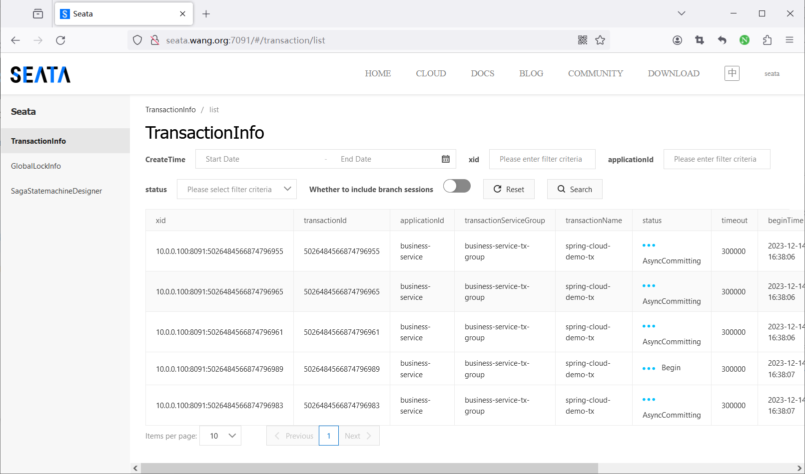

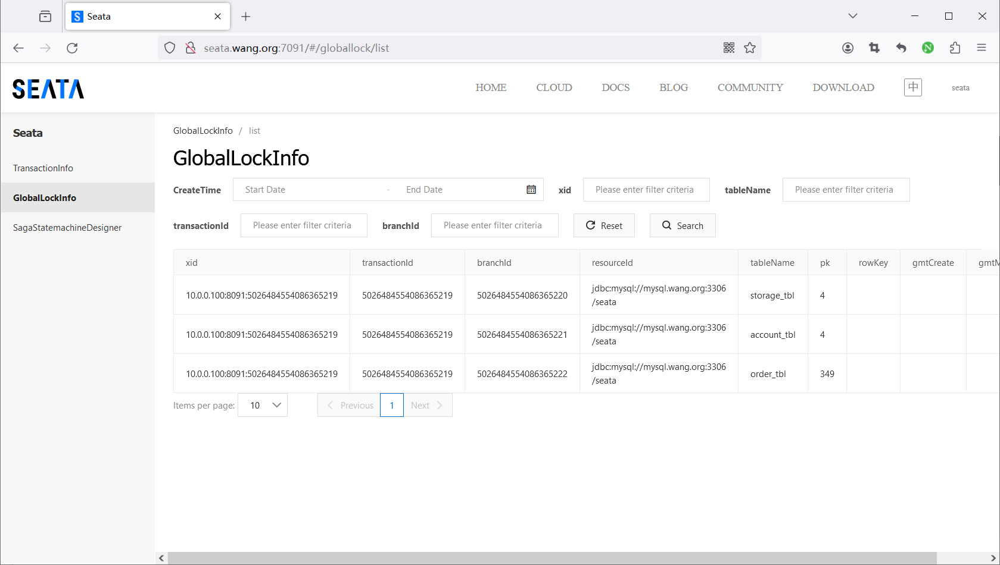



<nav class="article-end" aria-label="章节导航">
  <a href="{{ '/subjects/Microservices/32-installing-seata-server.html' | relative_url }}">← Previous: Installing Seata Server</a>
  <a href="{{ '/subjects/Microservices/' | relative_url }}">Back to Microservices Index</a>
  <a href="{{ '/subjects/Microservices/34-introduction-to-spring-cloud-gateway.html' | relative_url }}">Next: Introduction to Spring Cloud Gateway →</a>
</nav>
