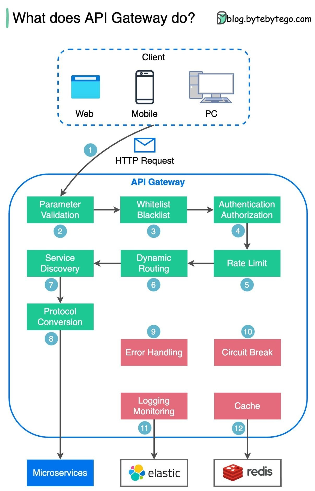
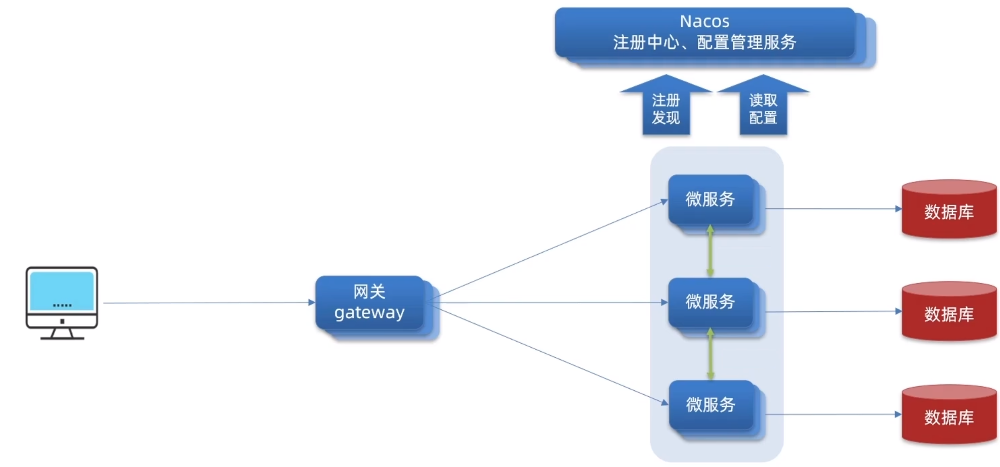
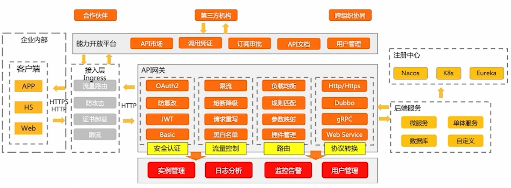
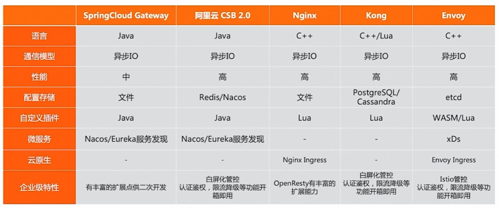

[← Back to Microservices Index]({{ '/subjects/Microservices/' | relative_url }})



# 34 Introduction to Spring Cloud Gateway
## 7 Spring Cloud Gateway（重点）

### 7.1 Spring Cloud Gateway 介绍

### 什么是 API 网关

近几年来移动应用与企业间互联需求的兴起。从以前单一的Web应用，扩展到多种使用场景，且每种使用场景对后台服务的要求都不尽相同。

这不仅增加了后台服务的响应量，还增加了后台服务的复杂性。随着微服务架构概念的提出，API网关成为了微服务架构的一个标配组件。

API网关作用就是把各个微服务对外提供的API汇聚起来,让外界看起来是一个统一的入口

同时还实现了微服务网关的额外功能, 包含：负载均衡、路由转发、身份认证、权限安全、请求限流、监控/指标等功能

即API网关就是所有微服务项目的统一入口。相当于传统的代理服务功能,还具有一些更加高级的功能

### 为什么要使用 API 网关

微服务的应用可能部署在不同机房，不同地区，不同域名下。此时客户端（浏览器/手机/软件工具）想要请求对应的服务，都需要知道应用所在主机的具体 IP 或者域名 URL，当微服务实例众多时，这是非常难以记忆的，对于客户端来说也太复杂难以维护。此时就有了网关，客户端相关的请求直接发送到网关，由网关根据请求标识解析判断出具体的微服务地址，再把请求转发到微服务实例。这其中的记忆功能就全部交由网关来操作了。

### API 网关核心功能

路由转发接收外界请求，通过网关的路由转发,转发到后端的服务上,和传统的反向代理功能类似此功能是API网关的最核心功能过滤器: 自行定制实现过滤器中默认提供了多种内置功能还支持额外的自定义功能。 比较常用的功能有网关的容错、限流以及请求及相应的额外处理。

### API 网关解决方案

### Spring Cloud Netflix Zuul

基于Spring Cloud的API网关

属于Spring Cloud Netflix 的一个组件，具有灵活、简单的特点。

基于Servlet的实现,属于阻塞式编程实现,性能较低

其版本更新都依赖于Netflix Zuul

在早期Spring Cloud中使用的比较多

### Spring Cloud Gateway

基于Spring 生态系统之上构建的API 网关，包括：Spring 5.x ，Spring Boot 2.x 和Project Reactor 。

旨在提供一种简单而有效的方法来路由到API ，并为它们提供跨领域的关注点，例如：安全性，监视/指标，限流等。

适合 JAVA 技术栈,目前也是 Spring Cloud 全家桶的一部分，Spring/Spring Cloud 社区生态好

由Spring自己推出的网关产品，完全依赖Spring自家产品,符合Spring战略意义，其更新版本等都由Spring 自己把控

SpringCloud Gateway 作为 Spring Cloud 生态系统中的网关，目标是替代 Zuul

目前很多项目中都是使用Gateway替代Zuul

基于Spring5中提供的WebFlux实现,基于响应式编程实现,具有更好的性能

Spring Cloud Gateway 源于 Spring 框架和 Spring Boot 平台，本质上专注于已经熟悉 Spring 的开发人员。

如果你熟悉Spring的开发模式，很容易就可以上手。

### APISIX

APISIX 是一个Apache基金会下的云原生、高性能、可扩展的微服务 API 开源网关，基于OpenResty(Nginx+Lua)和etcd来实现

对比传统的API网关，具有动态路由和热插件加载的特点。

Apache APISIX 更适合常规 Ops 配置文件，以他们熟悉的包装提供产品：Kubernetes 的 Docker 映像和 Helm 图表。

Apache APISIX  基于原生云，与开发平台无关，无供应商锁定，APISIX可以从裸机运行到Kubernetes。



<nav class="article-end" aria-label="章节导航">
  <a href="{{ '/subjects/Microservices/33-integrating-seata-with-nacos.html' | relative_url }}">← Previous: Integrating Seata with Nacos</a>
  <a href="{{ '/subjects/Microservices/' | relative_url }}">Back to Microservices Index</a>
  <a href="{{ '/subjects/Microservices/35-spring-cloud-gateway-core-concepts.html' | relative_url }}">Next: Spring Cloud Gateway Core Concepts →</a>
</nav>
