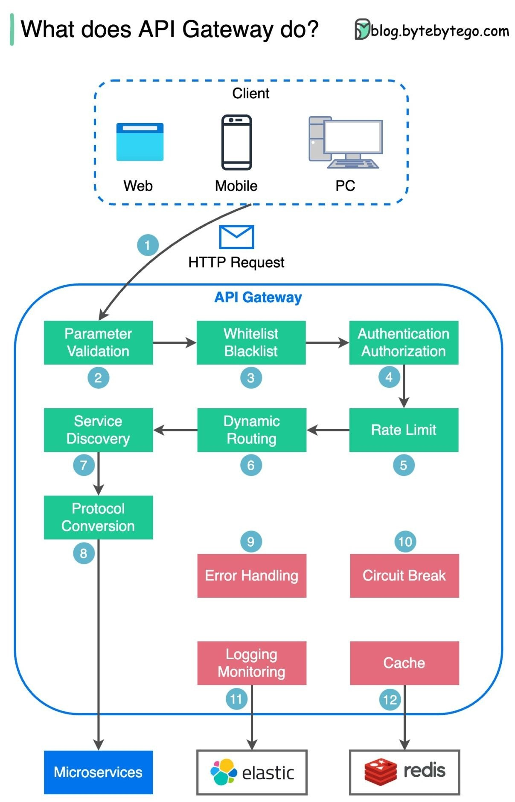
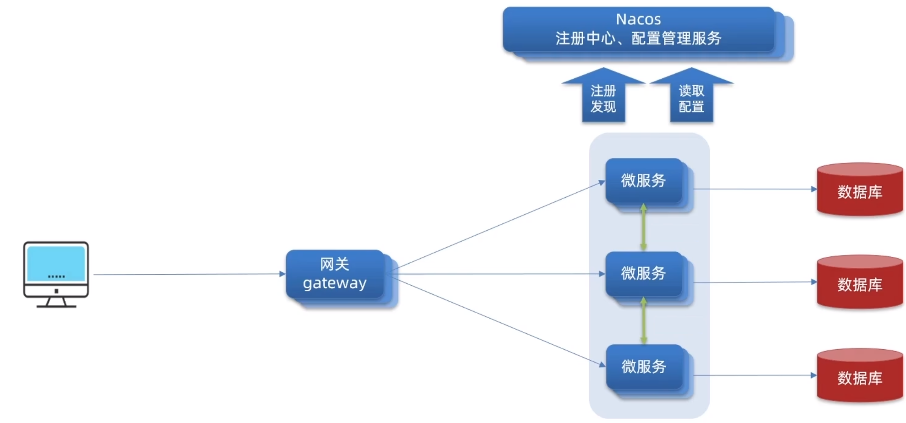
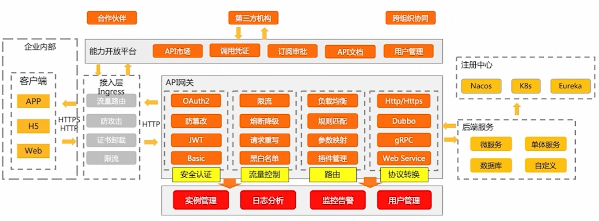
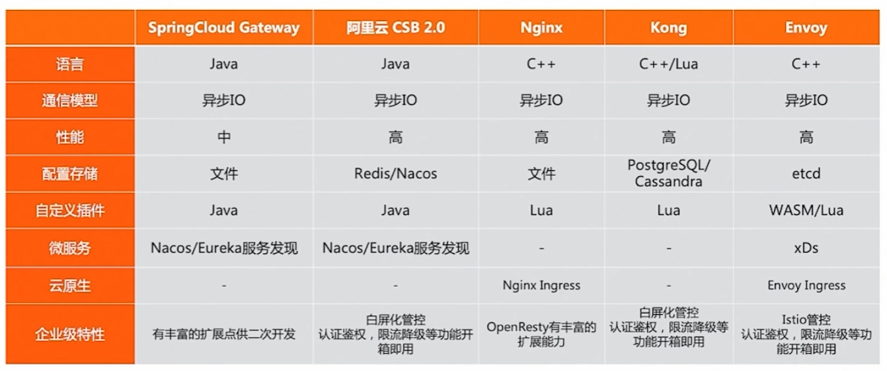

[← 返回微服务架构目录]({{ '/subjects/Microservices/' | relative_url }})



# 34 Spring Cloud Gateway 介绍

## API 网关位于哪里

客户端若直接记住每个微服务实例的地址，扩缩容、迁移或接口拆分都会迫使客户端跟着修改。API 网关把对外接口放在一个受控入口，按请求的路径、主机名等条件把流量路由到后端服务。它**不是服务注册中心**：注册中心回答“某个服务当前有哪些实例”，网关则决定“这次外部请求应该进入哪个服务，并经过哪些入口策略”。

网关的核心是路由转发，常见的横切能力还包括身份验证、限流、跨域处理、请求和响应改写、指标与日志。哪些能力放在网关，应根据团队的安全边界和性能要求决定；业务授权与数据校验不能只靠网关，一旦内部请求绕过入口仍须有防护。

## Spring Cloud Gateway 是什么

[Spring Cloud Gateway](https://spring.io/projects/spring-cloud-gateway) 是 Spring Cloud 的网关项目。应用通常定义**路由**，由断言判断是否匹配请求，再在过滤器中执行入口处理，并把请求转发到固定 URI 或通过服务发现得到的实例。具体配置键、过滤器和运行时架构随版本演进，示例应与项目的 Spring Boot / Spring Cloud 发布列车保持一致。

原资料把它固定描述为“Spring 5 + Boot 2 + WebFlux”，反映的是某个历史版本，并非所有新版本的要求；也不应简单断言“响应式一定比 Servlet 快”。WebFlux 版本适合非阻塞 I/O 场景，但阻塞调用、认证逻辑、线程配置和后端瓶颈仍会影响性能。选择网关应看团队技术栈、插件需求、运维方式和实测负载。

## 与其他网关的边界

- **Zuul**：早期常见于 Spring Cloud Netflix 方案，不同大版本的实现方式和维护状态不同；已有系统可按升级成本评估，不必仅因名称较旧就机械替换。
- **Spring Cloud Gateway**：适合将入口与 Spring 生态的配置、服务发现和观测体系集成。
- **Apache APISIX**：基于 OpenResty、etcd 等组件提供动态路由和插件能力，适合希望将网关作为独立基础设施治理的环境。它不是 Spring Cloud Gateway 的同一运行模式。

无论选择哪一种网关，都需验证转发正确性、客户端地址与真实源 IP 的处理、身份与权限边界、超时重试以及网关自身的高可用性。下一篇用 Spring Cloud Gateway 的路由、断言和过滤器建立完整请求模型。



<nav class="article-end" aria-label="章节导航">
  <a href="{{ '/subjects/Microservices/33-integrating-seata-with-nacos.html' | relative_url }}">← 上一篇：Seata 结合 Nacos</a>
  <a href="{{ '/subjects/Microservices/' | relative_url }}">返回专题目录</a>
  <a href="{{ '/subjects/Microservices/35-spring-cloud-gateway-core-concepts.html' | relative_url }}">下一篇：Spring Cloud Gateway 核心概念 →</a>
</nav>
