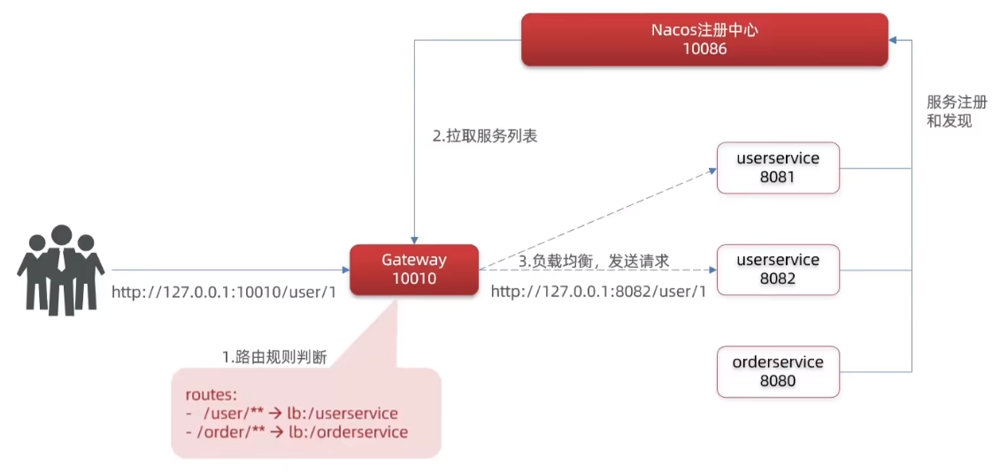
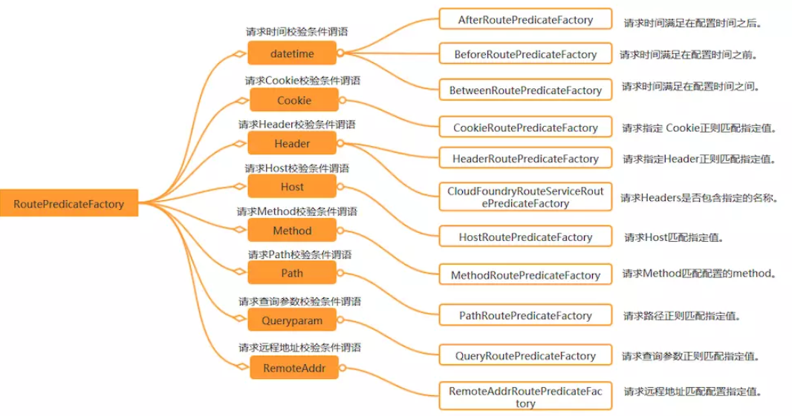
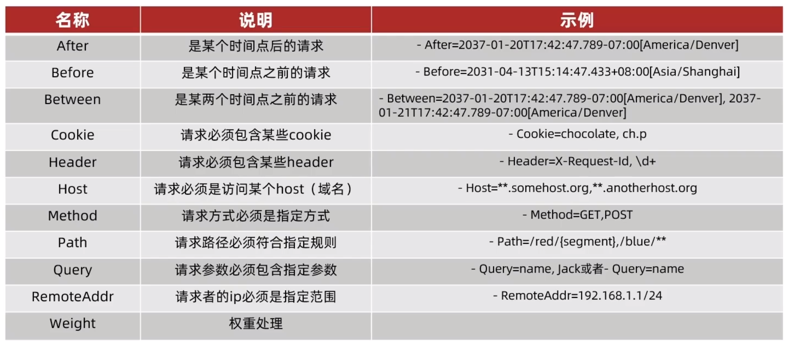
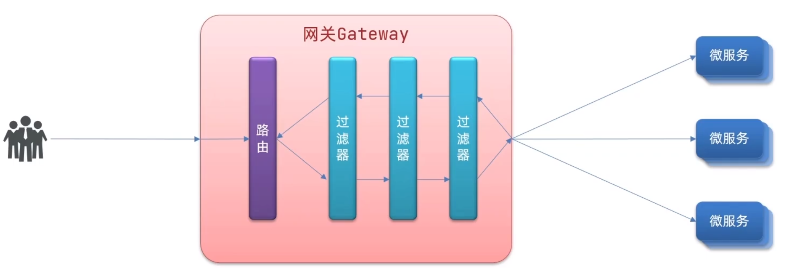
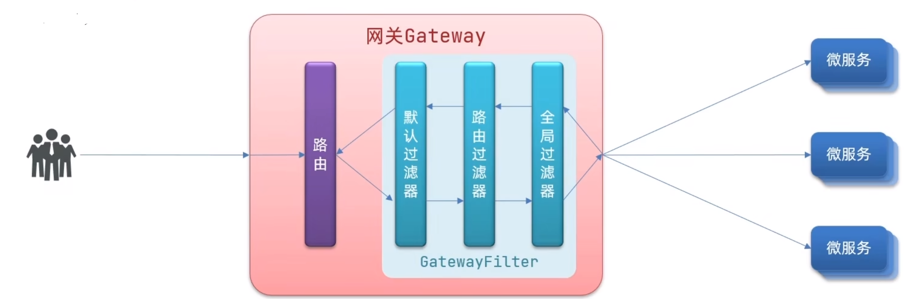
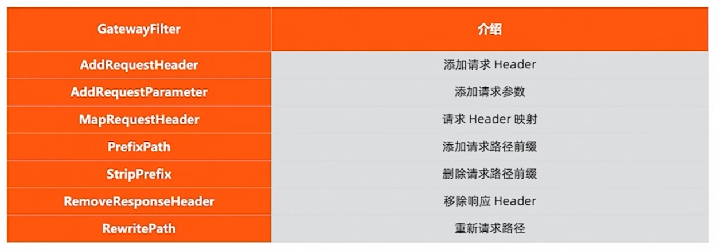

[← 返回微服务架构目录]({{ '/subjects/Microservices/' | relative_url }})



# 35 Spring Cloud Gateway 核心概念

## 一次请求如何找到后端

Spring Cloud Gateway 的基本单元是**路由（Route）**。一条路由包含唯一 ID、目标 URI、匹配条件（Predicate）以及可选过滤器（Filter）。请求先由断言决定匹配哪条路由，再进入该路由与全局过滤器组成的处理链，最后转发到目标。多条路由都可能匹配时，还要关注路由顺序；不能仅凭配置文件中出现的位置推断最终选择。

下面是结构完整的 YAML。它假设项目已接入服务发现与 Spring Cloud LoadBalancer，Nacos 中确有 `userservice`；若没有，先用固定 `http://` URI 验证路径：

```yaml
server:
  port: 10010
spring:
  application:
    name: gateway
  cloud:
    gateway:
      routes:
        - id: user-service
          uri: lb://userservice
          predicates:
            - Path=/user/**
        - id: order-service
          uri: lb://orderservice
          predicates:
            - Path=/order/**
          filters:
            - StripPrefix=1
```

请求 `/order/123` 匹配第二条路由，`StripPrefix=1` 去掉第一个路径段后向 `orderservice` 转发 `/123`。原资料把 `lb://orderservice/order` 与 `StripPrefix=1` 叠加，却没有说明路径如何合成，容易使后端收到意外地址。路由 URI 主要指向服务或主机，路径变换应明确写在过滤器中并实际测试。



## 断言：匹配哪些请求

多个断言通常按逻辑“与”共同约束一条路由。断言可以检查时间、Cookie、Header、Host、方法、路径、查询参数、来源地址或权重。常用写法如下：

| 条件 | 示例 | 含义 |
| --- | --- | --- |
| Path | `Path=/api/**` | 匹配约定的 API 路径；`*` 与 `**` 对路径段的含义不同 |
| Method | `Method=GET,POST` | 只匹配指定 HTTP 方法 |
| Header | `Header=X-Request-Id, \d+` | 请求头存在且值匹配正则 |
| Cookie | `Cookie=loginname, .*` | 指定 Cookie 名和值模式 |
| Host | `Host=**.example.org` | 按主机名匹配 |
| Query | `Query=username, abc.*` | 参数存在且值匹配模式 |
| RemoteAddr | `RemoteAddr=192.168.10.0/24` | 按网关看到的来源地址匹配 |
| After | `After=2025-01-01T00:00:00+08:00[Asia/Shanghai]` | 指定时间后才匹配 |
| Weight | 同组路由分别给权重 8 与 2 | 在同组中按权重分配匹配机会 |

表中 Cookie 示例的正则应为 `.*`；写为 `loginname, myapp` 就只能匹配相应的值，不能拿 `mapp` 作为成功测试。时间类断言还包括 `Before`、`Between`。权重是路由匹配层面的概率分配，不等于对后端单个实例做负载均衡。




对 `/api/*` 与 `/api/**` 的直觉区别是：前者主要面向一个路径段，后者可覆盖多层路径。但边界如末尾斜杠、空路径段和 URL 编码应按当前版本的 PathPattern 行为测试，不能把原资料的一组示意路径当作跨版本保证。

## 过滤器：转发前后做什么

`GatewayFilter` 可只作用于一条路由；`default-filters` 作用于配置中的路由；`GlobalFilter` 面向所有路由。过滤器能在请求发往下游前调整路径、头部或认证上下文，也能在响应返回时修改响应。它们合并成有序链执行，**请求阶段的顺序与返回阶段的顺序方向相反**。不要依赖“同一个 order 值时某一类过滤器必然优先”的口头规则；需要顺序保证时设置明确的 order，并用测试验证。





`StripPrefix=1` 表示去掉一个**路径段**，例如 `/api/foo` 转成 `/foo`。要去掉两个段就写 `StripPrefix=2`；不要叠放两次 `StripPrefix=1`，这样难以推断每一步的实际路径。路径改变后，后端映射、鉴权规则和指标标签也应一起检查。

## 目标 URI 的三种常见形式

- `http://backend.example:9090`：固定 HTTP 目标。适合先验证路由，但实例地址变化需要另外维护。
- `lb://userservice`：按服务名使用负载均衡解析，需要可用的 DiscoveryClient 与 LoadBalancer；并非仅写 `lb://` 就会自动找到 Nacos。
- `ws://backend.example:9090` 或相应的负载均衡 WebSocket 方案：用于升级连接；需检查前端协议、网关配置与后端对 WebSocket 的支持。

这些 URI 决定目标如何定位；Predicate 决定是否选中路由；Filter 决定转发内容如何变化。下一篇在项目中把三个环节接起来。



<nav class="article-end" aria-label="章节导航">
  <a href="{{ '/subjects/Microservices/34-introduction-to-spring-cloud-gateway.html' | relative_url }}">← 上一篇：Spring Cloud Gateway 介绍</a>
  <a href="{{ '/subjects/Microservices/' | relative_url }}">返回专题目录</a>
  <a href="{{ '/subjects/Microservices/36-developing-with-spring-cloud-gateway.html' | relative_url }}">下一篇：开发 Spring Cloud Gateway →</a>
</nav>
