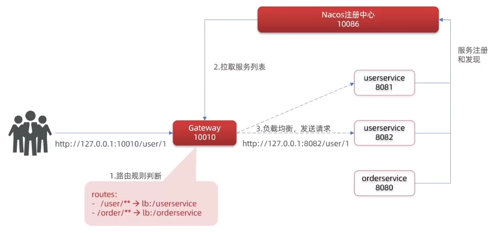
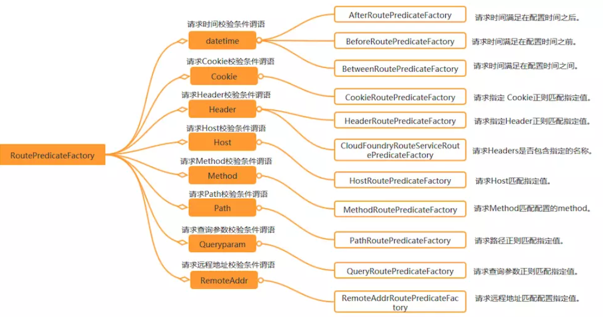
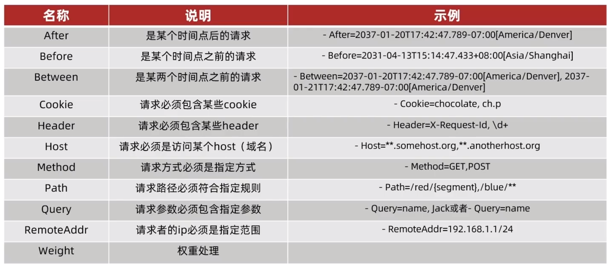
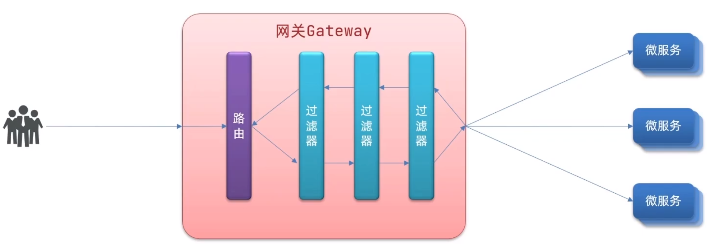
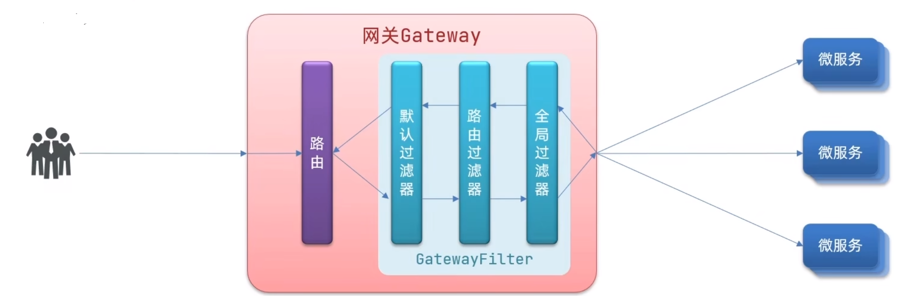
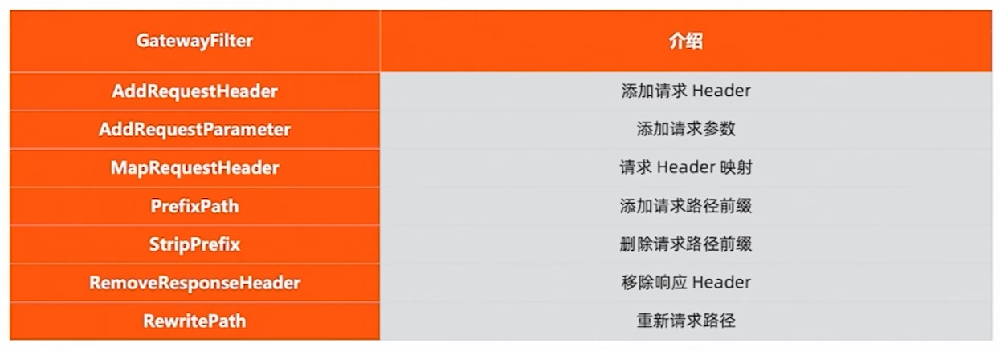

[← Back to Microservices Index]({{ '/subjects/Microservices/' | relative_url }})



# 35 Spring Cloud Gateway Core Concepts
### 7.2 Spring Cloud Gateway 核心概念

### Spring Cloud Gateway 相关概念介绍

<https://docs.spring.io/spring-cloud-gateway/docs/current/reference/html/>

Route 称为路由，一个Gateway项目可以包含多个Route。

一个Route路由包含如下部分:

Route ID: 是自定的，路由的唯一标识 predicates: 路由断言，判断请求是否匹配和符合转发规则的要求，如果符合则转发到路由目的地 URI: 路由目的地，为一个地址, 支持多种方式, 包括 LB,http,websocket filters: 路由过滤器,对请求或响应进行过滤处理, 比如: 身份认证和权限校验限流限速,此为可选项

示例: 路由配置

```text
#微服务项目中的application.yml内容
server:
port: 10010 #网关端口
spring:
application:
name: gateway #服务名称
cloud :
nacos:
server-addr: localhost:8848 # nacos地址
gateway:
routes: #网关路由配置
- id: user-service #路由id,自定义值,必须唯一
uri: lb://userservice #路由的目标地址Lb表示负载均衡,后面跟Nacos中微服务名称
# uri: http://127.0.0.1:8081 #路由的目标地址,如果使用 http表示固定地址
predicates: #路由断言,判断请求是否符合路由规则的条件
- Path=/user/** #这个是按照路径匹配，只要以/user/开头就符合要求 http://127.0.0.1:10010/user/xxx/yyy
- id: order-service
uri: lb://orderservice/order
predicates:
- Path=/order/**
filters:
- StripPrefix=1 #从请求路径中删除第一个前缀/order,再转发给后端
```



关于 * 和 **

```text
*（单星号）：#匹配一个路径段中的任意字符，不包括斜杠。适用于匹配具体的路径层次。
**（双星号）：#匹配任意字符，包括多个路径段和斜杠。适用于匹配多层次的路径。表示零个或多个目录级别的任意字符。它可以匹配任意长度的路
径
#示例
Path=/api/*
/api/：不匹配
/api/test：匹配
/api/user：匹配
/api/user/123：不匹配（因为有多个路径段）
Path=/api/**
#这个路径谓词表示匹配所有以/api/开头的请求路径。
/api/：匹配
/api/test：匹配
/api/user/123：匹配
/api/v1/products/list：匹配
```

### 路由断言工厂 Route Predicate Factory

<https://docs.spring.io/spring-cloud-gateway/docs/current/reference/html/#gateway-request-predicates-factories>

Route Predicate Factory 定义路由匹配条件 , 用于定义哪些请求应该匹配特定的路由。

断言（Predicate）是一个布尔函数，根据请求的不同属性（如路径、方法、头部等）来决定请求是否与路由匹配

Spring Cloud Gateway 创建Route 对象时， 使用RoutePredicateFactory 创建Predicate 对象，Predicate 对象可以赋值给Route 。

Spring Cloud Gateway 包含许多内置的Route Predicate Factories 。 所有这些断言都匹配 HTTP 请求的不同属性。 多个Route Predicate Factories 可以通过逻辑与（and）结合起来一起使用。

路由断言工厂RoutePredicateFactory 包含的主要实现类如图所示，包括Datetime 、请求的远端地址、路由权重、请求头、Host 地址、 请求方法、请求路径和请求参数等类型的路由断言。





### Datetime

匹配日期时间之后发生的请求

```text
spring:
application:
name: ruoyi-gateway
cloud:
gateway:
routes:
- id: myapp-system
uri: http://localhost:9201/
predicates:
- After=2022-12-22T14:20:00.000+08:00[Asia/Shanghai]
```

### Cookie

匹配指定名称且其值与正则表达式匹配的cookie

```text
spring:
application:
name: ruoyi-gateway
cloud:
gateway:
routes:
- id: myapp-system
uri: http://localhost:9201/
predicates:
- Cookie=loginname, myapp
```

测试 curl http://localhost:8080/system/config/1 --cookie "loginname=mapp"

### Header

匹配具有指定名称的请求头，\d+ 值匹配正则表达式

```text
spring:
application:
name: myapp-gateway
cloud:
gateway:
routes:
- id: myapp-system
uri: http://localhost:9201/
predicates:
- Header=X-Request-Id, \d+
```

### Host

匹配主机名的列表

```text
spring:
application:
name: myapp-gateway
cloud:
gateway:
routes:
- id: myapp-system
uri: http://localhost:9201/
predicates:
- Host=**.somehost.org,**.anotherhost.org
```

### Method

匹配请求methods的参数，它是一个或多个参数

```text
spring:
application:
name: myapp-gateway
cloud:
gateway:
routes:
- id: myapp-system
uri: http://localhost:9201/
predicates:
- Method=GET,POST
```

### Path

匹配请求路径

```text
spring:
application:
name: myapp-gateway
cloud:
gateway:
routes:
- id: myapp-system
uri: http://localhost:9201/
predicates:
- Path=/system/**
```

### Query

匹配查询参数

```text
spring:
application:
name: myapp-gateway
cloud:
gateway:
routes:
- id: myapp-system
uri: http://localhost:9201/
predicates:
- Query=username, abc.
```

### RemoteAddr

匹配IP地址和子网掩码

```text
spring:
application:
name: myapp-gateway
cloud:
gateway:
routes:
- id: myapp-system
uri: http://localhost:9201/
predicates:
- RemoteAddr=192.168.10.0/24
```

### Weight

匹配权重

```text
spring:
application:
name: myapp-gateway
cloud:
gateway:
routes:
- id: myapp-system-a
uri: http://localhost:9201/
predicates:
- Weight=group1, 8
- id: myapp-system-b
uri: http://localhost:9201/
predicates:
- Weight=group1, 2
```

### 路由过滤器 Gateway Filter

Gateway Filter是网关中提供的一种过滤器，对路由的请求进行修改,  可以对进入网关的请求和微服务返回的响应做处理





过滤器执行顺序

请求进入网关会碰到三类过滤器:当前路由的过滤器、DefaultFilter、GlobalFilter 请求路由后，会将三类过滤器，即当前路由过滤器和DefaultFilter、GlobalFilter，合并到一个过滤器链集合中，排序后依次执行每个过滤器每一个过滤器都必须指定一个int类型的order值,order值越小，优先级越高，执行顺序越靠前。 GlobalFilter通过实现Ordered接口或者添加@Order注解来指定order值，由用户自己指定路由过滤器和defaultFilter的order由Spring指定，默认是按照声明顺序从1递增。 当过滤器的order值一样时，会按照defaultFilter >路由过滤器> GlobalFilter的顺序执行

关于 StripPrefix=1

```text
#在 Spring Cloud Gateway 中，StripPrefix=1 表示在将请求转发到下游服务之前，从请求路径中删除第一个前缀。
#例如，假设您有一个路由配置如下：
routes:
- id: my-route
uri: http://localhost:8080
predicates:
- Path=/api/**
filters:
- StripPrefix=1
#当用户访问 /api/foo 时，Gateway 会将请求转发到 http://localhost:8080/foo。这是因为 StripPrefix=1 会将请求路径中的第一个
前缀 /api 删除。
#如果您希望删除多个前缀，可以使用多个 StripPrefix 过滤器。例如，以下配置将删除请求路径中的第一个和第二个前缀：
filters:
- StripPrefix=1
- StripPrefix=1
#或者相当于
filters:
- StripPrefix=2
#在这种情况下，当用户访问 /api/v1/foo 时，Gateway 会将请求转发到 http://localhost:8080/foo。这是因为 StripPrefix=1 会将
请求路径中的第一个前缀 /api 删除，而第二个 StripPrefix=1 会将请求路径中的第二个前缀 /v1 删除。
StripPrefix 过滤器是一个非常有用的工具，可以用于简化请求路径并提高下游服务的可访问性。
```

### 过滤器工厂 GatewayFilterFactory

<https://docs.spring.io/spring-cloud-gateway/docs/current/reference/html/#gatewayfilter-factories>

当前支持34类路由过滤器工厂，实现请求和响应的定制功能



### 路由URI 三种实现

在spring cloud gateway 中配置uri 有三种方式，包括

websocket配置方式

```text
spring:
cloud:
gateway:
routes:
- id: myapp-api
uri: ws://localhost:9090/
predicates:
- Path=/api/**
```

http地址配置方式

```text
spring:
cloud:
gateway:
routes:
- id: myapp-api
uri: http://localhost:9090/
predicates:
- Path=/api/**
```

注册中心配置方式

```text
spring:
cloud:
gateway:
routes:
- id: myapp-api
uri: lb://myapp-api   #myapp-api 服务名称，需要结合nacos发现实现解析IP：Port
predicates:
- Path=/api/**
```



<nav class="article-end" aria-label="章节导航">
  <a href="{{ '/subjects/Microservices/34-introduction-to-spring-cloud-gateway.html' | relative_url }}">← Previous: Introduction to Spring Cloud Gateway</a>
  <a href="{{ '/subjects/Microservices/' | relative_url }}">Back to Microservices Index</a>
  <a href="{{ '/subjects/Microservices/36-developing-with-spring-cloud-gateway.html' | relative_url }}">Next: Developing with Spring Cloud Gateway →</a>
</nav>
