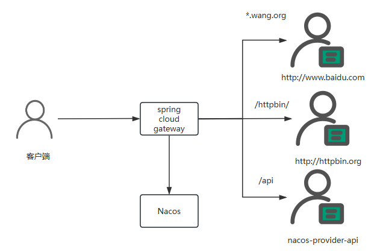
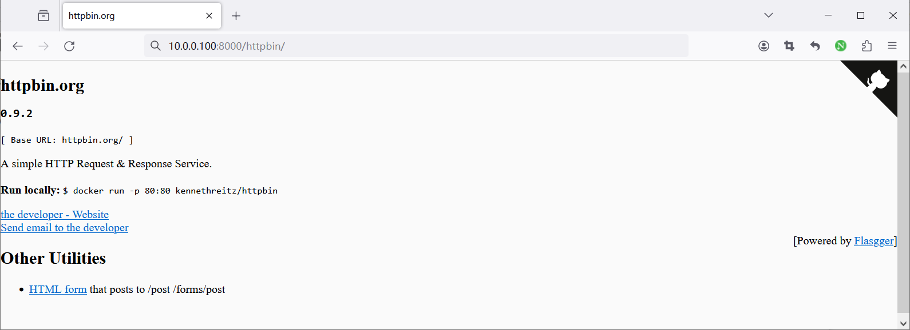
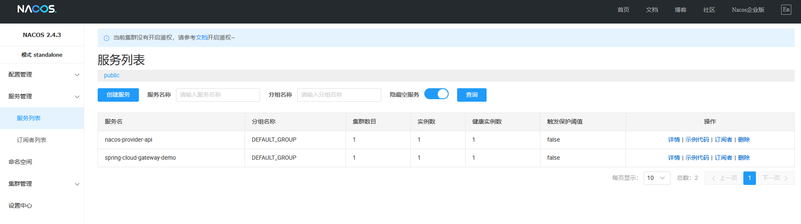
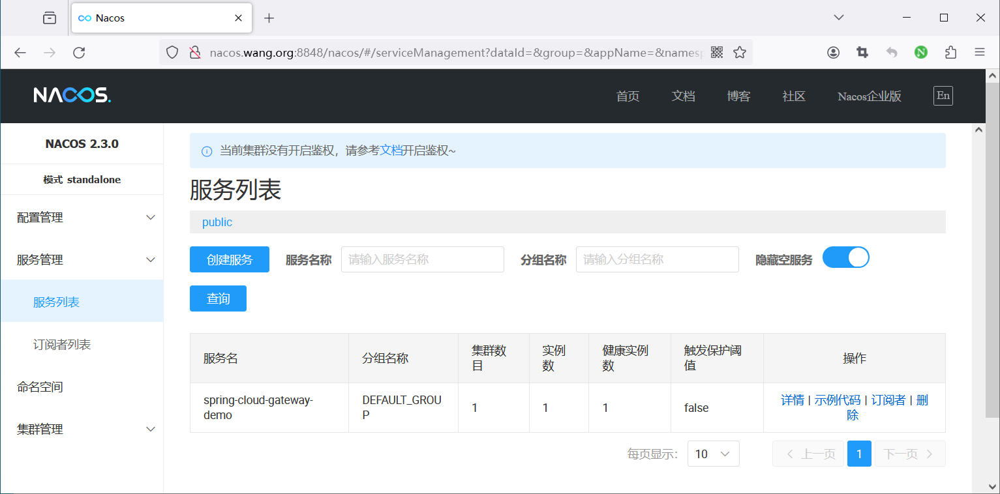

[← Back to Microservices Index]({{ '/subjects/Microservices/' | relative_url }})



# 37 Spring Cloud Gateway Practical Examples
### 7.4 Spring Cloud Gateway 实战案例

### 案例1: mall-microservice 项目

```text
#https://gitee.com/lbtooth/mall-microservice/blob/master/mall-gateway/src/main/resources/application.yml
server:
port: 8201
spring:
mvc:
pathmatch:
matching-strategy: ant_path_matcher
cloud:
gateway:
discovery:
locator:
enabled: true
lower-case-service-id: true #使用小写service-id
routes: #配置路由路径
- id: mall-auth
uri: lb://mall-auth
predicates:
- Path=/mall-auth/**
filters:
- StripPrefix=1
- id: mall-admin
uri: lb://mall-admin
predicates:
- Path=/mall-admin/**
filters:
- StripPrefix=1
- id: mall-portal
uri: lb://mall-portal
predicates:
- Path=/mall-portal/**
filters:
- StripPrefix=1
- id: mall-search
uri: lb://mall-search
predicates:
- Path=/mall-search/**
filters:
- StripPrefix=1
- id: mall-demo
uri: lb://mall-demo
predicates:
- Path=/mall-demo/**
filters:
- StripPrefix=1
security:
oauth2:
resourceserver:
jwt:
jwk-set-uri: 'http://localhost:8201/mall-auth/rsa/publicKey' #配置RSA的公钥访问地址
redis:
database: 0
port: 6379
host: localhost
password:
secure:
ignore:
urls: #配置白名单路径
- "/doc.html"
- "/swagger-resources/**"
- "/swagger/**"
- "/*/v2/api-docs"
- "/*/*.js"
- "/*/*.css"
- "/*/*.png"
- "/*/*.ico"
- "/webjars/**"
- "/actuator/**"
- "/mall-auth/oauth/token"
- "/mall-auth/rsa/publicKey"
- "/mall-search/**"
- "/mall-portal/sso/login"
- "/mall-portal/sso/register"
- "/mall-portal/sso/getAuthCode"
- "/mall-portal/home/**"
- "/mall-portal/product/**"
- "/mall-portal/brand/**"
- "/mall-admin/admin/login"
- "/mall-admin/admin/register"
- "/mall-admin/minio/upload"
management: #开启SpringBoot Admin的监控
endpoints:
web:
exposure:
include: '*'
endpoint:
health:
show-details: always
```

### 案例2: 若依微服务版

```text
#若依微服务，将路由规则放在MySQL，后导入Nacos的配置管理中
https://gitee.com/lbtooth/RuoYi-Cloud/raw/master/sql/ry_config_20231204.sql
```

### 案例3: Spring Cloud Gateway 结合Nacos的 JAVA 综合项目



### 安装 Nacos 服务并名称解析

```bash
#安装 nacos 服务
[root@ubuntu2404 ~]#apt update && apt install -y docker.io
[root@ubuntu2204 ~]#apt update && apt install -y docker.io
[root@ubuntu2204 ~]#docker run --name nacos  -e MODE=standalone  -p 8848:8848 -p 9848:9848  -d registry.cn-
beijing.aliyuncs.com/bowenxiaochun/nacos-server:v2.4.3-slim
[root@ubuntu2204 ~]#docker run --name nacos  -e MODE=standalone  -p 8848:8848 -p 9848:9848  -d nacos/nacos-
server:v2.2.0
#名称解析
[root@ubuntu2204 ~]#cat /etc/hosts
10.0.0.100 nacos.bowen.org
```

### 运行后面的微服务 nacos-provider

```bash
#方法1：如果编译
[root@ubuntu2204 ~]#apt update && apt -y install openjdk-8-jdk && apt -y install maven
[root@ubuntu2204 ~]#mvn -v
Apache Maven 3.6.3
Maven home: /usr/share/maven
Java version: 1.8.0_392, vendor: Private Build, runtime: /usr/lib/jvm/java-8-openjdk-amd64/jre
Default locale: en_US, platform encoding: UTF-8
OS name: "linux", version: "5.15.0-67-generic", arch: "amd64", family: "unix"
[root@ubuntu2204 nacos-provider]#mvn clean package -Dmaven.test.skip=true
#方法2：直接运行，可以支持JDK-17,21
[root@ubuntu2404 ~]#apt update && apt install -y openjdk-21-jre
[root@ubuntu2204 ~]#apt update && apt install -y openjdk-17-jre
[root@ubuntu2204 ~]#java -version
openjdk version "17.0.13" 2024-10-15
OpenJDK Runtime Environment (build 17.0.13+11-Ubuntu-2ubuntu122.04)
OpenJDK 64-Bit Server VM (build 17.0.13+11-Ubuntu-2ubuntu122.04, mixed mode, sharing)
[root@ubuntu2204 nacos-provider]#java -jar target/nacos-provider-1.0-SNAPSHOT.jar
```

### 准备 Spring Cloud Gateway Demo 项目

查看应用的路由配置

```bash
[root@ubuntu2204 spring-cloud-gateway-demo]#ls
src pom.xml
[root@ubuntu2204 spring-cloud-gateway-demo]#cat src/main/resources/application.yml
server:
port: 8000
spring:
application:
name: spring-cloud-gateway-demo
cloud:
nacos:
discovery:
server-addr: nacos.bowen.org:8848
config:
server-addr: nacos.bowen.org:8848
gateway:
routes:
- id: baidu
uri: https://www.baidu.com
predicates:
- Host=*.bowen.org
- id: httpbin
uri: http://httpbin.org
predicates:
- Path=/httpbin/**
filters:
- StripPrefix=1
- id: nacos-provider-api
uri: lb://nacos-provider-api
predicates:
- Path=/api/**
filters:
- StripPrefix=1
```

### 编译打包 Spring Cloud Gateway Demo

```bash
#如果编译
[root@ubuntu2204 ~]#apt update && apt -y install openjdk-8-jdk && apt -y install maven
[root@ubuntu2204 ~]#mvn -v
Apache Maven 3.6.3
Maven home: /usr/share/maven
Java version: 1.8.0_392, vendor: Private Build, runtime: /usr/lib/jvm/java-8-openjdk-amd64/jre
Default locale: en_US, platform encoding: UTF-8
OS name: "linux", version: "5.15.0-67-generic", arch: "amd64", family: "unix"
[root@ubuntu2204 spring-cloud-gateway-demo]#mvn clean package -Dmaven.test.skip=true
```

### 运行 Spring Cloud Gateway Demo

```bash
#如果已经有编译后的包,可以直接运行可以支持JDK-17
[root@ubuntu2204 ~]#apt update && apt -y install openjdk-17-jdk
[root@ubuntu2204 ~]#java -version
openjdk version "17.0.13" 2024-10-15
OpenJDK Runtime Environment (build 17.0.13+11-Ubuntu-2ubuntu122.04)
OpenJDK 64-Bit Server VM (build 17.0.13+11-Ubuntu-2ubuntu122.04, mixed mode, sharing)
[root@ubuntu2204 spring-cloud-gateway-demo]#java -jar target/spring-cloud-gateway-demo-0.0.1-SNAPSHOT.jar
```

### 验证访问

```json
[root@ubuntu2204 ~]#curl -H"host: demo.bowen.org" 127.0.0.1:8000 -I
HTTP/1.1 200 OK
Accept-Ranges: bytes
Cache-Control: private, no-cache, no-store, proxy-revalidate, no-transform
Content-Length: 277
Content-Type: text/html
Date: Thu, 04 Jan 2024 09:58:09 GMT
Etag: "575e1f59-115"
Last-Modified: Mon, 13 Jun 2016 02:50:01 GMT
Pragma: no-cache
Server: bfe/1.0.8.18
[root@ubuntu2204 ~]#curl 127.0.0.1:8000/api/
Hello,bowenxiaochun!
[root@ubuntu2204 ~]#curl 127.0.0.1:8000/api/echo/bowenxiaochun
Nacos Discovery Provider Service Message : bowenxiaochun
#访问/httpbin可看效果
[root@ubuntu2204 ~]#curl http://10.0.0.100:8000/httpbin/anything/bowenxiaochun
{
"args": {},
"data": "",
"files": {},
"form": {},
"headers": {
"Accept": "*/*",
"Content-Length": "0",
"Forwarded": "proto=http;host=\"10.0.0.100:8000\";for=\"10.0.0.202:40690\"",
"Host": "httpbin.org",
"User-Agent": "curl/7.81.0",
"X-Amzn-Trace-Id": "Root=1-65dc31c2-53f48ceb5dcc45fa10afaf0a",
"X-Forwarded-Host": "10.0.0.206:8000",
"X-Forwarded-Prefix": "/httpbin"
},
"json": null,
"method": "GET",
"origin": "10.0.0.201, 1.203.173.52",
"url": "http://10.0.0.100:8000/anything/bowenxiaochun"
}
#10.0.0.100:8000/httpbin/
```



查看nacos 显示服务注册成功







<nav class="article-end" aria-label="章节导航">
  <a href="{{ '/subjects/Microservices/36-developing-with-spring-cloud-gateway.html' | relative_url }}">← Previous: Developing with Spring Cloud Gateway</a>
  <a href="{{ '/subjects/Microservices/' | relative_url }}">Back to Microservices Index</a>
  <a href="{{ '/subjects/Microservices/38-introduction-to-apache-apisix.html' | relative_url }}">Next: Introduction to Apache APISIX →</a>
</nav>
