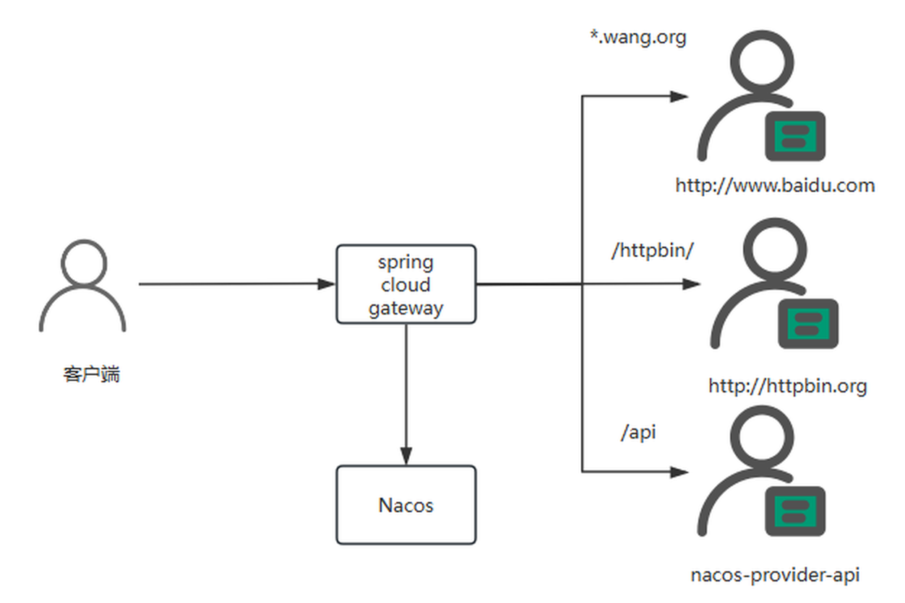
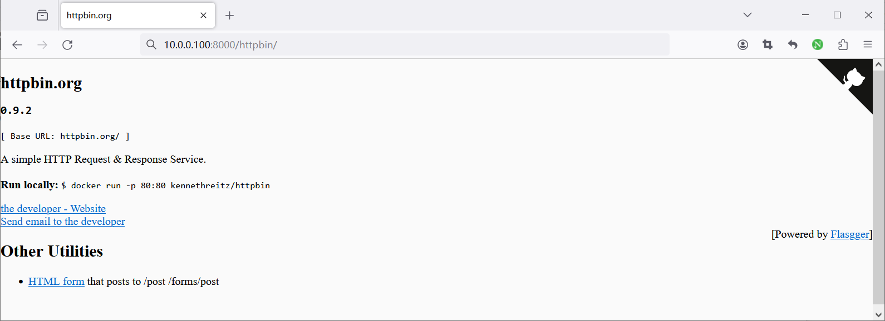
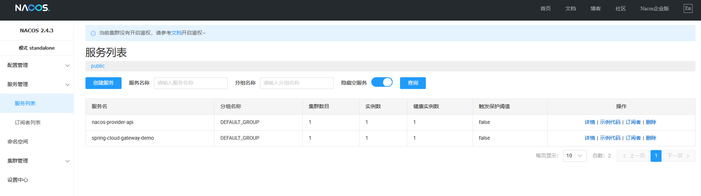
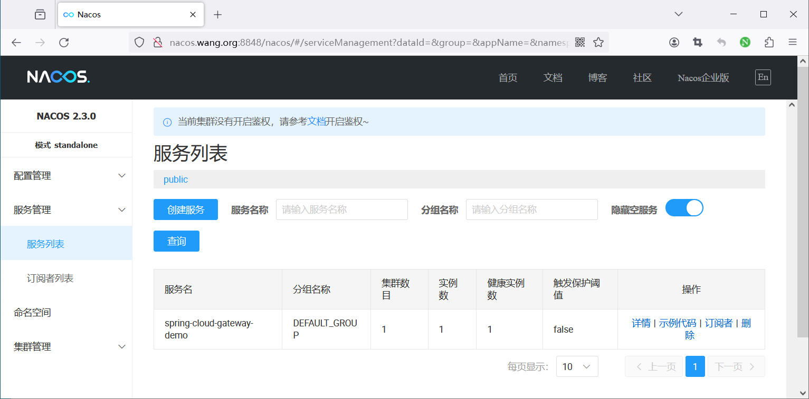

[← 返回微服务架构目录]({{ '/subjects/Microservices/' | relative_url }})



# 37 Spring Cloud Gateway 实战案例

本篇从已有项目的路由配置提炼可复用的判断方法，再用“Gateway + Nacos + Provider”验证一条动态路由。原资料中的几个项目处于不同技术版本，配置不能整份拼接；尤其需要分清**路由配置、服务发现、权限白名单和监控端点**的职责。

## 案例一：商城项目如何组织多条路由

原商城示例为 `mall-auth`、`mall-admin`、`mall-portal`、`mall-search` 等服务分别设置 `Path=/<服务名>/**`，并用 `StripPrefix=1` 去掉对外前缀。可以抽象为下面两条有效 YAML，其他服务按相同模式添加：

```yaml
spring:
  cloud:
    gateway:
      routes:
        - id: mall-auth
          uri: lb://mall-auth
          predicates:
            - Path=/mall-auth/**
          filters:
            - StripPrefix=1
        - id: mall-portal
          uri: lb://mall-portal
          predicates:
            - Path=/mall-portal/**
          filters:
            - StripPrefix=1
```

例如外部请求 `/mall-auth/login` 转给后端时路径变为 `/login`。每新增一条路由，都要确认目标服务名与注册中心一致、后端是否预期被剥离的路径，以及更具体的路由是否被宽泛路由抢先匹配。

原资料还将 JWT 公钥地址、Redis、权限白名单和 `management.endpoints.web.exposure.include='*'` 放进一大段无缩进文本。这些不是 Gateway 路由自动提供的能力，而是项目自身的认证和配置模块。白名单只表示某些路径跳过特定认证规则，不代表接口可无条件公开；Actuator 端点也不应为方便调试全部对外暴露。WebFlux Gateway 项目中放入 `spring.mvc.pathmatch` 配置并不能解决网关路径匹配问题。

## 案例二：若依项目的动态配置

若依微服务版可能把路由配置保存在数据库，再由 Nacos 管理配置发布。**路由存储位置**与**路由实际生效**是两回事：数据库记录需经过配置加载或动态刷新，才能成为 Gateway 的运行时路由。排查时查看 Nacos 中最终的 Data ID、配置内容、网关加载日志和实际请求结果，而不是仅看到 SQL 导入成功。动态发布应保留版本与回滚能力，并防止错误路由瞬间影响所有流量。

## 案例三：Gateway + Nacos + Provider



假设 Provider 注册为 `nacos-provider-api`，提供 `GET /echo/{name}`。Gateway 通过 Nacos 获取该服务的健康实例，并把外部 `/api/echo/test` 转成后端 `/echo/test`。在同一兼容的 Spring Boot / Spring Cloud Alibaba 版本组合下，网关至少需要 Gateway、Nacos Discovery 和 LoadBalancer 依赖。配置可写为：

```yaml
server:
  port: 8000
spring:
  application:
    name: spring-cloud-gateway-demo
  cloud:
    nacos:
      discovery:
        server-addr: NACOS_HOST:8848
    gateway:
      routes:
        - id: provider-api
          uri: lb://nacos-provider-api
          predicates:
            - Path=/api/**
          filters:
            - StripPrefix=1
```

原资料还演示了将请求按 Host 转发到公网网站、按 `/httpbin/**` 转发到外部测试服务。它们有助于理解断言与固定 URI，但不是验证 Nacos 发现的必要条件。对公网目标的连通性、TLS、转发 Host 头和外部服务稳定性都可能影响结果；为了定位问题，先只保留本地 Provider 路由。

按下面顺序验收：

1. 从 Gateway 主机直连 Provider 的 `/echo/test`，确定后端自身可用。
2. 在 Nacos 中确认 `nacos-provider-api` 的实例 IP 和端口从 Gateway 可达；Nacos 2.x 的 8848/9848 也应按客户端要求连通。
3. 请求 `http://GATEWAY_HOST:8000/api/echo/test`，确认响应来自 Provider；查看网关日志是否匹配 `provider-api` 路由。
4. 停止 Provider，观察网关如何返回不可用错误；重新启动后确认服务发现恢复。不要把所有 404 或 503 都归咎于网关本身。





原记录的 `curl -I` 只发送 HEAD 请求，后端若只实现 GET，返回值可能与浏览器访问不同。检验路由时应先用与业务接口一致的方法和路径，再核对响应体与状态码。



<nav class="article-end" aria-label="章节导航">
  <a href="{{ '/subjects/Microservices/36-developing-with-spring-cloud-gateway.html' | relative_url }}">← 上一篇：Spring Cloud Gateway 开发</a>
  <a href="{{ '/subjects/Microservices/' | relative_url }}">返回专题目录</a>
  <a href="{{ '/subjects/Microservices/38-introduction-to-apache-apisix.html' | relative_url }}">下一篇：Apache APISIX 介绍 →</a>
</nav>
