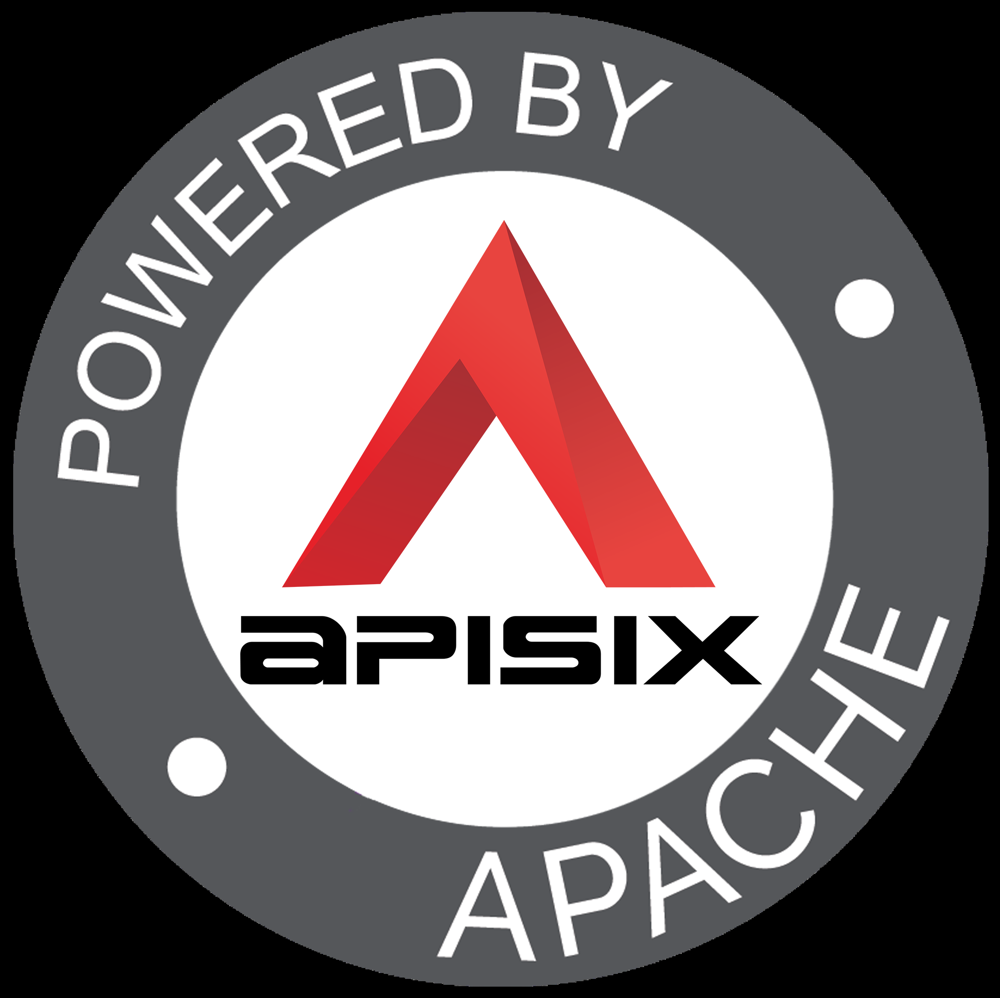
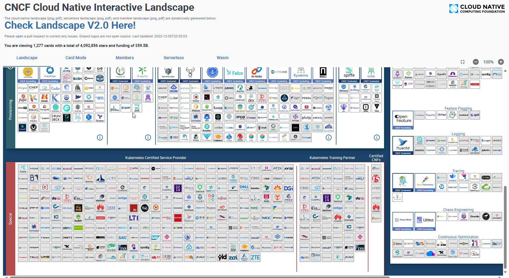
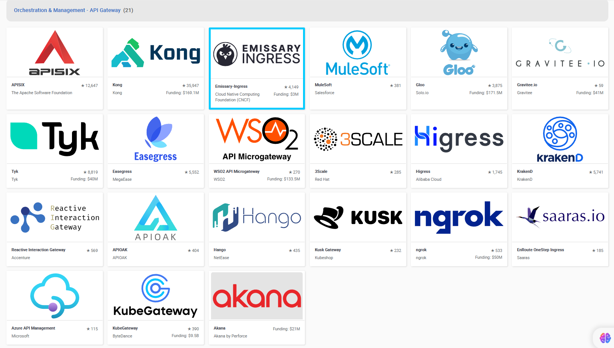
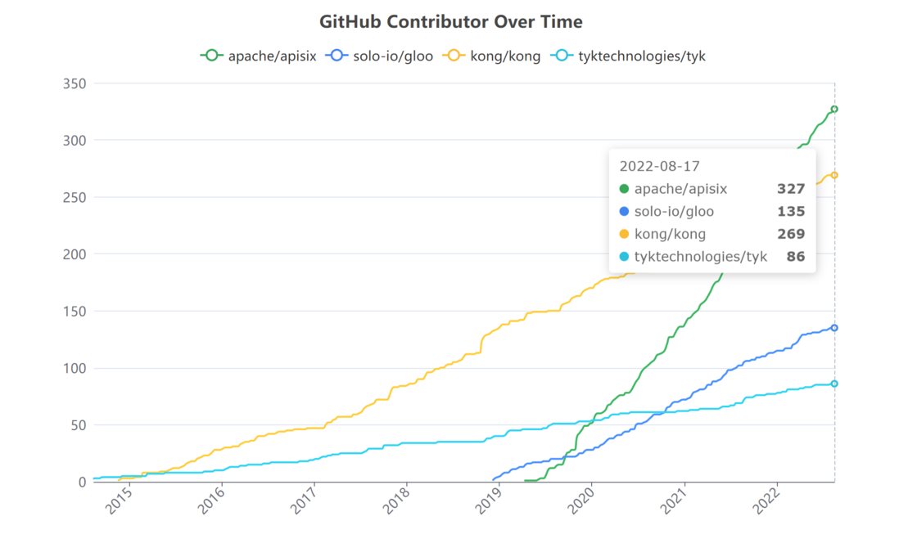
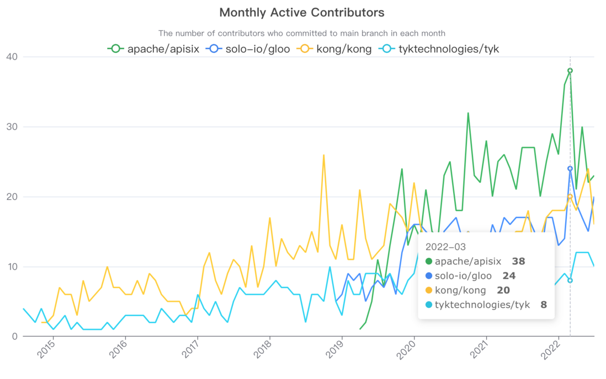
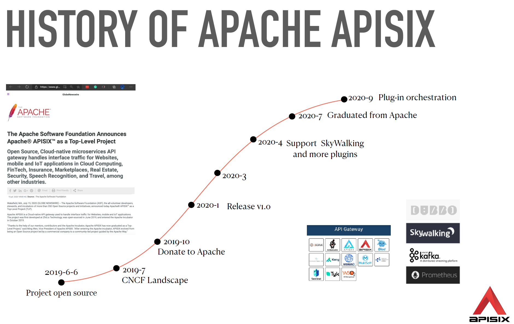
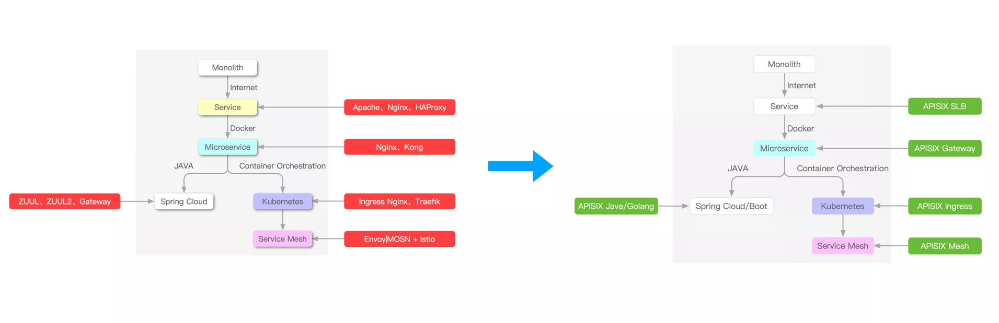
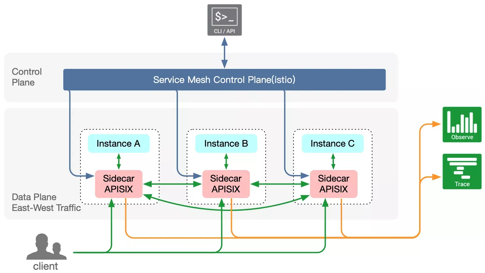
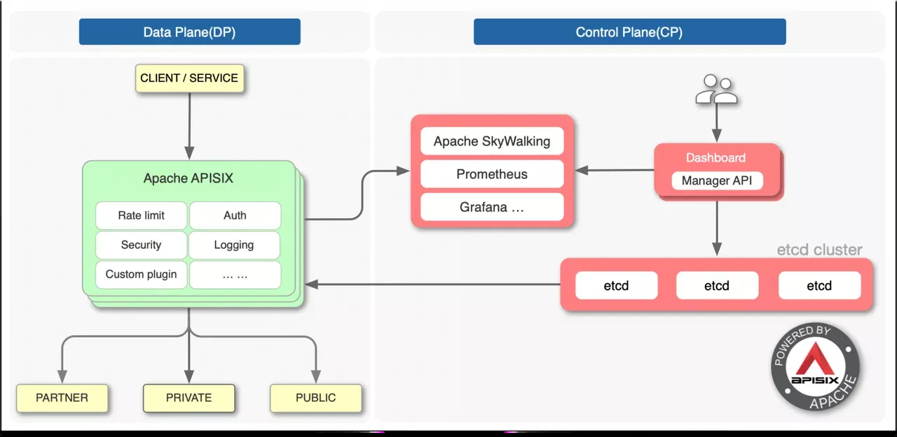

[← 返回微服务架构目录]({{ '/subjects/Microservices/' | relative_url }})



# 38 Apache APISIX 介绍

前一章用 Spring Cloud Gateway 在 Java 应用内实现统一入口。本章看另一种部署形态：把 API 网关作为独立基础设施运行，通过配置接口管理路由与插件。Apache APISIX 基于 OpenResty / Nginx 生态，配置通常由 etcd 保存并同步到网关实例；业务请求由 APISIX 数据面处理，不需要每次请求都查询 etcd。

## 在众多网关中如何定位 APISIX

CNCF Landscape 列出的网关项目很多，贡献者数、月活或某一版本的基准测试只能反映特定时间与条件，不能据此得出“某网关必然最流行或最快”。选型更应关注协议、插件、配置管理、运行环境、故障恢复、团队技能及实际负载测试。

[Apache APISIX](https://apisix.apache.org/zh/) 是 Apache 基金会项目，提供动态路由、上游负载均衡、认证、限流、TLS、日志与可观测性等能力。修改配置后可以动态生效，不需要把每一条路由写进应用代码或为每次改动重启网关；但“动态”不等于零传播时间或无故障风险，仍需验证 etcd 状态与各节点配置收敛。不同版本的内置插件数量和扩展语言支持会变化，应按目标版本文档核对。

## 常见应用场景

- **南北向入口**：浏览器、移动端或合作伙伴请求先到 APISIX，再按域名、路径、方法等规则转发到业务服务。
- **微服务入口**：多个语言栈共享认证、限流和可观测性策略。服务实例可静态配置，也可按版本支持的服务发现机制维护。
- **Kubernetes**：APISIX Ingress Controller 读取 Kubernetes 资源，将意图转换为 APISIX 配置。它是额外的控制器，不等于“安装 APISIX 后自动成为 Ingress”。
- **东西向或服务网格场景**：可能用 APISIX 承担部分内部流量治理，但是否替换既有 sidecar、如何接入 xDS 或服务网格，应按实际方案评估；不能把规划或实验能力写成所有版本的默认功能。

## 架构：控制配置与处理请求分离

**数据面**是处理客户端请求的 APISIX 进程：匹配路由、执行插件、选择上游并返回响应。它会在本地维护当前有效配置的缓存，因此 etcd 暂时不可达时，已加载的路由可能继续服务；但新配置无法正常发布，不能把它理解为完全不依赖配置存储。

**控制与配置路径**负责接收管理操作、校验并保存配置。传统部署常借助 Admin API 与 etcd；具体是否采用独立控制平面、Dashboard 或其他控制器取决于版本与部署方式。Admin API 应限制管理网络并使用有效凭据，不能对外当业务接口开放。原资料提到“AI 平面”是未来方向的叙述，不是理解普通 HTTP 路由的前置条件。

## 四个必须分清的对象

| 对象 | 职责 |
| --- | --- |
| Route（路由） | 定义请求匹配条件、关联插件和上游；决定某次请求走向哪里。 |
| Upstream（上游） | 管理后端节点、权重、健康检查与负载均衡。多个路由可复用同一上游。 |
| Service（服务） | 抽取多个路由共用的插件和上游配置；它与注册中心里的“服务实例”不是一个概念。 |
| Admin API | 创建、查询、修改上述对象的管理接口；业务请求应走代理监听端口。 |

例如请求 `GET /api/orders/1` 命中 Route，认证插件先处理，Upstream 再选择一个订单服务节点。下一篇先部署 APISIX 和 etcd，后续逐步创建这些对象并验证实际转发。



<nav class="article-end" aria-label="章节导航">
  <a href="{{ '/subjects/Microservices/37-spring-cloud-gateway-practical-examples.html' | relative_url }}">← 上一篇：Spring Cloud Gateway 实战案例</a>
  <a href="{{ '/subjects/Microservices/' | relative_url }}">返回专题目录</a>
  <a href="{{ '/subjects/Microservices/39-installing-apisix.html' | relative_url }}">下一篇：安装 APISIX →</a>
</nav>
