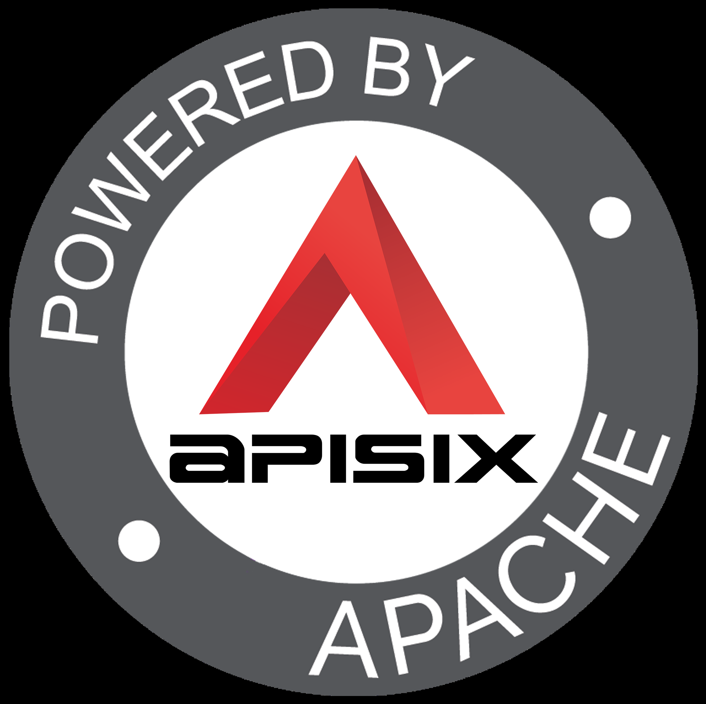
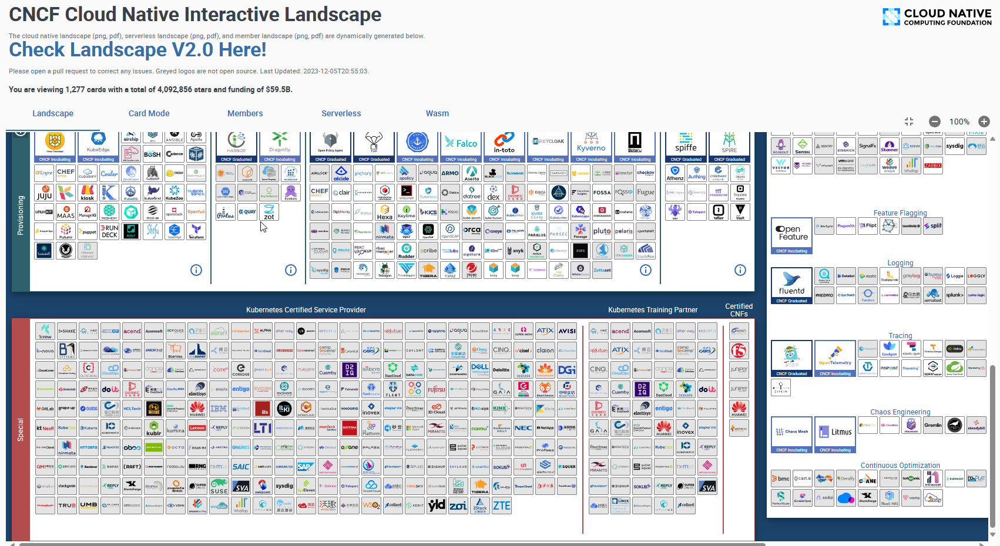
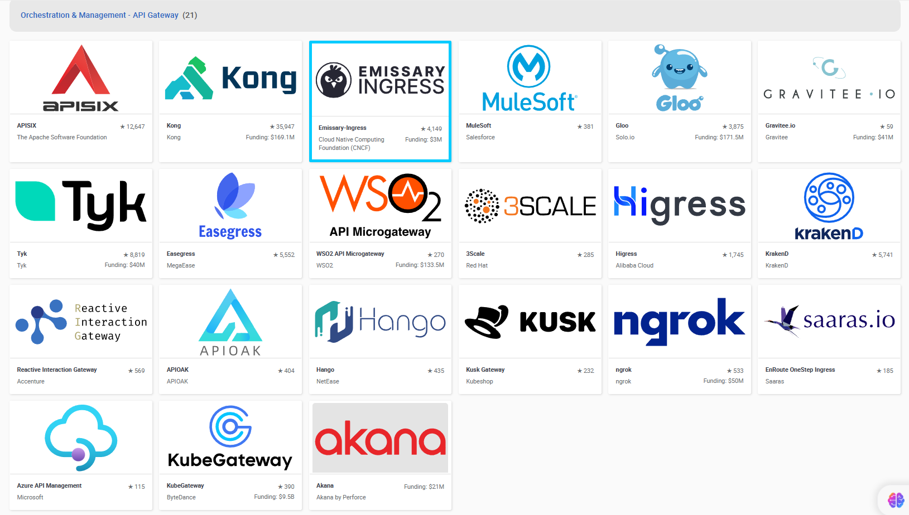
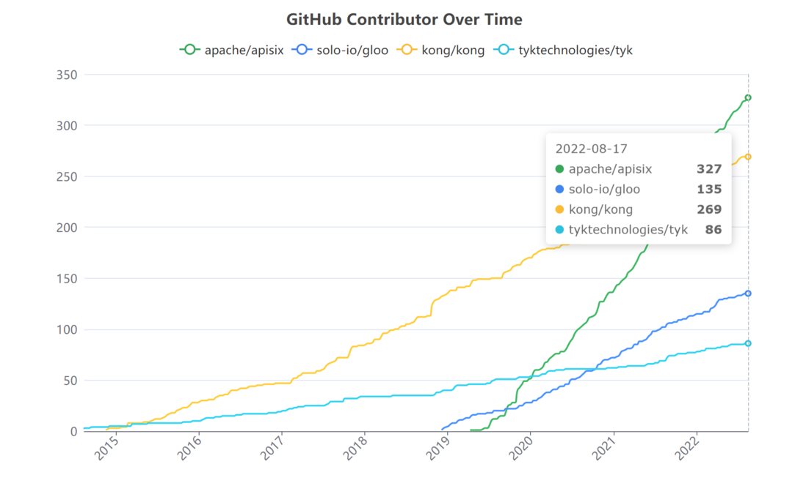
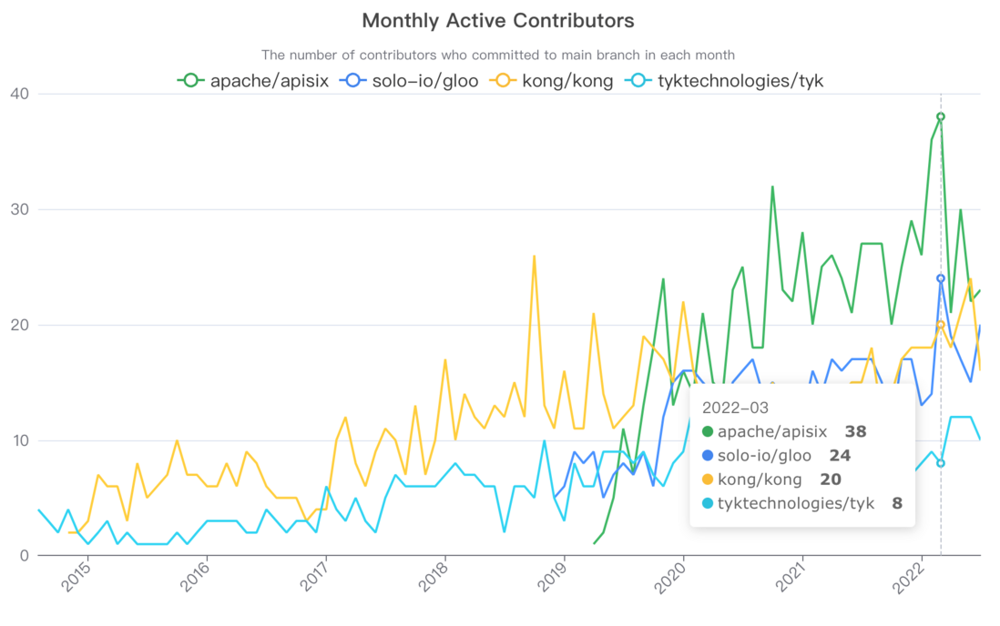
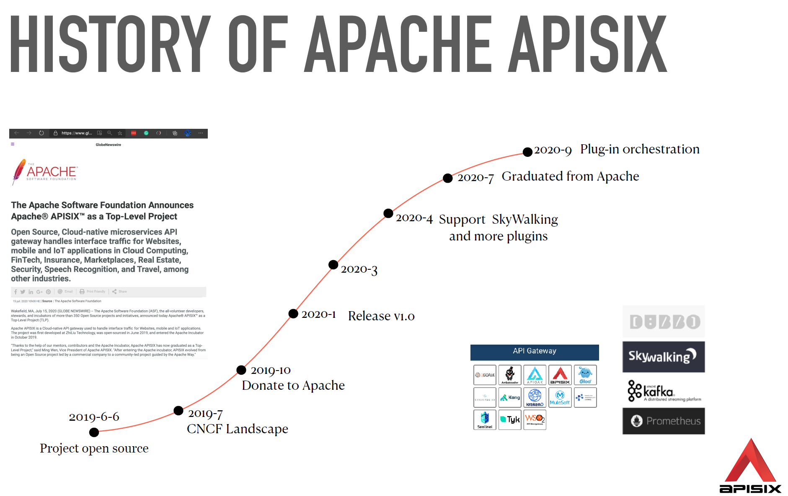
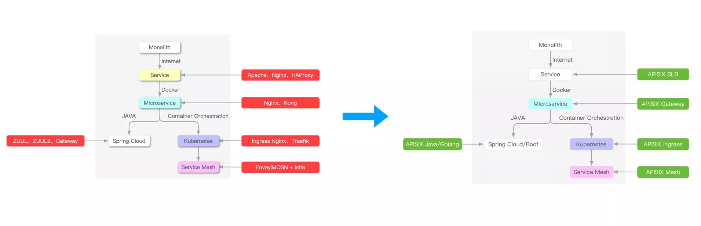
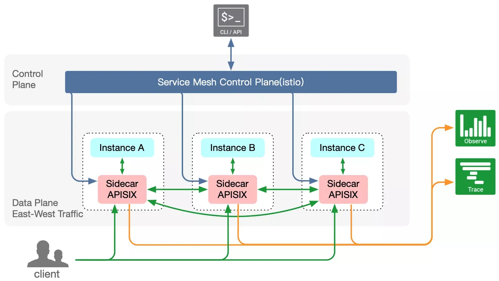
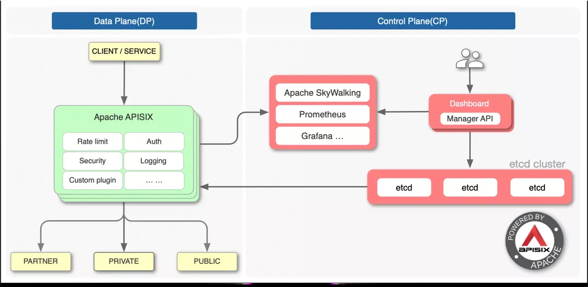

[← Back to Microservices Index]({{ '/subjects/Microservices/' | relative_url }})



# 38 Introduction to Apache APISIX
## 8 APISIX

### 8.1 Apache APISIX 介绍

### 云原生 API 网关

CNCF（Cloud Native Computing Foundation，云原生计算基金会） 的 API Gateway landscape 中有20多个不同的 API 网关（不包括公有云厂商产品），包括 Apache APISIX、Kong、Tyk 等

<https://landscape.cncf.io>

<https://landscape.cncf.io/card-mode?category=api-gateway&grouping=category&sort=contributors>

比较 4 个流行的开源云原生 API 网关Apache APISIX、Kong、Tyk 和 Gloo 对GitHub 的代码贡献者数量如下图

以上四个开源 API 网关的月度活跃的开发者数量如下图

以上比较可以发现 APISIX 是当前最流行的API 网关

### APISIX 介绍

官网:

<https://apisix.apache.org/>

<https://apisix.apache.org/zh/>

<https://github.com/apache/apisix>

<https://www.apiseven.com/>

Apache APISIX 是 Apache 软件基金会下的云原生API网关

Apache APISIX 于 2019 年开源并由支流科技捐赠给 Apache 软件基金会，现已成为性能最高、 社区最活跃的开源 API 网关项目。

Apache APISIX 是中国唯一由初创公司贡献的Apache顶级项目，也是最快毕业（只用了9个月）的项目

Apache APISIX 兼具动态、实时、高性能等特点,提供了负载均衡、动态上游、灰度发布(金丝雀发布)、服务熔断、身份认证、可观测性等丰富的流量管理功能。

Apache APISIX 可以使用Apache APISIX来处理传统的南北向流量，也可以处理服务间的东西向流量。

Apache APISIX 也支持作为Kubernetes Ingress Controller来使用。

Apache APISIX 也可以在服务网格 Service Mesh 中充当类似于 Envoy 这种 SideCar的 Proxy 功能,替代 Envoy 处理服务间东西向流量

Apache APISIX 可以支持实现全流量（南北，东西）网关

Apache APISIX 可以支持 AI Agents

### APISIX 主要特性

<https://apisix.apache.org/zh/docs/apisix/3.2/getting-started/>

Apache APISIX 使用户只需专注在具体业务中，而无需考虑 API 处理基础组件。 Apache APISIX 是首个提供低代码能力的开源 API 网关，作为 Apache 软件基金会顶级项目，避免出现Licences的商业纠纷 Apache APISIX 采用了基于OpenResty的架构，以及高效的Nginx引擎，能够处理更高的并发请求，响应更快的API。单核心QPS可达 1.5万，延迟低于0.7ms，基于ETCD的事件驱动的配置生效时间小于1ms，相对Kong轮询拉取需要5s APISIX 与其它API网关不同,不使用关系型数据库,而使用 etcd 作为存储，让 APISIX 在底层上更加贴合云原生，也让它在系统高可用和性能带来了更多优势多平台支持: APISIX提供了多平台解决方案，它不但支持裸机运行，也支持在Kubernetes中使用，还支持与AWS Lambda、 Azure Function、Lua 函数和Apache OpenWhisk等云服务集成。 全动态能力: APISIX支持热加载，这意味着你不需要重启服务就可以更新APISIX的配置。 精细化路由: APISIX支持使用NGINX内置变量做为路由的匹配条件,你可以自定义匹配函数来过滤请求,匹配路由。 运维友好: APISIX支持与以下工具和平台集成:  Apache SkyWalking、 Consul、 Nacos、 Eureka、 HashiCorp Vault、 Zipkin, 通过 APISIX Dashboard,运维人员可以通过友好且直观的UI配置APISIX。 部署更简单：APISIX提供了Docker镜像、Kubernetes Helm Chart等多种部署方式，可以快速部署APISIX。 多语言插件支持: APISIX支持多种开发语言进行插件开发,开发人员可以选择擅长语言的SDK开发自定义插件。当前支持80多种插件，覆盖各种功能包括;身份认证、安全、日志、可观测性... 开源社区更活跃：APISIX由Apache APISIX社区维护，有着广泛的用户和贡献者社区，提供了更加完善的文档和支持。

### APISIX 的应用场景

<https://apisix.apache.org/blog/2022/07/30/why-we-need-apache-apisix/#apisix-application-scenario>

APISIX的核心是高性能代理服务，自身不绑定任何环境属性。当它演变为Ingress、服务网格等产品时，都是外部服务与APISIX配合，变化的是外部程序而不是APISIX自身，下面将逐步为大家介绍APISIX是如何支持这些场景的。

Apache APISIX 可以支持实现全流量（南北，东西）网关

Load Balancer and API Gateway 第一个是传统的LB和API网关场景。 由于APISIX是基于NGINX + LuaJIT实现的，因此具有高性能、安全性等特点，同时还支持动态SSL 证书卸载、SSL握手优化等功能。 在负载均衡服务方面，也表现得更好。 从NGINX切换到APISIX不会降低性能，还能享受动态统一管理等特性带来的管理效率提升。 Microservice Gateway APISIX目前支持多种语言扩展插件的编写，可以解决东西向微服务API网关面临的主要问题——异构多语言和通用问题。 内置支持的服务注册中心有Nacos、etcd、Eureka等，以及标准的DNS方式，可以平滑替换Zuul、Spring Cloud Gateway、Dubbo等微服务API网关。 Kubernetes Ingress 目前K8s官方的Kubernetes Ingress Controller项目主要是基于NGINX配置文件的方式，因此在路由能力和加载方式上稍显不足，有一些明显的缺点。 例如，当添加或修改任何API时，需要重新启动服务才能完成新NGINX配置的更新，但服务的重新启动对在线流量的影响很大。 APISIX Ingress Controller完美解决了上述所有问题：支持全动态，无需重启加载。 同时继承了APISIX的所有优点，还支持原生 Kubernetes CRD，方便用户迁移。 Service mesh 未来五到十年，基于云原生模型架构的Service Mesh架构将开始出现。 APISIX也开始提前锁定赛道。 经过研究和技术分析，APISIX已经支持了xDS协议，APISIX Mesh诞生了，APISIX在服务网格领域也占有一席之地。 APISIX 可以替代 Envoy 处理服务间的东西向流量

Apache APISIX 可以支持 AI Agents

### APISIX 架构

<https://apisix.apache.org/blog/2022/11/02/apache-apisix-v3-preview/>

<https://apisix.apache.org/blog/2022/07/30/why-we-need-apache-apisix/>

APISIX的架构主要分成两部分:

数据平面 Data Plane 它是真正去处理来自客户端请求的一个组件，去处理用户的真实流量，包括像身份验证、证书卸载、日志分析和可观测性等功能。 数据面本身并不会存储任何数据，所以它是一个无状态结构。

控制平面 Control Plane 增加独立的控制平面（CP)，将来可以支持调度所有数据平面（DP)，不局限于APISIX APISIX在底层架构上和其它API网关的一个很大不同就在于控制面。 APISIX在控制面上选择使用etcd。 AI 平面 AP 未来增加AI 平面，因为仅是接入层本身没有价值，分析流动的数据并反哺业务，才有价值

### APISIX的主要概念和组件

<https://apisix.apache.org/zh/docs/apisix/next/tutorials/expose-api/>

<https://apisix.apache.org/zh/docs/apisix/3.2/getting-started/#%E4%B8%BB%E8%A6%81%E6%A6%82%E5%BF%B5>

Route Route 也称为路由，是 APISIX 中最基础和最核心的资源对象。 APISIX 可以通过路由定义规则来匹配客户端请求，根据匹配结果加载并执行相应的插件，最后把请求转发给到指定的上游服务。 路由中主要包含三部分内容：匹配规则、插件配置和上游信息。 Upstream Upstream 也称为上游，上游是对虚拟主机的抽象，即应用层服务或节点的抽象。 上游的作用是按照配置规则对服务节点进行负载均衡，它的地址信息可以直接配置到路由或服务上。

当多个路由或服务引用同一个上游时，可以通过创建上游对象，在路由或服务中使用上游 ID 的方式引用上游，减轻维护压力。 服务

Service 也称为服务，是某类 API 的抽象（也可以理解为一组 Route 的抽象）。 它通常与上游服务抽象是一一对应的，Route 与 Service 之间，通常是 N:1 的关系。 Service 用于定义 API 服务的通用属性，并将其与上游（upstream ）关联。它的主要功能包括：

1. 路由配置：service 可以通过路由规则（route ）关联，指定哪些请求会被转发到该服务。

2. 插件配置：可以在service 层面上配置插件，如身份认证、限流、监控等，这些插件将应用于所有通过该服务的请求。

3. 上游关联：service 会引用一个upstream ，定义具体的后端服务集群。

Admin API 用户可以通过 Admin API 控制 APISIX 实例。



<nav class="article-end" aria-label="章节导航">
  <a href="{{ '/subjects/Microservices/37-spring-cloud-gateway-practical-examples.html' | relative_url }}">← Previous: Spring Cloud Gateway Practical Examples</a>
  <a href="{{ '/subjects/Microservices/' | relative_url }}">Back to Microservices Index</a>
  <a href="{{ '/subjects/Microservices/39-installing-apisix.html' | relative_url }}">Next: Installing APISIX →</a>
</nav>
