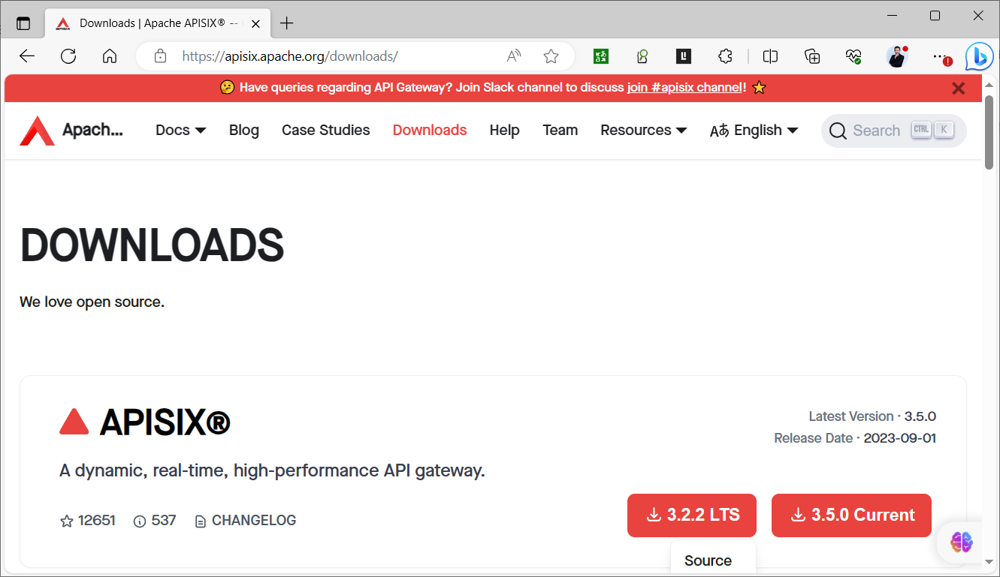
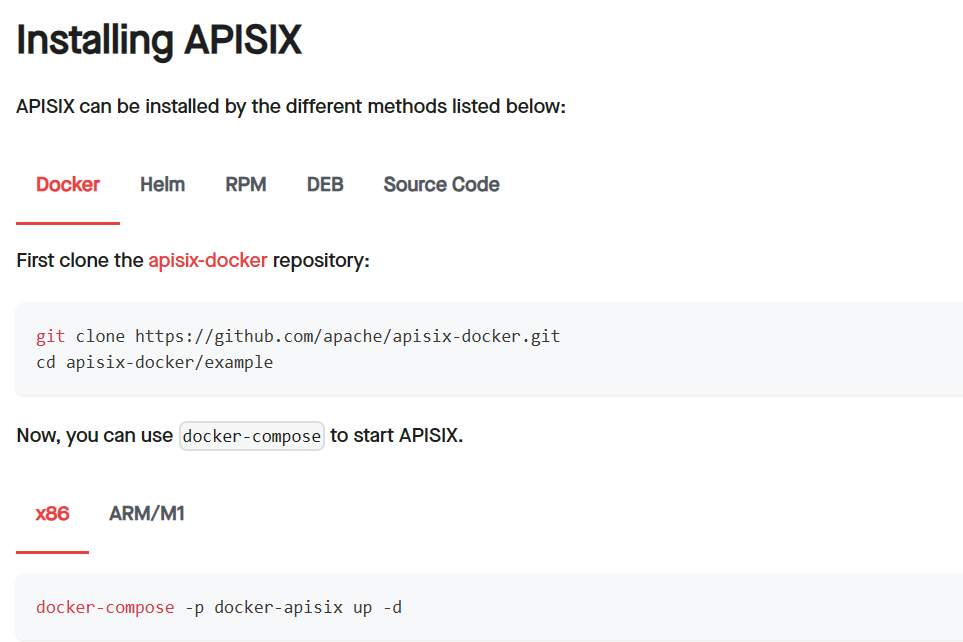
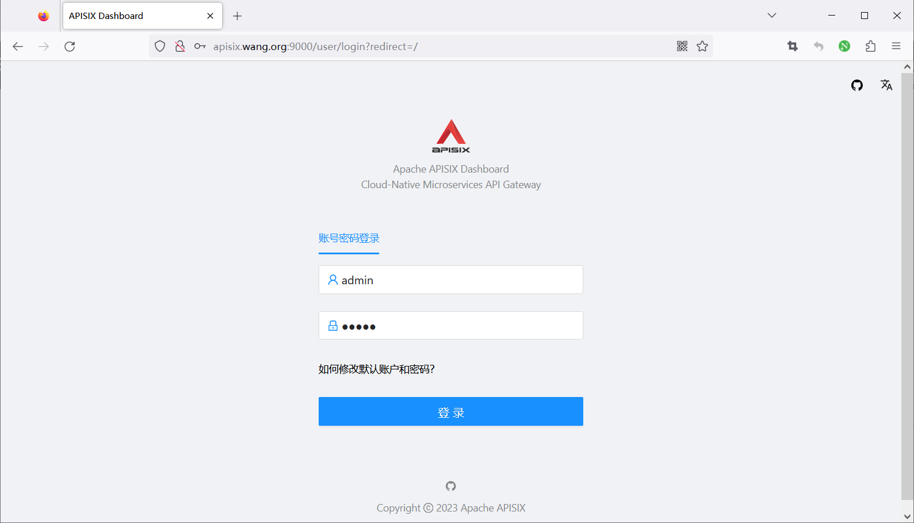
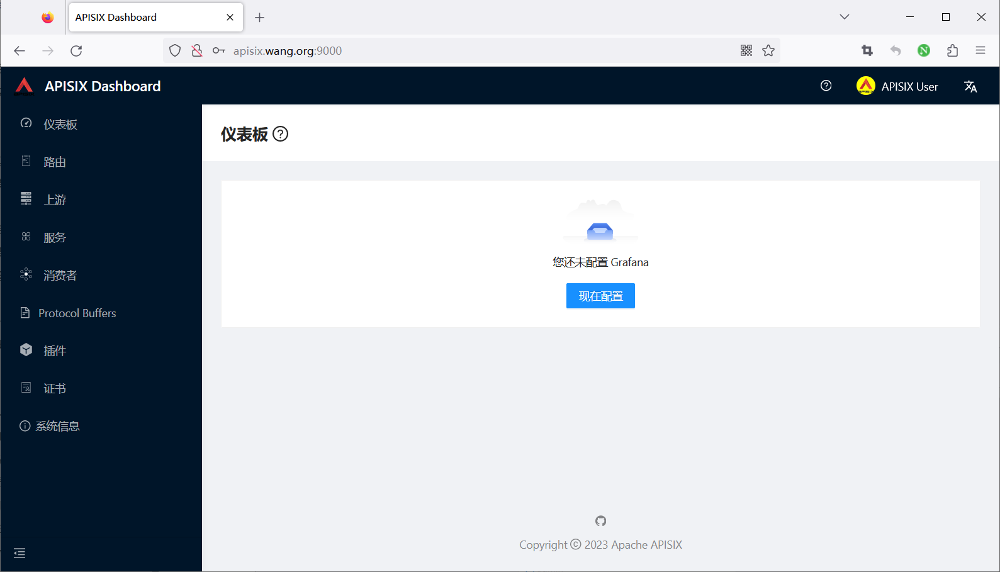

[← 返回微服务架构目录]({{ '/subjects/Microservices/' | relative_url }})



# 39 APISIX 安装
### 8.2 APISIX 安装

### 安装 APISIX 方法说明

<https://apisix.apache.org/docs/apisix/installation-guide/>

<https://apisix.apache.org/downloads/>

<https://github.com/apache/apisix>

APISIX 包括以下三个核心组件

APISIX ETCD APISIX Dashboard

APISIX 版本选择

<https://apisix.apache.org/downloads>

每个月发布一个版本

注意: 建议安装LTS版本

```text
https://www.apiseven.com/apisix-vs-enterprise
#商业版
API7 EE 是一款专注于 API 全生命周期管理的商业产品，它以开源 API 网关 APISIX 为基础，并添加了企业级功能。
API7 EE 可以帮助企业用户优化并升级传统应用架构，以更高效、更安全的方式交付产品。
```



APISIX 安装方法

二进制包安装 Docker Helm 源码编译


### APISIX 二进制包安装

### 二进制安装 ETCD

APISIX使用etcd作为配置中心进行保存和同步配置。在安装APISIX之前，需要提前安装etcd。

<https://apisix.apache.org/docs/apisix/installation-guide/#installing-etcd>

范例:  安装启动 ETCD

```bash
[root@ubuntu2204 ~]#ETCD_VERSION=3.5.17
[root@ubuntu2204 ~]#ETCD_VERSION=3.5.16
[root@ubuntu2204 ~]#ETCD_VERSION='3.5.4'
#直接下载
[root@ubuntu2204 ~]#wget https://github.com/etcd-io/etcd/releases/download/v${ETCD_VERSION}/etcd-
v${ETCD_VERSION}-linux-amd64.tar.gz
#使用国内镜像加速下载
[root@ubuntu2204 ~]#wget https://mirror.ghproxy.com/https://github.com/etcd-
io/etcd/releases/download/v${ETCD_VERSION}/etcd-v${ETCD_VERSION}-linux-amd64.tar.gz
[root@ubuntu2204 ~]#tar -xvf etcd-v${ETCD_VERSION}-linux-amd64.tar.gz -C /usr/local/
[root@ubuntu2204 ~]#cd /usr/local/etcd-v${ETCD_VERSION}-linux-amd64 && cp -a etcd etcdctl /usr/local/bin/
[root@ubuntu2204 ~]#etcd --version
etcd Version: 3.5.4
Git SHA: 08407ff76
Go Version: go1.16.15
Go OS/Arch: linux/amd64
#启动ETCD
[root@ubuntu2204 ~]#nohup etcd >/tmp/etcd.log 2>&1 &
#查看端口
[root@ubuntu2204 ~]#ss -ntlup|grep etcd
tcp   LISTEN 0      4096       127.0.0.1:2379      0.0.0.0:*    users:(("etcd",pid=2487,fd=8))
tcp   LISTEN 0      4096       127.0.0.1:2380      0.0.0.0:*    users:(("etcd",pid=2487,fd=7))
#serivce方式
[root@ubuntu2404 ~]#killall etcd
[root@ubuntu2404 ~]#cat  /lib/systemd/system/etcd.service
[Unit]
Description=etcd
After=network-online.target
Wants=network-online.target
[Service]
#Type=forking
#Restart=on-failure
ExecStart=/usr/local/bin/etcd
LimitNOFILE=65536
[Install]
WantedBy=multi-user.target
[root@ubuntu2404 ~]#systemctl daemon-reload
[root@ubuntu2404 ~]#systemctl enable --now  etcd
[root@ubuntu2404 ~]#systemctl status etcd
```

● etcd.service - etcd

```text
Loaded: loaded (/usr/lib/systemd/system/etcd.service; enabled; preset: enabled)
Active: active (running) since Wed 2025-03-12 15:44:04 CST; 1s ago
Main PID: 1832 (etcd)
Tasks: 7 (limit: 2214)
Memory: 7.0M (peak: 7.5M)
CPU: 59ms
CGroup: /system.slice/etcd.service
```

### APISIX 基于 Ubuntu 系统安装

<https://apisix.apache.org/docs/apisix/installation-guide/>

范例：Ubuntu 包安装 APISIX

```bash
#生成apt仓库配置，支持CPU架构amd64
[root@ubuntu2204 ~]#wget -O - http://repos.apiseven.com/pubkey.gpg | sudo apt-key add -
[root@ubuntu2204 ~]#echo "deb http://repos.apiseven.com/packages/debian bullseye main" | sudo tee
/etc/apt/sources.list.d/apisix.list
#安装前查看版本
[root@ubuntu2204 ~]#apt update && apt -a  list apisix
Listing... Done
apisix/bullseye,now 3.5.0-0 amd64
apisix/bullseye 3.4.1-0 amd64
apisix/bullseye 3.4.0-0 amd64
apisix/bullseye 3.3.0-0 amd64
apisix/bullseye 3.2.2-0 amd64
apisix/bullseye 3.2.1-0 amd64
apisix/bullseye 3.2.0-0 amd64
apisix/bullseye 3.1.0-0 amd64
apisix/bullseye 3.0.0-0 amd64
apisix/bullseye 2.99.0-0 amd64
apisix/bullseye 2.15.3-0 amd64
apisix/bullseye 2.15.2-0 amd64
apisix/bullseye 2.15.1-0 amd64
apisix/bullseye 2.15.0-0 amd64
apisix/bullseye 2.14.1-0 amd64
apisix/bullseye 2.13.3-0 amd64
apisix/bullseye 2.13.2-0 amd64
#安装指定版本
[root@ubuntu2204 ~]#apt -y install apisix=3.0.0-0
#用法帮助
[root@ubuntu2204 ~]#apisix
/usr/local/openresty//luajit/bin/luajit /usr/local/apisix/apisix/cli/apisix.lua
Usage: apisix [action] <argument>
help:       print the apisix cli help message
init:       initialize the local nginx.conf
init_etcd:  initialize the data of etcd
start:      start the apisix server
stop:       stop the apisix server
quit:       stop the apisix server gracefully
restart:    restart the apisix server
reload:     reload the apisix server
test:       test the generated nginx.conf
version:    print the version of apisix
#初始化
[root@ubuntu2204 ~]#apisix init
/usr/local/openresty//luajit/bin/luajit /usr/local/apisix/apisix/cli/apisix.lua init
Warning! Current maximum number of open file descriptors [1024] is not greater than 1024, please increase user
limits by execute 'ulimit -n <new user limits>' , otherwise the performance is low.
#配置文件格式检查
[root@ubuntu2204 ~]#apisix test
/usr/local/openresty//luajit/bin/luajit /usr/local/apisix/apisix/cli/apisix.lua test
Warning! Current maximum number of open file descriptors [1024] is not greater than 1024, please increase user
limits by execute 'ulimit -n <new user limits>' , otherwise the performance is low.
configuration test is successful
#修改资源限制，消除告警(可选)
[root@ubuntu2204 ~]#vim /etc/security/limits.conf
root  -  nofile 88888
[root@ubuntu2204 ~]#reboot
[root@ubuntu2204 ~]#ulimit -n
88888
#启动服务,注意:不要和service方式混用
[root@ubuntu2204 ~]#apisix start
/usr/local/openresty//luajit/bin/luajit /usr/local/apisix/apisix/cli/apisix.lua start
APISIX is running...
#停止服务
[root@ubuntu2204 ~]#apisix stop|quit
#内置service文件内容
[root@ubuntu2204 ~]#cat /lib/systemd/system/apisix.service
## 8.apisix systemd service
## 8.https://github.com/api7/apisix-build-tools/blob/master/usr/lib/systemd/system/apisix.service
[Unit]
Description=apisix
#Conflicts=apisix.service
After=network-online.target
Wants=network-online.target
[Service]
Type=forking
Restart=on-failure
WorkingDirectory=/usr/local/apisix
ExecStart=/usr/bin/apisix start
ExecStop=/usr/bin/apisix stop
ExecReload=/usr/bin/apisix reload
LimitNOFILE=65536
[Install]
WantedBy=multi-user.target
#Service方式启动
[root@ubuntu2204 ~]#systemctl enable  --now apisix.service
[root@ubuntu2204 ~]#journalctl -u apisix
12月 06 10:24:37 ubuntu2204.bowen.org systemd[1]: Starting apisix...
12月 06 10:24:37 ubuntu2204.bowen.org apisix[99882]: /usr/local/openresty//luajit/bin/luajit
./apisix/cli/apisix.lua start
12月 06 10:24:37 ubuntu2204.bowen.org systemd[1]: Started apisix.
#监听端口
[root@ubuntu2204 ~]#ss -ntlp|grep openresty
LISTEN 0      511          0.0.0.0:9080       0.0.0.0:*    users:(("openresty",pid=11864,fd=13),
("openresty",pid=11862,fd=13))   LISTEN 0      511          0.0.0.0:9080       0.0.0.0:*    users:
(("openresty",pid=11863,fd=9),("openresty",pid=11862,fd=9))
LISTEN 0      511          0.0.0.0:9180       0.0.0.0:*    users:(("openresty",pid=11864,fd=7),
("openresty",pid=11863,fd=7),("openresty",pid=11862,fd=7))
LISTEN 0      511        127.0.0.1:9090       0.0.0.0:*    users:(("openresty",pid=11864,fd=6),
("openresty",pid=11863,fd=6),("openresty",pid=11862,fd=6))
LISTEN 0      511        127.0.0.1:9091       0.0.0.0:*    users:(("openresty",pid=11867,fd=26))
LISTEN 0      511          0.0.0.0:9443       0.0.0.0:*    users:(("openresty",pid=11864,fd=15),
("openresty",pid=11862,fd=15))
LISTEN 0      511          0.0.0.0:9443       0.0.0.0:*    users:(("openresty",pid=11863,fd=11),
("openresty",pid=11862,fd=11))
LISTEN 0      511             [::]:9080          [::]:*    users:(("openresty",pid=11863,fd=10),
("openresty",pid=11862,fd=10))
LISTEN 0      511             [::]:9080          [::]:*    users:(("openresty",pid=11864,fd=14),
("openresty",pid=11862,fd=14))
LISTEN 0      511             [::]:9443          [::]:*    users:(("openresty",pid=11863,fd=12),
("openresty",pid=11862,fd=12))
LISTEN 0      511             [::]:9443          [::]:*    users:(("openresty",pid=11864,fd=16),
("openresty",pid=11862,fd=16))
#查看配置文件
[root@ubuntu2204 ~]#ls /usr/local/apisix
apisix  client_body_temp  conf  deps  fastcgi_temp  logs  proxy_temp  scgi_temp  uwsgi_temp
[root@ubuntu2204 ~]#ls /usr/local/apisix/conf
apisix.uid  cert  config-default.yaml  config_listen.sock  config.yaml  debug.yaml  mime.types  nginx.conf
[root@ubuntu2204 ~]#cat /usr/local/apisix/conf/config.yaml
#确认启动
[root@ubuntu2204 ~]#curl -s "http://127.0.0.1:9080" --head | grep Server
Server: APISIX/3.0.0
```

### APISIX 基于红帽系统安装

<https://apisix.apache.org/docs/apisix/installation-guide/#installation-via-rpm-repository>

8.2.2.3.1 在线RPM仓库安装

If OpenResty is not installed, you can run the command below to install both OpenResty and APISIX repositories:

```text
sudo yum install -y https://repos.apiseven.com/packages/centos/apache-apisix-repo-1.0-1.noarch.rpm
```

If OpenResty is installed, the command below will install the APISIX repositories:

```text
sudo yum-config-manager --add-repo https://repos.apiseven.com/packages/centos/apache-apisix.repo
```

Then, to install APISIX, run:

```text
sudo yum install apisix
```

You can also install a specific version of APISIX by specifying it:

```text
#查看版本
yum list apisix --showduplicates
sudo yum install apisix-2.13.1
```

范例: Rocky8 安装 APISIX

```bash
[root@rocky8 ~]#yum install -y https://repos.apiseven.com/packages/centos/apache-apisix-repo-1.0-1.noarch.rpm
[root@rocky8 ~]#yum-config-manager --add-repo https://repos.apiseven.com/packages/centos/apache-apisix.repo
[root@rocky8 ~]#yum list apisix --showduplicates
apisix.x86_64                3.0.0-0.el8                   release
apisix.x86_64                3.1.0-0.el8                   release
apisix.x86_64                3.2.0-0.el8                   release
apisix.x86_64                3.2.1-0.el8                   release
apisix.x86_64                3.2.2-0.el8                   release
apisix.x86_64                3.3.0-0.el8                   release
apisix.x86_64                3.4.0-0.el8                   release
apisix.x86_64                3.4.1-0.el8                   release
apisix.x86_64                3.5.0-0.el8                   release
.......
#安装指定版本
[root@rocky8 ~]#yum -y install apisix-3.0.0
#安装最新版本
[root@rocky8 ~]#yum -y install apisix
[root@rocky8 ~]#systemctl enable --now  apisix
[root@rocky8 ~]#systemctl status -  apisix
Unit -.service could not be found.
```

● apisix.service - apisix

```bash
Loaded: loaded (/usr/lib/systemd/system/apisix.service; enabled; vendor preset: disabled)
Active: active (running) since Tue 2023-11-07 14:01:22 CST; 11min ago
Process: 24572 ExecStart=/usr/bin/apisix start (code=exited, status=0/SUCCESS)
Main PID: 24595 (openresty)
Tasks: 28 (limit: 11175)
Memory: 83.8M
CGroup: /system.slice/apisix.service
├─24595 nginx: master process /usr/bin/openresty -p /usr/local/apisix -c
/usr/local/apisix/conf/nginx.conf
├─24596 nginx: worker process
├─24597 nginx: worker process
├─24598 nginx: cache manager process
└─24600 nginx: privileged agent process
Nov 07 14:01:22 rocky8.bowen.org systemd[1]: Starting apisix...
Nov 07 14:01:22 rocky8.bowen.org apisix[24572]: /usr/local/openresty/luajit/bin/luajit ./apisix/cli/apisix.lua
start
Nov 07 14:01:22 rocky8.bowen.org systemd[1]: Started apisix.
[root@rocky8 ~]#ss -ntlp|grep openresty
LISTEN 0      128          0.0.0.0:9080      0.0.0.0:*    users:(("openresty",pid=24597,fd=17),
("openresty",pid=24595,fd=17))
LISTEN 0      128          0.0.0.0:9080      0.0.0.0:*    users:(("openresty",pid=24596,fd=13),
("openresty",pid=24595,fd=13))
LISTEN 0      128          0.0.0.0:9180      0.0.0.0:*    users:(("openresty",pid=24597,fd=11),
("openresty",pid=24596,fd=11),("openresty",pid=24595,fd=11))
LISTEN 0      128        127.0.0.1:9090      0.0.0.0:*    users:(("openresty",pid=24597,fd=9),
("openresty",pid=24596,fd=9),("openrest",pid=24595,fd=9))
LISTEN 0      128          0.0.0.0:9443      0.0.0.0:*    users:(("openresty",pid=24597,fd=19),
("openresty",pid=24595,fd=19))
LISTEN 0      128          0.0.0.0:9443      0.0.0.0:*    users:(("openresty",pid=24596,fd=15),
("openresty",pid=24595,fd=15))
LISTEN 0      128        127.0.0.1:9091      0.0.0.0:*    users:(("openresty",pid=24597,fd=10),
("openresty",pid=24596,fd=10),("openresty",pid=24595,fd=10))
LISTEN 0      128             [::]:9080         [::]:*    users:(("openresty",pid=24596,fd=14),
("openresty",pid=24595,fd=14))
LISTEN 0      128             [::]:9080         [::]:*    users:(("openresty",pid=24597,fd=18),
("openresty",pid=24595,fd=18))
LISTEN 0      128             [::]:9443         [::]:*    users:(("openresty",pid=24596,fd=16),
("openresty",pid=24595,fd=16))
LISTEN 0      128             [::]:9443         [::]:*    users:(("openresty",pid=24597,fd=20),
("openresty",pid=24595,fd=20))
#确认启动
[root@rocky8 ~]#curl -s "http://127.0.0.1:9080" --head | grep Server
Server: APISIX/3.0.0
```

8.2.2.3.2 离线RPM包安装

<https://apisix.apache.org/docs/apisix/installation-guide/#installation-via-rpm-offline-package>

First, download APISIX RPM offline package to an apisix folder:

```text
sudo mkdir -p apisix
sudo yum install -y https://repos.apiseven.com/packages/centos/apache-apisix-repo-1.0-1.noarch.rpm
sudo yum clean all && yum makecache
sudo yum install -y --downloadonly --downloaddir=./apisix apisix
```

Then copy the apisix folder to the target host and run:

```text
sudo yum install ./apisix/*.rpm
```

8.2.2.3.3 启动 APISIX server

<https://apisix.apache.org/docs/apisix/installation-guide/#managing-apisix-server-1)>

Once APISIX is installed, you can initialize the configuration file and etcd by running:

```text
sudo apisix init
```

To start APISIX server, run:

```text
sudo apisix start
```

或者

```text
systemctl enable --now  apisix
```

### 源码编译安装 APISIX

<https://apisix.apache.org/zh/docs/apisix/building-apisix/#源码安装-apisix>

首先，你可以通过以下命令安装依赖项：

```text
curl https://raw.githubusercontent.com/apache/apisix/master/utils/install-dependencies.sh -sL | bash -
```

然后，创建一个目录并设置环境变量 APISIX_VERSION ：

```text
APISIX_VERSION='3.5.0'
mkdir apisix-${APISIX_VERSION}
```

现在，你可以运行以下命令，从 Github 克隆 APISIX 源码：

```text
git clone --depth 1 --branch ${APISIX_VERSION} https://github.com/apache/apisix.git apisix-${APISIX_VERSION}
```

你可以从下载页面下载源码包。但是官网的源码包缺少测试用例，可能会对你后续操作产生困扰。

另外，你也可以在该页面找到 APISIX Dashboard 和 APISIX Ingress Controller 的源码包。

然后切换到 APISIX 源码的目录，创建依赖项并安装 APISIX，命令如下所示：

```text
cd apisix-${APISIX_VERSION}
make deps
make install
```

该命令将安装 APISIX 运行时依赖的 Lua 库和 apisix 命令。

### Docker 脚本安装

APISIX 可以借助 quickstart 脚本快速安装并启动：

该命令启动 apisix-quickstart 和 etcd 两个容器，APISIX 使用 etcd 保存和同步配置。

APISIX 和 etcd 容器使用 Docker 的 host 网络模式，因此可以从本地直接访问。

注意: 需要提前安装docker环境

```text
curl -sL https://run.api7.ai/apisix/quickstart | bash
```

范例: 官方Docker启动脚本

```bash
[root@ubuntu2204 ~]#curl -sL https://run.api7.ai/apisix/quickstart
#!/bin/bash
#
## 8.Licensed to the Apache Software Foundation (ASF) under one or more
## 8.contributor license agreements.  See the NOTICE file distributed with
## 8.this work for additional information regarding copyright ownership.
## 8.The ASF licenses this file to You under the Apache License, Version 2.0
## 8.(the "License"); you may not use this file except in compliance with
## 8.the License.  You may obtain a copy of the License at
#
## 8.    http://www.apache.org/licenses/LICENSE-2.0
#
## 8.Unless required by applicable law or agreed to in writing, software
## 8.distributed under the License is distributed on an "AS IS" BASIS,
## 8.WITHOUT WARRANTIES OR CONDITIONS OF ANY KIND, either express or implied.
## 8.See the License for the specific language governing permissions and
## 8.limitations under the License.
#
DEFAULT_ETCD_IMAGE_NAME="bitnami/etcd"
DEFAULT_ETCD_IMAGE_TAG="3.5.7"
DEFAULT_APISIX_IMAGE_NAME="apache/apisix"
DEFAULT_APISIX_IMAGE_TAG="3.6.0-debian"
DEFAULT_ETCD_LISTEN_HOST=0.0.0.0
DEFAULT_ETCD_LISTEN_PORT=2379
DEFAULT_APISIX_PORT=9180
DEFAULT_ETCD_NAME="etcd-quickstart"
DEFAULT_APP_NAME="apisix-quickstart"
DEFAULT_NET_NAME="apisix-quickstart-net"
DEFAULT_PROMETHEUS_NAME="apisix-quickstart-prometheus"
usage() {
echo "Runs a Docker based Apache APISIX."
echo
echo "See the document for more information:"
echo "  https://docs.api7.ai/apisix/getting-started"
exit 0
}
echo_fail() {
```

printf "\e[31m✘ \e[0m$@\n"

```text
}
echo_pass() {
```

printf "\e[32m✔ \e[0m$@\n"

```text
}
echo_warning() {
```

printf "\e[33m⚠ $@\e[0m\n"

```json
}
ensure_docker() {
{
docker ps -q >/dev/null 2>&1
} || {
return 1
}
}
ensure_curl() {
{
curl -h >/dev/null 2>&1
} || {
return 1
}
}
install_apisix() {
echo "Installing APISIX with the quickstart options."
echo ""
echo "Creating bridge network ${DEFAULT_NET_NAME}."
docker network create -d bridge $DEFAULT_NET_NAME && echo_pass "network ${DEFAULT_NET_NAME} created" || {
echo_fail "Create network failed!"
return 1
}
echo ""
echo "Starting the container ${DEFAULT_ETCD_NAME}."
docker run -d \
--name ${DEFAULT_ETCD_NAME} \
--network=$DEFAULT_NET_NAME \
-e ALLOW_NONE_AUTHENTICATION=yes \
-e ETCD_ADVERTISE_CLIENT_URLS=http://${DEFAULT_ETCD_LISTEN_HOST}:${DEFAULT_ETCD_LISTEN_PORT} \
${DEFAULT_ETCD_IMAGE_NAME}:${DEFAULT_ETCD_IMAGE_TAG} && echo_pass "etcd is listening on
${DEFAULT_ETCD_NAME}:${DEFAULT_ETCD_LISTEN_PORT}" || {
echo_fail "Start etcd failed!"
return 1
}
echo ""
APISIX_DEPLOYMENT_ETCD_HOST="[\"http://${DEFAULT_ETCD_NAME}:${DEFAULT_ETCD_LISTEN_PORT}\"]"
echo "Starting the container ${DEFAULT_APP_NAME}."
docker run -d \
--name ${DEFAULT_APP_NAME} \
--network=$DEFAULT_NET_NAME \
-p9080:9080 -p9180:9180 -p9443:9443 -p9090:9092 -p9100:9100 \
-e APISIX_DEPLOYMENT_ETCD_HOST=${APISIX_DEPLOYMENT_ETCD_HOST} \
${DEFAULT_APISIX_IMAGE_NAME}:${DEFAULT_APISIX_IMAGE_TAG} && validate_apisix && sleep 2 || {
echo_fail "Start APISIX failed!"
return 1
}
docker exec ${DEFAULT_APP_NAME} /bin/bash -c "echo '
apisix:
enable_control: true
control:
ip: "0.0.0.0"
port: 9092
deployment:
role: traditional
role_traditional:
config_provider: etcd
admin:
admin_key_required: false
allow_admin:
- 0.0.0.0/0
plugin_attr:
prometheus:
export_addr:
ip: 0.0.0.0
port: 9091
' > /usr/local/apisix/conf/config.yaml"
docker exec ${DEFAULT_APP_NAME} apisix reload >>/dev/null 2>&1
echo_warning "WARNING: The Admin API key is currently disabled. You should turn on admin_key_required and
set a strong Admin API key in production for security."
echo ""
}
destroy_apisix() {
echo "Destroying existing ${DEFAULT_APP_NAME} container, if any."
echo ""
docker rm -f $DEFAULT_APP_NAME >>/dev/null 2>&1
docker rm -f $DEFAULT_ETCD_NAME >>/dev/null 2>&1
docker rm -f $DEFAULT_PROMETHEUS_NAME >>/dev/null 2>&1
docker network rm $DEFAULT_NET_NAME >>/dev/null 2>&1
sleep 2
}
validate_apisix() {
local rv=0
retry 30 curl "http://localhost:${DEFAULT_APISIX_PORT}/apisix/admin/services" >>/dev/null 2>&1 && echo_pass
"APISIX is up" || rv=$?
}
main() {
ensure_docker || {
echo_fail "Docker is not available, please install it first"
exit 1
}
ensure_curl || {
echo_fail "curl is not available, please install it first"
exit 1
}
destroy_apisix
install_apisix || {
exit 1
}
echo_pass "APISIX is ready!"
}
main "$@"
#安装docker
[root@ubuntu2204 ~]#apt update && apt -y install docker.io
[root@ubuntu2204 ~]#curl -sL https://run.api7.ai/apisix/quickstart | sh
Destroying existing apisix-quickstart container, if any.
Installing APISIX with the quickstart options.
Creating bridge network apisix-quickstart-net.
d35c58509bd53d9de99f3cc2e9315e09ff6168ee3430395a318fa9209ac94b5d
```

✔ network apisix-quickstart-net created

```text
Starting the container etcd-quickstart.
Unable to find image 'bitnami/etcd:3.5.7' locally
3.5.7: Pulling from bitnami/etcd
c9a9b67eb7a5: Pull complete
Digest: sha256:4189bbeb7d0a7cc0f7becc729163b904342b86195cfc3eabee10f14f5549a719
Status: Downloaded newer image for bitnami/etcd:3.5.7
c132befe013ca950ae7f2fc9c904b15352b5e0328c528c881830289c5cc9a5cb
```

✔ etcd is listening on etcd-quickstart:2379

```text
Starting the container apisix-quickstart.
Unable to find image 'apache/apisix:3.6.0-debian' locally
3.6.0-debian: Pulling from apache/apisix
7dbc1adf280e: Pull complete
d897da9f1412: Pull complete
4f4fb700ef54: Pull complete
6fcada50be6f: Pull complete
47e4ac278598: Pull complete
d461fbbcd2e8: Pull complete
Digest: sha256:f61f941685bd4ddecccb64bf2e5bf4954da021ff5e1210a5bcd8c8c9c5757295
Status: Downloaded newer image for apache/apisix:3.6.0-debian
20befff17eccad3b6daec19e1e1bb824bee8ceb87adfa79515471ce54702e783
```

⚠ WARNING: The Admin API key is currently disabled. You should turn on admin_key_required and set a strong

```text
Admin API key in production for security.
```

✔ APISIX is ready!

```bash
[root@ubuntu2204 ~]#docker images
REPOSITORY      TAG            IMAGE ID       CREATED        SIZE
apache/apisix   3.7.0-debian   6ce6a26190a6   12 days ago    284MB
bitnami/etcd    3.5.7          985a23c47893   7 months ago   146MB
#注意:ETCD没有暴露2379端口,无法直接访问
[root@ubuntu2204 ~]#docker ps
CONTAINER ID   IMAGE      COMMAND         CREATED              STATUS              PORTS
NAMES
20befff17ecc   apache/apisix:3.6.0-debian   "/docker-entrypoint.…"   43 seconds ago       Up 42 seconds
0.0.0.0:9080->9080/tcp, :::9080->9080/tcp, 0.0.0.0:9100->9100/tcp, :::9100->9100/tcp, 0.0.0.0:9180->9180/tcp,
:::9180->9180/tcp, 0.0.0.0:9443->9443/tcp, :::9443->9443/tcp, 0.0.0.0:9090->9092/tcp, :::9090->9092/tcp
apisix-quickstart
c132befe013c   bitnami/etcd:3.5.7           "/opt/bitnami/script…"   About a minute ago   Up About a minute
2379-2380/tcp
etcd-quickstart
#创建自定义网络
[root@ubuntu2204 ~]#docker network ls
NETWORK ID     NAME                    DRIVER    SCOPE
d35c58509bd5   apisix-quickstart-net   bridge    local
56aa3e9c6ff3   bridge                  bridge    local
9590e295ef91   host                    host      local
beb23924d19b   none                    null      local
[root@ubuntu2204 ~]#docker network inspect  apisix-quickstart-net
[
{
"Name": "apisix-quickstart-net",
"Id": "d35c58509bd53d9de99f3cc2e9315e09ff6168ee3430395a318fa9209ac94b5d",
"Created": "2023-11-07T10:30:01.954611201+08:00",
"Scope": "local",
"Driver": "bridge",
"EnableIPv6": false,
"IPAM": {
"Driver": "default",
"Options": {},
"Config": [
{
"Subnet": "172.18.0.0/16",
"Gateway": "172.18.0.1"
}
]
},
"Internal": false,
"Attachable": false,
"Ingress": false,
"ConfigFrom": {
"Network": ""
},
"ConfigOnly": false,
"Containers": {
"20befff17eccad3b6daec19e1e1bb824bee8ceb87adfa79515471ce54702e783": {
"Name": "apisix-quickstart",
"EndpointID": "9043846f8f5324ce4b316016b4163f2e96d17605f9c02e2327bb7bb3c4964d97",
"MacAddress": "02:42:ac:12:00:03",
"IPv4Address": "172.18.0.3/16",
"IPv6Address": ""
},
"c132befe013ca950ae7f2fc9c904b15352b5e0328c528c881830289c5cc9a5cb": {
"Name": "etcd-quickstart",
"EndpointID": "f3bae573c7da0fe56389d64306fc1641964e0d63d21c811f5d26a13608d761e3",
"MacAddress": "02:42:ac:12:00:02",
"IPv4Address": "172.18.0.2/16",
"IPv6Address": ""
}
},
"Options": {},
"Labels": {}
}
]
#验证安装成功
[root@ubuntu2204 ~]#curl -s "http://127.0.0.1:9080" --head | grep Server
Server: APISIX/3.6.0
```

### Docker Compose 安装

<https://apisix.apache.org/docs/apisix/installation-guide/#installing-apisix>



范例:  基于 docker-compose 布署APISIX,ETCD和APISIX-Dashboard

```bash
#基于Docker-compose部署APISIX和Dashboard
#需要安装Docker和 Docker Compose
[root@ubuntu2204 ~]#apt update && apt -y install docker-compose
#注意:从2023年11月6日后面版本已经删除APISIX-Dashboard
#使用旧版的dashboard方法1
[root@ubuntu2204 ~]#git clone https://github.com/apache/apisix-docker.git
[root@ubuntu2204 ~]#cd apisix-docker/
#默认新版中删除了APISIX-Dashboard
[root@ubuntu2204 apisix-docker]#grep dashboard example/docker-compose.yml
- "./grafana_conf/dashboards:/var/lib/grafana/dashboards"
[root@ubuntu2204 apisix-docker]#cat example/docker-compose.yml
#
#Licensed to the Apache Software Foundation (ASF) under one or more
#contributor license agreements.  See the NOTICE file distributed with
#this work for additional information regarding copyright ownership.
#The ASF licenses this file to You under the Apache License, Version 2.0
#(the "License"); you may not use this file except in compliance with
#the License.  You may obtain a copy of the License at
#
#    http://www.apache.org/licenses/LICENSE-2.0
#
#Unless required by applicable law or agreed to in writing, software
#distributed under the License is distributed on an "AS IS" BASIS,
#WITHOUT WARRANTIES OR CONDITIONS OF ANY KIND, either express or implied.
#See the License for the specific language governing permissions and
#limitations under the License.
#
version: "3"
services:
apisix:
image: apache/apisix:${APISIX_IMAGE_TAG:-3.7.0-debian}
restart: always
volumes:
- ./apisix_conf/config.yaml:/usr/local/apisix/conf/config.yaml:ro
depends_on:
- etcd
##network_mode: host
ports:
- "9180:9180/tcp"
- "9080:9080/tcp"
- "9091:9091/tcp"
- "9443:9443/tcp"
- "9092:9092/tcp"
networks:
apisix:
etcd:
image: bitnami/etcd:3.4.15
restart: always
volumes:
- etcd_data:/bitnami/etcd
environment:
ETCD_ENABLE_V2: "true"
ALLOW_NONE_AUTHENTICATION: "yes"
ETCD_ADVERTISE_CLIENT_URLS: "http://etcd:2379"
ETCD_LISTEN_CLIENT_URLS: "http://0.0.0.0:2379"
ports:
- "2379:2379/tcp"
networks:
apisix:
web1:
image: nginx:1.19.0-alpine
restart: always
volumes:
- ./upstream/web1.conf:/etc/nginx/nginx.conf
ports:
- "9081:80/tcp"
environment:
- NGINX_PORT=80
networks:
apisix:
web2:
image: nginx:1.19.0-alpine
restart: always
volumes:
- ./upstream/web2.conf:/etc/nginx/nginx.conf
ports:
- "9082:80/tcp"
environment:
- NGINX_PORT=80
networks:
apisix:
prometheus:
image: prom/prometheus:v2.25.0
restart: always
volumes:
- ./prometheus_conf/prometheus.yml:/etc/prometheus/prometheus.yml
ports:
- "9090:9090"
networks:
apisix:
grafana:
image: grafana/grafana:7.3.7
restart: always
ports:
- "3000:3000"
volumes:
- "./grafana_conf/provisioning:/etc/grafana/provisioning"
- "./grafana_conf/dashboards:/var/lib/grafana/dashboards"
- "./grafana_conf/config/grafana.ini:/etc/grafana/grafana.ini"
networks:
apisix:
networks:
apisix:
driver: bridge
volumes:
etcd_data:
driver: local
#查看commitid
[root@ubuntu2204 apisix-docker]#git log
commit aa6581dbbfa4e26dcf3f233e4a65f62ee4472d18 (HEAD -> master, origin/release/apisix-3.7.0, origin/master,
origin/HEAD)
Author: AlinsRan <alinsran@apache.org>
Date:   Thu Nov 23 18:02:03 2023 +0800
feat: release APISIX 3.7.0 (#521)
commit 8e3bf6f1ad0e9e1d4e3fca97bf3419cc24fbf690
Author: Gallardot <gallardot@apache.org>
Date:   Wed Nov 22 17:19:34 2023 +0800
doc: fix typo (#520)
commit 2f226c7b606b06f4b5a35a782d482998f21cd640
Author: Liu Wei <monkeydluffy6017@gmail.com>
Date:   Wed Nov 8 14:19:03 2023 +0800
feat: remove apisix-dashboard (#518)             #删除dashboard
commit 5720e8a520a34d7bf31a188576f4f3ea6ca07983
Author: Liu Wei <monkeydluffy6017@gmail.com>
Date:   Tue Nov 7 16:11:53 2023 +0800
feat: remove apisix-dashboard (#516)            #删除dashboard
commit bf08d86aad95859e010a2cede7f5c697a3f71e2e     #使用带有dashboard的版本
Author: Abhishek Choudhary <shreemaan.abhishek@gmail.com>
Date:   Mon Oct 16 14:05:48 2023 +0545
chore: remove docker image scanning (#515)
........
#回滚至指定版本
[root@ubuntu2204 apisix-docker]#git reset --hard bf08d86aad95859e0
#确认回滚成功
[root@ubuntu2204 apisix-docker]#grep dashboard example/docker-compose.yml
apisix-dashboard:
image: apache/apisix-dashboard:3.0.1-alpine
- ./dashboard_conf/conf.yaml:/usr/local/apisix-dashboard/conf/conf.yaml
- "./grafana_conf/dashboards:/var/lib/grafana/dashboards"
#使用旧版的dashboard方法2
[root@ubuntu2204 ~]#unzip apisix-docker-master.zip
[root@ubuntu2204 ~]#cd apisix-docker-master/example
[root@ubuntu2204 example]#ls
apisix_conf     docker-compose-arm64.yml       docker-compose.yml  grafana_conf  prometheus_conf
dashboard_conf  docker-compose-standalone.yml  etcd_conf           mkcert        upstream
[root@ubuntu2204 example]#cat docker-compose.yml
#
## 8.Licensed to the Apache Software Foundation (ASF) under one or more
## 8.contributor license agreements.  See the NOTICE file distributed with
## 8.this work for additional information regarding copyright ownership.
## 8.The ASF licenses this file to You under the Apache License, Version 2.0
## 8.(the "License"); you may not use this file except in compliance with
## 8.the License.  You may obtain a copy of the License at
#
## 8.    http://www.apache.org/licenses/LICENSE-2.0
#
## 8.Unless required by applicable law or agreed to in writing, software
## 8.distributed under the License is distributed on an "AS IS" BASIS,
## 8.WITHOUT WARRANTIES OR CONDITIONS OF ANY KIND, either express or implied.
## 8.See the License for the specific language governing permissions and
## 8.limitations under the License.
#
version: "3"
services:
apisix-dashboard:
image: apache/apisix-dashboard:3.0.1-alpine
restart: always
volumes:
- ./dashboard_conf/conf.yaml:/usr/local/apisix-dashboard/conf/conf.yaml
ports:
- "9000:9000"
networks:
apisix:
apisix:
image: apache/apisix:${APISIX_IMAGE_TAG:-3.6.0-debian}
restart: always
volumes:
- ./apisix_conf/config.yaml:/usr/local/apisix/conf/config.yaml:ro
depends_on:
- etcd
##network_mode: host
ports:
- "9180:9180/tcp"
- "9080:9080/tcp"
- "9091:9091/tcp"
- "9443:9443/tcp"
- "9092:9092/tcp"
networks:
apisix:
etcd:
image: bitnami/etcd:3.4.15
restart: always
volumes:
- etcd_data:/bitnami/etcd
environment:
ETCD_ENABLE_V2: "true"
ALLOW_NONE_AUTHENTICATION: "yes"
ETCD_ADVERTISE_CLIENT_URLS: "http://etcd:2379"
ETCD_LISTEN_CLIENT_URLS: "http://0.0.0.0:2379"
ports:
- "2379:2379/tcp"
networks:
apisix:
web1:
image: nginx:1.19.0-alpine
restart: always
volumes:
- ./upstream/web1.conf:/etc/nginx/nginx.conf
ports:
- "9081:80/tcp"
environment:
- NGINX_PORT=80
networks:
apisix:
web2:
image: nginx:1.19.0-alpine
restart: always
volumes:
- ./upstream/web2.conf:/etc/nginx/nginx.conf
ports:
- "9082:80/tcp"
environment:
- NGINX_PORT=80
networks:
apisix:
prometheus:
image: prom/prometheus:v2.25.0
restart: always
volumes:
- ./prometheus_conf/prometheus.yml:/etc/prometheus/prometheus.yml
ports:
- "9090:9090"
networks:
apisix:
grafana:
image: grafana/grafana:7.3.7
restart: always
ports:
- "3000:3000"
volumes:
- "./grafana_conf/provisioning:/etc/grafana/provisioning"
- "./grafana_conf/dashboards:/var/lib/grafana/dashboards"
- "./grafana_conf/config/grafana.ini:/etc/grafana/grafana.ini"
networks:
apisix:
networks:
apisix:
driver: bridge
volumes:
etcd_data:
driver: local
[root@ubuntu2204 example]#docker-compose -p docker-apisix up -d
[root@ubuntu2204 ~]#docker images
REPOSITORY                TAG             IMAGE ID       CREATED         SIZE
apache/apisix             3.6.0-debian    6d2ba652c010   7 months ago    286MB
apache/apisix-dashboard   3.0.1-alpine    e7673027fec5   13 months ago   136MB
bitnami/etcd              3.4.15          8c7e00e786b8   3 years ago     132MB
prom/prometheus           v2.25.0         a618f5685492   3 years ago     175MB
grafana/grafana           7.3.7           13afb861111c   3 years ago     187MB
nginx
#指定项目名称才能查看到
[root@ubuntu2204 example]#docker-compose -p docker-apisix ps
Name                            Command               State
Ports
--------------------------------------------------------------------------------------------------------------
---------------------------------------------------------------
docker-apisix_apisix-dashboard_1   /usr/local/apisix-dashboar ...   Up      0.0.0.0:9000->9000/tcp,:::9000-
>9000/tcp
docker-apisix_apisix_1             /docker-entrypoint.sh dock ...   Up      0.0.0.0:9080->9080/tcp,:::9080-
>9080/tcp, 0.0.0.0:9091->9091/tcp,:::9091->9091/tcp,
0.0.0.0:9092->9092/tcp,:::9092-
>9092/tcp, 0.0.0.0:9180->9180/tcp,:::9180->9180/tcp,
0.0.0.0:9443->9443/tcp,:::9443-
>9443/tcp
docker-apisix_etcd_1               /opt/bitnami/scripts/etcd/ ...   Up      0.0.0.0:2379->2379/tcp,:::2379-
>2379/tcp, 2380/tcp
docker-apisix_grafana_1            /run.sh                          Up      0.0.0.0:3000->3000/tcp,:::3000-
>3000/tcp
docker-apisix_prometheus_1         /bin/prometheus --config.f ...   Up      0.0.0.0:9090->9090/tcp,:::9090-
>9090/tcp
docker-apisix_web1_1               /docker-entrypoint.sh ngin ...   Up      0.0.0.0:9081->80/tcp,:::9081-
>80/tcp
docker-apisix_web2_1               /docker-entrypoint.sh ngin ...   Up      0.0.0.0:9082->80/tcp,:::9082-
>80/tcp
#可能看不到容器
[root@ubuntu2204 example]#docker-compose ps
Name                         Command               State                                Ports
--------------------------------------------------------------------------------------------------------------
------------------------
example_apisix-dashboard_1   /usr/local/apisix-dashboar ...   Up      0.0.0.0:9000->9000/tcp,:::9000->9000/tcp
example_apisix_1             /docker-entrypoint.sh dock ...   Up      0.0.0.0:9080->9080/tcp,:::9080-
>9080/tcp,
0.0.0.0:9091->9091/tcp,:::9091-
>9091/tcp,
0.0.0.0:9092->9092/tcp,:::9092-
>9092/tcp,
0.0.0.0:9180->9180/tcp,:::9180-
>9180/tcp,
0.0.0.0:9443->9443/tcp,:::9443->9443/tcp
example_etcd_1               /opt/bitnami/scripts/etcd/ ...   Up      0.0.0.0:2379->2379/tcp,:::2379-
>2379/tcp, 2380/tcp
example_grafana_1            /run.sh                          Up      0.0.0.0:3000->3000/tcp,:::3000->3000/tcp
example_prometheus_1         /bin/prometheus --config.f ...   Up      0.0.0.0:9090->9090/tcp,:::9090->9090/tcp
example_web1_1               /docker-entrypoint.sh ngin ...   Up      0.0.0.0:9081->80/tcp,:::9081->80/tcp
example_web2_1               /docker-entrypoint.sh ngin ...   Up      0.0.0.0:9082->80/tcp,:::9082->80/tcp
#确认APISIX启动
[root@ubuntu2204 ~]#curl -s "http://127.0.0.1:9080" --head | grep Server
Server: APISIX/3.6.0
#浏览器访问dashboard,用户名和密码都是admin
```





### Kubernetes 基于 Helm 安装

通过 Helm 安装 APISIX，请执行以下命令：

```text
helm repo add apisix https://charts.apiseven.com
helm repo update
helm install apisix apisix/apisix --create-namespace  --namespace apisix
```



<nav class="article-end" aria-label="章节导航">
  <a href="{{ '/subjects/Microservices/38-introduction-to-apache-apisix.html' | relative_url }}">← Previous: Introduction to Apache APISIX</a>
  <a href="{{ '/subjects/Microservices/' | relative_url }}">Back to Microservices Index</a>
  <a href="{{ '/subjects/Microservices/40-apisix-configuration-management.html' | relative_url }}">Next: APISIX Configuration Management →</a>
</nav>
