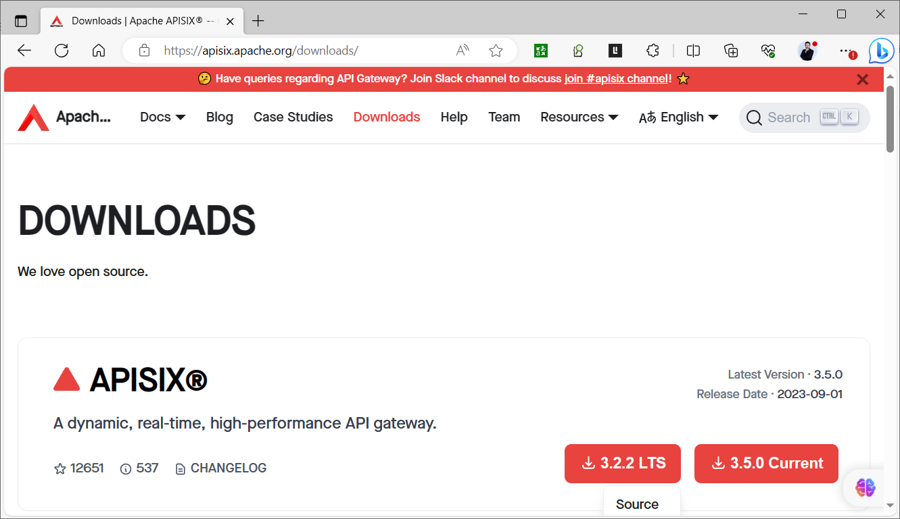
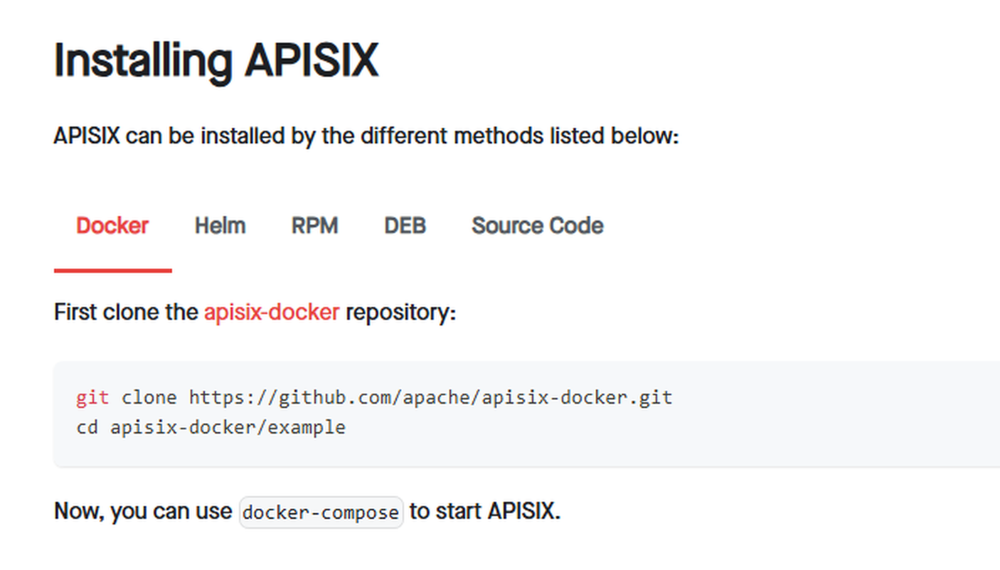
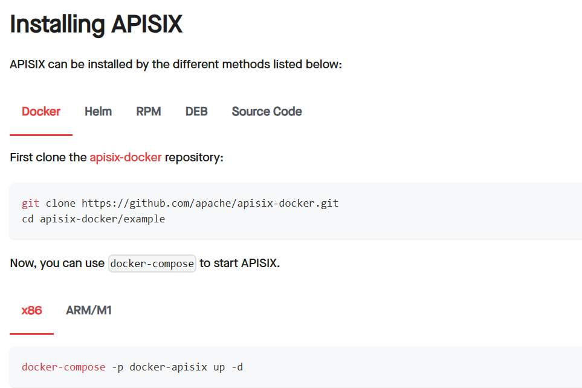
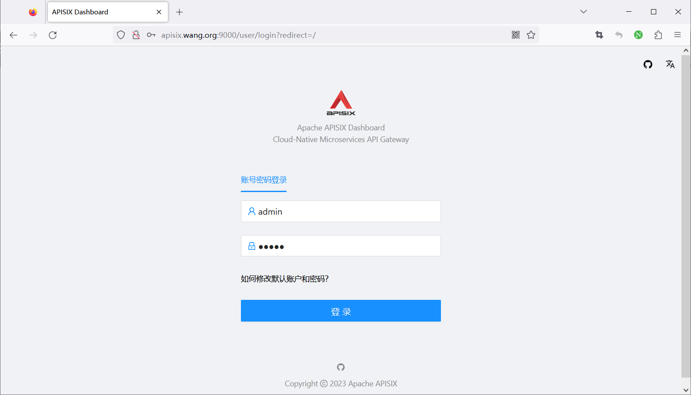
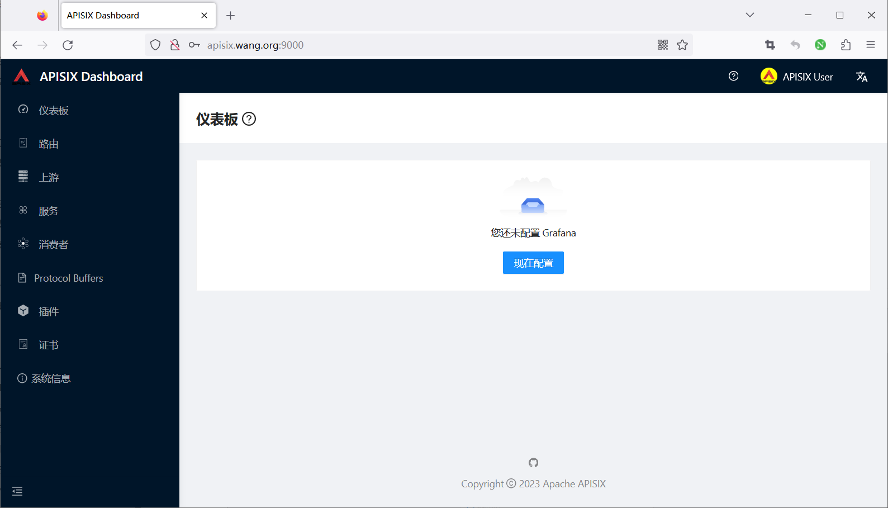

[← 返回微服务架构目录]({{ '/subjects/Microservices/' | relative_url }})



# 39 APISIX 安装

APISIX 的代理进程处理请求，etcd 保存和分发动态配置；Dashboard 是**可选的管理界面**，不是代理处理流量的必需组件。安装前先选择 APISIX 版本，再核对对应的 etcd、Dashboard 或 Ingress Controller 兼容版本。原资料把 3.0、3.5、3.6、3.7 的输出混排，并把“每月发布”“安装 LTS”写成通用规律；实际支持周期应以[官方发布与安装文档](https://apisix.apache.org/docs/apisix/installation-guide/)为准。




## 先认清端口与连接

原实验的常见端口如下，实际值以 `conf/config.yaml` 为准：

| 端口 | 作用 | 建议访问范围 |
| --- | --- | --- |
| 9080 | HTTP 代理入口，业务客户端请求 | 按业务暴露 |
| 9443 | HTTPS 代理入口 | 按业务暴露 |
| 9180 | Admin API，用于写入路由等配置 | 仅管理网络 |
| 2379 | etcd 客户端接口 | 仅 APISIX 和管理组件 |
| 2380 | etcd 节点间通信 | 仅 etcd 集群 |

Dashboard 若独立运行，还会有自己的管理端口，例如旧版示例的 9000。**Admin API 与 etcd 不能因为“方便调试”直接对公网开放**；应设置强密钥、网络访问控制、TLS 和审计。代理入口有响应不代表 etcd 正常或 Admin API 可写，还需要分别验证。

## 方式一：系统包安装

在目标操作系统上先按照当前官方文档安装受支持的 etcd，再添加对应发行版和架构的 APISIX 软件源。原资料把 Debian Bullseye 的源行直接写入 Ubuntu，并用已弃用的 `apt-key`，不宜照抄。安装顺序可以概括为：

1. 从官方发布页选定 APISIX、etcd 的确切版本及签名/校验和。
2. 配置目标发行版对应的软件源，或下载发行包并验证。
3. 配置 etcd 为受控地址并检查 `etcdctl endpoint health`。
4. 在 `conf/config.yaml` 指定 etcd 端点、代理监听、Admin API 地址与密钥。
5. 执行 `apisix init`、`apisix test`。先用 `systemctl cat apisix.service` 确认安装包是否提供服务单元；有则交给 systemd 管理，没有则按该版本文档用 APISIX CLI 管理，不能混用两套启动方式。

```bash
apisix init
apisix test
# 以下两条仅适用于已安装 apisix.service 的系统包
systemctl enable --now apisix
systemctl status apisix
ss -lntp | grep -E '9080|9180|9443'
curl -I http://127.0.0.1:9080/
```

未配置路由时代理入口返回 404 也可能表示进程正常；要进一步创建测试路由并访问后端，才能确认整个链路。不要执行原记录的 `apisix stop|quit`：它是错误的 Shell 管道写法；可按需单独使用 `apisix stop` 或 `apisix quit`。也不要在使用 systemd 管理同一实例时再手工 `apisix start`，以免重复进程。

### etcd 与系统服务

单节点 etcd 可用于学习，但它本身是配置存储单点。正式环境应按 etcd 的集群、备份、TLS 与磁盘要求部署，再让 APISIX 指向可靠端点。原资料的 `nohup etcd` 和随后编写 systemd 服务是两个**替代方案**，不能两者同时启动占用 2379。验证时要检查 etcd 健康和 APISIX 日志中的配置同步，而不是只看两个端口监听。

### 源码构建什么时候需要

源码方式适合开发和定制，不是普通部署的默认步骤。若确实需要，应检出明确的版本标签、审查其依赖安装脚本、运行对应版本的测试与构建流程。原记录直接把远程 `install-dependencies.sh` 管道给 Shell，既无法固定脚本版本，也不便复现。

## 方式二：Docker 与 Compose

容器部署同样需要 APISIX 与 etcd。官方 [apisix-docker](https://github.com/apache/apisix-docker) 项目提供示例；使用时固定与 APISIX 版本对应的分支或提交，先读懂 `apisix_conf/config.yaml` 和 Compose 文件，再执行：

```bash
docker compose -f example/docker-compose.yml config
docker compose -f example/docker-compose.yml up -d
docker compose -f example/docker-compose.yml ps
docker compose -f example/docker-compose.yml logs apisix etcd
```

`config` 先检查 YAML 缩进、环境变量和服务定义；`ps` 与日志再检查运行态。项目名不同会影响容器名，查看时使用同一 `-p` 选项即可，没必要因为容器名不同就重建实例。

原资料的远程 quickstart 脚本在历史版本中会删除同名容器，并为了演示关闭 Admin API key、放宽管理地址；它适合作为**隔离实验环境的源码阅读材料**，不应直接放进现有主机或生产网络执行。容器示例里的 `ALLOW_NONE_AUTHENTICATION=yes` 也是开发环境 etcd 选项；正式环境应限制网络并启用适当认证与备份。



旧的 apisix-docker 示例曾包含 `apache/apisix-dashboard:3.0.1-alpine`，后来的示例已移除该服务。不要为了得到旧 Dashboard 就对当前仓库执行 `git reset --hard` 并继续混用新版 APISIX：这样会把一组版本不匹配的配置硬拼在一起。第 41 篇会单独说明 Dashboard 的兼容性和验证步骤。




## 方式三：Kubernetes / Helm

Helm 适合在 Kubernetes 中安装并管理 APISIX，但 chart 版本、etcd 部署方式、Ingress Controller 与 Dashboard 是否安装应分别决定。先查看 chart 的版本和默认值，再覆盖镜像标签、Admin API 密钥、etcd 地址、代理 Service 类型与资源限制；不要直接以默认值当作生产配置：

```bash
helm repo add apisix https://charts.apiseven.com
helm repo update
helm search repo apisix/apisix --versions
helm show values apisix/apisix > apisix-values.yaml
# 编辑 values 后先渲染和检查，再安装
helm template apisix apisix/apisix -n apisix -f apisix-values.yaml > rendered.yaml
kubectl apply --dry-run=client -f rendered.yaml
helm install apisix apisix/apisix --create-namespace -n apisix -f apisix-values.yaml
```

最终验收要穿过三个层次：etcd 健康、APISIX 节点已加载配置、代理请求到达测试上游。下一篇再解释 `config.yaml` 和动态资源配置如何分工。



<nav class="article-end" aria-label="章节导航">
  <a href="{{ '/subjects/Microservices/38-introduction-to-apache-apisix.html' | relative_url }}">← 上一篇：Apache APISIX 介绍</a>
  <a href="{{ '/subjects/Microservices/' | relative_url }}">返回专题目录</a>
  <a href="{{ '/subjects/Microservices/40-apisix-configuration-management.html' | relative_url }}">下一篇：APISIX 配置管理 →</a>
</nav>
