[← Back to Microservices Index]({{ '/subjects/Microservices/' | relative_url }})



# 41 Installing and Using APISIX Dashboard
### 8.4 APISIX Dashboard 安装和使用

### APISIX Dashboard 说明

<https://apisix.apache.org/zh/docs/dashboard/USER_GUIDE/>

Apache APISIX Dashboard是基于WEB的可视化平台，用于监控、管理Apache APISIX

Apache APISIX Dashboard可以让用户尽可能直观、便捷地通过可视化界面操作Apache APISIX

通过Dashboard，我们能够:

创建并管理服务、上游、路由、应用、证书全局插件等模块配合内置的80多种插件，可精细化控制流量支持配置自定义插件围绕API全生命周期管理提供解决方案，通过持续地更新、升级，更好地为用户赋能兼容OpenAPI 3.0，支持路由的导入、导出

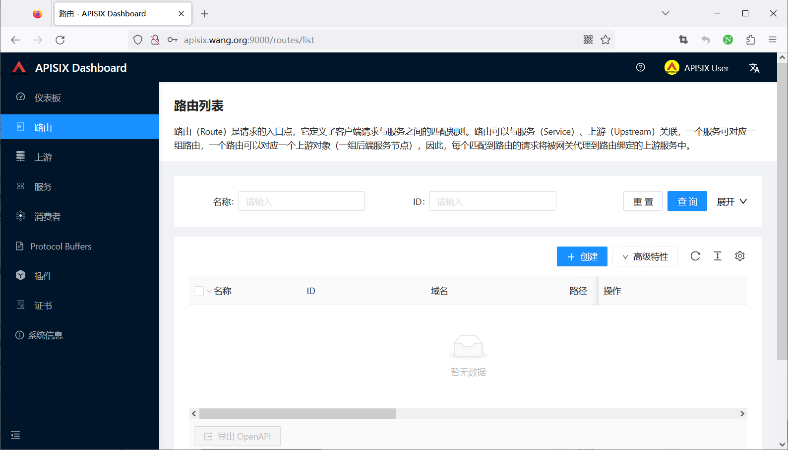

APISIX  和 APISIX Dashboard 及ETCD

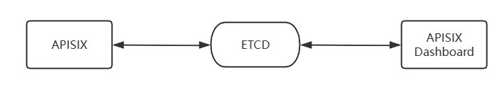

### 安装 APISIX Dashboard

<https://apisix.apache.org/zh/docs/dashboard/install/>

支持多种安装方法

Docker RPM包安装，不支持Debian 源码编译安装

### Docker 安装

<https://apisix.apache.org/zh/docs/dashboard/install/#docker>

<https://hub.docker.com/r/apache/apisix-dashboard>

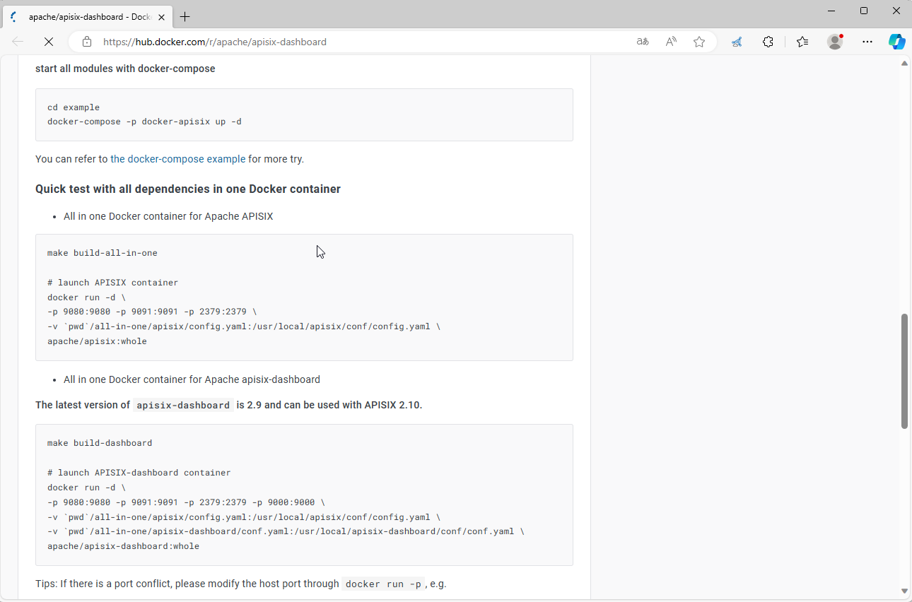

```text
docker pull apache/apisix-dashboard
docker run -d --name dashboard \
-p 9000:9000        \
-v <CONFIG_FILE>:/usr/local/apisix-dashboard/conf/conf.yaml \
apache/apisix-dashboard
```

范例：基于Docker部署APISIX Dashboard和基于二进制包安装的APISIX

```bash
#拉取镜像
[root@ubuntu2204 ~]#apt update && apt -y instasll docker.io
[root@ubuntu2204 ~]#docker pull registry.cn-beijing.aliyuncs.com/bowenxiaochun/apisix-dashboard:3.0.1-alpine
[root@ubuntu2204 ~]#docker pull apache/apisix-dashboard:3.0.1-alpine
#直接启动容器会有问题
[root@ubuntu2204 ~]#docker run -d --name apisix-dashboard  registry.cn-
beijing.aliyuncs.com/bowenxiaochun/apisix-dashboard:3.0.1-alpine
[root@ubuntu2204 ~]#docker run -d --name apisix-dashboard apache/apisix-dashboard:3.0.1-alpine
0d6960d8c0d0e6ec2c039cb934b51740a0aabfbc4a329b6aef3115ed1eae005c
#默认无法连接本地的etcd
[root@ubuntu2204 ~]#docker logs  apisix-dashboard
{"level":"warn","ts":"2023-12-06T03:06:10.361Z","logger":"etcd-
client","caller":"v3@v3.5.5/retry_interceptor.go:62","msg":"retrying of unary invoker failed","target":"etcd-
endpoints://0xc0000efa40/127.0.0.1:2379","attempt":0,"error":"rpc error: code = DeadlineExceeded desc = latest
balancer error: last connection error: connection error: desc = \"transport: Error while dialing dial tcp
127.0.0.1:2379: connect: connection refused\""}
Error: etcd get failed: context deadline exceeded
Usage:
manager-api [flags]
manager-api [command]
Available Commands:
completion  Generate the autocompletion script for the specified shell
help        Help about any command
version     show manager-api version
Flags:
-c, --config string     config file
-h, --help              help for manager-api
-p, --work-dir string   current work directory (default ".")
Use "manager-api [command] --help" for more information about a command.
etcd get failed: context deadline exceeded
#使用宿主机网络启动，连接宿主机的ETCD
[root@ubuntu2204 ~]#docker run -d --network host --name apisix-dashboard registry.cn-
beijing.aliyuncs.com/bowenxiaochun/apisix-dashboard:3.0.1-alpine
[root@ubuntu2204 ~]#docker run -d --network host --name apisix-dashboard apache/apisix-dashboard:3.0.1-alpine
#查看日志
[root@ubuntu2204 ~]#docker logs  apisix-dashboard
The manager-api is running successfully!
Version : 3.0.1
GitHash : 397c0cb5
Config File: /usr/local/apisix-dashboard/conf/conf.yaml
Listen  : 0.0.0.0:9000
Loglevel: warn
ErrorLogFile: /usr/local/apisix-dashboard/logs/error.log
AccessLogFile: /usr/local/apisix-dashboard/logs/access.log
[root@ubuntu2204 ~]#docker ps
CONTAINER ID   IMAGE                                  COMMAND                   CREATED              STATUS
PORTS     NAMES
d6f896595e2c   apache/apisix-dashboard:3.0.1-alpine   "/usr/local/apisix-d…"   About a minute ago   Up About a
minute             apisix-dashboard
#默认不允许远程访问apix dashboard，只允许本地127.0.0.1访问
[root@ubuntu2204 ~]#curl http://10.0.0.200:9000/
{"Code":20002,"Message":"IP address not allowed","Data":null,"SourceSrv":""}
[root@ubuntu2204 ~]#curl http://127.0.0.1:9000/ -I
HTTP/1.1 200 OK
Accept-Ranges: bytes
Content-Length: 6712
Content-Security-Policy: default-src 'self'; script-src 'self' 'unsafe-eval' 'unsafe-inline'; style-src 'self'
'unsafe-inline'; img-src 'self' data:
Content-Type: text/html; charset=utf-8
Last-Modified: Wed, 12 Apr 2023 02:49:17 GMT
X-Frame-Options: deny
X-Request-Id: 0a5814e9-2f89-41fc-a8dc-58b305d0c636
Date: Mon, 16 Dec 2024 03:56:08 GMT
#生成dashboard配置文件
#方法1：从容器出提取conf.yaml文件
[root@ubuntu2204 ~]#docker cp apisix-dashboard:/usr/local/apisix-dashboard/conf/conf.yaml .
[root@ubuntu2204 ~]#vim conf.yaml
......
conf:
listen:
host: 0.0.0.0     #`manager api` listening ip or host name
port: 9000          #`manager api` listening port
allow_list:           #If we don't set any IP list, then any IP access is allowed by default.
- 0.0.0.0/0         #修改此行，开放远程访问
#方法2：从github网络下载旧版conf.yaml，注意：新版没有此文件
[root@ubuntu2204 ~]#wget https://github.com/apache/apisix-docker/archive/refs/heads/release/apisix-2.15.0.zip
[root@ubuntu2204 ~]#unzip apisix-2.15.0.zip
[root@ubuntu2204 ~]#cp apisix-docker-master/example/dashboard_conf/conf.yaml .
#修改dashboard配置文件
[root@ubuntu2204 ~]#vim conf.yaml
......
conf:
listen:
host: 0.0.0.0     #`manager api` listening ip or host name
port: 9000          #`manager api` listening port
allow_list:           #If we don't set any IP list, then any IP access is allowed by default.
- 0.0.0.0/0         #开放远程访问
etcd:
endpoints:          #supports defining multiple etcd host addresses for an etcd cluster
#- "http://etcd:2379"     #原内容
- "http://127.0.0.1:2379" #修改此行
......
[root@ubuntu2204 ~]#docker rm -f apisix-dashboard
#用修改过的配置覆盖容器内的原有的配置
#阿里镜像仓库
[root@ubuntu2204 ~]#docker run -d --network host --name apisix-dashboard -v ./conf.yaml:/usr/local/apisix-
dashboard/conf/conf.yaml  registry.cn-beijing.aliyuncs.com/bowenxiaochun/apisix-dashboard:3.0.1-alpine
#官方镜像仓库
[root@ubuntu2204 ~]#docker run -d --network host --name apisix-dashboard -v ./conf.yaml:/usr/local/apisix-
dashboard/conf/conf.yaml  apache/apisix-dashboard:3.0.1-alpine
```

范例: 基于 quickstart 脚本安装 apisix 基础上安装 apisix dashboard

```bash
[root@ubuntu2204 ~]#git clone https://github.com/apache/apisix-docker.git
[root@ubuntu2204 ~]#cd apisix-docker/
[root@ubuntu2204 apisix-docker]#ls
all-in-one  compose  dashboard  debian  debian-dev  docs  example  LICENSE  MAINTAINING.md  Makefile
README.md  redhat
[root@ubuntu2204 apisix-docker]#cd example/
[root@ubuntu2204 example]#ls
apisix_conf     docker-compose-arm64.yml       docker-compose.yml  grafana_conf  prometheus_conf
dashboard_conf  docker-compose-standalone.yml  etcd_conf           mkcert        upstream
[root@ubuntu2204 example]#cat dashboard_conf/conf.yaml
#
#Licensed to the Apache Software Foundation (ASF) under one or more
#contributor license agreements.  See the NOTICE file distributed with
#this work for additional information regarding copyright ownership.
#The ASF licenses this file to You under the Apache License, Version 2.0
#(the "License"); you may not use this file except in compliance with
#the License.  You may obtain a copy of the License at
#
#   http://www.apache.org/licenses/LICENSE-2.0
#
#Unless required by applicable law or agreed to in writing, software
#distributed under the License is distributed on an "AS IS" BASIS,
#WITHOUT WARRANTIES OR CONDITIONS OF ANY KIND, either express or implied.
#See the License for the specific language governing permissions and
#limitations under the License.
#
conf:
listen:
host: 0.0.0.0     #`manager api` listening ip or host name
port: 9000          #`manager api` listening port
allow_list:           #If we don't set any IP list, then any IP access is allowed by default.
- 0.0.0.0/0
etcd:
endpoints:          #supports defining multiple etcd host addresses for an etcd cluster
- "http://etcd:2379"
#yamllint disable rule:comments-indentation
#etcd basic auth info
#username: "root"    #ignore etcd username if not enable etcd auth
#password: "123456"  #ignore etcd password if not enable etcd auth
mtls:
key_file: ""          #Path of your self-signed client side key
cert_file: ""         #Path of your self-signed client side cert
ca_file: ""           #Path of your self-signed ca cert, the CA is used to sign callers' certificates
#prefix: /apisix     #apisix config's prefix in etcd, /apisix by default
log:
error_log:
level: warn       #supports levels, lower to higher: debug, info, warn, error, panic, fatal
file_path:
logs/error.log  #supports relative path, absolute path, standard output
#such as: logs/error.log, /tmp/logs/error.log, /dev/stdout, /dev/stderr
access_log:
file_path:
logs/access.log  #supports relative path, absolute path, standard output
#such as: logs/access.log, /tmp/logs/access.log, /dev/stdout, /dev/stderr
#log example: 2020-12-09T16:38:09.039+0800 INFO    filter/logging.go:46
/apisix/admin/routes/r1 {"status": 401, "host": "127.0.0.1:9000", "query": "asdfsafd=adf&a=a", "requestId":
"3d50ecb8-758c-46d1-af5b-cd9d1c820156", "latency": 0, "remoteIP": "127.0.0.1", "method": "PUT", "errs": []}
security:
#access_control_allow_origin: "http://httpbin.org"
#access_control_allow_credentials: true          #support using custom cors configration
#access_control_allow_headers: "Authorization"
#access_control-allow_methods: "*"
#x_frame_options: "deny"
content_security_policy: "default-src 'self'; script-src 'self' 'unsafe-eval' 'unsafe-inline'; style-src
'self' 'unsafe-inline'; frame-src *"  #You can set frame-src to provide content for your grafana panel.
authentication:
secret:
secret              #secret for jwt token generation.
#NOTE: Highly recommended to modify this value to protect `manager api`.
#if it's default value, when `manager api` start, it will generate a random string to
replace it.
expire_time: 3600     #jwt token expire time, in second
users:                #yamllint enable rule:comments-indentation
- username: admin   #username and password for login `manager api`
password: admin
- username: user
password: user
plugins:                          #plugin list (sorted in alphabetical order)
- api-breaker
- authz-keycloak
- basic-auth
- batch-requests
- consumer-restriction
- cors
#- dubbo-proxy
- echo
#- error-log-logger
#- example-plugin
- fault-injection
- grpc-transcode
- hmac-auth
- http-logger
- ip-restriction
- jwt-auth
- kafka-logger
- key-auth
- limit-conn
- limit-count
- limit-req
#- log-rotate
#- node-status
- openid-connect
- prometheus
- proxy-cache
- proxy-mirror
- proxy-rewrite
- redirect
- referer-restriction
- request-id
- request-validation
- response-rewrite
- serverless-post-function
- serverless-pre-function
#- skywalking
- sls-logger
- syslog
- tcp-logger
- udp-logger
- uri-blocker
- wolf-rbac
- zipkin
- server-info
- traffic-split
#创建配置文件
[root@ubuntu2204 ~]#cp apisix-docker/example/dashboard_conf/conf.yaml /tmp/conf.yaml
#修改配置文件
[root@ubuntu2204 ~]#vim /tmp/conf.yaml
......
conf:
listen:
host: 0.0.0.0     #`manager api` listening ip or host name
port: 9000          #`manager api` listening port
allow_list:           #If we don't set any IP list, then any IP access is allowed by default.
- 0.0.0.0/0
etcd:
endpoints:          #supports defining multiple etcd host addresses for an etcd cluster
- "http://etcd-quickstart:2379"  #修改此行的etcd地址,此处使用2.3节的docker脚本安装,所以指定etcd服务对应容器的名称
#- "http://127.0.0.1:2379"       #如果是2.2的二进制包安装,修改为此处配置
......
#如果APISIX是基于2.3的docker脚本安装,执行下面
[root@ubuntu2204 ~]#docker run -d --network apisix-quickstart-net --name dashboard  -p 9000:9000  -v
/tmp/conf.yaml:/usr/local/apisix-dashboard/conf/conf.yaml   apache/apisix-dashboard
#确认容器启动
[root@ubuntu2204 ~]#docker ps
CONTAINER ID   IMAGE                        COMMAND                  CREATED         STATUS         PORTS
NAMES
b9feff96bc1d   apache/apisix-dashboard      "/usr/local/apisix-d…"   7 minutes ago   Up 7 minutes
0.0.0.0:9000->9000/tcp, :::9000->9000/tcp
dashboard
20befff17ecc   apache/apisix:3.6.0-debian   "/docker-entrypoint.…"   2 hours ago     Up 2 hours
0.0.0.0:9080->9080/tcp, :::9080->9080/tcp, 0.0.0.0:9100->9100/tcp, :::9100->9100/tcp, 0.0.0.0:9180->9180/tcp,
:::9180->9180/tcp, 0.0.0.0:9443->9443/tcp, :::9443->9443/tcp, 0.0.0.0:9090->9092/tcp, :::9090->9092/tcp
apisix-quickstart
c132befe013c   bitnami/etcd:3.5.7           "/opt/bitnami/script…"   2 hours ago     Up 2 hours     2379-
2380/tcp
etcd-
quickstart
#如果APISIX是是基于2.2的二进制包安装，执行下面
[root@ubuntu2204 ~]#apt update && apt -y install docker.io
[root@ubuntu2204 ~]#docker run -d  --name dashboard  --network host  -v /tmp/conf.yaml:/usr/local/apisix-
dashboard/conf/conf.yaml   apache/apisix-dashboard
#确认容器启动
[root@ubuntu2204 ~]#docker ps
CONTAINER ID   IMAGE                     COMMAND                  CREATED         STATUS         PORTS
NAMES
398f521946ab   apache/apisix-dashboard   "/usr/local/apisix-d…"   2 minutes ago   Up 2 minutes
dashboard
#浏览器访问:默认用户名和密码都是admin
http://apisix.bowen.org:9000/
```


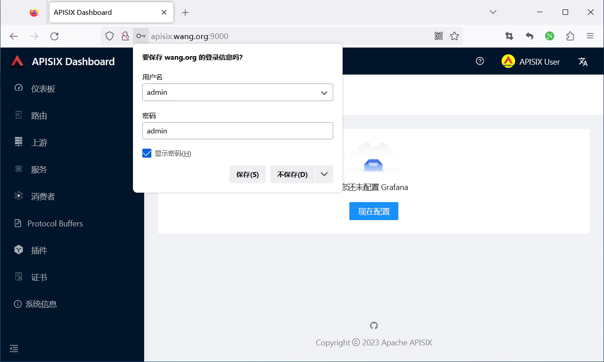

### RPM 二进制包安装

官方没有提供DEB包，只提供了RPM包，即只支持红帽系统的安装包

<https://apisix.apache.org/zh/docs/dashboard/install/#rpm)>

注意：此方法当前只支持 CentOS 7  和 8

范例

```text
#1. install RPM package
sudo yum install -y https://github.com/apache/apisix-dashboard/releases/download/v3.0.1/apisix-dashboard-
3.0.1-0.el7.x86_64.rpm
#run dashboard in the shell
sudo manager-api -p /usr/local/apisix/dashboard/
#or run dashboard as a service
systemctl start apisix-dashboard
#浏览器访问http://127.0.0.1:9000 默认用户名和密码都是admin
```

范例: 在Rocky8 安装 apisix-dashboard

```bash
#先安装ETCD和APISIX,参看2.2.1和2.2.3节
#安装
[root@rocky8 ~]#wget https://github.com/apache/apisix-dashboard/releases/download/v3.0.1/apisix-dashboard-
3.0.1-0.el8.x86_64.rpm
[root@rocky8 ~]#yum -y install apisix-dashboard-3.0.1-0.el8.x86_64.rpm
[root@rocky8 ~]#ls /usr/local/apisix/dashboard/
conf  dag-to-lua  html  logs  manager-api
[root@rocky8 ~]#ls /usr/local/apisix/dashboard/conf
conf.yaml  customize_schema.json  schema.json
#修改配置文件
[root@rocky8 ~]#cat /usr/local/apisix/dashboard/conf/conf.yaml
#
#Licensed to the Apache Software Foundation (ASF) under one or more
#contributor license agreements.  See the NOTICE file distributed with
#this work for additional information regarding copyright ownership.
#The ASF licenses this file to You under the Apache License, Version 2.0
#(the "License"); you may not use this file except in compliance with
#the License.  You may obtain a copy of the License at
#
## 8.   http://www.apache.org/licenses/LICENSE-2.0
#
#Unless required by applicable law or agreed to in writing, software
#distributed under the License is distributed on an "AS IS" BASIS,
#WITHOUT WARRANTIES OR CONDITIONS OF ANY KIND, either express or implied.
#See the License for the specific language governing permissions and
#limitations under the License.
#
#yamllint disable rule:comments-indentation
conf:
listen:
#host: 127.0.0.1     #the address on which the `Manager API` should listen.
#The default value is 0.0.0.0, if want to specify, please enable it.
#This value accepts IPv4, IPv6, and hostname.
port: 9000            #The port on which the `Manager API` should listen.
#ssl:
## 8. host: 127.0.0.1     #the address on which the `Manager API` should listen for HTTPS.
#The default value is 0.0.0.0, if want to specify, please enable it.
## 8. port: 9001            #The port on which the `Manager API` should listen for HTTPS.
## 8. cert: "/tmp/cert/example.crt" #Path of your SSL cert.
## 8. key:  "/tmp/cert/example.key"  #Path of your SSL key.
allow_list:             #If we don't set any IP list, then any IP access is allowed by default.
- 0.0.0.0/0           #修改此行,默认只允许本机访问
- 127.0.0.1           #The rules are checked in sequence until the first match is found.
- ::1                 #In this example, access is allowed only for IPv4 network 127.0.0.1, and for IPv6
network ::1.
#It also support CIDR like 192.168.1.0/24 and 2001:0db8::/32
etcd:
endpoints:            #supports defining multiple etcd host addresses for an etcd cluster
- 127.0.0.1:2379
#yamllint disable rule:comments-indentation
#etcd basic auth info
#username: "root"    #ignore etcd username if not enable etcd auth
#password: "123456"  #ignore etcd password if not enable etcd auth
mtls:
key_file: ""          #Path of your self-signed client side key
cert_file: ""         #Path of your self-signed client side cert
ca_file: ""           #Path of your self-signed ca cert, the CA is used to sign callers' certificates
#prefix: /apisix       #apisix config's prefix in etcd, /apisix by default
log:
error_log:
level: warn       #supports levels, lower to higher: debug, info, warn, error, panic, fatal
file_path:
logs/error.log  #supports relative path, absolute path, standard output
#such as: logs/error.log, /tmp/logs/error.log, /dev/stdout, /dev/stderr
#such as absolute path on Windows: winfile:///C:\error.log
access_log:
file_path:
logs/access.log  #supports relative path, absolute path, standard output
#such as: logs/access.log, /tmp/logs/access.log, /dev/stdout, /dev/stderr
#such as absolute path on Windows: winfile:///C:\access.log
#log example: 2020-12-09T16:38:09.039+0800 INFO    filter/logging.go:46
/apisix/admin/routes/r1 {"status": 401, "host": "127.0.0.1:9000", "query": "asdfsafd=adf&a=a", "requestId":
"3d50ecb8-758c-46d1-af5b-cd9d1c820156", "latency": 0, "remoteIP": "127.0.0.1", "method": "PUT", "errs": []}
max_cpu: 0             #supports tweaking with the number of OS threads are going to be used for
parallelism. Default value: 0 [will use max number of available cpu cores considering hyperthreading (if
any)]. If the value is negative, is will not touch the existing parallelism profile.
#security:
## 8. access_control_allow_origin: "http://httpbin.org"
## 8. access_control_allow_credentials: true          #support using custom cors configration
## 8. access_control_allow_headers: "Authorization"
## 8. access_control-allow_methods: "*"
## 8. x_frame_options: "deny"
## 8. content_security_policy: "default-src 'self'; script-src 'self' 'unsafe-eval' 'unsafe-inline'; style-
src 'self' 'unsafe-inline'; img-src 'self' data:; frame-src xx.xx.xx.xx:3000"  #You can set frame-src to
provide content for your grafana panel.
authentication:
secret:
secret              #secret for jwt token generation.
#NOTE: Highly recommended to modify this value to protect `manager api`.
#if it's default value, when `manager api` start, it will generate a random string to
replace it.
expire_time: 3600     #jwt token expire time, in second
users:                #yamllint enable rule:comments-indentation
- username: admin   #username and password for login `manager api`
password: admin
- username: user
password: user
oidc:
enabled: false
expire_time: 3600
client_id: dashboard
client_secret: dashboard
auth_url: http://172.17.0.1:8080/auth/realms/master/protocol/openid-connect/auth
token_url: http://172.17.0.1:8080/auth/realms/master/protocol/openid-connect/token
user_info_url: http://172.17.0.1:8080/auth/realms/master/protocol/openid-connect/userinfo
redirect_url: http://127.0.0.1:9000/apisix/admin/oidc/callback
scope: openid
plugins:
- api-breaker
- authz-casbin
- authz-casdoor
- authz-keycloak
- aws-lambda
- azure-functions
- basic-auth
#- batch-requests
- clickhouse-logger
- client-control
- consumer-restriction
- cors
- csrf
- datadog
#- dubbo-proxy
- echo
- error-log-logger
#- example-plugin
- ext-plugin-post-req
- ext-plugin-post-resp
- ext-plugin-pre-req
- fault-injection
- file-logger
- forward-auth
- google-cloud-logging
- grpc-transcode
- grpc-web
- gzip
- hmac-auth
- http-logger
- ip-restriction
- jwt-auth
- kafka-logger
- kafka-proxy
- key-auth
- ldap-auth
- limit-conn
- limit-count
- limit-req
- loggly
#- log-rotate
- mocking
#- node-status
- opa
- openid-connect
- opentelemetry
- openwhisk
- prometheus
- proxy-cache
- proxy-control
- proxy-mirror
- proxy-rewrite
- public-api
- real-ip
- redirect
- referer-restriction
- request-id
- request-validation
- response-rewrite
- rocketmq-logger
- server-info
- serverless-post-function
- serverless-pre-function
- skywalking
- skywalking-logger
- sls-logger
- splunk-hec-logging
- syslog
- tcp-logger
- traffic-split
- ua-restriction
- udp-logger
- uri-blocker
- wolf-rbac
- zipkin
- elasticsearch-logge
- openfunction
- tencent-cloud-cls
- ai
- cas-auth
[root@rocky8 ~]#systemctl status apisix-dashboard.service
```

● apisix-dashboard.service - apisix-dashboard

```bash
Loaded: loaded (/usr/lib/systemd/system/apisix-dashboard.service; static; vendor preset: disabled)
Active: active (running) since Tue 2023-11-07 13:54:09 CST; 5s ago
Main PID: 2032 (manager-api)
Tasks: 7 (limit: 11175)
Memory: 15.0M
CGroup: /system.slice/apisix-dashboard.service
└─2032 /usr/local/apisix/dashboard/manager-api -c /usr/local/apisix/dashboard/conf/conf.yaml
Nov 07 13:54:09 rocky8.bowen.org systemd[1]: apisix-dashboard.service: Dependency Conflicts=apisix-
dashboard.service dropped
Nov 07 13:54:09 rocky8.bowen.org systemd[1]: Started apisix-dashboard.
Nov 07 13:54:09 rocky8.bowen.org manager-api[2032]: The manager-api is running successfully!
Nov 07 13:54:09 rocky8.bowen.org manager-api[2032]: Version : 3.0.1
Nov 07 13:54:09 rocky8.bowen.org manager-api[2032]: GitHash : 397c0cb
Nov 07 13:54:09 rocky8.bowen.org manager-api[2032]: Config File: /usr/local/apisix/dashboard/conf/conf.yaml
Nov 07 13:54:09 rocky8.bowen.org manager-api[2032]: Listen  : 0.0.0.0:9000
Nov 07 13:54:09 rocky8.bowen.org manager-api[2032]: Loglevel: warn
Nov 07 13:54:09 rocky8.bowen.org manager-api[2032]: ErrorLogFile: /usr/local/apisix/dashboard/logs/error.log
Nov 07 13:54:09 rocky8.bowen.org manager-api[2032]: AccessLogFile: /usr/local/apisix/dashboard/logs/access.log
[root@rocky8 ~]#ss -ntlp|grep api
LISTEN 0      128                *:9000            *:*    users:(("manager-api",pid=2032,fd=10))
```

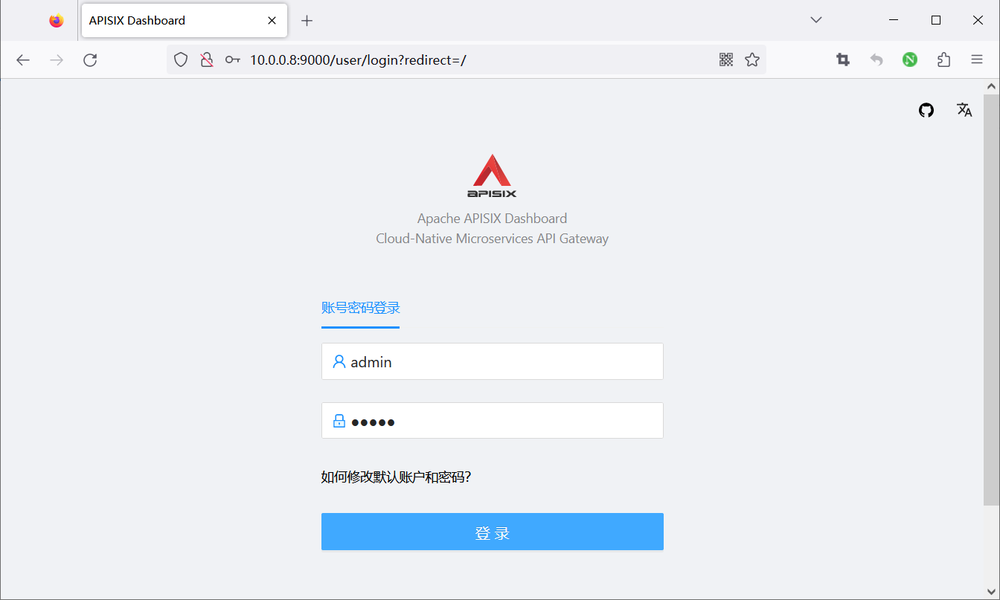

### 源码编译安装

The Dashboard project contains both manager-api and web , but web is optional.

The manager-api and web will be included in this build guide product.

8.4.2.3.1 Prerequisites

<https://apisix.apache.org/zh/docs/dashboard/install/#source-prerequisites>

Before using source codes to build, make sure that the following dependencies are installed in your environment.

For manager-api :

Golang 1.16+

Tip: For users in mainland China, you can use the following command to speed up the module downloads.

```text
$ go env -w GOPROXY=https://goproxy.cn,direct
```

For web :

Node.js current LTS (14.x+) Yarn

8.4.2.3.2 Download

```text
https://apisix.apache.org/zh/docs/dashboard/install/#source-download
git clone -b release/3.0 https://github.com/apache/apisix-dashboard.git && cd apisix-dashboard
```

8.4.2.3.3 Build

```text
https://apisix.apache.org/zh/docs/dashboard/install/#source-build
cd apisix-dashboard
make build
```

When the build is complete, the results are stored in the root output directory.

Note: make build will build manager-api and web , use the make help command to see more commands.

8.4.2.3.4 Launch

<https://apisix.apache.org/zh/docs/dashboard/install/#source-launch>

After the build is complete and before you start, make sure the following dependencies are installed and running in your environment. etcd 3.4.0+

1. Check and modify the configuration information in output/conf/conf.yaml according to your deployment environment.

2. Launch the Dashboard

```text
cd ./output
./manager-api
```

Without changing the configuration, visit http://127.0.0.1:9000 to use the dashboard with GUI, where the default username and password are admin .

8.4.2.3.5 Service

<https://apisix.apache.org/zh/docs/dashboard/install/#source-service>

You will need to handle your own service management when deploying using the source code compilation method. We provide a service file template for operating systems that use the Systemd service manager.

Install

```text
mkdir -p /usr/local/apisix-dashboard
cp -rf ./output/* /usr/local/apisix-dashboard
```

Create service unit

Copy the following or use this file directly, you need to copy it to the /usr/lib/systemd/system directory and execute the systemctl daemon-reload command.

```text
#copy service unit
cp ./api/service/apisix-dashboard.service /usr/lib/systemd/system/apisix-dashboard.service
systemctl daemon-reload
#or: If you need to modify the service unit, you can use the following command
echo "[Unit]
Description=apisix-dashboard
Conflicts=apisix-dashboard.service
After=network-online.target
[Service]
WorkingDirectory=/usr/local/apisix-dashboard
ExecStart=/usr/local/apisix-dashboard/manager-api -c /usr/local/apisix-dashboard/conf/conf.yaml" >
/usr/lib/systemd/system/apisix-dashboard.service
```

Manage service

You can use the following command to manage the service.

```text
#start apisix-dashboard
systemctl start apisix-dashboard
#stop apisix-dashboard
systemctl stop apisix-dashboard
#check apisix-dashboard status
systemctl status apisix-dashboard
```

### 基于APISIX Dashboard 管理路由

以下案例可以使用到一个测试网站 https://httpbin.org/ 和相关容器

<https://httpbin.org>

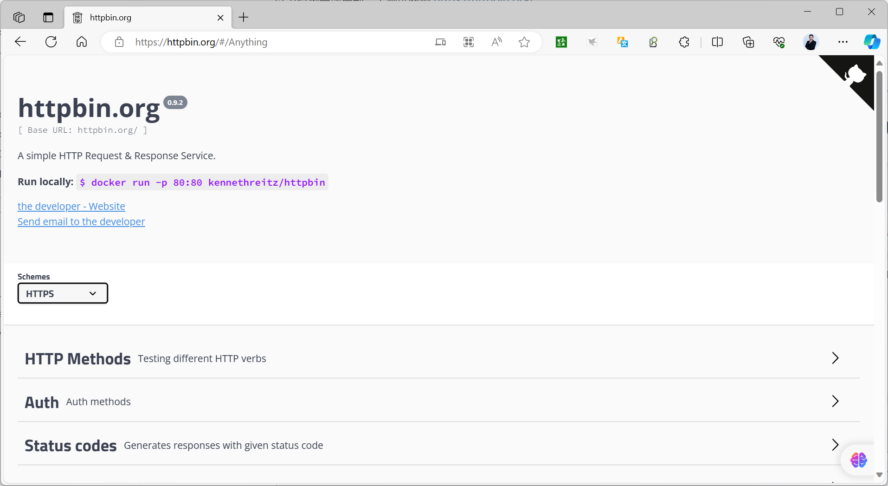

范例：基于httpbin.org网站测试HTTP请求访问

```text
#发起请求URL,可以观察到下面显示结果
https://httpbin.org/cookies/set/name/bowen
```

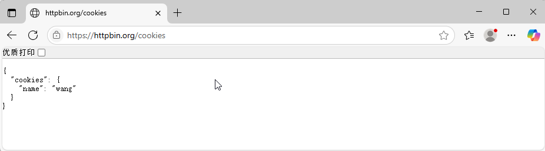

```json
[root@ubuntu2404 ~]#curl -X GET "https://httpbin.org/anything/class?name=bowenxiaochun"
{
"args": {
"name": "bowenxiaochun"
},
"data": "",
"files": {},
"form": {},
"headers": {
"Accept": "*/*",
"Host": "httpbin.org",
"User-Agent": "curl/8.5.0",
"X-Amzn-Trace-Id": "Root=1-6882f752-2acdcdcd7baad83e04634a47"
},
"json": null,
"method": "GET",
"origin": "219.142.151.32",
"url": "https://httpbin.org/anything/class?name=bowenxiaochun"
}
```

范例：容器方式运行

```bash
[root@ubuntu2204 ~]#docker run --name httpbin -d -p 80:80 registry.cn-
beijing.aliyuncs.com/bowenxiaochun/httpbin:2019
[root@ubuntu2204 ~]#docker run --name httpbin -d -p 80:80 kennethreitz/httpbin
Unable to find image 'kennethreitz/httpbin:latest' locally
latest: Pulling from kennethreitz/httpbin
473ede7ed136: Pull complete
c46b5fa4d940: Pull complete
93ae3df89c92: Pull complete
6b1eed27cade: Pull complete
0373952b589d: Pull complete
7b82cd0ee527: Pull complete
a36b2d884a89: Pull complete
Digest: sha256:599fe5e5073102dbb0ee3dbb65f049dab44fa9fc251f6835c9990f8fb196a72b
Status: Downloaded newer image for kennethreitz/httpbin:latest
[2023-12-06 03:45:33 +0000] [1] [INFO] Starting gunicorn 19.9.0
[2023-12-06 03:45:33 +0000] [1] [INFO] Listening at: http://0.0.0.0:80 (1)
[2023-12-06 03:45:33 +0000] [1] [INFO] Using worker: gevent
[2023-12-06 03:45:33 +0000] [9] [INFO] Booting worker with pid: 9
```

### 直接创建路由

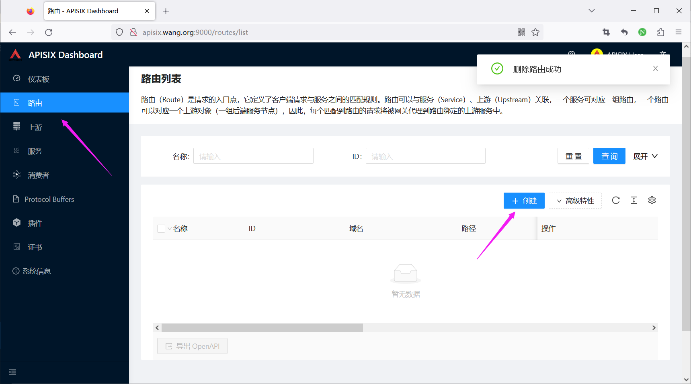

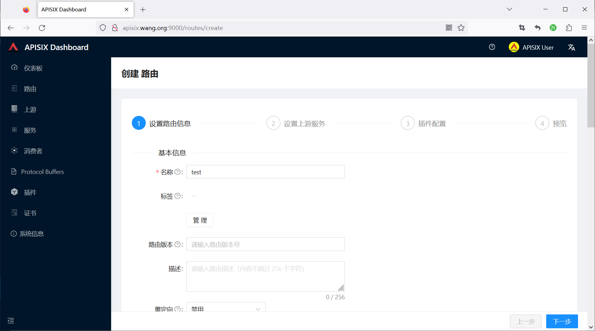

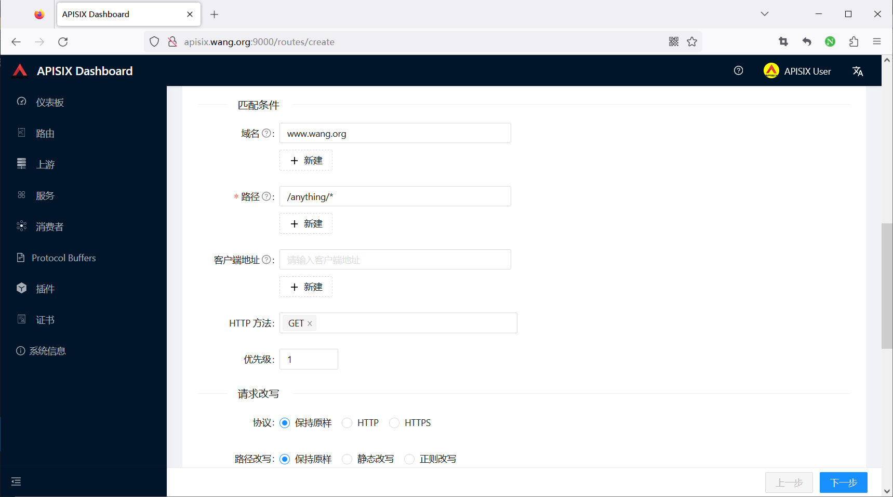

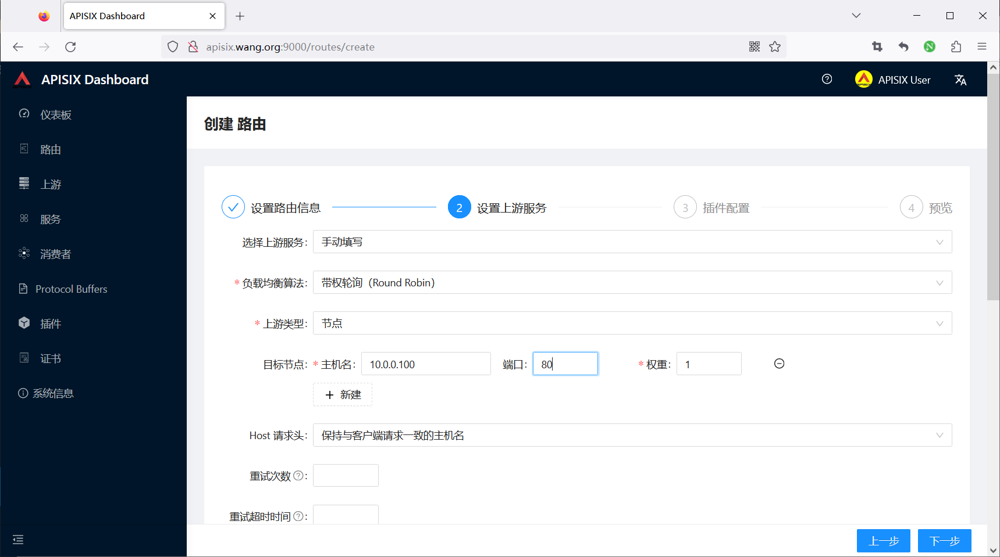

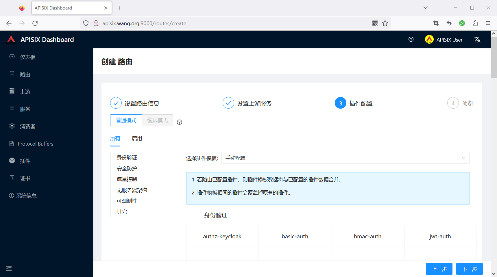

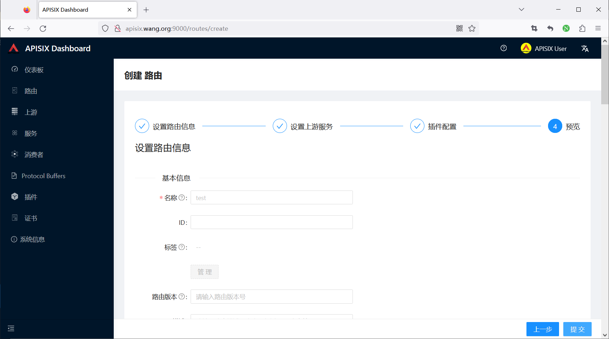

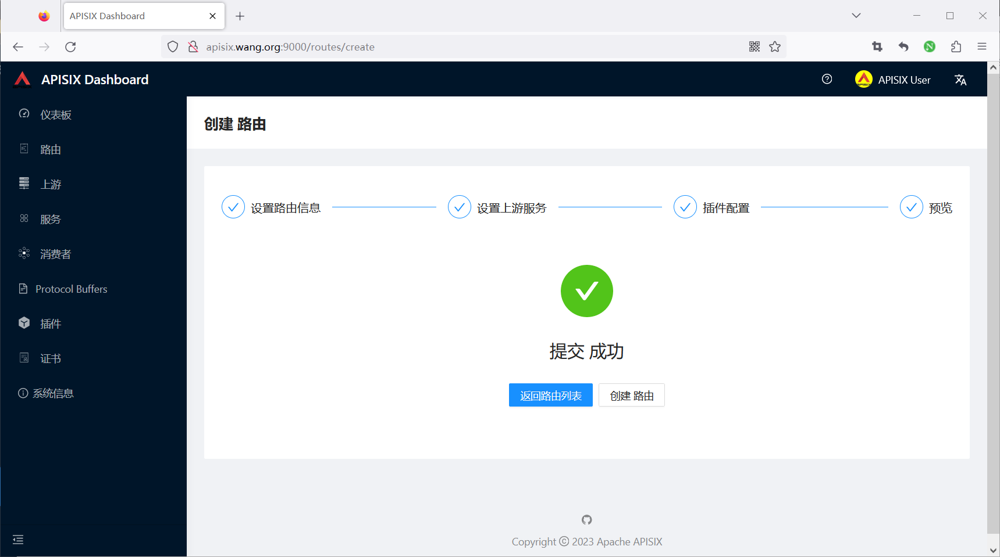

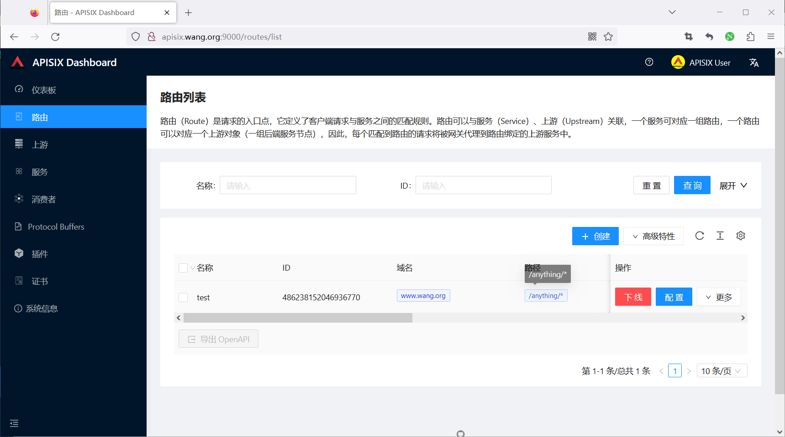

```json
#注意:先在10.0.0.100上开启服务
[root@ubuntu2204 ~]#docker run -d --name httpbin -p 80:80 registry.cn-
beijing.aliyuncs.com/bowenxiaochun/httpbin:2019
[root@ubuntu2204 ~]#docker run -d --name httpbin -p 80:80 kennethreitz/httpbin
#测试访问
[root@ubuntu2204 ~]#curl -XGET -H"host: www.bowen.org" http://127.0.0.1:9080/anything/bowen?name=18
{
"args": {
"name": "18"
},
"data": "",
"files": {},
"form": {},
"headers": {
"Accept": "*/*",
"Host": "www.bowen.org",
"User-Agent": "curl/7.81.0",
"X-Forwarded-Host": "www.bowen.org"
},
"json": null,
"method": "GET",
"origin": "172.20.0.1",
"url": "http://www.bowen.org/anything/bowen?name=18"
}
#在10.0.0.100上关闭服务,再访问可以看到下面显示结果
[root@ubuntu2204 ~]#curl -XGET -H"host: www.bowen.org" http://127.0.0.1:9080/anything/bowen?name=18
<html>
<head><title>502 Bad Gateway</title></head>
<body>
<center><h1>502 Bad Gateway</h1></center>
<hr><center>openresty</center>
<p><em>Powered by <a href="https://apisix.apache.org/">APISIX</a>.</em></p></body>
</html>
```

添加新的上游服务

```bash
#在10.0.0.101上开启服务
[root@ubuntu2204 ~]#docker run -p 80:80 kennethreitz/httpbin
```

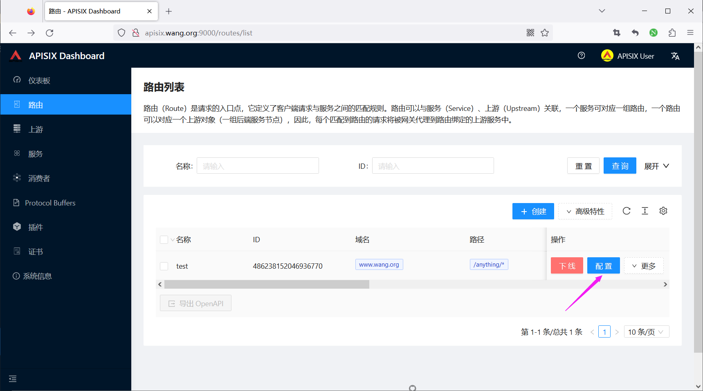

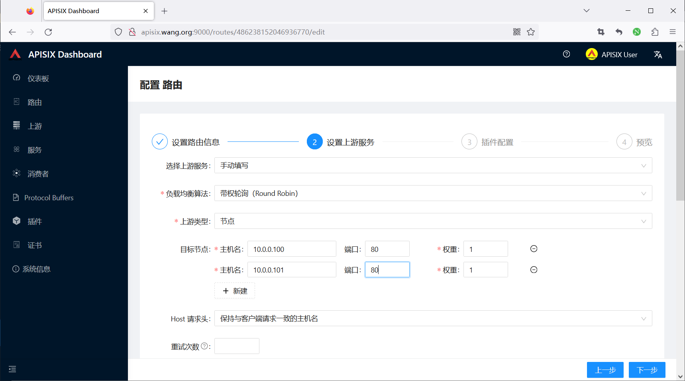

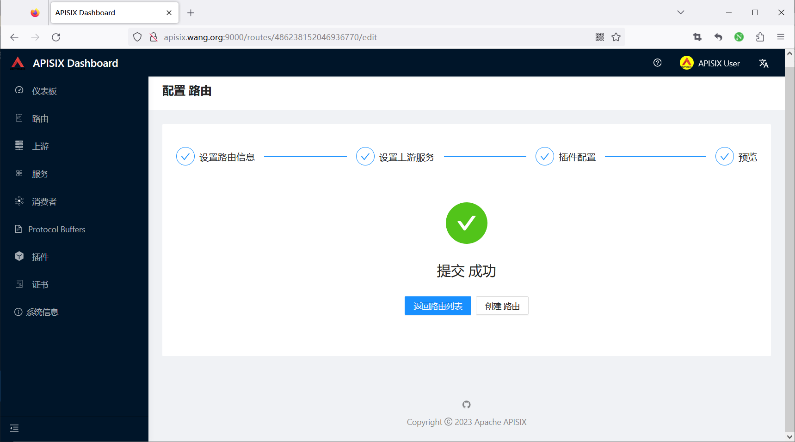

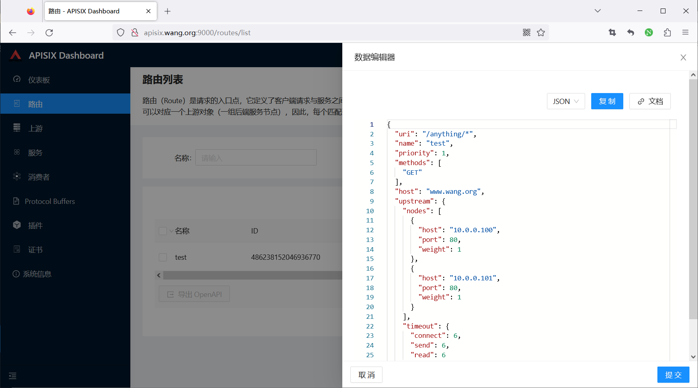

```json
#再次访问,如下显示
[root@ubuntu2204 ~]#curl -XGET -H"host: www.bowen.org" http://127.0.0.1:9080/anything/bowen?name=18
{
"args": {
"name": "18"
},
"data": "",
"files": {},
"form": {},
"headers": {
"Accept": "*/*",
"Host": "www.bowen.org",
"User-Agent": "curl/7.81.0",
"X-Forwarded-Host": "www.bowen.org"
},
"json": null,
"method": "GET",
"origin": "172.20.0.1",
"url": "http://www.bowen.org/anything/bowen?name=18"
}
```

### 基于 Upstream 创建路由

8.4.3.2.1 创建上游 Upstream

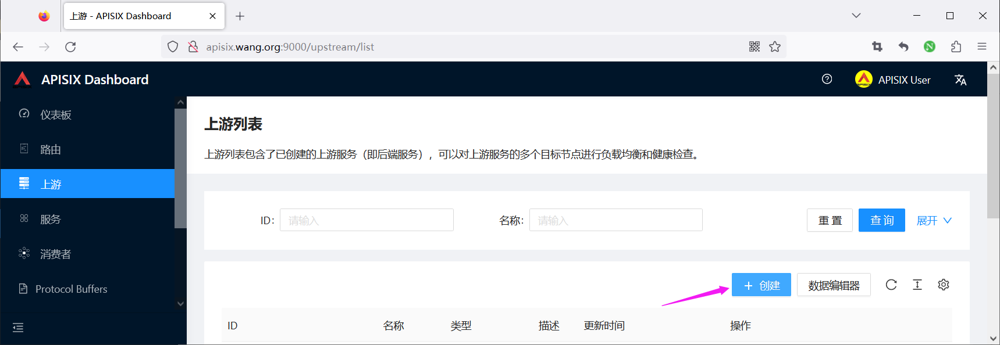

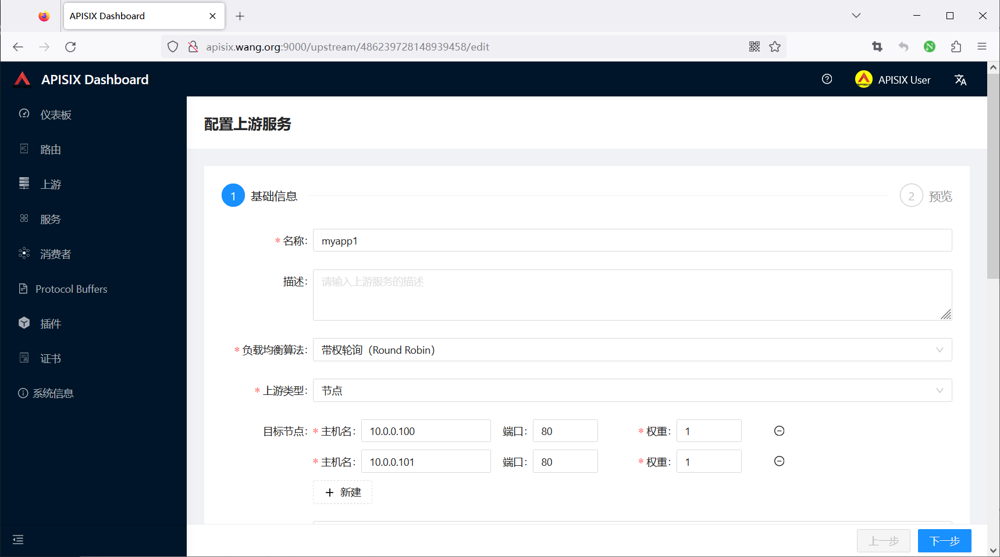

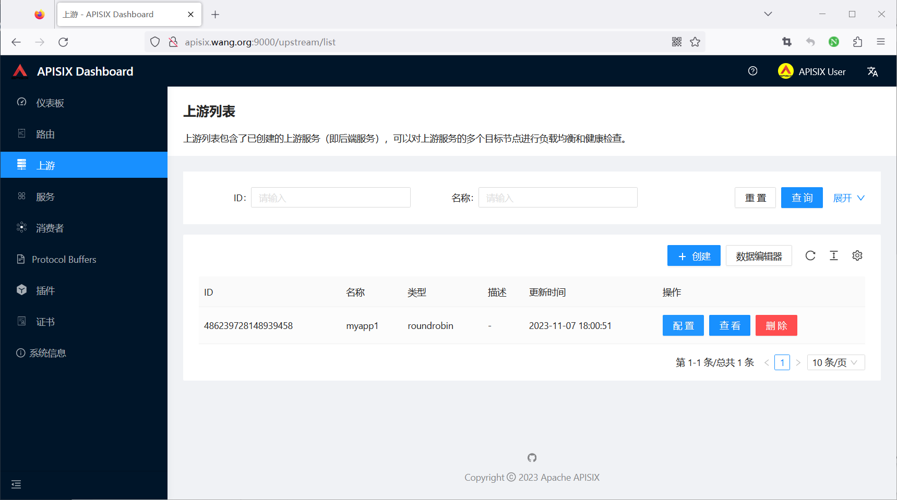

8.4.3.2.2 创建路由 Route

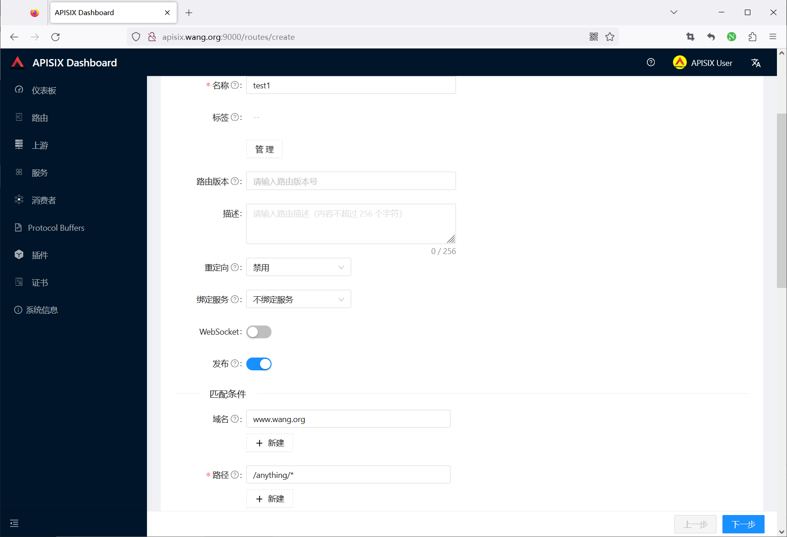

直接选择前面创建的upstream

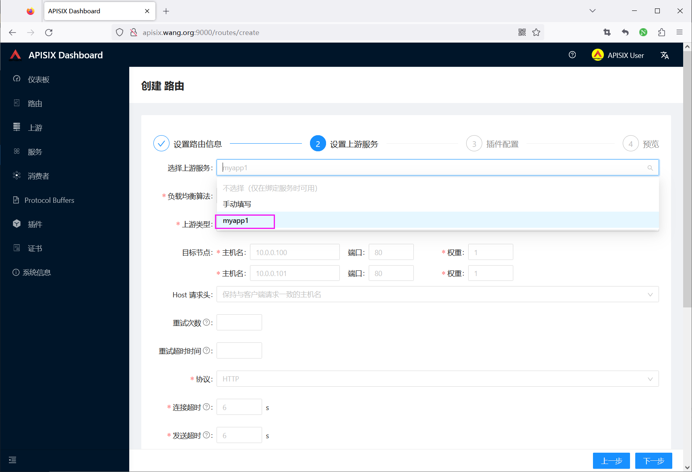

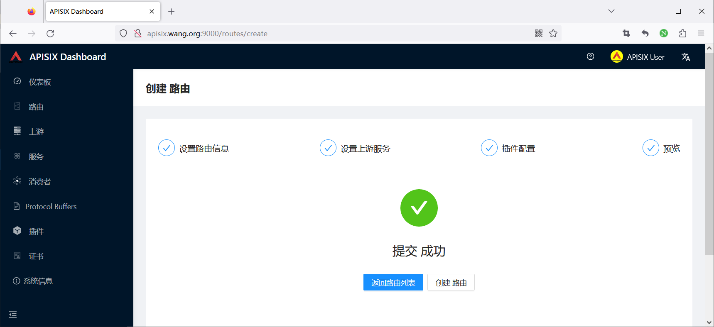

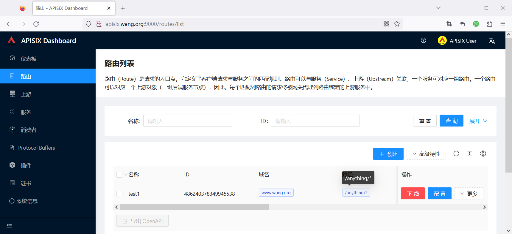

```json
#只要后台upstream主机开启服务,就可以看到下面显示
[root@ubuntu2204 ~]#curl -XGET -H"host: www.bowen.org" http://127.0.0.1:9080/anything/bowen?name=18
{
"args": {
"name": "18"
},
"data": "",
"files": {},
"form": {},
"headers": {
"Accept": "*/*",
"Host": "www.bowen.org",
"User-Agent": "curl/7.81.0",
"X-Forwarded-Host": "www.bowen.org"
},
"json": null,
"method": "GET",
"origin": "172.20.0.1",
"url": "http://www.bowen.org/anything/bowen?name=18"
}
#停止后面所有服务,再访问可看到下面提示
[root@ubuntu2204 ~]#curl -XGET -H"host: www.bowen.org" http://127.0.0.1:9080/anything/bowen?name=18
<html>
<head><title>502 Bad Gateway</title></head>
<body>
<center><h1>502 Bad Gateway</h1></center>
<hr><center>openresty</center>
<p><em>Powered by <a href="https://apisix.apache.org/">APISIX</a>.</em></p></body>
</html>
#测试错误的路由
[root@ubuntu2204 ~]#curl -XGET -H"host: www.bowen.com" http://127.0.0.1:9080/anything/bowen?name=18
{"error_msg":"404 Route Not Found"}
[root@ubuntu2204 ~]#curl -XGET -H"host: www.bowen.org" http://127.0.0.1:9080
{"error_msg":"404 Route Not Found"}
[root@ubuntu2204 ~]#curl -XGET -H"host: www.bowen.org" http://127.0.0.1:9080/anything
{"error_msg":"404 Route Not Found"}
```

### Grafana 展示

通过 docker-compose 安装内置 grafana展示

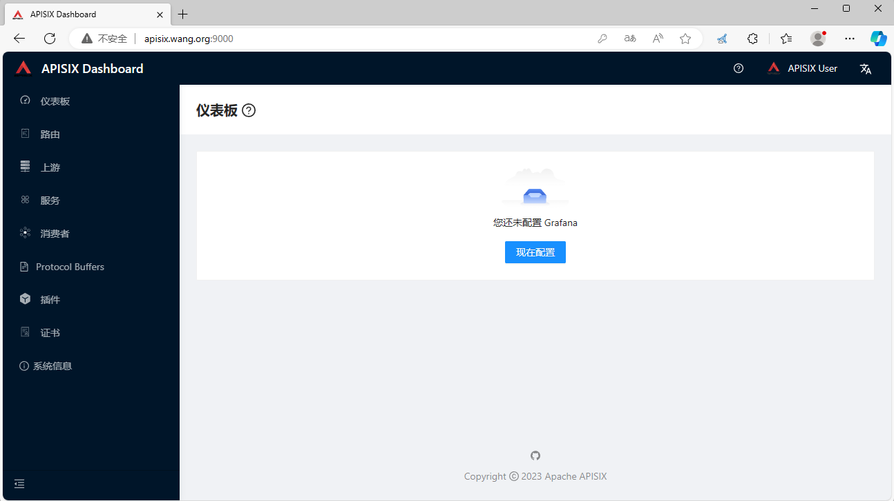

输入本机的IP，注意：不支持127.0.0.1

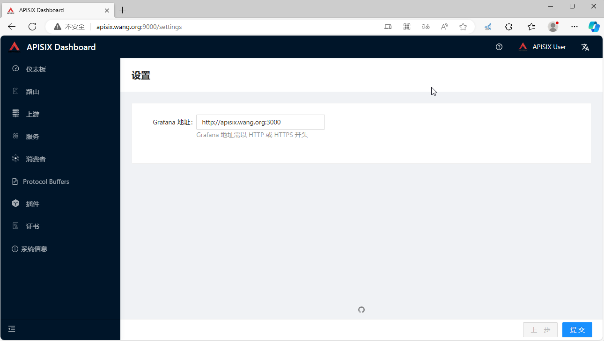

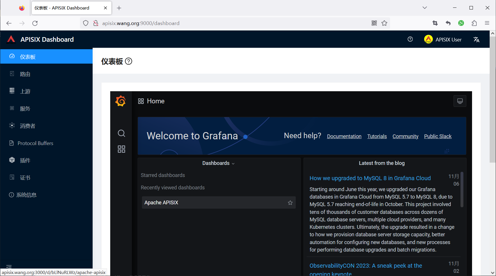

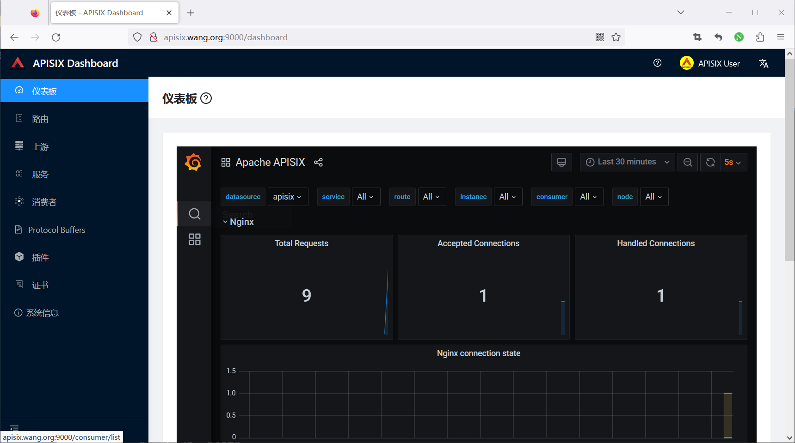

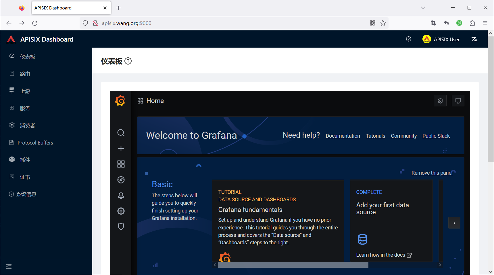

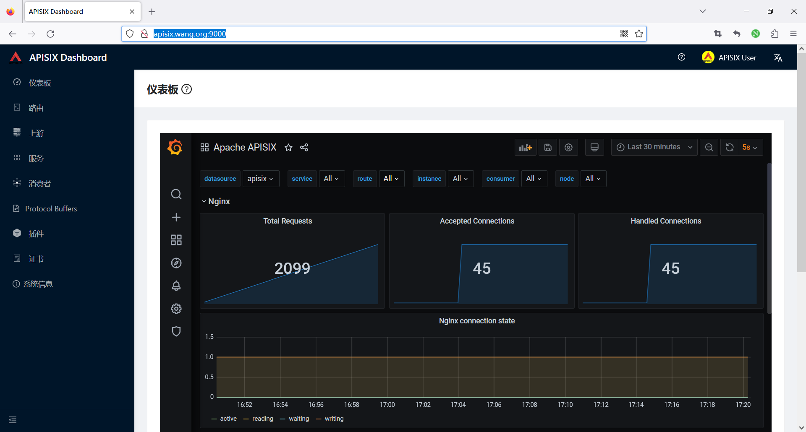



<nav class="article-end" aria-label="章节导航">
  <a href="{{ '/subjects/Microservices/40-apisix-configuration-management.html' | relative_url }}">← Previous: APISIX Configuration Management</a>
  <a href="{{ '/subjects/Microservices/' | relative_url }}">Back to Microservices Index</a>
  <a href="{{ '/subjects/Microservices/42-accessing-apisix-apis.html' | relative_url }}">Next: Accessing APISIX APIs →</a>
</nav>
