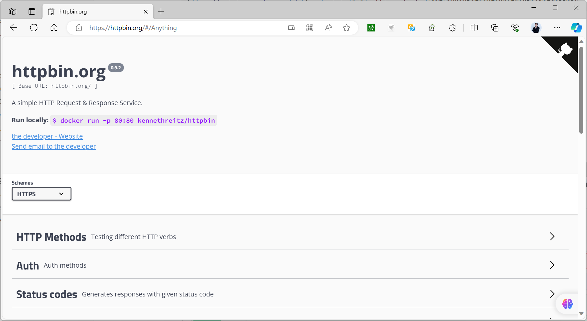
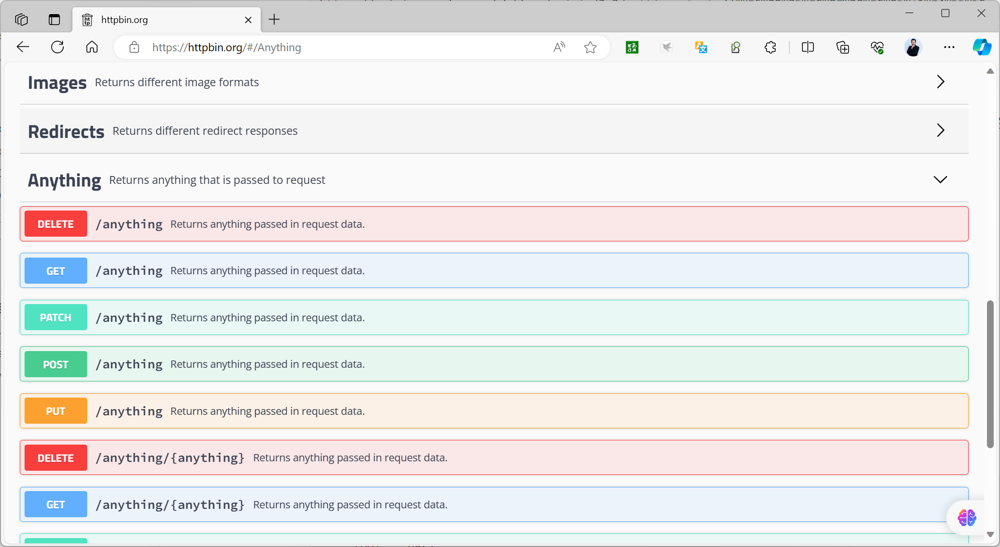
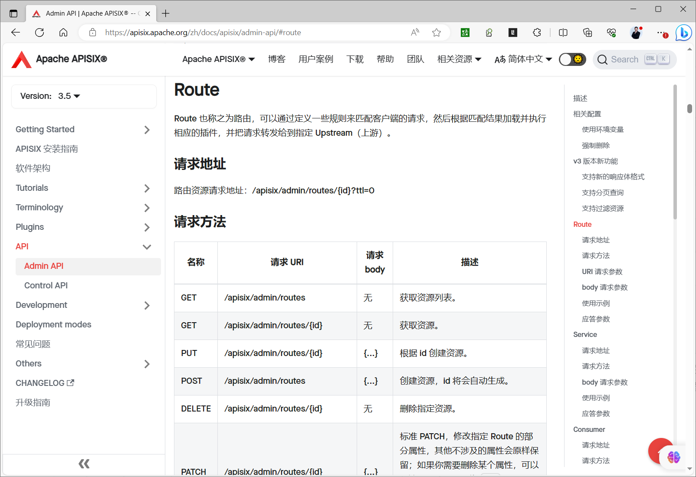
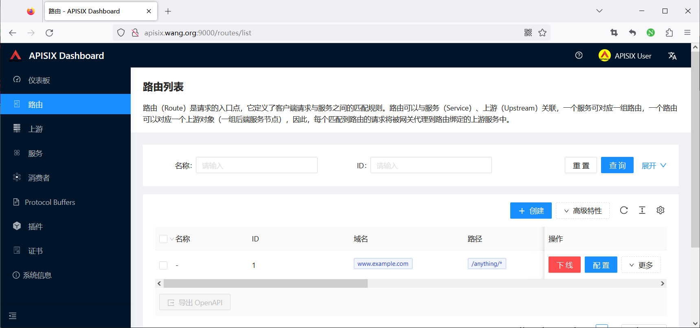
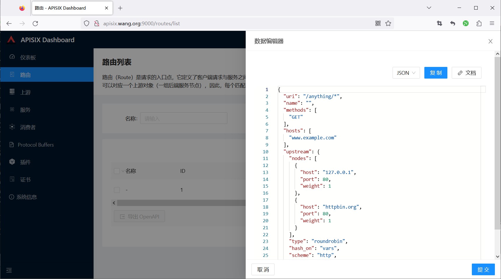
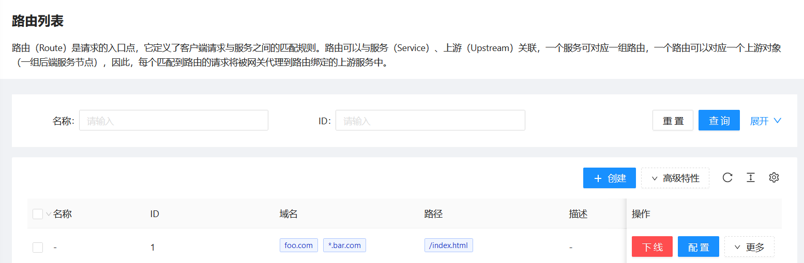
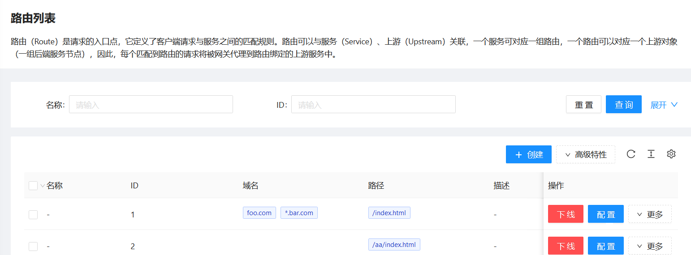
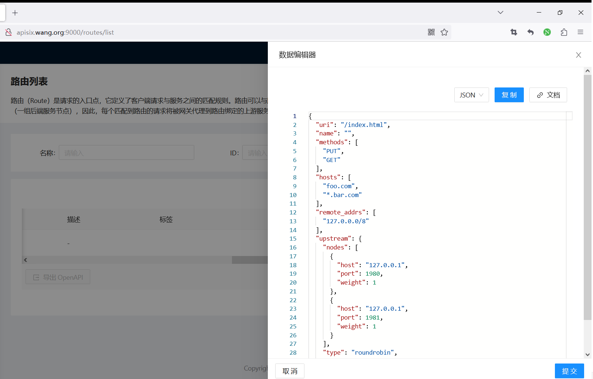
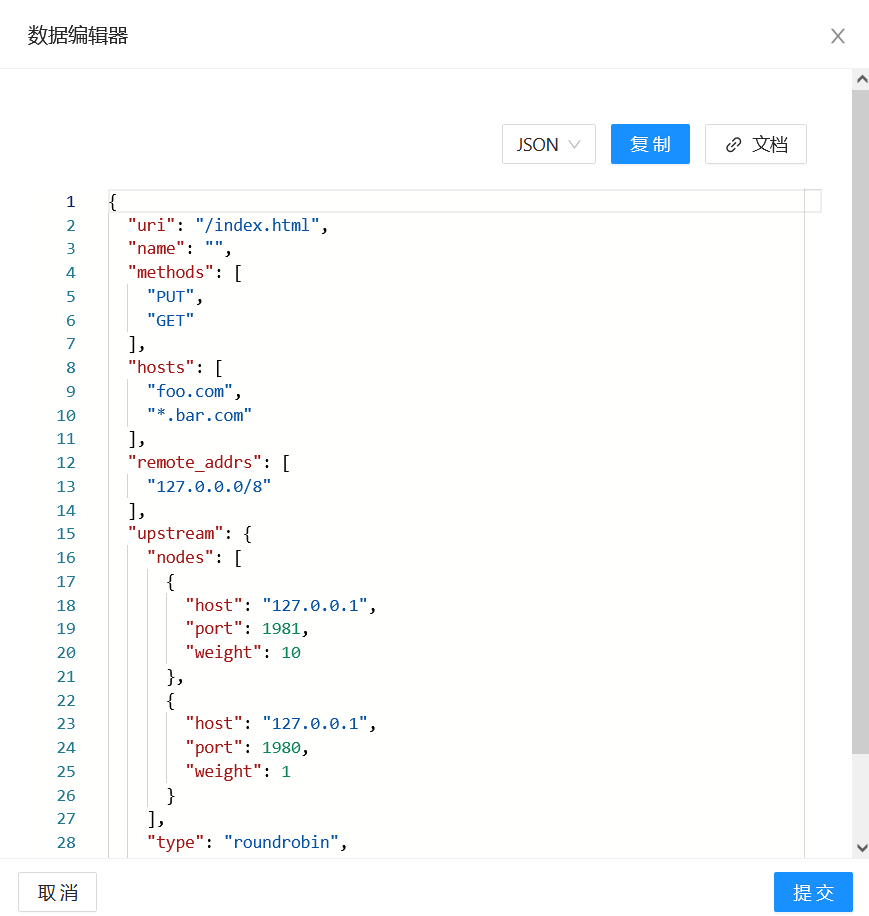

[← 返回微服务架构目录]({{ '/subjects/Microservices/' | relative_url }})



# 42 APISIX API 访问
### 8.5 APISIX API 访问

<https://apisix.apache.org/zh/docs/apisix/admin-api>

### API 访问说明

<https://apisix.apache.org/zh/docs/apisix/3.2/getting-started/#%E5%89%8D%E6%8F%90%E6%9D%A1%E4%BB%B6>

APISIX 通过端口9180/TCP提供API访问

在开始使用 APISIX 之前，请确保你已经安装以下应用：

Docker 和 Docker Compose。 curl 用于测试 API。你也可以使用 Hoppscotch 之类的工具。 下面会使用的上游服务是 httpbin.org，你可以使用它进行测试。这是一个返回服务，它将返回我们在请求中传递的参数。

关于 httpbin.org 说明

A simple HTTP Request & Response Service.

<https://httpbin.org/>





请求内容：

请求 URL 由以下参数构成：

Protocol：即网络传输协议，在示例中，我们使用的是 HTTP 协议。 Port：即端口，示例中使用的 80 端口。 Host：即主机地址，示例中使用的是 httpbin.org 。 Path：即路径，示例中的路径是 /get 。 Query Parameters：即查询字符串，这里有两个字符串，分别是 foo1 和 foo2 。

环境准备

httpbin.org 测试网站准备一个测试容器, docker run -p 80:80 kennethreitz/httpbin

范例: 测试访问 httpbin.org 网站

```json
[root@ubuntu2204 ~]#curl --location --request GET "http://httpbin.org/get?foo1=bar1&foo2=bar2"
{
"args": {
"foo1": "bar1",
"foo2": "bar2"
},
"headers": {
"Accept": "*/*",
"Host": "httpbin.org",
"User-Agent": "curl/7.81.0",
"X-Amzn-Trace-Id": "Root=1-6549e617-04677a9d31de10326f61686d"
},
"origin": "1.203.173.227",
"url": "http://httpbin.org/get?foo1=bar1&foo2=bar2"
}
```

范例: 部署 kennethreitz/httpbin 测试Docker容器

```json
[root@ubuntu2404 ~]#docker run --name httpbin -d -p 80:80 registry.cn-
beijing.aliyuncs.com/bowenxiaochun/httpbin:2019
[root@ubuntu2204 ~]#docker run --name httpbin -d -p 80:80  kennethreitz/httpbin
Unable to find image 'kennethreitz/httpbin:latest' locally
latest: Pulling from kennethreitz/httpbin
473ede7ed136: Pull complete
c46b5fa4d940: Pull complete
93ae3df89c92: Pull complete
6b1eed27cade: Pull complete
0373952b589d: Pull complete
7b82cd0ee527: Pull complete
a36b2d884a89: Pull complete
Digest: sha256:599fe5e5073102dbb0ee3dbb65f049dab44fa9fc251f6835c9990f8fb196a72b
Status: Downloaded newer image for kennethreitz/httpbin:latest
[2023-11-07 08:22:39 +0000] [1] [INFO] Starting gunicorn 19.9.0
[2023-11-07 08:22:39 +0000] [1] [INFO] Listening at: http://0.0.0.0:80 (1)
[2023-11-07 08:22:39 +0000] [1] [INFO] Using worker: gevent
[2023-11-07 08:22:39 +0000] [8] [INFO] Booting worker with pid: 8
[root@ubuntu2204 ~]#curl http://127.0.0.1/anything/foo?age=18
{
"args": {
"age": "18"
},
"data": "",
"files": {},
"form": {},
"headers": {
"Accept": "*/*",
"Host": "127.0.0.1",
"User-Agent": "curl/7.81.0"
},
"json": null,
"method": "GET",
"origin": "172.17.0.1",
"url": "http://127.0.0.1/anything/foo?age=18"
}
```

范例: 查看服务

```bash
[root@ubuntu2204 ~]#curl "http://127.0.0.1:9180/apisix/admin/services" -H "X-API-KEY:
edd1c9f034335f136f87ad84b625c8f1"
{"list":[],"total":0}
[root@ubuntu2204 ~]#curl -I "http://127.0.0.1:9180/apisix/admin/services" -H "X-API-KEY:
edd1c9f034335f136f87ad84b625c8f1"
HTTP/1.1 404 Not Found
Date: Tue, 26 Sep 2023 08:20:25 GMT
Content-Type: text/html; charset=utf-8
Content-Length: 225
Connection: keep-alive
Server: APISIX/3.5.0
Access-Control-Allow-Origin: *
Access-Control-Allow-Credentials: true
Access-Control-Expose-Headers: *
Access-Control-Max-Age: 3600
#说明:edd1c9f034335f136f87ad84b625c8f1是config.yml文件的key的值
```

### 管理路由 Route

路由（Route）是请求的入口点，它定义了客户端请求与服务之间的匹配规则。

路由可以与服务（Service）、上游（Upstream）关联，一个服务可对应一组路由，一个路由可以对应一个上游对象（一组后端服务节点），因此，每个匹配到路由的请求将被网关代理到路由绑定的上游服务中。

<https://apisix.apache.org/zh/docs/apisix/admin-api/#route>



```json
#Route 对象 JSON 配置示例：
{
"id": "1",                            #id，非必填
"uris": ["/a","/b"],                  #一组 URL 路径
"methods": ["GET","POST"],            #可以填多个方法
"hosts": ["a.com","b.com"],           #一组 host 域名
"plugins": {},                        #指定 route 绑定的插件
"priority": 0,                        #apisix 支持多种匹配方式，可能会在一次匹配中同时匹配到多条路由，此时优先级高的优
先匹配中
"name": "路由 xxx",
"desc": "hello world",
"remote_addrs": ["127.0.0.1"],        #一组客户端请求 IP 地址
"vars": [["http_user", "==", "ios"]], #由一个或多个 [var, operator, val] 元素组成的列表
"upstream_id": "1",                   #upstream 对象在 etcd 中的 id ，建议使用此值
"upstream": {},                       #upstream 信息对象，建议尽量不要使用
"timeout": {                          #为 route 设置 upstream 的连接、发送消息、接收消息的超时时间。
"connect": 3,
"send": 3,
"read": 3
},
"filter_func": ""                     #用户自定义的过滤函数，非必填
}
```

官方使用示例

<https://apisix.apache.org/zh/docs/apisix/admin-api/#route-example>

范例: 创建一个路由

```json
#测试上游服务
[root@ubuntu2204 ~]#curl -H"host: www.example.com" http://httpbin.org/anything/foo?arg=18
#返回结果如下
{
"args": {
"arg": "18"
},
"data": "",
"files": {},
"form": {},
"headers": {
"Accept": "*/*",
"Host": "www.example.com",
"User-Agent": "curl/7.81.0",
"X-Amzn-Trace-Id": "Root=1-6549f122-6a9539412936f9da26226cc5"
},
"json": null,
"method": "GET",
"origin": "1.203.173.227",
"url": "http://www.example.com/anything/foo?arg=18"
}
#创建路由
[root@ubuntu2204 ~]#curl http://127.0.0.1:9180/apisix/admin/routes/1 \
-H 'X-API-KEY: edd1c9f034335f136f87ad84b625c8f1' -X PUT -i -d '
{
"name": "testroute1",
"methods": ["GET"],
"hosts": ["www.example.com"],
"uri": "/anything/*",
"upstream": {
"type": "roundrobin",
"nodes": {
"httpbin.org:80": 1
}
}
}'
#返回结果如下
HTTP/1.1 201 Created
Date: Tue, 07 Nov 2023 08:16:36 GMT
Content-Type: application/json
Transfer-Encoding: chunked
Connection: keep-alive
Server: APISIX/3.6.0
Access-Control-Allow-Origin: *
Access-Control-Allow-Credentials: true
Access-Control-Expose-Headers: *
Access-Control-Max-Age: 3600
X-API-VERSION: v3
{"value":{"uri":"/anything/*","hosts":["www.example.com"],"status":1,"methods":
["GET"],"priority":0,"upstream":{"pass_host":"pass","nodes":
{"httpbin.org:80":1},"hash_on":"vars","scheme":"http","type":"roundrobin"},"id":"1","create_time":1699344996,"
update_time":1699344996},"key":"/apisix/routes/1"}
#访问APISIX
[root@ubuntu2204 ~]#curl -XGET -H"host: www.example.com" http://127.0.0.1:9080/anything/foo?arg=18
{
"args": {
"arg": "18"
},
"data": "",
"files": {},
"form": {},
"headers": {
"Accept": "*/*",
"Host": "www.example.com",
"User-Agent": "curl/7.81.0",
"X-Amzn-Trace-Id": "Root=1-6549f292-744f27f967c045d027e940a8",
"X-Forwarded-Host": "www.example.com"
},
"json": null,
"method": "GET",
"origin": "172.18.0.1, 1.203.173.227",
"url": "http://www.example.com/anything/foo?arg=18"
}
```



范例：删除路由

```bash
[root@ubuntu2204 ~]#curl -X DELETE http://127.0.0.1:9180/apisix/admin/routes/1 -H 'X-API-KEY:
edd1c9f034335f136f87ad84b625c8f1'
```

范例: 添加一个新的上游

```json
#添加一个新的上游
[root@ubuntu2204 ~]#curl http://127.0.0.1:9180/apisix/admin/routes/1 \
-H 'X-API-KEY: edd1c9f034335f136f87ad84b625c8f1' -X PATCH -i -d '
{
"upstream": {
"nodes": {
"127.0.0.1:80": 1
}
}
}'
[root@ubuntu2204 ~]#curl -XGET -H"host: www.example.com" http://127.0.0.1:9080/anything/foo?arg=18
{
"args": {
"arg": "18"
},
"data": "",
"files": {},
"form": {},
"headers": {
"Accept": "*/*",
"Host": "www.example.com",
"User-Agent": "curl/7.81.0",
"X-Amzn-Trace-Id": "Root=1-6549f7d8-0de75e125f3af0e2733c6131",
"X-Forwarded-Host": "www.example.com"
},
"json": null,
"method": "GET",
"origin": "172.18.0.1, 1.203.173.227",
"url": "http://www.example.com/anything/foo?arg=18"
}
```



范例: 删除一个上游

```json
[root@ubuntu2204 ~]#curl http://127.0.0.1:9180/apisix/admin/routes/1 \
-H 'X-API-KEY: edd1c9f034335f136f87ad84b625c8f1' -X PATCH -i -d '
{
"upstream": {
"nodes": {
"127.0.0.1:80": null
}
}
}'
```


范例: 禁用路由

```json
curl http://127.0.0.1:9180/apisix/admin/routes/1 \
-H 'X-API-KEY: edd1c9f034335f136f87ad84b625c8f1' -X PATCH -i -d '
{
"status": 0
}'
#结果显示
HTTP/1.1 200 OK
...
#执行成功后，`status` 将更新为：
{
"status": 0
}
```

范例:启用路由

```json
curl http://127.0.0.1:9180/apisix/admin/routes/1 \
-H 'X-API-KEY: edd1c9f034335f136f87ad84b625c8f1' -X PATCH -i -d '
{
"status": 1
}'
#结果显示
HTTP/1.1 200 OK
...
#执行成功后，`status` 将更新为：
{
"status": 1
}
```

范例:创建多个域名的一个路由

```json
curl http://127.0.0.1:9180/apisix/admin/routes/1 \
-H 'X-API-KEY: edd1c9f034335f136f87ad84b625c8f1' -X PUT -i -d '
{
"uri": "/index.html",
"hosts": ["foo.com", "*.bar.com"],
"remote_addrs": ["127.0.0.0/8"],
"methods": ["PUT", "GET"],
"enable_websocket": true,
"upstream": {
"type": "roundrobin",
"nodes": {
"127.0.0.1:1980": 1
}
}
}'
#显示结果
HTTP/1.1 201 Created
Date: Sat, 31 Aug 2019 01:17:15 GMT
...
```



范例: 创建一个有效期为 60 秒的路由，过期后自动删除

```json
curl 'http://127.0.0.1:9180/apisix/admin/routes/2?ttl=60' \
-H 'X-API-KEY: edd1c9f034335f136f87ad84b625c8f1' -X PUT -i -d '
{
"uri": "/aa/index.html",
"upstream": {
"type": "roundrobin",
"nodes": {
"127.0.0.1:1980": 1
}
}
}'
#显示结果
HTTP/1.1 201 Created
date: Sat, 31 Aug 2019 01:17:15 GMT
...
#通过dashboard 可以查看到如下,过一分钟后则被删除
```



范例: 在路由中新增一个上游节点

```json
curl http://127.0.0.1:9180/apisix/admin/routes/1 \
-H 'X-API-KEY: edd1c9f034335f136f87ad84b625c8f1' -X PATCH -i -d '
{
"upstream": {
"nodes": {
"127.0.0.1:1981": 1
}
}
}'
#结果显示
HTTP/1.1 200 OK
...
#执行成功后，上游节点将更新为：
{
"127.0.0.1:1980": 1,
"127.0.0.1:1981": 1
}
```



范例: 更新路由中上游节点的权重

```json
curl http://127.0.0.1:9180/apisix/admin/routes/1 \
-H 'X-API-KEY: edd1c9f034335f136f87ad84b625c8f1' -X PATCH -i -d '
{
"upstream": {
"nodes": {
"127.0.0.1:1981": 10
}
}
}'
#结果显示
HTTP/1.1 200 OK
...
#执行成功后，上游节点将更新为
{
"127.0.0.1:1980": 1,
"127.0.0.1:1981": 10
}
```



范例: 从路由中删除一个上游节点

```json
curl http://127.0.0.1:9180/apisix/admin/routes/1 \
-H 'X-API-KEY: edd1c9f034335f136f87ad84b625c8f1' -X PATCH -i -d '
{
"upstream": {
"nodes": {
"127.0.0.1:1980": null
}
}
}'
#结果显示
HTTP/1.1 200 OK
...
#执行成功后，Upstream `nodes` 将更新为：
{
"127.0.0.1:1981": 10
}
```

范例: 更新路由中的 methods 数组

```json
curl http://127.0.0.1:9180/apisix/admin/routes/1 \
-H 'X-API-KEY: edd1c9f034335f136f87ad84b625c8f1' -X PATCH -i -d '{
"methods": ["GET", "POST"]
}'
#结果显示
HTTP/1.1 200 OK
...
```

执行成功后，methods 将不保留原来的数据，将更新为：

```text
["GET", "POST"]
```

范例: 使用 sub path 更新路由中的上游节点：

```json
curl http://127.0.0.1:9180/apisix/admin/routes/1/upstream/nodes \
-H 'X-API-KEY: edd1c9f034335f136f87ad84b625c8f1' -X PATCH -i -d '
{
"127.0.0.1:1982": 1
}'
#结果显示
HTTP/1.1 200 OK
...
#执行成功后，`nodes` 将不保留原来的数据，整个更新为：
{
"127.0.0.1:1982": 1
}
```

范例: 使用 sub path 更新路由中的 methods ：

```text
curl http://127.0.0.1:9180/apisix/admin/routes/1/methods \
-H 'X-API-KEY: edd1c9f034335f136f87ad84b625c8f1' -X PATCH -i -d '["POST", "DELETE", "PATCH"]'
#结果显示
HTTP/1.1 200 OK
...
#执行成功后，`methods` 将不保留原来的数据，更新为：
["POST", "DELETE", "PATCH"]
```

### 管理上游 Upstream

<https://apisix.apache.org/zh/docs/apisix/admin-api/#upstream>

Upstream 上游列表包含了已创建的上游服务（即后端服务），可以对上游服务的多个目标节点进行负载均衡和健康检查。

Upstream 是虚拟主机抽象，对给定的多个服务节点按照配置规则进行负载均衡。

Upstream 的地址信息可以直接配置到 Route （或 Service ) 上，当 Upstream 有重复时，需要用“引用”方式避免重复。

请求地址#

Upstream 资源请求地址：/apisix/admin/upstreams/{id}

请求方法#

名称请求 URI 请求

body 描述

GET /apisix/admin/upstreams/{id} 无获取资源。

PUT /apisix/admin/upstreams/{id} {...} 创建指定 id 的资源。

POST /apisix/admin/upstreams {...} 创建资源，id 由后台服务自动生成。

DELETE /apisix/admin/upstreams/{id} 无删除资源。

标准 PATCH，修改已有 Upstream 的部分属性，其他不涉及的属性

PATCH /apisix/admin/upstreams/{id} {...}

会原样保留；如果需要删除某个属性，可将该属性的值设置为 null ；注意：当需要修改属性的值为数组时，该属性将全量更新。

PATCH /apisix/admin/upstreams/{id}/{path} {...} SubPath PATCH，通过 {path} 指定 Upstream 需要更新的属性，

全量更新该属性的数据，其他不涉及的属性会原样保留。

body 请求参数#

APISIX 的 Upstream 除了基本的负载均衡算法选择外，还支持对上游做主被动健康检查、重试等逻辑。详细信息如下： 名称必选项类型描述示例 type 否枚举负载均衡算法，默认值是roundrobin 。

哈希表或数组。当它是哈希表时，内部元素的 key 是上游机器地址列表，格式为地址 +（可选的）端口，其中地址部分可以是 IP 也可以是域名，比如 192.168.1.100:80 、foo.com:80 等。对于哈希表的情况，如果 key 是 IPv6 地址加端口，则必须用中括号将 IPv6 地址括起来。value 则是节点的权重。当它是数组时，数组中每个元素都是一个哈希表，其中包含 host 、weight 以及可选的

nodes 是，与 service_name 二选一。 Node

192.168.1.100:80 , [::1]:80

port 、priority 。nodes 可以为空，这通常用作占位符。客户端命中这样的上游会返回 502 。

service_name 是，与 nodes 二选一。 string 服务发现时使用的服务名，请参考 集成服务发现注册中心。 a-bootiful-client discovery_type 是，与 service_name 配合使用。 string 服务发现类型，请参考 集成服务发现注册中心。 eureka

该选项只有类型是 chash 才有效。根据 key 来查找对应的节点 id ，相同的 key 在同一个对象中，则返回相同 id。目前支持的 NGINX 内置变量有 uri,

key 条件必需匹配类型

```text
server_name, server_addr, request_uri, remote_port, remote_addr,
```

query_string, host, hostname, arg_*** ，其中 arg_*** 是来自 URL 的请求参数，详细信息请参考 NGINX 变量列表。

checks 否 health_checker 配置健康检查的参数，详细信息请参考 health-check。

使用 NGINX 重试机制将请求传递给下一个上游，默认启用重试机制且次数为后端可用的节点数量。如果指定了具体重试次数，它将覆盖默认值。当设置为 0 时， 表示不启用重试机制。

retries 否整型

retry_timeout 否 number 限制是否继续重试的时间，若之前的请求和重试请求花费太多时间就不再继续重试。当设置为 0 时，表示不启用重试超时机制。

timeout 否超时时间对象设置连接、发送消息、接收消息的超时时间，以秒为单位。 {"connect": 0.5,"send": 0.5,"read":

```text
0.5}
```

hash_on 否辅助 hash_on 支持的类型有 vars （NGINX 内置变量），header （自定义 header），cookie ，consumer ，默认值为 vars 。 name 否辅助标识上游服务名称、使用场景等。 desc 否辅助上游服务描述、使用场景等。

请求发给上游时的 host 设置选型。 [ pass ，node ，rewrite ] 之一，默认是

pass_host 否枚举

pass 。pass : 将客户端的 host 透传给上游； node : 使用 upstream node 中配置的 host ； rewrite : 使用配置项 upstream_host 的值。

upstream_host 否辅助指定上游请求的 host，只在 pass_host 配置为 rewrite 时有效。

跟上游通信时使用的 scheme。对于 7 层代理，可选值为 [ http , https , grpc ,

scheme 否辅助

grpcs ]。对于 4 层代理，可选值为 [ tcp , udp , tls ]。默认值为 http ，详细信息请参考下文。

labels 否匹配规则标识附加属性的键值对。 {"version":"v2","build":"16","env":"production"} create_time 否辅助 epoch 时间戳，单位为秒。如果不指定则自动创建。 1602883670 update_time 否辅助 epoch 时间戳，单位为秒。如果不指定则自动创建。 1602883670 tls.client_cert 否，不能和 tls.client_cert_id 一起使用

https 证书设置跟上游通信时的客户端证书，详细信息请参考下文。

tls.client_key 否，不能和 tls.client_cert_id 一起使用

https 证书私钥设置跟上游通信时的客户端私钥，详细信息请参考下文。

tls.client_cert_id 否，不能和 tls.client_cert 、

SSL 设置引用的 SSL id，详见 SSL。

tls.client_key 一起使用

keepalive_pool.size 否辅助动态设置 keepalive 指令，详细信息请参考下文。 keepalive_pool.idle_timeout 否辅助动态设置 keepalive_timeout 指令，详细信息请参考下文。 keepalive_pool.requests 否辅助动态设置 keepalive_requests 指令，详细信息请参考下文。

type 详细信息如下：

roundrobin : 带权重的 Round Robin。 chash : 一致性哈希。 ewma : 选择延迟最小的节点，请参考 EWMA_chart。 least_conn : 选择 (active_conn + 1) / weight 最小的节点。此处的 active connection 概念跟 NGINX 的相同，它是当前正在被请求使用的连接。 用户自定义的 balancer，需要可以通过 require("apisix.balancer.your_balancer") 来加载。

hash_on 详细信息如下：

设为 vars 时，key 为必传参数，目前支持的 NGINX 内置变量有 uri, server_name, server_addr, request_uri, remote_port, remote_addr, query_string, host, hostname, arg_*** ，其中 arg_*** 是来自 URL 的请求参数。详细信息请参考 NGINX 变量列表。 设为 header 时，key 为必传参数，其值为自定义的 Header name，即 "http_ key "。 设为 cookie 时，key 为必传参数，其值为自定义的 cookie name，即 "cookie_ key "。请注意 cookie name 是区分大小写字母的。 例如：cookie_x_foo 与 cookie_X_Foo 表示不同的 cookie 。 设为 consumer 时，key 不需要设置。此时哈希算法采用的 key 为认证通过的 consumer_name 。 如果指定的 hash_on 和 key 获取不到值时，使用默认值：remote_addr 。

以下特性需要 APISIX 运行于 APISIX-Base：

scheme 可以设置成 tls ，表示 TLS over TCP 。 tls.client_cert/key 可以用来跟上游进行 mTLS 通信。他们的格式和 SSL 对象的 cert 和 key 一样。 tls.client_cert_id 可以用来指定引用的 SSL 对象。只有当 SSL 对象的 type 字段为 client 时才能被引用，否则请求会被 APISIX 拒绝。另外，SSL 对象中只有 cert 和 key 会被使用。 keepalive_pool 允许 Upstream 有自己单独的连接池。它下属的字段，比如 requests ，可以用于配置上游连接保持的参数。

Upstream 对象 JSON 配置示例：

```json
{
"id": "1",                  #id
"retries": 1,               #请求重试次数
"timeout": {                #设置连接、发送消息、接收消息的超时时间，每项都为 15 秒
"connect":15,
"send":15,
"read":15
},
"nodes": {"host:80": 100},  #上游机器地址列表，格式为`地址 + 端口`
#等价于 "nodes": [ {"host":"host", "port":80, "weight": 100} ],
"type":"roundrobin",
"checks": {},               #配置健康检查的参数
"hash_on": "",
"key": "",
"name": "upstream-xxx",     #upstream 名称
"desc": "hello world",      #upstream 描述
"scheme": "http"            #跟上游通信时使用的 scheme，默认是 `http`
}
https://apisix.apache.org/zh/docs/apisix/admin-api/#upstream-example
```

范例: 创建 Upstream 并对 nodes 的数据进行修改

<https://apisix.apache.org/zh/docs/apisix/admin-api/#create-upstream>

1. 创建 Upstream：

```json
curl http://127.0.0.1:9180/apisix/admin/upstreams/1  \
-H 'X-API-KEY: edd1c9f034335f136f87ad84b625c8f1' -i -X PUT -d '
{
"type":"roundrobin",
"nodes":{
"127.0.0.1:1980": 1
}
}'
HTTP/1.1 201 Created
...
```

2. 在路由中绑定上面创建的 Upstream

```json
curl http://127.0.0.1:9180/apisix/admin/routes/1 \
-H 'X-API-KEY: edd1c9f034335f136f87ad84b625c8f1' -X PUT -i -d '
{
"methods": ["GET"],
"hosts": ["www.example.com"],
"uri": "/anything/*",
"upstream_id": "1"
}'
```

3. 在 Upstream 中添加一个节点：

```json
curl http://127.0.0.1:9180/apisix/admin/upstreams/100 \
-H 'X-API-KEY: edd1c9f034335f136f87ad84b625c8f1' -X PATCH -i -d '
{
"nodes": {
"127.0.0.1:1981": 1
}
}'
HTTP/1.1 200 OK
...
```

执行成功后，nodes 将更新为：

```json
{
"127.0.0.1:1980": 1,
"127.0.0.1:1981": 1
}
```

4. 更新 Upstream 中单个节点的权重：

```json
curl http://127.0.0.1:9180/apisix/admin/upstreams/100 \
-H 'X-API-KEY: edd1c9f034335f136f87ad84b625c8f1' -X PATCH -i -d '
{
"nodes": {
"127.0.0.1:1981": 10
}
}'
HTTP/1.1 200 OK
...
```

执行成功后，nodes 将更新为：

```json
{
"127.0.0.1:1980": 1,
"127.0.0.1:1981": 10
}
```

5. 删除 Upstream 中的一个节点：

```json
curl http://127.0.0.1:9180/apisix/admin/upstreams/100 \
-H 'X-API-KEY: edd1c9f034335f136f87ad84b625c8f1' -X PATCH -i -d '
{
"nodes": {
"127.0.0.1:1980": null
}
}'
HTTP/1.1 200 OK
...
```

执行成功后，nodes 将更新为：

```json
{
"127.0.0.1:1981": 10
}
```

6. 更新 Upstream 的 nodes ：

```json
curl http://127.0.0.1:9180/apisix/admin/upstreams/100/nodes \
-H 'X-API-KEY: edd1c9f034335f136f87ad84b625c8f1' -X PATCH -i -d '
{
"127.0.0.1:1982": 1
}'
HTTP/1.1 200 OK
...
```

执行成功后，nodes 将不再保留原来的数据：

```json
{
"127.0.0.1:1982": 1
}
```



<nav class="article-end" aria-label="章节导航">
  <a href="{{ '/subjects/Microservices/41-installing-and-using-apisix-dashboard.html' | relative_url }}">← Previous: Installing and Using APISIX Dashboard</a>
  <a href="{{ '/subjects/Microservices/' | relative_url }}">Back to Microservices Index</a>
  <a href="{{ '/subjects/Microservices/43-apisix-examples.html' | relative_url }}">Next: APISIX Examples →</a>
</nav>
