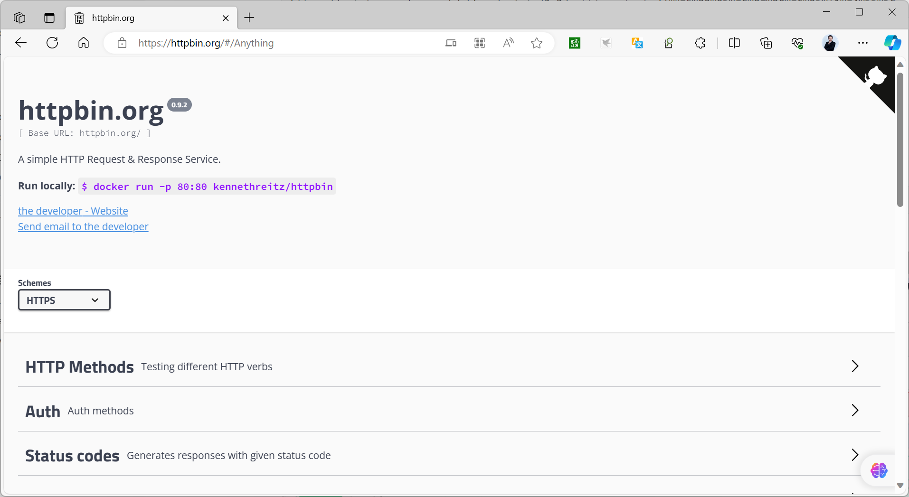
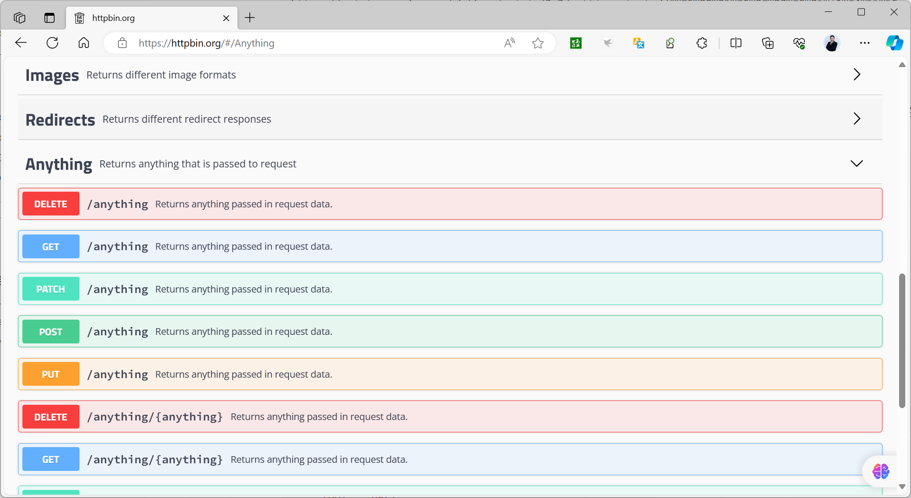
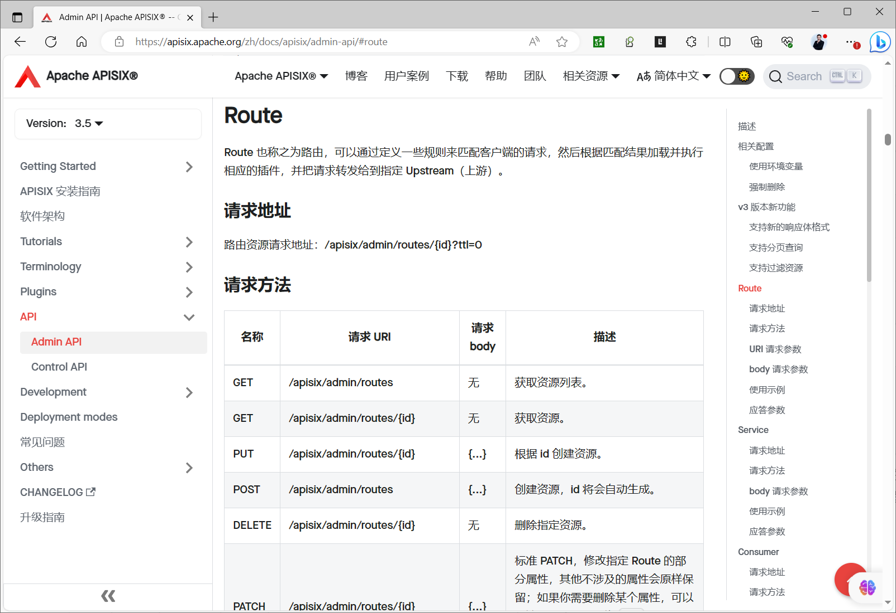
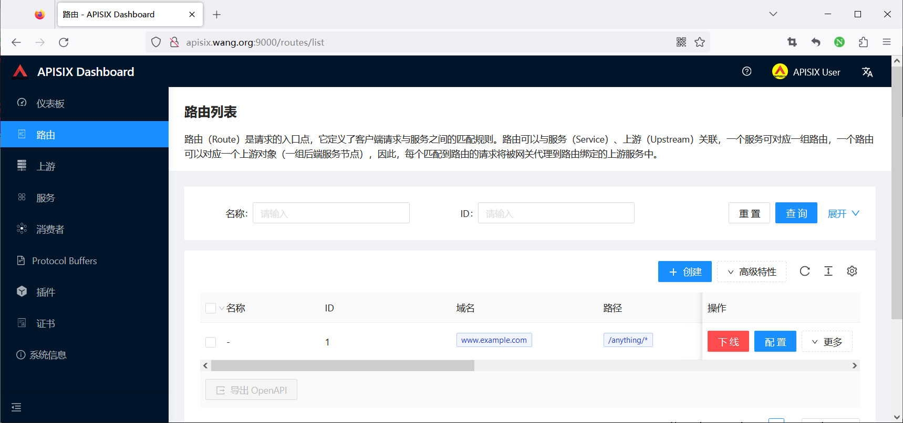
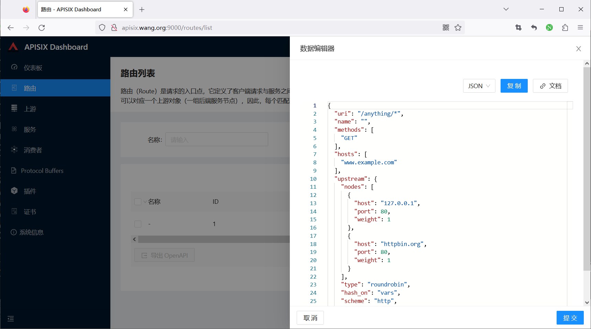
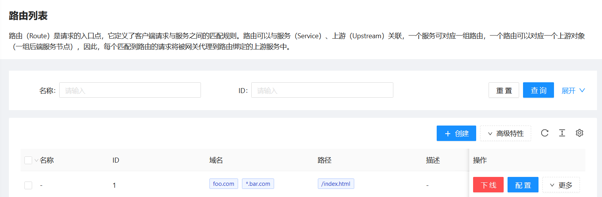
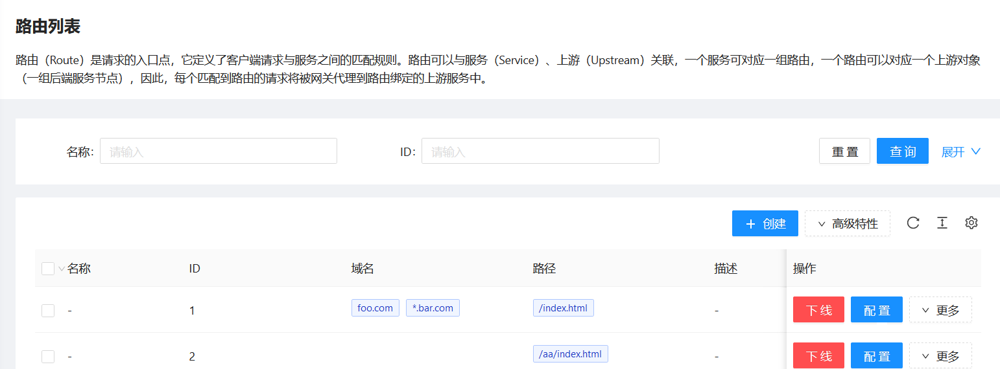
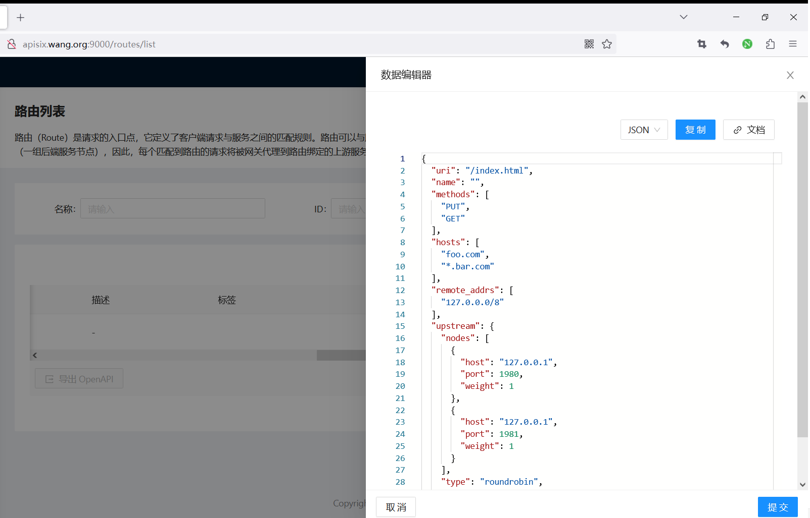
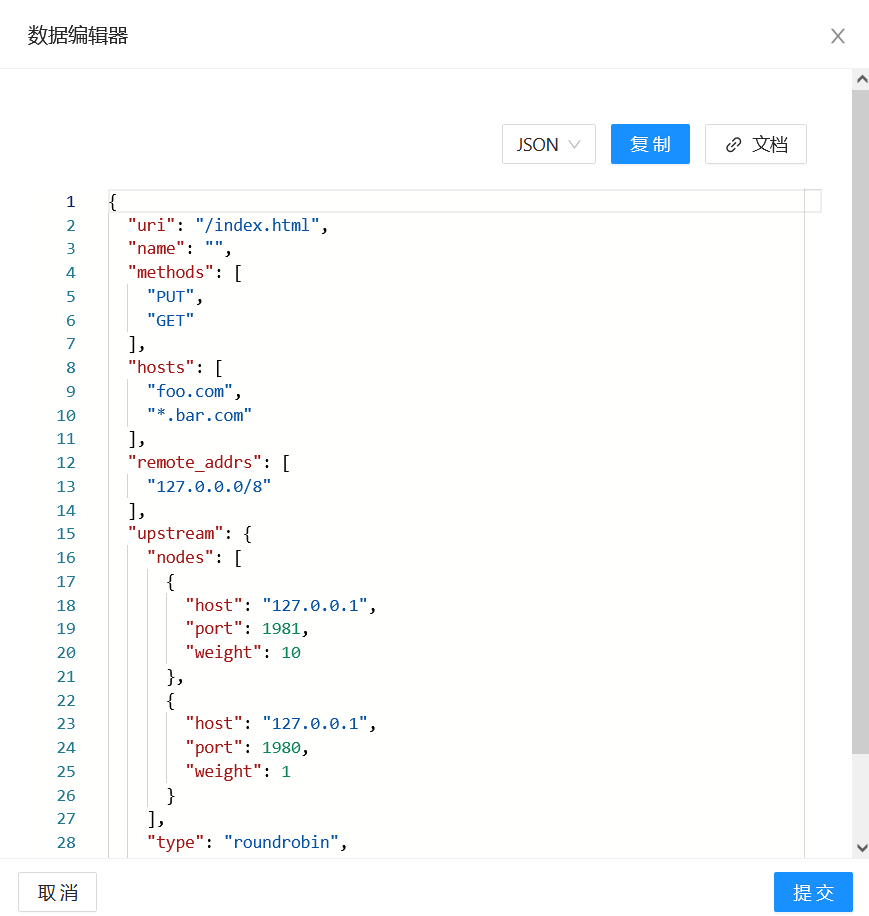

[← 返回微服务架构目录]({{ '/subjects/Microservices/' | relative_url }})



# 42 APISIX API 访问

本篇用 Admin API 完成“创建 Upstream → 创建 Route → 代理访问 → 更新 → 删除”。先分清两个端口：`9180` 是配置管理接口，`9080` 是客户端业务入口。Admin API 的地址和凭据应只供管理端访问；业务客户端不应持有管理密钥。




## 0. 准备可达的测试上游

可使用团队内的 HTTP echo 服务，先从 **APISIX 所在网络**直接访问 `http://UPSTREAM_HOST:80/anything/test`。若 APISIX 运行在容器里，`127.0.0.1` 指容器本身，不能自动访问宿主机或另一个容器。原资料使用公共 httpbin.org 与多个未固定版本的 Docker 镜像；为了让实验结果可复现，优先使用可控的内部上游。

以下 Bash 示例假设已在受控终端设置 `APISIX_ADMIN_KEY`，并且 Admin API 仅在本机可访问。密钥不要写入 URL、脚本仓库或 Shell 历史：

```bash
ADMIN=http://127.0.0.1:9180/apisix/admin
PROXY=http://127.0.0.1:9080
# 通过密钥管理方式设置 APISIX_ADMIN_KEY
curl -sS -H "X-API-KEY: $APISIX_ADMIN_KEY" "$ADMIN/routes"
```

列表为空只说明当前没有 Route；使用 `curl -I` 发送的是 HEAD 请求，不能代替 GET 接口的验证。实际 JSON 字段与响应码以目标 APISIX 版本文档为准。

## 1. 创建可复用的 Upstream

Upstream 定义后端节点、权重、负载均衡和可选的健康检查。下面将同一个 ID `demo-upstream` 贯穿后续操作，避免原资料先创建 `1`、更新时却操作 `100` 的断裂。将 `UPSTREAM_HOST:80` 换成从 APISIX 可达的真实测试地址：

```bash
curl -sS -X PUT "$ADMIN/upstreams/demo-upstream" \
  -H "X-API-KEY: $APISIX_ADMIN_KEY" \
  -H 'Content-Type: application/json' \
  -d '{"type":"roundrobin","nodes":{"UPSTREAM_HOST:80":1}}'

curl -sS -H "X-API-KEY: $APISIX_ADMIN_KEY" \
  "$ADMIN/upstreams/demo-upstream"
```

权重为 1 表示参与加权轮询，不是“一秒一个请求”。若有多个节点，还需考虑健康检查、连接/读取超时、重试是否会导致非幂等写请求重复执行，以及请求 Host 是否需要透传或改写。

## 2. 让 Route 引用 Upstream

Route 负责匹配条件和插件。下面只匹配 `GET`、Host 为 `www.example.test`、路径为 `/anything/*` 的请求。创建时引用已经存在的 Upstream ID：

```bash
curl -sS -X PUT "$ADMIN/routes/demo-route" \
  -H "X-API-KEY: $APISIX_ADMIN_KEY" \
  -H 'Content-Type: application/json' \
  -d '{"name":"echo-demo","hosts":["www.example.test"],"methods":["GET"],"uri":"/anything/*","upstream_id":"demo-upstream"}'

curl -i -H 'Host: www.example.test' \
  "$PROXY/anything/test?name=demo"
```

如果配置写入成功但代理返回 `404 Route Not Found`，先核对 Host、方法和 URI；若路由命中后返回 502/503，再查上游地址、端口、健康状态和网络。响应体中的 `Host`、`X-Forwarded-*` 字段与 upstream 的 `pass_host` 设置有关，不能把 echo 服务显示的 URL 直接当作客户端最初访问的地址。




## 3. 更新规则要区分“合并”与“替换”

Admin API 支持读取、创建、更新和删除资源。通常 `PUT /routes/{id}` 用于提交完整资源；`PATCH` 可修改部分字段。但数组和子路径的更新语义可能是**整项替换**，不能假设所有 PATCH 都会逐元素合并。每次更新前先 GET 当前对象，保存回滚副本；更新后再 GET 并发真实请求验证。

例如暂时禁用与重新启用路由：

```bash
curl -sS -X PATCH "$ADMIN/routes/demo-route" \
  -H "X-API-KEY: $APISIX_ADMIN_KEY" \
  -H 'Content-Type: application/json' -d '{"status":0}'
curl -i -H 'Host: www.example.test' "$PROXY/anything/test"

curl -sS -X PATCH "$ADMIN/routes/demo-route" \
  -H "X-API-KEY: $APISIX_ADMIN_KEY" \
  -H 'Content-Type: application/json' -d '{"status":1}'
```

原资料还展示了添加节点、调整权重、删除节点、修改 methods、多 Host 路由及带 TTL 的临时路由。它们都是在同一资源模型上改字段，但操作前应考虑影响范围：

- **增删上游节点**：Route 若引用共享 Upstream，所有引用它的路由都受影响；不能把最后一个健康节点删掉仍期待请求成功。
- **调整权重**：是流量分配倾向，不是固定每 10 次精确命中 10 次；可用足够样本验证分布。
- **修改 methods 或 hosts**：可能立即改变接口可达范围；先核对认证和回滚方案。
- **TTL 路由**：只适合明确需要自动过期的临时配置，过期后应验证它确已被删除，不能用于常驻业务接口。








## 4. 查询、清理与回滚

```bash
curl -sS -H "X-API-KEY: $APISIX_ADMIN_KEY" "$ADMIN/routes/demo-route"
curl -sS -H "X-API-KEY: $APISIX_ADMIN_KEY" "$ADMIN/upstreams/demo-upstream"

# 确认测试环境不再需要后，先删 Route，再删 Upstream
curl -sS -X DELETE -H "X-API-KEY: $APISIX_ADMIN_KEY" "$ADMIN/routes/demo-route"
curl -sS -X DELETE -H "X-API-KEY: $APISIX_ADMIN_KEY" "$ADMIN/upstreams/demo-upstream"
```

若误改共享资源，应从事先保存的完整 JSON 恢复，而不是凭记忆再 PATCH 一次。管理 API 返回成功还应通过代理请求和日志验证配置已被数据面加载。下一篇将用一个完整业务例子结合路由、上游和插件。



<nav class="article-end" aria-label="章节导航">
  <a href="{{ '/subjects/Microservices/41-installing-and-using-apisix-dashboard.html' | relative_url }}">← 上一篇：APISIX Dashboard 安装和使用</a>
  <a href="{{ '/subjects/Microservices/' | relative_url }}">返回专题目录</a>
  <a href="{{ '/subjects/Microservices/43-apisix-examples.html' | relative_url }}">下一篇：APISIX 案例 →</a>
</nav>
