[← Back to Microservices Index]({{ '/subjects/Microservices/' | relative_url }})



# 43 APISIX Examples
### 8.6 APISIX 案例

### Apache APISIX 集成 Nacos 说明

在微服务体系中，各个业务服务的地址是动态变化的,并且服务之间会频繁互相调用，因些需要对各个服务的IP、port 等路由信息进行统一的管理。

注册中心本质上是为了解耦服务提供者和服务消费者

注册中心的核心功能:

服务注册:服务提供方向注册中心进行注册。 服务发现:服务消费方可以通过注册中心寻找到服务提供方的调用路由信息。 健康检测:确保注册到注册中心的服务节点是可以被正常调用的，避免无效节点导致的调用资源不可用等异常问题。

Apache APISIX结合Nacos可以将各个微服务节点中与业务无关的各项控制，集中在Apache APISIX中进行统一管理

即通过Apache APISIX实现接口服务的代理和路由转发的能力。

在Nacos上注册各个微服务后，Apache APISIX可以通过Nacos的服务发现功能获取服务列表，查找对应的服务地址从而实现动态代理。

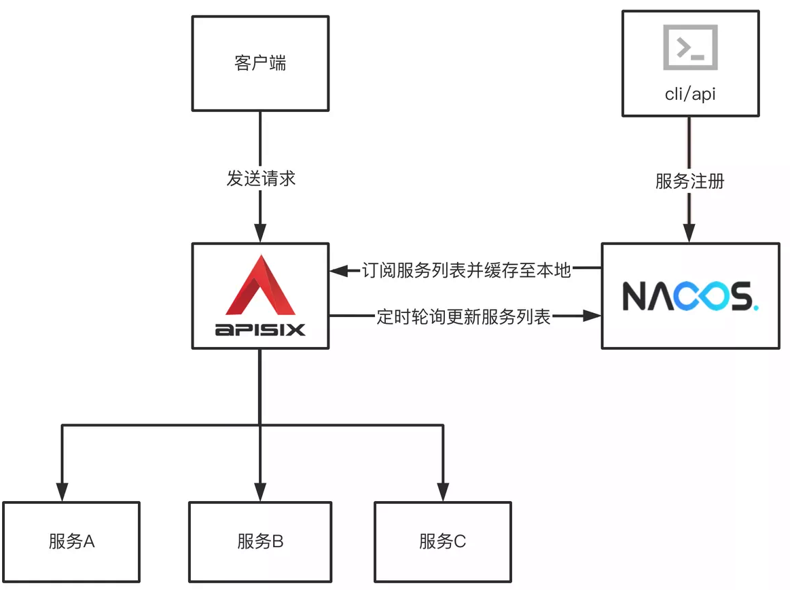

APISIX 配置说明

在apisix的配置文件conf/config.yaml 中添加以下配置:

```text
#详细配置
discovery:
nacos:
host:
- "http://${username}:${password}@${host1}:${port1}"
prefix: "/nacos/v1/"
fetch_interval: 30 #default 30sec
weight: 100        #default 100
timeout:
connect: 2000    #default 2000 ms
send: 2000       #default 2000 ms
read: 5000       #default 5e00 ms
#简化配置(使用默认配置):
discovery:
nacos:
host:
- "http://nacos.bowen.org:8848"
```

创建路由时指定服务发现类型为 Nacos 相关信息

```json
curl http://127.0.0.1:9180/apisix/admin/routes/1 -H 'X-API-KEY: edd1c9f034335f136f87ad84b625c8f1' -X PUT -d
{
"uri" : "/nacos/*"，
"upstream" : {
"service_name": "APISIX-NACOS",
"type" : "roundrobin",
"discovery_type " : "nacos",
"service_name": "nacos-consumer-api",
"discovery_args": {
"namespace_id": "testns"
"group_name": "testgroup"
}
}
}
```

### 案例：Apache APISIX 集成 Nacos 实现服务发现项目

实现访问http://www.bowen.org/echo/ 路径转发后面的微服务


### 准备 Nacos 服务

```bash
#安装 Nacos 服务.可以和APISIX部署在同一台主机，可以下面方式之一部署并启动
#方法1：docker启动
[root@ubuntu2204 ~]#docker run --name nacos -e MODE=standalone -p 8848:8848 -p 9848:9848 -d registry.cn-
beijing.aliyuncs.com/bowenxiaochun/nacos-server:v2.4.3-slim
[root@ubuntu2204 ~]#docker run --name nacos -e MODE=standalone -p 8848:8848 -p 9848:9848 -d nacos/nacos-
server:v2.2.3-slim
#方法2：二进制启动
[root@ubuntu2204 ~]#bash install_nacos_single_node.sh
```

### 准备两个微服务生产者和消费者

```bash
#分别在不同主机上准备两个应用:provider和consumer
#启动应用provider
[root@ubuntu2204 ~]#cat nacos-provider/src/main/resources/application.properties
server.port=8001
spring.application.name=nacos-provider-api
spring.cloud.nacos.discovery.server-addr=nacos.bowen.org:8848
#编译完后直接运行,支持JRE8，11，17，21
[root@ubuntu2404 ~]#apt update && apt install -y openjdk-21-jre
[root@ubuntu2204 ~]#apt update && apt install -y openjdk-17-jre
[root@ubuntu2204 ~]#java -version
openjdk version "17.0.13" 2024-10-15
OpenJDK Runtime Environment (build 17.0.13+11-Ubuntu-2ubuntu122.04)
OpenJDK 64-Bit Server VM (build 17.0.13+11-Ubuntu-2ubuntu122.04, mixed mode, sharing)
[root@ubuntu2204 ~]#java -jar nacos-provider/target/nacos-provider-1.0-SNAPSHOT.jar
#启动应用consumer
[root@ubuntu2204 ~]#cat nacos-consumer/src/main/resources/application.properties
server.port=8002
spring.application.name=nacos-consumer-api
spring.cloud.nacos.discovery.server-addr=nacos.bowen.org:8848
[root@ubuntu2204 ~]#java -jar nacos-consumer/target/nacos-consumer-1.0-SNAPSHOT.jar
#测试访问两个应用:provider和consumer
#provider
[root@ubuntu2204 ~]#curl http://10.0.0.101:8001/echo/bowenxiaochun/
Nacos Discovery Provider Service Message : bowenxiaochun
#consumer
[root@ubuntu2204 ~]#curl http://10.0.0.102:8002/echo/bowenxiaochun/
Nacos Discovery Consumer Service Operation Result From : Nacos Discovery Provider Service Message :
bowenxiaochun
#在Nacos上可以看到两个服务provider和consumer注册成功
```

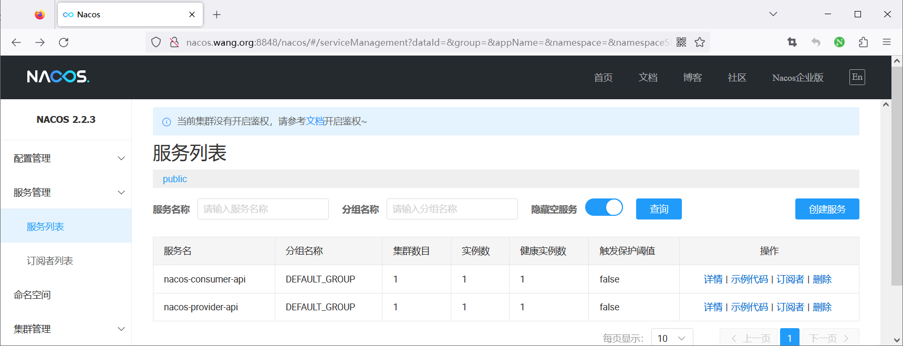

### 安装 APISIX 并配置使用Nacos 注册中心

范例：基于二进制包安装 APISIX

```bash
[root@ubuntu2204 ~]#vim /usr/local/apisix/conf/config.yaml
#最后添加下面行
discovery:
nacos:
host:
- "http://nacos.bowen.org:8848"  #指定Nacos地址信息
[root@ubuntu2204 ~]#systemctl restart apisix.service
```

范例: 基于docker-compose 启动APISIX和Dashboard

```bash
#名称解析
[root@ubuntu2204 ~]#cat /etc/hosts
10.0.0.100 nacos.bowen.org
#基于Docker-compose部署APISIX和Dashboard
#注意:从2023年11月6日后面版本已经删除APISIX-Dashboard
#使用旧版的dashboard方法1
[root@ubuntu2204 ~]#git clone https://github.com/apache/apisix-docker.git
[root@ubuntu2204 ~]#cd apisix-docker/
#默认新版中删除了APISIX-Dashboard
[root@ubuntu2204 apisix-docker]#grep dashboard example/docker-compose.yml
- "./grafana_conf/dashboards:/var/lib/grafana/dashboards"
#查看commitid
[root@ubuntu2204 apisix-docker]#git log
commit aa6581dbbfa4e26dcf3f233e4a65f62ee4472d18 (HEAD -> master, origin/release/apisix-3.7.0, origin/master,
origin/HEAD)
Author: AlinsRan <alinsran@apache.org>
Date:   Thu Nov 23 18:02:03 2023 +0800
feat: release APISIX 3.7.0 (#521)
commit 8e3bf6f1ad0e9e1d4e3fca97bf3419cc24fbf690
Author: Gallardot <gallardot@apache.org>
Date:   Wed Nov 22 17:19:34 2023 +0800
doc: fix typo (#520)
commit 2f226c7b606b06f4b5a35a782d482998f21cd640
Author: Liu Wei <monkeydluffy6017@gmail.com>
Date:   Wed Nov 8 14:19:03 2023 +0800
feat: remove apisix-dashboard (#518)             #删除dashboard
commit 5720e8a520a34d7bf31a188576f4f3ea6ca07983
Author: Liu Wei <monkeydluffy6017@gmail.com>
Date:   Tue Nov 7 16:11:53 2023 +0800
feat: remove apisix-dashboard (#516)            #删除dashboard
commit bf08d86aad95859e010a2cede7f5c697a3f71e2e     #使用带有dashboard的版本
Author: Abhishek Choudhary <shreemaan.abhishek@gmail.com>
Date:   Mon Oct 16 14:05:48 2023 +0545
chore: remove docker image scanning (#515)
........
#回滚至指定版本
[root@ubuntu2204 apisix-docker]#git reset --hard bf08d86aad95859e0
#确认回滚成功
[root@ubuntu2204 apisix-docker]#grep dashboard example/docker-compose.yml
apisix-dashboard:
image: apache/apisix-dashboard:3.0.1-alpine
- ./dashboard_conf/conf.yaml:/usr/local/apisix-dashboard/conf/conf.yaml
- "./grafana_conf/dashboards:/var/lib/grafana/dashboards"
#使用旧版的dashboard方法2
[root@ubuntu2204 ~]#unzip apisix-docker-master.zip
[root@ubuntu2204 ~]#cd apisix-docker-master/example
[root@ubuntu2204 example]#ls
apisix_conf     docker-compose-arm64.yml       docker-compose.yml  grafana_conf  prometheus_conf
dashboard_conf  docker-compose-standalone.yml  etcd_conf           mkcert        upstream
#配置APISIX使用nacos地址
[root@ubuntu2204 example]#vim apisix_conf/config.yaml
.......
apisix:
node_listen: 9080              #APISIX listening port
enable_ipv6: false
enable_control: true
control:
ip: "0.0.0.0"
port: 9092
#添加下面行
discovery:
nacos:
host:
- "http://10.0.0.100:8848"  #指定Nacos地址信息
......
#重启生效
[root@ubuntu2204 example]#docker-compose restart
```

### APISIX 添加路由

8.6.2.4.1 方法1: 通过API 添加路由

```json
[root@ubuntu2204 ~]#curl http://127.0.0.1:9180/apisix/admin/routes/1 -H 'X-API-KEY:
edd1c9f034335f136f87ad84b625c8f1' -X PUT -d '{
"uri": "/echo/*",
"name": "nacos-consumer",
"methods": ["GET"],
"host": "www.bowen.org",
"upstream": {
"type": "roundrobin",
"scheme": "http",
"discovery_type": "nacos",
"pass_host": "pass",
"service_name": "nacos-consumer-api"
}
}'
#登录apisix Dashboard,确认路由创建成功
http://apisix.bowen.org:9000/
```

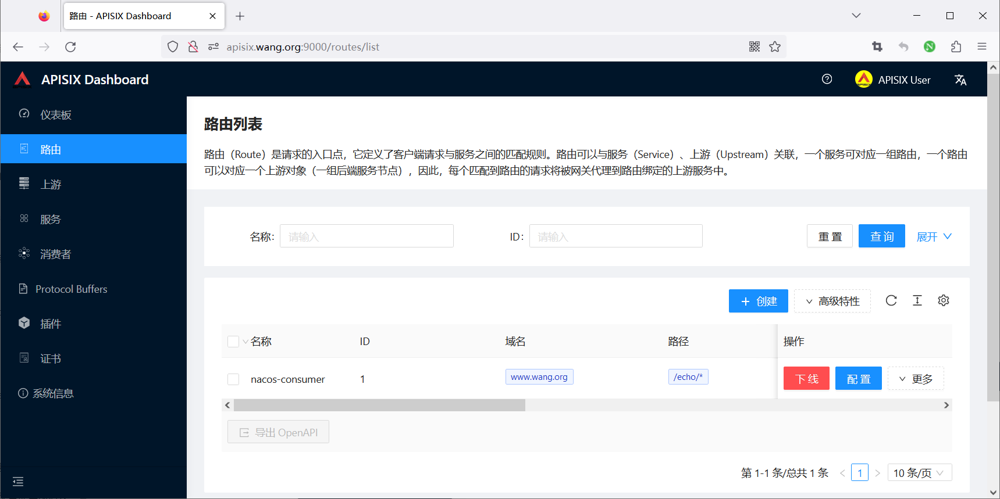

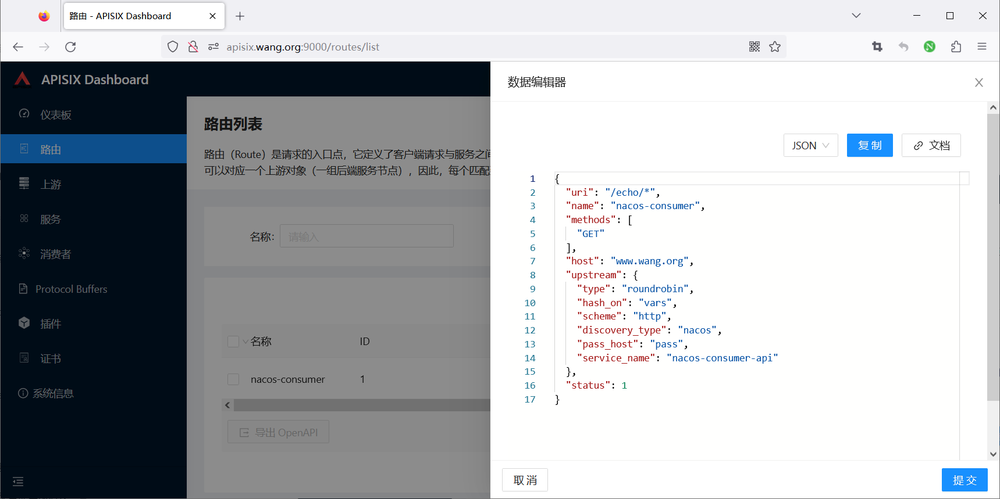

8.6.2.3.4 方法2: 通过APISIX Dashboard 添加路由

先创建上游服务，nacos不能直接创建路由

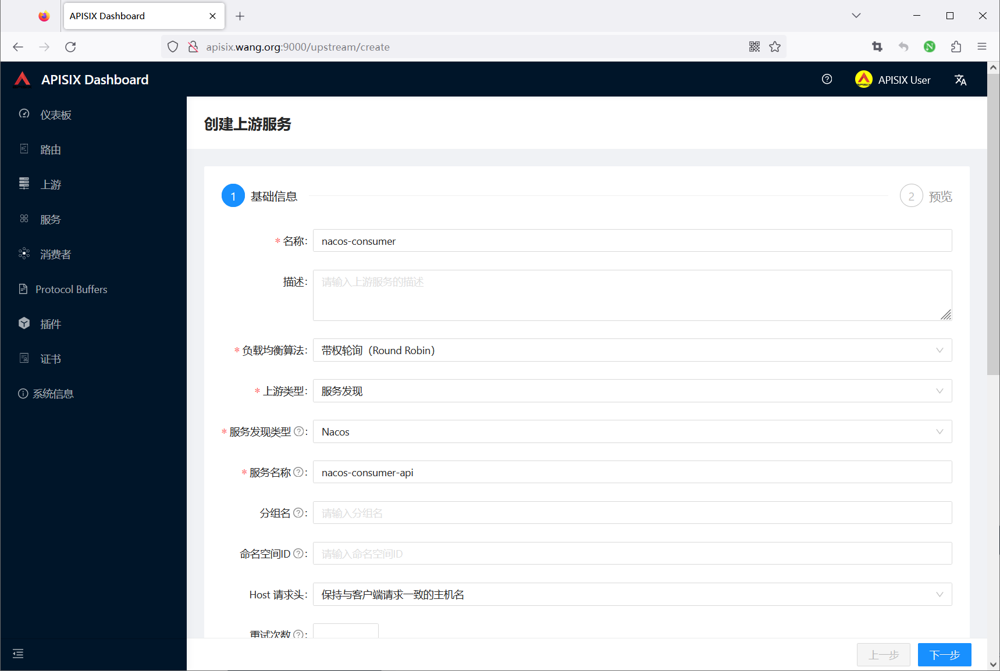

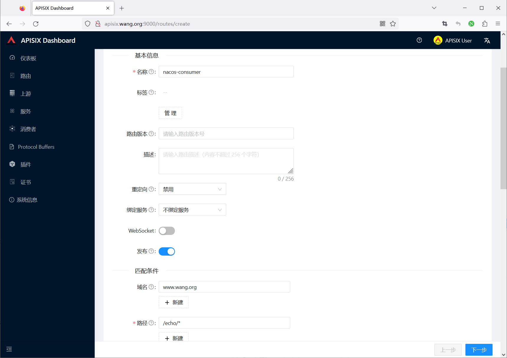

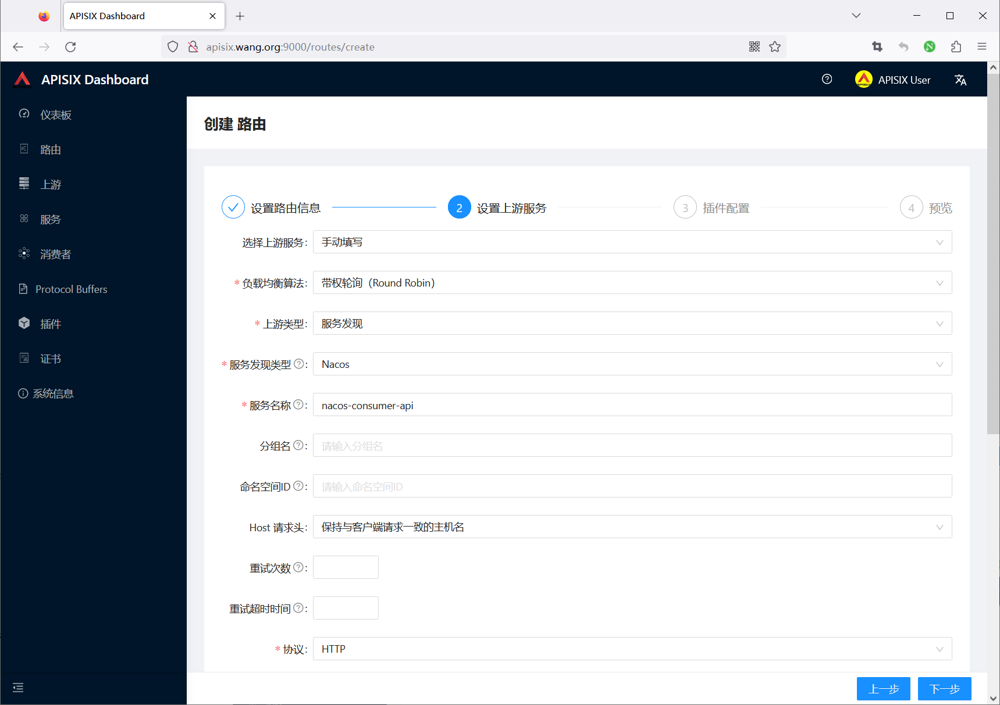

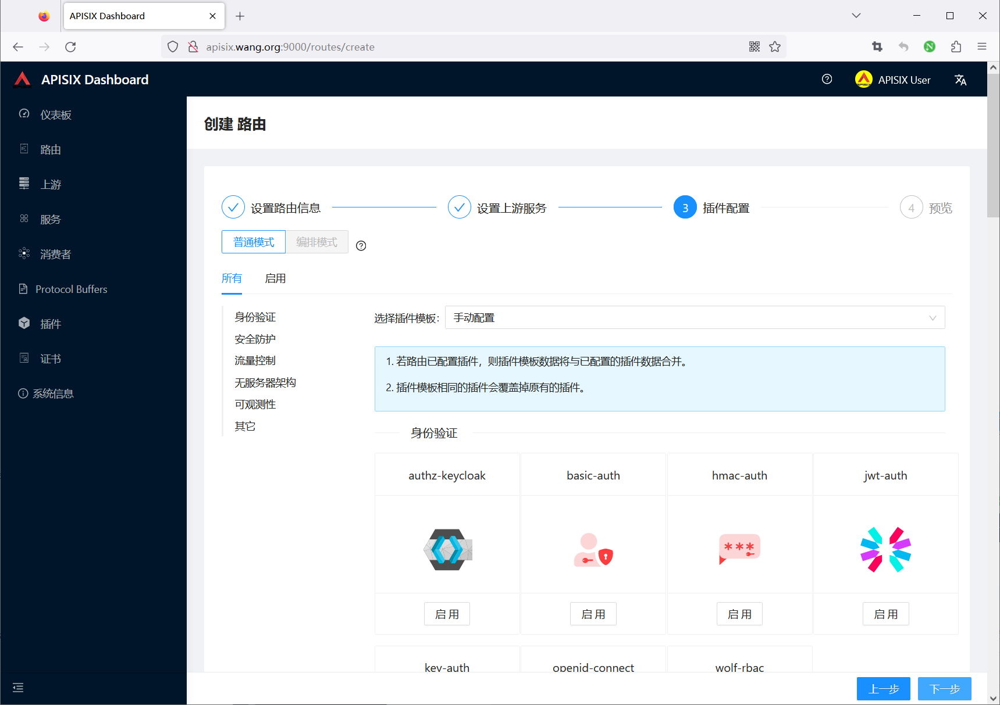

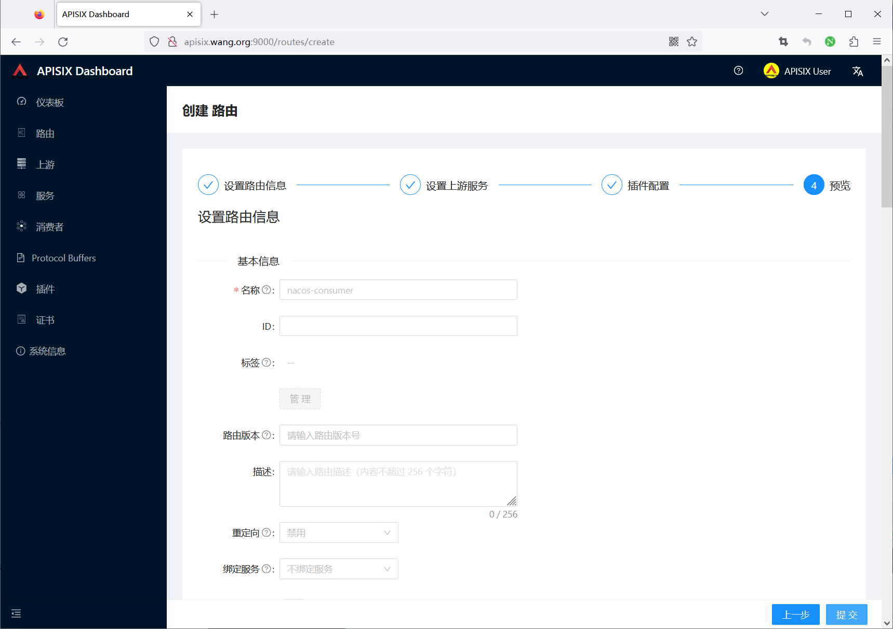

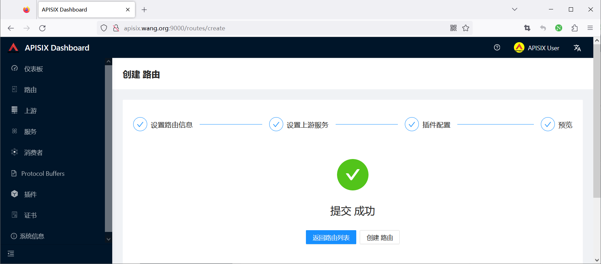

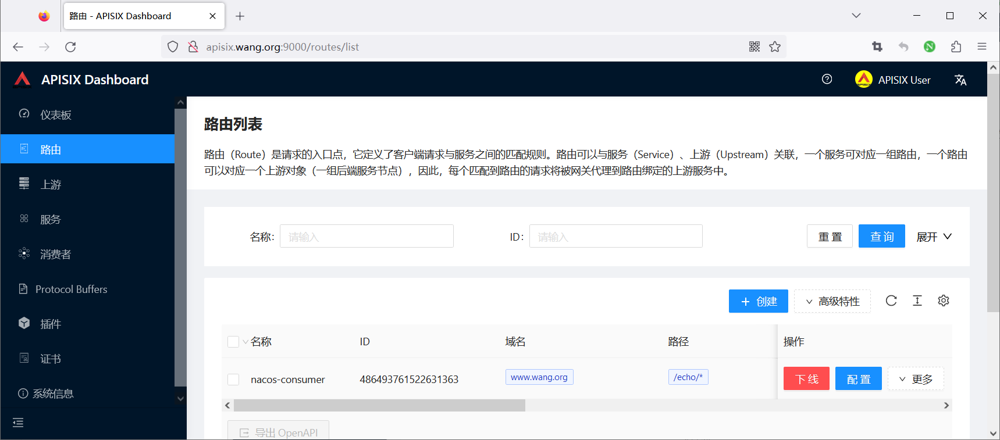

### 通过APISIX网站进行测试访问

```bash
[root@ubuntu2204 ~]#curl -H"host: www.bowen.org" 127.0.0.1:9080/echo/bowenxiaochun
Nacos Discovery Consumer Service Operation Result From : Nacos Discovery Provider Service Message :
bowenxiaochun
```



<nav class="article-end" aria-label="章节导航">
  <a href="{{ '/subjects/Microservices/42-accessing-apisix-apis.html' | relative_url }}">← Previous: Accessing APISIX APIs</a>
  <a href="{{ '/subjects/Microservices/' | relative_url }}">Back to Microservices Index</a>
</nav>
