[← 返回微服务架构目录]({{ '/subjects/Microservices/' | relative_url }})



# 43 APISIX 集成 Nacos 案例

最后一个案例把两条调用关系接起来：外部客户端经 APISIX 到 `nacos-consumer-api`，消费者再通过 Nacos 找到 `nacos-provider-api`。APISIX 也从 Nacos 发现**消费者实例**的地址，所以实例扩缩容时不必手工改路由中的 IP。Nacos 负责注册发现，APISIX 负责入口匹配和代理，消费者代码负责调用提供者；三者的边界不能混淆。

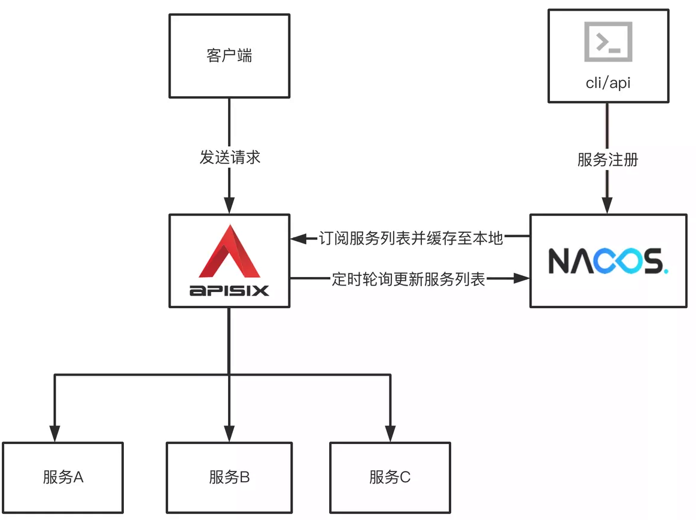
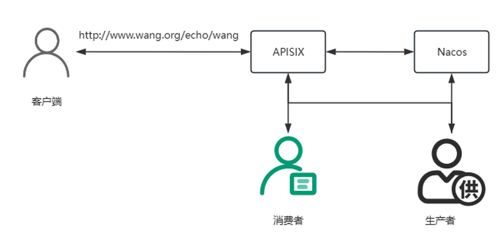

## 1. 先验证 Nacos 和两个服务

选择彼此兼容的 Nacos、Spring Boot、Spring Cloud Alibaba 和 APISIX 版本。原资料交替列出多个 Nacos 镜像、JDK 8/11/17/21 与旧 Dashboard 提取方法，它们不是必须依次执行的步骤。部署一份已验证的 Nacos，确认应用与 APISIX 都能访问它；Nacos 2.x 客户端通常还要可达 9848。

两个应用分别注册为：

```properties
# Provider
server.port=8001
spring.application.name=nacos-provider-api
spring.cloud.nacos.discovery.server-addr=NACOS_HOST:8848
```

```properties
# Consumer
server.port=8002
spring.application.name=nacos-consumer-api
spring.cloud.nacos.discovery.server-addr=NACOS_HOST:8848
```

运行与项目 JDK 版本匹配的 JAR 后，先**不经 APISIX**直连两个接口：Provider 的 `/echo/test` 应返回自身响应，Consumer 的 `/echo/test` 应包含 Provider 的响应。随后在 Nacos 控制台核对两个服务的实例、健康状态与 IP:端口。若 Consumer 直连都失败，先排查它到 Provider 的服务发现与调用，暂时不要调整网关。

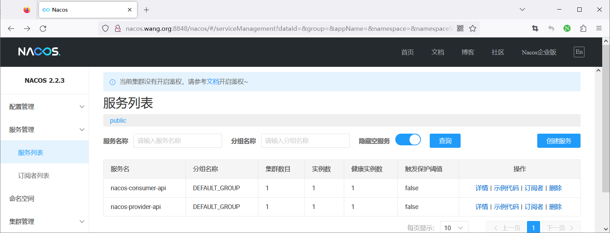

## 2. 让 APISIX 从 Nacos 发现上游

在所用 APISIX 版本支持 Nacos discovery 的前提下，于 `conf/config.yaml` 配置 Nacos 地址。下例使用**有效的 YAML 缩进**，地址应从 APISIX 进程所在网络可达：

```yaml
discovery:
  nacos:
    host:
      - http://NACOS_HOST:8848
```

若 Nacos 启用鉴权、命名空间和分组，按该 APISIX 版本的 discovery 插件文档添加对应参数；不要把账号密码硬写在公开文档的 URL 中。配置加载后检查 APISIX 日志里的 Nacos 连接或服务发现错误。原资料把 `discovery_type ` 写成带尾空格的 JSON 键、用中文逗号并重复写 `service_name`，直接请求会失败。

Admin API 中创建指向 `nacos-consumer-api` 的测试 Route。管理密钥从受控环境变量取得，参数写在一段有效 JSON 中：

```bash
ADMIN=http://127.0.0.1:9180/apisix/admin
curl -sS -X PUT "$ADMIN/routes/nacos-consumer-demo" \
  -H "X-API-KEY: $APISIX_ADMIN_KEY" \
  -H 'Content-Type: application/json' \
  -d '{
    "name": "nacos-consumer-demo",
    "uri": "/echo/*",
    "methods": ["GET"],
    "host": "www.example.test",
    "upstream": {
      "type": "roundrobin",
      "scheme": "http",
      "discovery_type": "nacos",
      "service_name": "nacos-consumer-api"
    }
  }'
```

这里的 `service_name` 指 **Nacos 中的消费者服务名**，不是 Provider 名，也不是 APISIX Service 资源。APISIX 只代理外部请求到 Consumer；Consumer 再按自己的 Nacos 客户端配置调用 Provider。若使用了非默认 namespace/group，路由的 discovery 参数须与实际注册身份一致。Dashboard 是否能编辑这类上游取决于其版本；不能因旧界面不支持就断言 Admin API 也不支持。

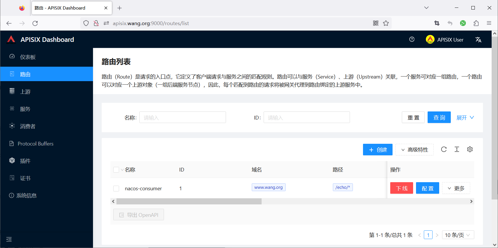
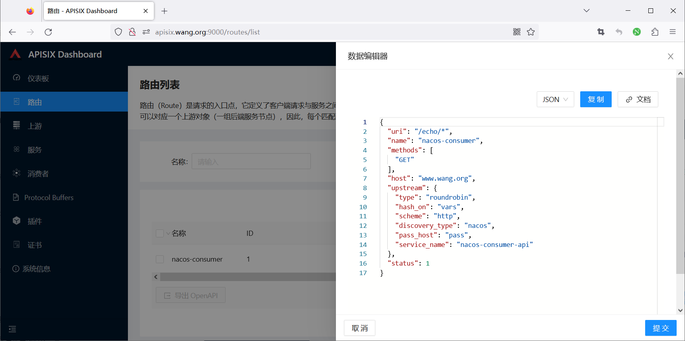
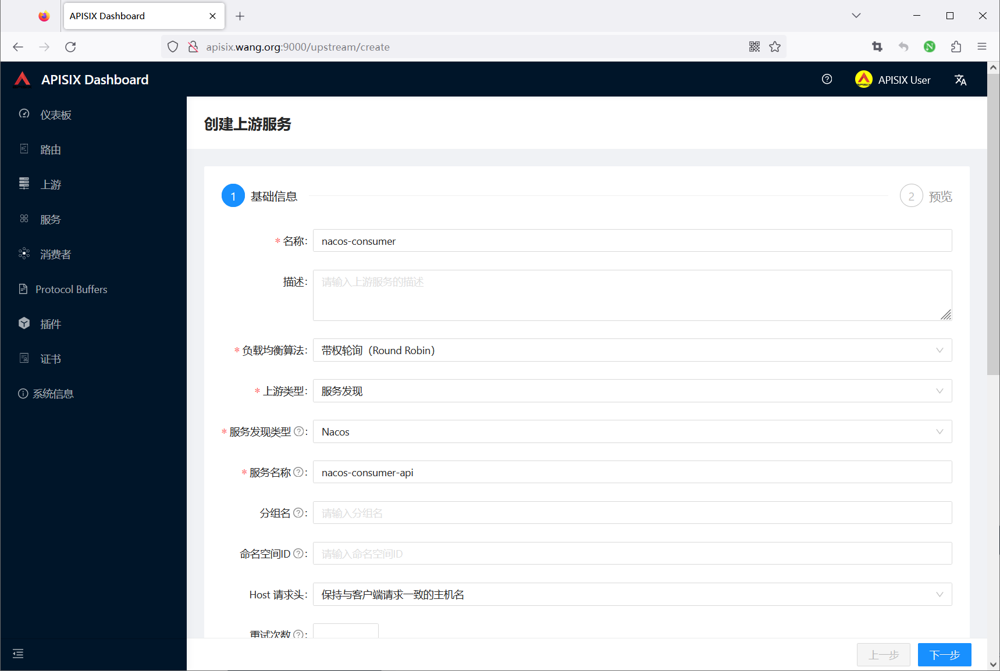
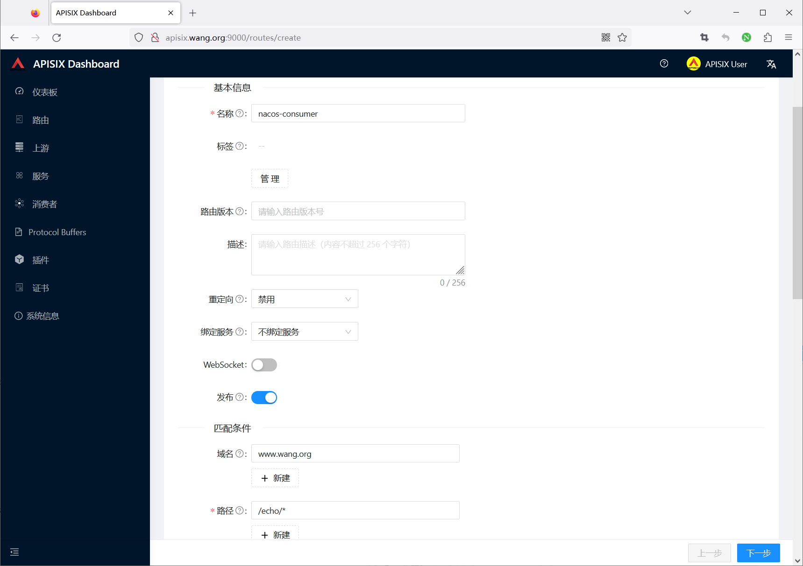
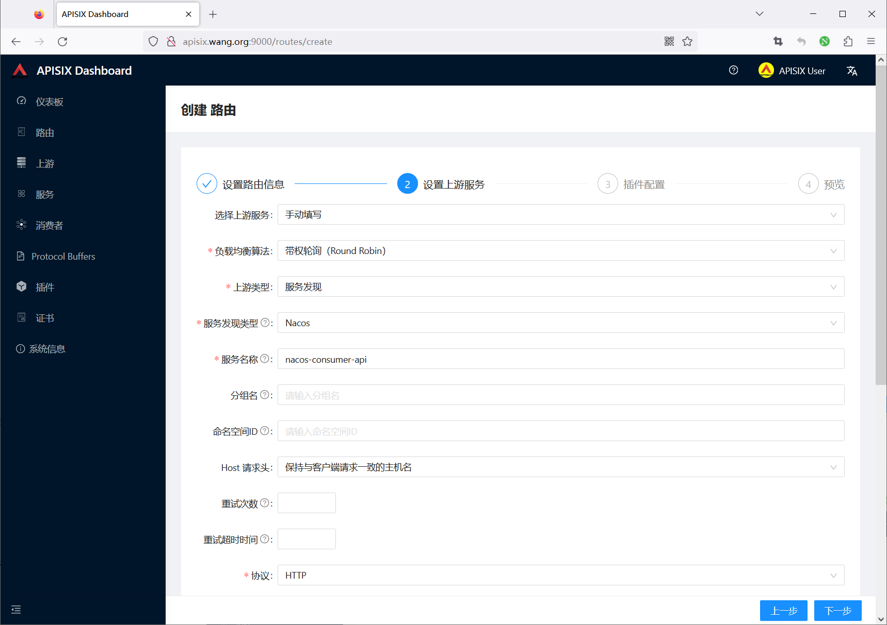
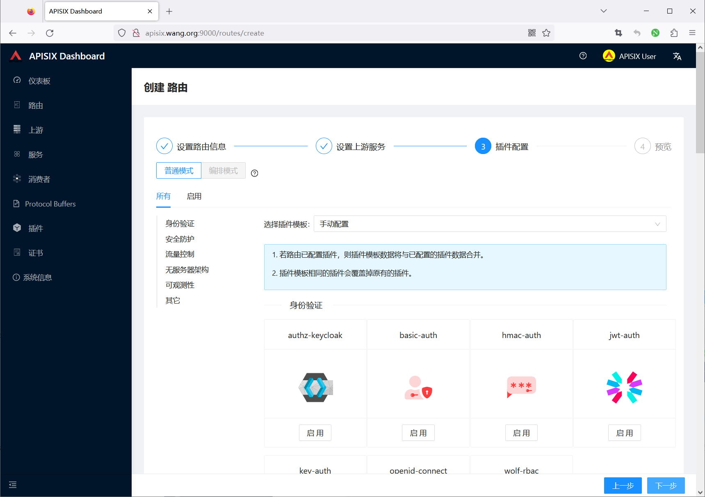
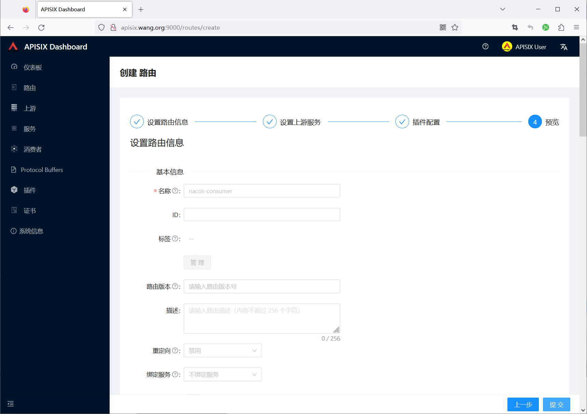
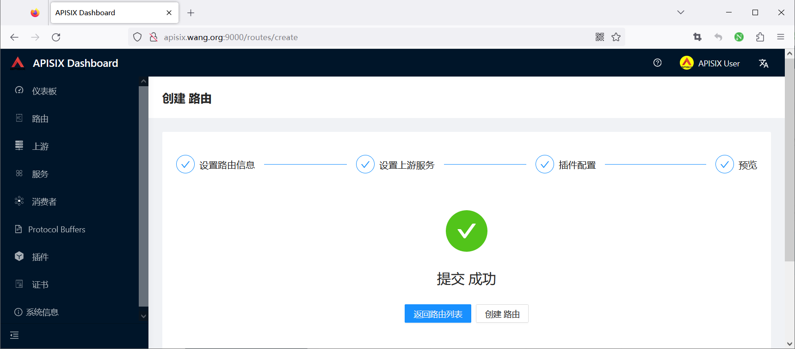
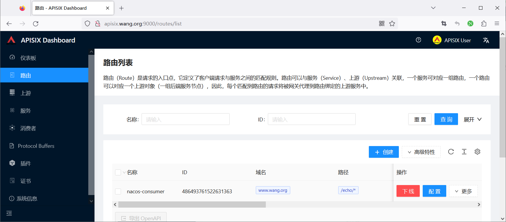

## 3. 验证请求与实例变化

```bash
curl -i -H 'Host: www.example.test' \
  http://127.0.0.1:9080/echo/test
```

预期响应先由 Consumer 生成，并包含 Provider 调用结果。接着增加一个 Consumer 实例，观察 Nacos 列表和 APISIX 的服务发现结果是否更新；再停掉其中一个实例，确认健康信息收敛后请求仍能到其他实例。Nacos 的注册健康不等于业务接口必然正常，仍需检查 APISIX 上游健康、网络和应用日志。

错误可按层定位：`404 Route Not Found` 优先查 Host、URI、方法；`502/503` 查 APISIX 到 Consumer 的发现与网络；Consumer 自身返回错误则继续查它到 Provider 的调用。最后删除测试 Route，确认管理资源和外部入口都恢复到实验前状态。至此，完整链路的每一跳都有独立可验证的结果。



<nav class="article-end" aria-label="章节导航">
  <a href="{{ '/subjects/Microservices/42-accessing-apisix-apis.html' | relative_url }}">← 上一篇：APISIX API 访问</a>
  <a href="{{ '/subjects/Microservices/' | relative_url }}">返回专题目录</a>
</nav>
