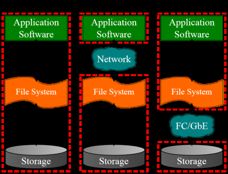

[← 返回MinIO 对象存储目录]({{ '/subjects/MinIO/' | relative_url }})



# 01 分布式存储系统应用场景
## 1 MINIO 介绍

### 1.1 分布式存储系统应用场景

### 常见的传统存储方案

DAS

Direct Attached Storage直连存储,储设备直接与主机服务器连接，其他主机不能使用这个存储设备

普通的PC服务器的存储即为DAS，将外部的存储设备直接加在服务器内部来存储数据

服务器本身容易成为系统瓶颈，服务器发生故障时，整个存储数据将不可访问。

对于存在多个服务器的系统，设备分散，不便于管理。同时多台服务器使用DAS时，存储空间不能在服务器之间动态分配和共享，可能造成相当的资源浪费。

这种存储方式，比较适用于小型网络结构，数据量小，对数据的传输与读取速度要求不高的场景下

DAS 属于块设备

NAS

Network Attached Storage 网络附加存储

存储系统直接接入网络，通过网络交换机，将服务器与存储连接在一起，用户可以通过TCPIP协议访问数据

并通过标准的业界文件共享协议，如: FTP、CIFS、NFS来实现目录级的共享。

此方式安装布署比较简单，可以即插即用，而且不依赖于操作系统，缺点就是存储的性能不太好

NAS是“文件级”数据共享

SAN

Storage Area Network 存储区域网络

交换机将磁盘阵列等存储设备与相关服务器连接起来的高速专用存储网络。最开始用的是FCSAN，也就是基于FC设备及通信协议的存储区域网络。

因为光纤网络的成本太高，后面又发展出一种基于以太网的SAN存储形式, 利用TCP/IP协议实现了对SCSI协议的封装

相对于其它方式,更易于扩容、集中管理、更好的性能以及更灵活的备份策略。

SAN提供的是裸设备，属于Block级共享

### OS Object storage 对象存储

### 什么是 Object storage

对象存储（Object Storage）是一种用于存储和管理海量非结构化数据的存储架构，常用于存放图片、 视频、备份文件、日志等大文件。与传统的块存储和文件存储不同，对象存储将数据作为对象 （Object）来管理，而不是文件系统中的文件或块设备中的块。每个对象包含：

1. 数据：需要存储的内容（例如一张图片或一个视频）。

2. 元数据：关于这个数据的描述性信息，比如创建时间、文件类型等。

3. 唯一的标识符：每个对象都有一个唯一的ID，通过它可以直接访问该对象。

### OS 对象存储应用场景

当前互联网上有海量的非结构化数据的需要存储,如下数据

电商网站: 海量商品图片视频网站: 海量视频文件音乐网站: 海量音频文件社交网站: 海量图片云平台: 大量的虚拟机镜像文件网盘: 海量文件

以上海量的数据如果是基于传统的SAN和NAS的方式进行存储，无论是性能,容器和可用性方方面面都已经力所不及。

当前常用的解决方案是基于对象存储服务(Object Storage Service, OSS)实现

### 对象存储服务 OSS (Object Storage Service ) 特点

对象存储是一种分布式、基于Restful方式操作的存储服务数据作为单独的对象进行存储水平扩展性：对象存储的架构能够轻松扩展，支持存储海量数据，在上传大文件时，OSS会采用分片上传, 通常用于云存储服务（如Amazon S3、Google Cloud Storage等） 高可用性和持久性：对象存储的数据被自动复制并分布在多个物理位置，减少数据丢失的可能。 无层级结构：与文件存储的层次目录结构不同，对象存储是扁平结构，不直接使用目录树，所有对象存放在同一个命名空间中，可以通过其唯一ID直接访问。可以在互联网任何位置通过URL方式对每个对象进行存储和访问,但不支持挂载适合大文件存储：适合存储非结构化数据﹔比如︰视频、图片、日志、文本文件等，通常用于云计算环境中适合读多写少的场景

### OSS 分类

分为公有云的OSS服务和私有云的OSS服务

公有云: 阿里云的OSS，腾讯云的COS，天翼云的OSS，亚马逊的S3(2006年3月)，Microsoft Azure Blob存储等公有云提供OSS服务私有云: MinIO, Ceph RGW



<nav class="article-end" aria-label="章节导航">
  <a href="{{ '/subjects/MinIO/' | relative_url }}">Back to MinIO Object Storage Index</a>
  <a href="{{ '/subjects/MinIO/02-alibaba-cloud-oss.html' | relative_url }}">Next: Alibaba Cloud OSS →</a>
</nav>
