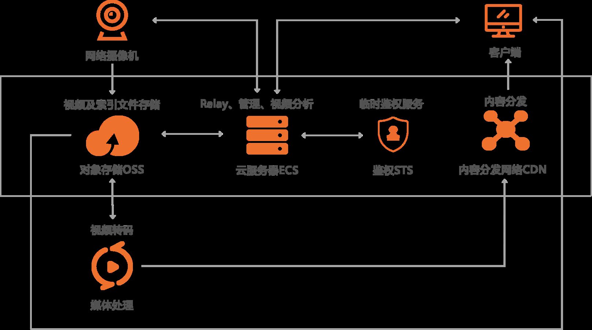
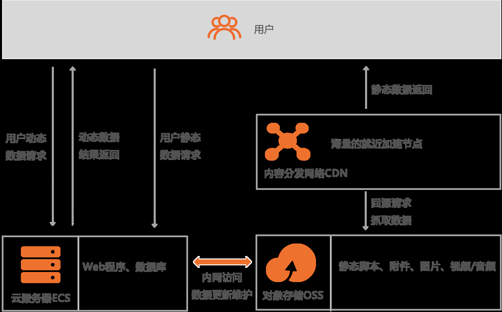
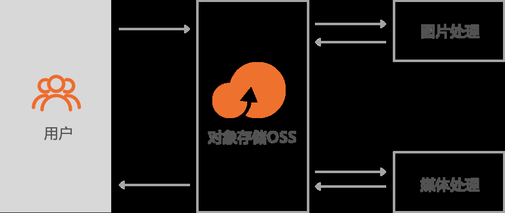

[← 返回MinIO 对象存储目录]({{ '/subjects/MinIO/' | relative_url }})



# 02 以阿里云 OSS 理解对象存储

在学习 MinIO 之前，先用公有云对象存储作参照。阿里云 OSS（Object Storage Service）把文件作为 **Object（对象）** 存入 **Bucket（存储空间）**，应用通过 API 上传、下载和管理对象。它与本地文件系统或传统块设备的访问方式不同：通常按对象键读写，而不是直接修改文件中的某一小段。

产品介绍：<https://www.aliyun.com/product/oss>

原资料的视频介绍：

<https://static-aliyun-doc.oss-cn-hangzhou.aliyuncs.com/file-manage-files/zh-CN/20220727/ttob/OSS%E6%96%B0%E7%89%88%E4%BA%A7%E5%93%81%E4%BB%8B%E7%BB%8D%EF%BC%88%E4%B8%AD%E6%96%87%EF%BC%89.mp4>

对象存储适合图片、音视频、备份和日志归档等非结构化数据。服务通常提供多种存储类型，读写费用、存储费用与取回时间各不相同。原资料列出的持久性和可用性百分比是特定产品或服务等级的指标，不能理解为单个对象绝不会丢失、服务永不间断；生产使用仍需核对当前服务协议并设计备份。

### 重要能力

#### 版本控制

对 Bucket 启用版本控制后，覆盖或删除对象可留下历史版本，便于恢复误操作。但历史版本继续占用空间并可能产生费用，应配合生命周期策略管理；它也不能代替异地备份。

#### Bucket Policy

Bucket Policy 用于描述哪些身份能对 Bucket 或其中的对象执行哪些操作，可配合身份与访问管理策略实现跨账号或细粒度授权。默认应采用最小权限：开放匿名读取前，确认对象确实可以公开；写入、删除权限通常只授予指定身份。

#### 跨区域复制

跨区域复制把源 Bucket 的对象按规则异步同步到另一地域，可用于容灾或跨地域分发。异步意味着存在复制延迟；删除标记、历史版本和加密对象如何复制，也应在配置时逐项核对。它与版本控制、备份的职责不同。

#### 数据加密

**服务端加密**由存储服务在接收对象后加密保存，读取时按授权解密；应明确密钥由谁管理。**客户端加密**在上传之前由应用加密，密钥管理和解密责任也留在应用侧。两者都不能代替传输链路上的 TLS 和访问控制。

#### 生命周期与保留

对象的保留时间由生命周期规则、人工删除、版本控制与账号状态等共同决定。“默认没有自动过期”并不意味着永久保存。对临时文件、旧版本和归档数据，应设置符合业务和合规要求的保留周期。

### 典型应用场景

#### 图片、音视频与日志

应用可把上传的图片、音视频及日志保存为对象，再通过 API 读取。终端直传时，应使用有范围和有效期限制的临时凭证或签名，而不是在客户端内置长期密钥。上传方式还要结合文件大小选择普通上传、分片上传等接口。

#### 静态资源分发

网站或移动应用可把图片、脚本和安装包等静态资源放在对象存储，并按访问区域与流量情况接入 CDN。动态请求仍由应用服务处理。采用 CDN 后，还要考虑缓存过期、文件版本命名和源站访问权限，否则更新资源时可能继续返回旧文件。

#### 上传后的数据处理

对象上传后，可按需求触发图片缩放、视频转码或其他云端处理。原始对象与处理结果应分别规划存储类型、生命周期和权限，避免处理链路失败后找不到原件。



<nav class="article-end" aria-label="章节导航">
  <a href="{{ '/subjects/MinIO/01-distributed-storage-use-cases.html' | relative_url }}">← 上一篇：分布式存储应用场景</a>
  <a href="{{ '/subjects/MinIO/' | relative_url }}">返回 MinIO 对象存储专题目录</a>
  <a href="{{ '/subjects/MinIO/03-introduction-to-minio.html' | relative_url }}">下一篇：MinIO 简介 →</a>
</nav>
