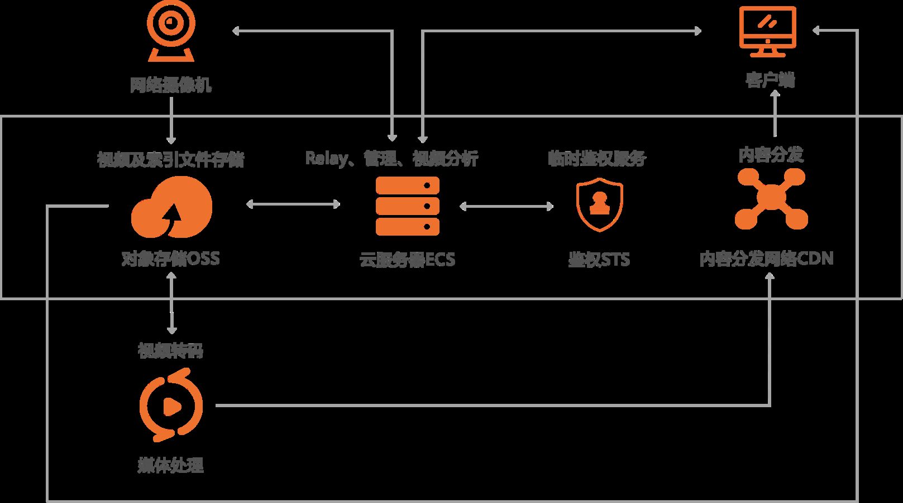
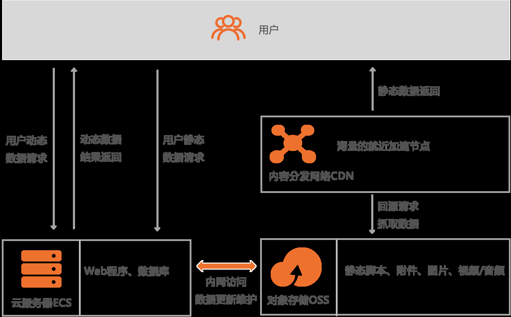
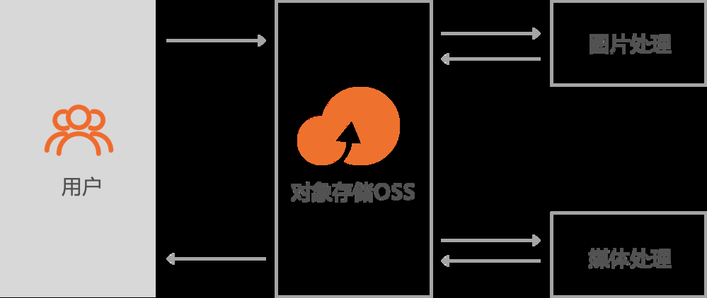

[← Back to MinIO Object Storage Index]({{ '/subjects/MinIO/' | relative_url }})



# 02 Alibaba Cloud OSS
### 1.2 阿里云的OSS

阿里云等公有云提供了OSS服务

<https://www.aliyun.com/product/oss>

什么是 OSS

<https://static-aliyun-doc.oss-cn-hangzhou.aliyuncs.com/file-manage-files/zh-CN/20220727/ttob/OSS%E6%96%B0%E7%89%88%E4%BA%A7%E5%93%81%E4%BB%8B%E7%BB%8D%EF%BC%88%E4%B8%AD%E6%96%87%EF%BC%89.mp4>

阿里云对象存储OSS（Object Storage Service）是一款海量、安全、低成本、高可靠的云存储服务，可提供99.9999999999%（12个9）的数据持久性，99.995%的数据可用性。多种存储类型供选择，全面优化存储成本。

OSS具有与平台无关的RESTful API接口，您可以在任何应用、任何时间、任何地点存储和访问任意类型的数据。

阿里云 OSS重要特性

版本控制

版本控制是针对存储空间（Bucket）级别的数据保护功能。开启版本控制后，针对数据的覆盖和删除操作将会以历史版本的形式保存下来。您在错误覆盖或者删除文件（Object）后，能够将Bucket 中存储的Object恢复到任意时刻的历史版本。更多信息，请参见版本控制概述。

Bucket Policy

Bucket拥有者可通过Bucket Policy授权不同用户以何种权限访问指定的OSS资源。例如您需要进行跨账号或对匿名用户授权访问或管理整个Bucket或Bucket内的部分资源，或者需要对同账号下的不同RAM用户授予访问或管理Bucket资源的不同权限，例如只读、读写或完全控制的权限等。关于配置Bucket Policy的具体操作，请参见通过Bucket Policy授权用户访问指定资源。

跨区域复制

跨区域复制（Cross-Region Replication）是跨不同OSS数据中心（地域）的Bucket自动、异步 （近实时）复制Object，它会将Object的创建、更新和删除等操作从源存储空间复制到不同区域的目标存储空间。跨区域复制功能满足Bucket跨区域容灾或用户数据复制的需求。更多信息，请参见跨区域复制概述。

数据加密

服务器端加密：上传文件时，OSS对收到的文件进行加密，再将得到的加密文件持久化保存；下载文件时，OSS自动将加密文件解密后返回给用户，并在返回的HTTP请求Header中，声明该文件进行了服务器端加密。更多信息，请参见服务器端加密。

客户端加密：将文件上传到OSS之前在本地进行加密。更多信息，请参见客户端加密。

数据永久保存

OSS默认永久保存上传到Bucket的数据

阿里云 OSS应用场景

图片和音视频等应用的海量存储

OSS可用于图片、音视频、日志等海量文件的存储。各种终端设备、Web网站程序、移动应用可以直接向OSS写入或读取数据。

OSS支持流式写入和文件写入两种方式。

网页或者移动应用的静态和动态资源分离

利用海量互联网带宽，OSS可以实现海量数据的互联网并发下载。OSS提供原生的传输加速功能， 支持上传加速、下载加速，提升跨国、跨洋数据上传、下载的体验。同时，OSS也可以结合CDN产品，提供静态内容存储、分发到边缘节点的解决方案，利用CDN边缘节点缓存的数据，提升同一个文件被同一地区客户大量重复并发下载的体验。

云端数据处理

上传文件到OSS后，可以配合智能媒体管理服务和图片处理服务进行云端的数据处理。



<nav class="article-end" aria-label="章节导航">
  <a href="{{ '/subjects/MinIO/01-distributed-storage-use-cases.html' | relative_url }}">← Previous: Distributed Storage Use Cases</a>
  <a href="{{ '/subjects/MinIO/' | relative_url }}">Back to MinIO Object Storage Index</a>
  <a href="{{ '/subjects/MinIO/03-introduction-to-minio.html' | relative_url }}">Next: Introduction to MinIO →</a>
</nav>
