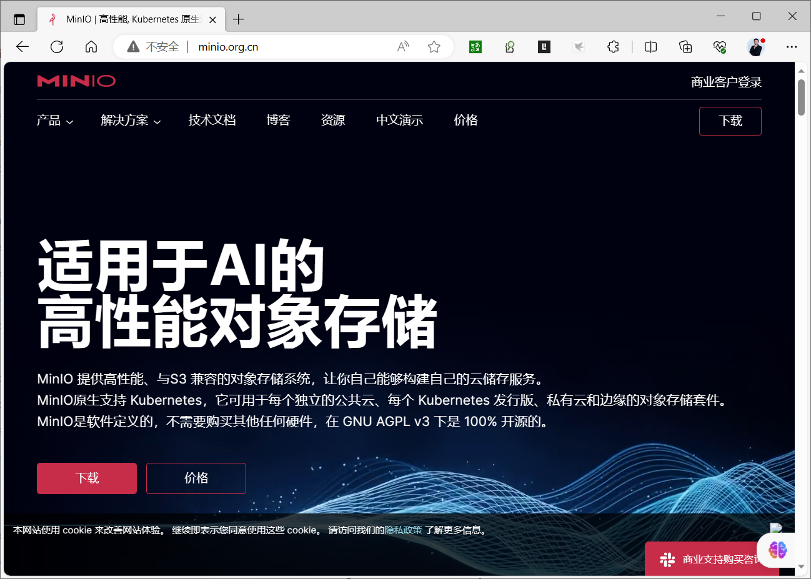
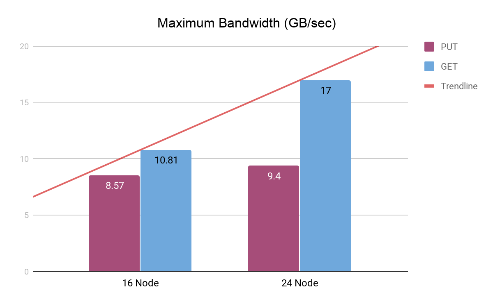
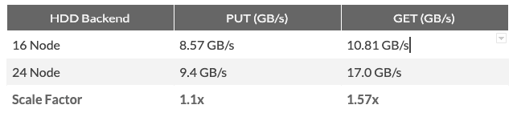
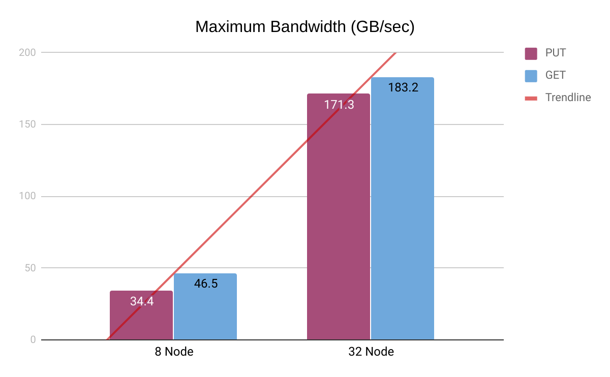
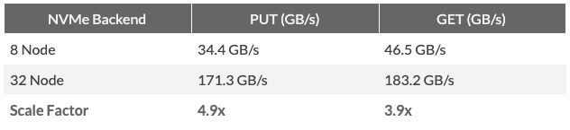

[← 返回MinIO 对象存储目录]({{ '/subjects/MinIO/' | relative_url }})



# 03 MinIO介绍
### 1.3 MinIO介绍

MinIO 是GlusterFS创始人之一Anand Babu Periasamy发布的新的开源项目。

MinlO 是一个用 GoLang 语言开发的基于 GNU AGPL v3 开源协议的对象存储服务(Object Storage Service, OSS)

对象存储服务是一种海量、安全、低成本、高可靠的云存储服务，适合存放任意类型的文件。

对象存储服务支持容量和处理能力弹性扩展，多种存储类型供选择，全面优化存储成本。

MinlO 兼容亚马逊S3云存储服务接口，非常适合于存储大容量非结构化的数据，例如:图片、视频、日志文件、备份数据和容器/虚拟机镜像等

MinlO  支持的一个对象文件可以是任意大小，从几kb到最大5T不等

MinlO 是一个非常轻量的服务， 可以很简单的和其他应用的结合,也支持各种操作系统,比如:Linux,Windows,Mac等

对于中小型企业的对象存储，如果不选择公有云存储，那么Minio是个不错的选择

MinIO 除了直接作为对象存储使用,还可以作为云上对象存储服务的网关层，无缝对接到Amazon S3、 MicroSoft Azure。

国内的阿里巴巴、腾讯、百度、中国联通、华为、中国移动等9000多家企业也都在使用MinIO产品。

官网

<https://min.io/>

<http://minio.org.cn/>

<https://github.com/minio/minio>

MinIO 特点

MinIO 提供高性能、与S3 兼容的对象存储系统，让你自己能够构建自己的云储存服务。 MinIO 使用和部署非常简单，可以让您在最快的时间内实现下载到生产环境的部署。 MinIO 读写性能优异，高性能MinIO 是世界上最快的对象存储，没有之一。在 32 个 NVMe 驱动器节点和 100Gbe 网络上发布的 GET/PUT 结果超过 325 GiB/秒和 165 GiB/秒 MinIO 支持的对象文件小到几kb到最大5T,并实现了数据的高可用 MinIO 原生支持 Kubernetes，它可用于每个独立的公共云、每个 Kubernetes 发行版、私有云和边缘的对象存储套件。 MinIO 是软件定义的，不需要购买其他任何硬件，在 GNU AGPL v3 下是 100% 开源的

MinIO 性能

<https://blog.min.io/scaling-minio-more-hardware-for-higher-scale/>

机械硬盘

NVME固态硬盘



<nav class="article-end" aria-label="章节导航">
  <a href="{{ '/subjects/MinIO/02-alibaba-cloud-oss.html' | relative_url }}">← Previous: Alibaba Cloud OSS</a>
  <a href="{{ '/subjects/MinIO/' | relative_url }}">Back to MinIO Object Storage Index</a>
  <a href="{{ '/subjects/MinIO/04-how-minio-works.html' | relative_url }}">Next: How MinIO Works →</a>
</nav>
