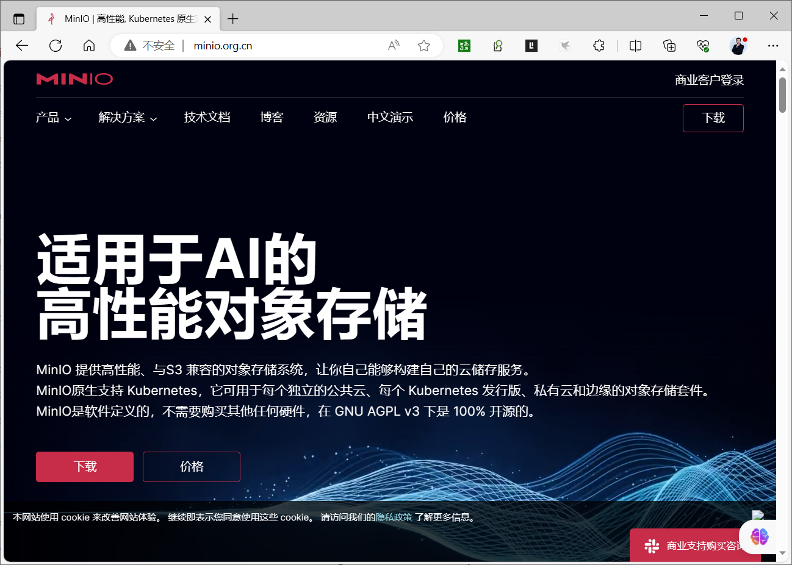
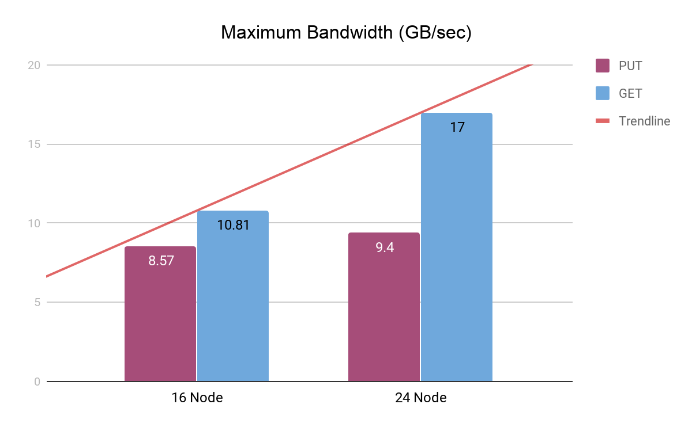
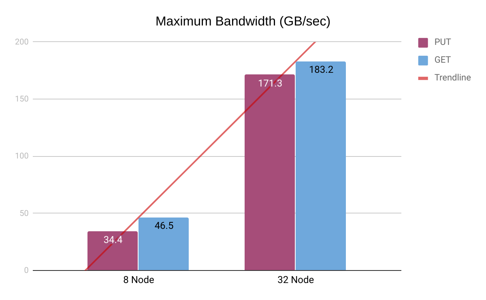
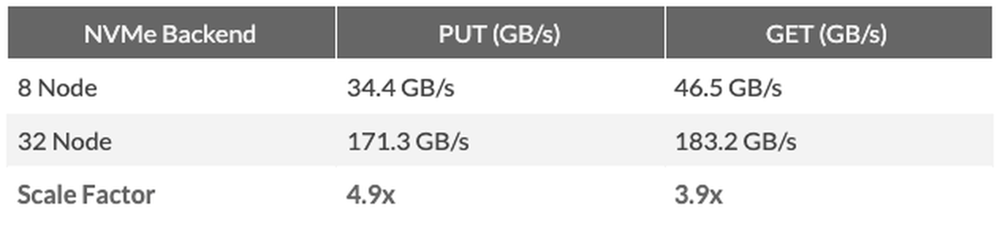

[← 返回MinIO 对象存储目录]({{ '/subjects/MinIO/' | relative_url }})



# 03 MinIO 简介

MinIO 是可自行部署的、兼容 Amazon S3 API 的对象存储软件，适合让应用通过现成的 S3 客户端和 SDK 管理图片、视频、日志、备份等对象。兼容 S3 API 不等于每一项 Amazon S3 特性、限制或行为完全相同；迁移应用时应测试实际使用的接口。

它可运行在服务器或 Kubernetes 环境中，但“安装容易”与“长期可靠运行”是两回事。容量规划要考虑磁盘数量、节点分布、纠删码、故障恢复和备份，不能仅根据宣传吞吐量或企业使用数量做选型。原资料中的固定对象大小上限、云网关描述和“世界最快”表述均与特定版本或测试条件有关，不作为本专题的通用结论。

官网

<https://min.io/>

<https://github.com/minio/minio>

### 关键能力

- **S3 API**：便于通过对象键、桶、策略和 SDK 接入应用。
- **纠删码与修复**：多盘部署时可在一定故障范围内继续读取并修复对象，具体容错数量取决于部署拓扑。
- **部署灵活**：可从实验用单机实例扩展到多节点，但扩容、升级和恢复都要遵循对应版本限制。
- **权限与审计**：应按应用分配访问凭据和桶策略，并配置 TLS、日志与备份。

许可证及商业支持条款应以所使用版本的项目文件和官方说明为准，不能把“源码可见”理解为所有用途都没有义务或限制。

### 如何看性能图

<https://blog.min.io/scaling-minio-more-hardware-for-higher-scale/>

下面两组历史图分别展示机械硬盘与 NVMe 环境。比较时要看磁盘数量、网络带宽、对象大小、并发和 GET／PUT 比例；单一峰值不能代表自己的部署会达到同样吞吐。

NVMe 图应与前面的机械硬盘图按相同测试条件比较，否则差异既可能来自介质，也可能来自节点规模或网络。



<nav class="article-end" aria-label="章节导航">
  <a href="{{ '/subjects/MinIO/02-alibaba-cloud-oss.html' | relative_url }}">← 上一篇：以阿里云 OSS 理解对象存储</a>
  <a href="{{ '/subjects/MinIO/' | relative_url }}">返回 MinIO 专题目录</a>
  <a href="{{ '/subjects/MinIO/04-how-minio-works.html' | relative_url }}">下一篇：MinIO 工作机制 →</a>
</nav>
