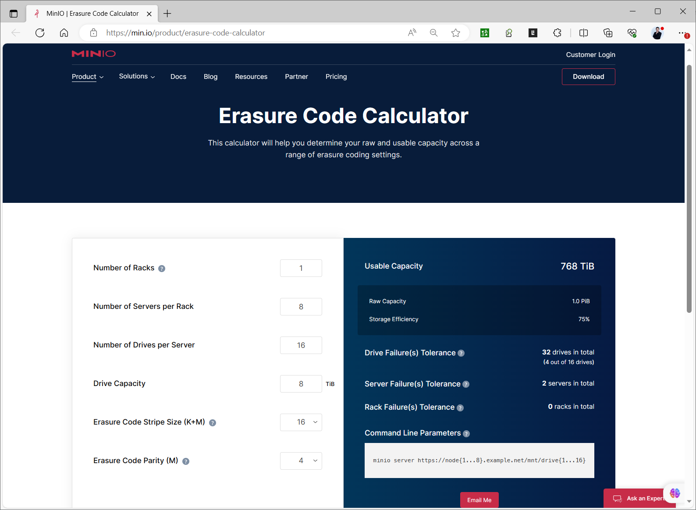
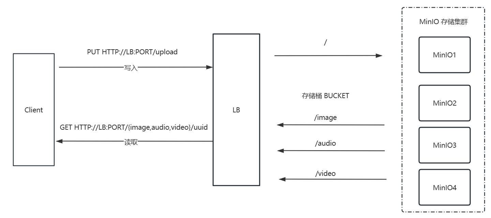
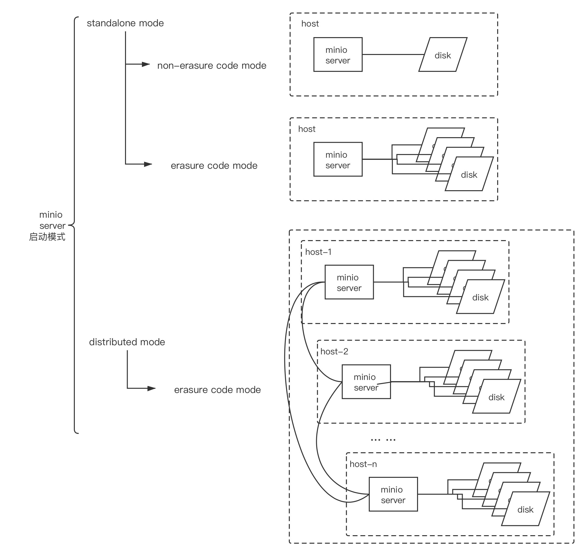

[← 返回MinIO 对象存储目录]({{ '/subjects/MinIO/' | relative_url }})



# 04 MinIO 工作机制

了解 MinIO，先把客户端看到的 S3 对象，与服务端如何把对象分散到磁盘上区分开。应用只需使用桶名和对象键；纠删集、分片及磁盘目录属于存储系统内部实现，不应由业务代码直接操作。

## 从对象到磁盘

| 概念 | 在本篇中的含义 |
| --- | --- |
| Object（对象） | 桶内以键标识的一份内容及其元数据；上传图片或备份文件都会形成对象 |
| Bucket（桶） | 组织对象及其访问策略、版本控制等设置的逻辑容器 |
| Drive（磁盘） | MinIO 部署使用的存储端点；应核对它对应真实、持久的磁盘或卷 |
| Erasure Set（纠删集） | 一组参与编码与保存对象分片的磁盘；一个对象的数据与校验分片落在一个纠删集内 |

桶不是主机文件系统中可任意改写的普通目录。对象键里的斜杠可以让客户端显示“文件夹”，但它只是对象命名的一部分。集群可能包含多个纠删集；分布如何形成、可否增减磁盘，应以目标 MinIO 版本的部署约束为准。

## 为什么使用纠删码

复制通过保存多份完整副本承受故障，纠删码则把对象编码为若干**数据分片**和**校验分片**，再分布到不同磁盘。假设某纠删集对一份对象使用 4 个数据分片和 4 个校验分片，在满足编码条件的情况下，可以从足够数量的可用分片重建内容。这个“4+4”只是便于理解的例子，不表示所有 MinIO 部署都固定这样配置。

读取与写入需要满足各自的仲裁要求；失去一半磁盘后是否还能写入，不能只从“分片可重建”推断。网络分区、磁盘分布、纠删集大小和奇偶校验配置都会影响可用性。对象级修复有助于定位受影响内容，但也会消耗磁盘与网络资源；不能保证任何大小的损坏都能“几秒钟恢复”。

校验和用于发现传输或静默存储损坏，纠删码用于在可恢复范围内重建内容。它们都不能代替备份：误删除、错误覆盖、密钥丢失或整个故障域受损，仍要依赖版本控制、异地备份和恢复演练。

- [MinIO 纠删码说明](https://min.io/docs/minio/linux/operations/concepts/erasure-coding.html)
- [纠删码容量计算器](https://min.io/product/erasure-code-calculator)

## 一次上传经历什么

应用通过 S3 API 指定桶和对象键，MinIO 接收请求、校验身份与策略，再把对象写入其负责的纠删集。大对象可以由客户端使用 S3 Multipart Upload 拆成多个上传部分；**多部分上传是客户端传输机制，纠删码是服务端存储机制**，两者不是同一次“分片”。每个上传部分仍要按服务端的存储规则写入。分段大小和是否采用 Multipart Upload 取决于客户端 SDK 与配置，不是“大于 10 MB 就一定拆分”。

读取时，客户端仍请求桶与对象键；MinIO 根据内部元数据定位分片，读取足够的数据，必要时重建损坏分片，并把对象内容返回给客户端。故障期间的具体读写行为需结合所用版本的仲裁规则判断。

## 不要直接依赖磁盘目录

原资料展示了每块磁盘上对象目录、part.1 和 xl.meta 的历史结构。这个示例能说明“同一对象的数据分布在多块磁盘上”，但其中“奇数磁盘保存校验、偶数磁盘保存原始数据”的说法不成立：分片布局不应按盘号猜测。xl.meta 等内部文件格式也可能随版本变化。

因此，业务读取、迁移或删除对象时应使用 S3 API 或官方客户端，而不是在磁盘上直接复制、改名或删除内部 part 文件。排障时可查看磁盘容量、服务日志和官方诊断信息，但不要把某次 tree 输出当作稳定 API。

## 部署模式如何影响可靠性

单机单盘便于练习，却没有多盘容错；单机多盘可以应对部分磁盘故障，仍无法承受整机故障；多节点多盘可跨主机分布数据，但需要同时规划网络、负载入口、故障域和恢复过程。下图是原资料中的部署模式示意，下一篇会把数据布局与运行方式分别说明。



<nav class="article-end" aria-label="章节导航">
  <a href="{{ '/subjects/MinIO/03-introduction-to-minio.html' | relative_url }}">← 上一篇：MinIO 简介</a>
  <a href="{{ '/subjects/MinIO/' | relative_url }}">返回 MinIO 专题目录</a>
  <a href="{{ '/subjects/MinIO/05-deployment-modes-and-methods.html' | relative_url }}">下一篇：部署模式和方法 →</a>
</nav>