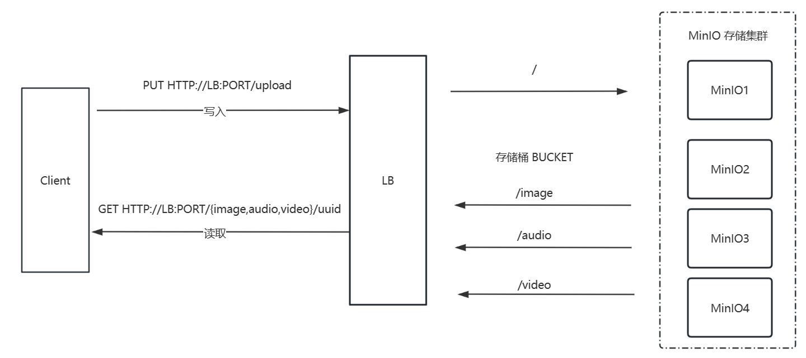
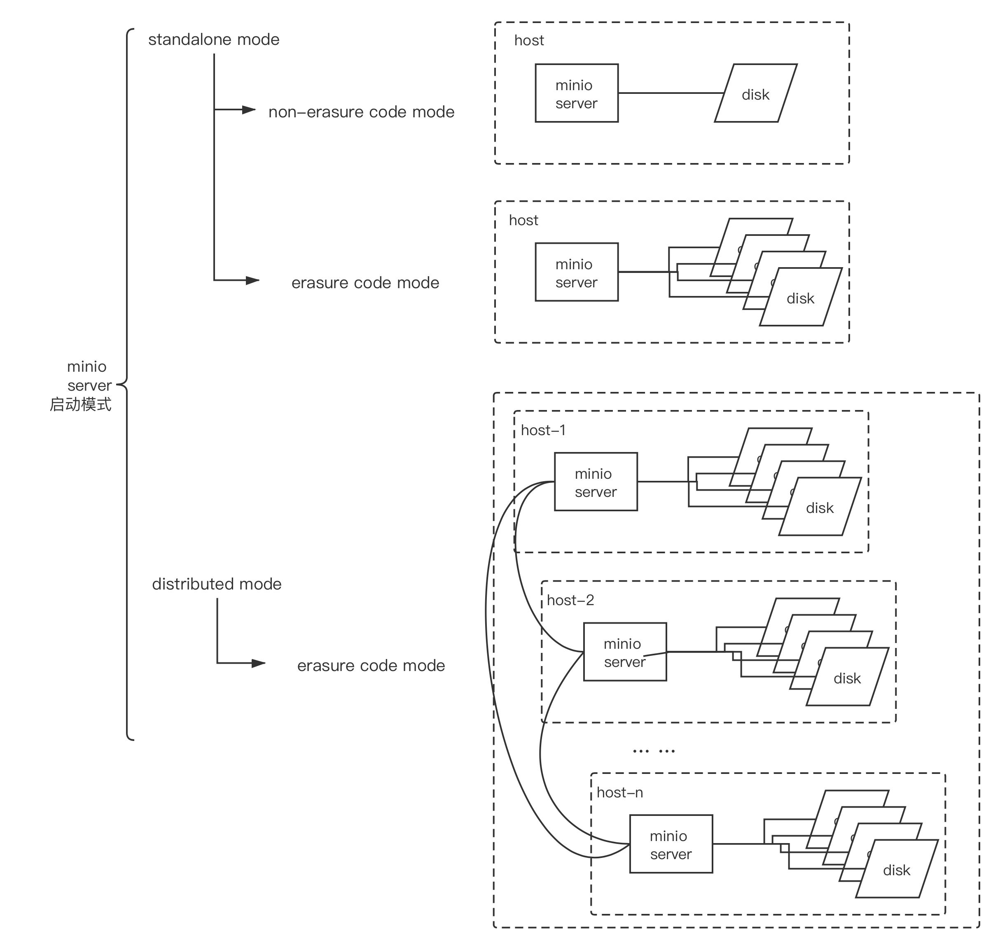

[← 返回MinIO 对象存储目录]({{ '/subjects/MinIO/' | relative_url }})



# 04 MinIO 工作机制
### 1.4 MinIO 工作机制

### MinIO 相关术语

0bject 对象

存储到Minio的基本对象,如文件、字节流等任意数据

一个文件就是一个对象

Bucket 桶

用来存储Object的逻辑空间。

每个Bucket之间的数据是相互隔离的。

对于客户端而言，就相当于一个存放文件的顶层文件夹，用于实现不同资源的分类存储

通常一个项目或同一类资源可以对应于一个Bucket

Drive 驱动器

即存储数据的磁盘,一个Drive通常对应一块物理磁盘或者一个独立目录

在MinIO启动时，以参数的方式传入。

Minio 中所有的对象数据都会存储在Drive里

Set 存储集

set 是一组Drive的集合,即一组相关的磁盘的集合

分布式部署时,MinIO会根据集群规模自动划分一个或多个Set，每个Set中的Drive分布在不同位置。

一个对象存储在一个Set上

一个集群划分为多个Set

一个Set包含的Drive数量是固定的， 默认由系统根据集群规模自动计算得出

一个Set中的Drive尽可能分布在不同的节点上

### 纠删码EC (Erasure Code)

<https://blog.min.io/erasure-coding/>

<https://min.io/docs/minio/linux/operations/concepts/erasure-coding.html>

<https://www.minio.org.cn/docs/minio/kubernetes/upstream/operations/concepts.html#id11>

分布式存储，很关键的点在于数据的可靠性，即保证数据的完整，不丢失，不损坏。只有在可靠性实现的前提下，才有了追求一-致性、高可用、高性能的基础。而对于在存储领域，一 般对于保证数据可靠性的方法主要有两类，一类是冗余法，一 类是校验法。

分布式存储可靠性常用方法

冗余法冗余法即对存储的数据进行副本备份，当数据出现丢失，损坏，即可使用备份内容进行恢复，而副本备份的多少，决定了数据可靠性的高低。这其中会有成本的考量，副本数据越多，数据越可靠， 但需要的设备就越多，成本就越高。可靠性是允许丢失其中一份数据。

当前有很多分布式系统采用此种方式实现，如：ELasticsearch的索引副本，Kafka的副本，Redis 的集群，MySQL的主从模式，Hadoop的多副本的文件系统

校验法

校验法即通过校验码的数学计算的方式，对出现丢失、损坏的数据可以实现校验和还原两个功能

通过对数据进行校验和( checksum )进行计算，可以检查数据是否完整，有无损坏或更改，在数据传输和保存时经常用到，如TCP协议

恢复还原，通过对数据结合校验码进行数学计算，还原丢失或损坏的数据，可以在保证数据可靠的前提下，降低冗余，如单机硬盘存储中的RAID技术，纠删码(Erasure Code)技术等。

MinlO采用的就是纠删码技术。

MinIO 纠删码EC (Erasure Code) 是一种提供数据高可用性功能，允许具有多个驱动器的 MinIO 部署即时自动重建对象，即使群集中丢失了多个驱动器或节点。 纠删码提供了对象级修复

Minio使用纠删码erasure code 与校验和checksum来保护数据免受硬件故障和无声数据损坏。即便您丢失一 半数量(N/2) 的硬盘,您仍然可以恢复数据。

纠删码是一种恢复铁和损坏数据的数学算法，Minio采用Reed-Solomon code将对象拆分成N/2数据和 N/2奇偶校验块。

当损坏总磁盘数的一半磁盘时,只能读取而不能上传新的文件,只要保证正常磁盘数大于等n/2+1时,就可以支持写入新数据

这就意味着如果是12块盘，一个对象会被分成6个数据块、6个奇偶校验块，你可以失任意6块盘(不管其是存放的数据块还是奇偶校验块)，你仍可以从剩下的盘中的数据进行恢复。

实现纠删码 EC 至少需要4块Drive磁盘以上

纠删码是可以通过数学计算,实现数据冗余,功能上类似于RAID技术,当磁盘损坏时,可以通过计算把丢失的数据进行还原，它可以将n份原始数据,增加m份数据,并能通过n+m份中的任意n份数据,还原为原始数据。即如果有任意小于等于m份的数据失效,仍然能通过剩下的数据还原出来。

MinIO 根据纠删集的大小将对象拆分为数据和奇偶校验块，然后将数据和奇偶校验块随机均匀地分布在一组驱动器上，以便每个驱动器每个对象包含的块不超过一个。虽然驱动器可能包含多个对象的数据和奇偶校验块，但只要系统中有足够的驱动器，单个对象每个驱动器的块不超过一个。对于版本化对象， MinIO 选择相同的驱动器进行数据和奇偶校验存储，同时在任何一个驱动器上保持零重叠。

当一个大文件大于10 MB时，写入 MinIO，S3 API 将其分解为分段上传。分段大小由客户端在上传时确定。S3 要求每个部分至少为 5 MB（最后一部分除外）且不超过 5 GB。根据 S3 规范，一个对象最多可以分成10,000 个Part 部分。假设一个 320 MB 的对象。如果此对象分为 64 个部分，MinIO 会将每个部分: part.1、part.2 写入驱动器,...直到第 64 部分。这些部分的大小大致相等，例如，作为多部分上传的 320 MB 对象将拆分为 64 个 5 MB 部分。

上传的每个部分都通过条带进行纠删码。Part.1 是上载对象的第一部分，所有部分在驱动器上水平条带化。每个部分都由其数据块、奇偶校验块和 XL 元数据组成。MinIO 轮换写入，因此系统不会总是将数据写入相同的驱动器，并将奇偶校验写入相同的驱动器。每个对象都独立旋转，允许统一有效地使用群集中的所有驱动器，同时还增强了数据保护。

为了检索对象，MinIO 执行哈希计算以确定对象的保存位置，读取哈希并访问所需的纠删节和驱动器。

需要注意的是: 纠删码的内在工作原理和RAID实际是不同的，像RAID5可以在损失一块盘的情况下不丢数据，而Minio纠删码可以在丢失一半的盘的情况下，仍可以保证数据安全。 而且Minio纠删码是作用在对象级别，可以一次恢复一个对象，而RAID是作用在卷级别，数据恢复时间很长。 Minio对每个对象单独编码，存储服务一经部署，通常情况下是不需要更换硬盘或者修复。MinIO纠删码的设计目标是为了性能和尽可能的使用硬件加速，与相类技术（如 RAID 或复制）相比，开销要少得多。

纠删码比 RAID 更适合对象存储有几个原因。MinIO 纠删码不仅可以在多个驱动器和节点发生故障时保护对象免受数据丢失，还可以在对象级别进行保护和修复。一次修复一个对象的能力是比在卷级别修复的 RAID 的显着优势。损坏的对象可以在几秒钟内在 MinIO 中恢复，而在 RAID 中则需要数小时。如果驱动器损坏并被更换，MinIO 会识别新驱动器，将其添加到纠删节，然后验证所有驱动器上的对象。更重要的是，读取和写入不会相互影响，从而实现大规模性能。有 MinIO 部署，在 PB 级存储中拥有数千亿个对象。

MinIO 中的纠删码实施可提高数据中心的运营效率。与复制不同，无需跨驱动器和节点进行冗长的重建或重新同步数据。这听起来可能微不足道，但移动/复制对象可能非常昂贵，并且 16TB 驱动器出现故障并通过数据中心网络复制到另一个驱动器会给存储系统和网络带来巨大的负担。

<https://min.io/docs/minio/linux/operations/concepts/erasure-coding.html>

纠删码计算器

<https://min.io/product/erasure-code-calculator>


```text
EC(Erasure-Code)算法的最底层的基本的数学原理:行列矩阵中-种特殊矩阵的性质:即任意N*M (N行M列
{N<M})的行列式，其任意NxN的子矩阵那是可逆，以实现数据恢复运算。
定义: erasure code是一种技术，它可以将n份原始数据,增加m份数据(用来存储erasure编码)， 并能通
过n+m份中的任意n份数据，还原为原始数据。定义中包含了encode和decode两个过程，将原始的n份数据变
为n+m份是encode,之后这n+m份数据可存放在不同的device上，如果有任意小于m份的数据失效，仍然能通
过剩下的数据还原出来。也就是说，通常n+m的erasure编码，能容m块数据故障的场景，这时候的存储成本是
1+m/n，通常m<n。
RS(Reed-Solomon) code是最基本的一种ES。RS codes是基于有限域的一种编码算法，有限域又称为
GaloisField,是以法国著名数学家Galois 命名的,在RS codes中使用GF(2^w),其中2^w>=n+ m. RS
codes定义了一个(n + m) * n的分发矩阵(Distribution Matrix)
```

### MinIO 工作流程



### MinIO 存储机制

对象上传到MinIO后,以Bucket目录下,目录结构如下

```bash
./bucket_name/filename/xl.meta #元数据文件
./bucket_name/filename/hash/part.N
#编号为奇数的磁盘中的part.N为校验码文件
#编号为偶数的磁盘中的part.N为原始数据文件
#示例
[root@ubuntu2204 ~]#tree /minio/
/minio/
├── data1
│ └── mybucket
│     └── 19M图片.jpg
│         ├── ff0324e9-45d5-4cb3-af1e-b04cb9b948b2
│         │ └── part.1
│         └── xl.meta
├── data2
│ └── mybucket
│     └── 19M图片.jpg
│         ├── ff0324e9-45d5-4cb3-af1e-b04cb9b948b2
│         │ └── part.1
│         └── xl.meta
├── data3
│ └── mybucket
│     └── 19M图片.jpg
│         ├── ff0324e9-45d5-4cb3-af1e-b04cb9b948b2
│         │ └── part.1
│         └── xl.meta
├── data4
│ └── mybucket
│     └── 19M图片.jpg
│         ├── ff0324e9-45d5-4cb3-af1e-b04cb9b948b2
│         │ └── part.1
│         └── xl.meta
├── data5
│ └── mybucket
│     └── 19M图片.jpg
│         ├── ff0324e9-45d5-4cb3-af1e-b04cb9b948b2
│         │ └── part.1
│         └── xl.meta
├── data6
│ └── mybucket
│     └── 19M图片.jpg
│         ├── ff0324e9-45d5-4cb3-af1e-b04cb9b948b2
│         │ └── part.1
│         └── xl.meta
├── data7
│ └── mybucket
│     └── 19M图片.jpg
│         ├── ff0324e9-45d5-4cb3-af1e-b04cb9b948b2
│         │ └── part.1
│         └── xl.meta
└── data8
└── mybucket
└── 19M图片.jpg
├── ff0324e9-45d5-4cb3-af1e-b04cb9b948b2
│ └── part.1
└── xl.meta
```

### MinIO 启动模式





<nav class="article-end" aria-label="章节导航">
  <a href="{{ '/subjects/MinIO/03-introduction-to-minio.html' | relative_url }}">← Previous: Introduction to MinIO</a>
  <a href="{{ '/subjects/MinIO/' | relative_url }}">Back to MinIO Object Storage Index</a>
  <a href="{{ '/subjects/MinIO/05-deployment-modes-and-methods.html' | relative_url }}">Next: Deployment Modes and Methods →</a>
</nav>
